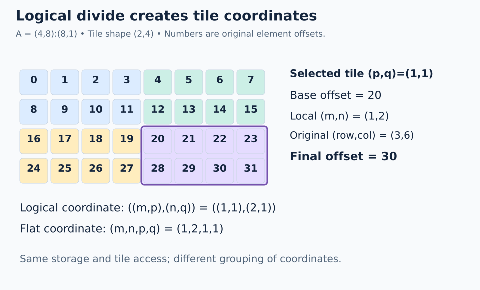

# FlyDSL layout algebra notes

Learn how FlyDSL maps coordinates to memory and distributes work across GPU threads. **A layout is an indexing rule:** it maps a coordinate to an offset. Layout algebra transforms that rule; loads, stores, and copies use it to access data.

The course begins with small mappings that can be traced by hand, then builds toward GPU copies, vector addition, measurement, and BF16 matrix multiplication. Familiarity with Python and array indexing is useful; each lesson introduces the layout concepts needed for its example.

## Learning path

| Section | Lessons | What you learn |
| --- | --- | --- |
| [00 · Layout algebra](lessons/00-layout-algebra/README.md) | 00–07 | Shapes, coordinates, composition, coalescing, tiling, block windows, thread/value ownership |
| [01 · GPU programming](lessons/01-gpu-programming/README.md) | 08–13 | Tiled copies, register fragments, predicates, vector addition, ISA inspection, and BF16 matmul through matrix instructions |

Start with layout algebra; lessons 06 and 07 still develop the coordinate and ownership fundamentals. Actual copy plans begin in lesson 08.

Each lesson contains an illustrated walkthrough, a scaffolded `practice.py`, and a commented `solution.py`. Both programs use native FlyDSL APIs inside GPU kernels. There is no Python layout implementation: PyTorch allocates GPU buffers and the host checks the returned results.

## How to study each lesson

1. Read the opening example and identify what the numbers in its diagram represent: coordinates, offsets, or stored values.
2. Trace the highlighted coordinate or thread by hand before reading the corresponding code.
3. Complete the practice expressions and run the supplied checker. Use its expected table to compare the full mapping.
4. Compare the worked solution, then answer the revision question and try the suggested variation.

The examples keep layout construction, thread ownership, and memory access visible as separate steps. Follow one position through those steps before considering the entire tile.

## Set up and start

The included Pixi environment pins FlyDSL 0.4.1, ROCm 10, and PyTorch 2.13.0+rocm10.0.0 for Linux x86-64 (glibc 2.35 or newer). The same lock includes ROCm and PyTorch device packages for both AMD `gfx1151` and `gfx1152` (including Radeon 860M), so both machines use the same commands. Activation does not set `PYTORCH_ROCM_ARCH`; kernels target the detected GPU.

Install [Pixi](https://pixi.sh/) (setup checked with 0.67.2), ensure the host GPU driver and `/dev/kfd` and render-node permissions are available, then run:

```bash
pixi install --locked
pixi run gpu-check
pixi run python lessons/00-layout-algebra/00-shapes-and-strides/practice.py
```

The starter reports `Practice not finished: ...` and exits with status 1. Read the lesson's **Practice** section and replace the numbered `None` TODOs in `exercise_kernel()`. Keep the supplied stores, launch, and checker. A completed exercise prints `Exercise passed: ...`; incorrect results fail the host assertions.

After your attempt, compare with the worked solution:

```bash
pixi run python lessons/00-layout-algebra/00-shapes-and-strides/solution.py
```

Exercises require the GPU environment; plain system Python is not enough. The first install downloads the ROCm SDK and PyTorch and can be large. To support another AMD GPU, add its matching `device-gfx...` extra to both `rocm` and `torch` in `pixi.toml`, run `pixi lock` and `pixi install --locked`, then validate with `pixi run gpu-check` on that GPU. Included device packages do not imply that every GPU has been tested. With an already configured FlyDSL/ROCm PyTorch environment, use `python` in place of `pixi run python`.

## How to read a kernel

The examples follow a consistent sequence where applicable:

```text
Create or reuse views → select the work → assign ownership → load → compute → store
```

A memory view combines a storage iterator (a typed pointer) with a layout. Use `make_view` when changing the storage's indexing; reuse the incoming tensor when its layout already fits. View construction, division, and slicing do not move data. Reads, writes, and copies do.

The early algebra lessons intentionally stop at mapping coordinates to offsets. Copy lessons begin with their data views. Tail lessons use a separate coordinate-only view to decide whether a memory access is valid. The combined divide exercise is an explicit cross-check, while the four focused tutorials show one direct access path each.

The 22 practice exercises provide expression-sized TODOs inside the kernel, together with the launch and host checker. Implement the requested FlyDSL operations so that the checker evaluates the mapping or memory accesses across the complete example.

## What executes where

- `@flyc.kernel` traces native `fx.make_layout`, `fx.crd2idx`, `fx.composition`, `fx.coalesce`, and divide operations. Static algebra can simplify at compile time.
- `fx.thread_idx.x` supplies a runtime thread ID. The initial layout lessons use `thread_layout = fx.make_ordered_layout(...)` and `fx.idx2crd` to decode its logical coordinate. The initial mapping exercises evaluate the complete small coordinate domain on the GPU, with one output row per thread.
- `@flyc.jit` launches the kernel. `solve()` allocates buffers, synchronizes, and checks results on the host. The expected tables are independent checks, not replacement layout APIs.

`fx.*` snippets in the notes belong inside a tracing context. The practice and solution files provide complete runnable programs. The thread layout maps logical coordinates to owning thread IDs; `fx.idx2crd` reverses that mapping. A separate data layout maps coordinates to storage offsets. `fx.make_ordered_layout(shape, order)` assigns each axis a speed rank (0 is fastest) and derives compact strides; `fx.make_layout(shape, stride)` accepts explicit strides, including padding.

Lessons 00–04 use first-mode-fastest thread ownership, so the thread ID also equals the original scalar logical index. Lesson 05 uses order `(1,0,3,2)` to place consecutive threads along tile columns. Coalescing keeps a scalar-index comparison because its result can have a different coordinate shape. Applying `idx2crd` directly to the data layout would instead interpret memory indices.



## Review and validation

- [One-page cheat sheet](CHEATSHEET.md)
- [Roadmap: vector addition and GPU thread layouts](ROADMAP.md)
- [Sources and version scope](SOURCES.md)

Run all 22 worked programs: thirteen foundational lessons, four focused divide tutorials, and five matmul stages:

```bash
pixi run lessons-check
```

Run the lessons plus the additional examples from the notes:

```bash
pixi run gpu-check
```

The GPU check covers padding, aliasing, scalar and nested coordinates, full and subset composition, coalescing (including size-1 and unmergeable cases), every position across all four 2-D divide groupings, and actual loads through sliced 1-D and 2-D tensor views. The selected matrix tile returns values from offsets `20,21,22,23,28,29,30,31`.

Originally validated on AMD Radeon 860M Graphics (`gfx1152`). On 2026-10-31, the shared environment passed all 22 solutions and the additional GPU checks on AMD Radeon 8060S Graphics (`gfx1151`) with Pixi 0.67.2. The updated shared lock has not yet been rerun on gfx1152. The five new BF16 matmul stages also passed on gfx1151 at M=N=K=1024; their gfx1152 hardware validation is pending. The checks include copy plans, register fragments, guarded vector addition, and a small copy-width benchmark.

On the gfx1151 setup, GPU event durations reported zero, including for a standalone PyTorch operation. Lesson 12 still checks copy correctness and reports timing and bandwidth as unavailable instead of dividing by zero. Lesson 12 explains how to dump generated ISA and interpret timing results.

**After completing the divide tutorials:** [select a block tile](lessons/00-layout-algebra/06-select-block-tile/README.md), then [assign multiple values per thread](lessons/00-layout-algebra/07-thread-value-layouts/README.md).

## Practice BF16 matmul optimization

After lesson 12, follow [13 · BF16 matmul](lessons/01-gpu-programming/13-matmul/README.md): naive → coalesced access → register tiling → LDS staging → matrix instructions. Every stage uses **M=N=K=1024**, row-major BF16 inputs/output, and FP32 accumulation. Each contains a diagram, two practice TODOs, a commented solution, and a full-output checker.

```bash
pixi run python lessons/01-gpu-programming/13-matmul/00-naive/practice.py
pixi run matmul-bench
# GPU computation timed with synchronized host batches when events return zero:
pixi run matmul-bench --timing host
```

Each matmul solution and completed practice prints its own timing and TFLOP/s comparison against GPU `torch.matmul`. The separate benchmark compares all five GPU kernels with GPU `torch.matmul` on the same inputs and preallocated output. CPU arithmetic is only the untimed correctness reference. Default automatic timing falls back to synchronized host batches for every compared implementation when any event duration is unavailable. The fallback is labeled and includes dispatch and synchronization. Use `--timing gpu-event` to disable fallback or `--check-only` to skip timing. See the [roadmap](ROADMAP.md#matmul-continuation-planned) for planned pipelining, tuning, and a measured hipBLAS/hipBLASLt challenge.
