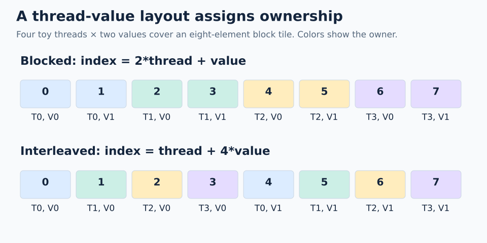

# Next: from windows to vector addition

The layout algebra foundation is covered through logical divide. The next steps connect those blueprints to thread ownership and actual data movement.

| Stage | Learn | Small exercise / completion check |
| --- | --- | --- |
| `06-select-block-tile` | `logical_divide` + `slice`, block index | Split 32 elements into blocks of 8; block 2 must name 16–23 |
| `07-thread-value-layouts` | Thread/value coordinates and layouts | Draw 4 threads × 2 values over an 8-element tile |
| `08-tiled-copy` | Copy atom, `make_layout_tv`, `get_slice(tid)`, `partition_S/D` | Predict each thread's source and destination offsets |
| `09-register-fragments` | Global views versus register fragments; fragment allocation | Load A and B, compute C, store C; explain each data movement |
| `10-predicates-and-tails` | Coordinate tensors and predicates | For N=19 and block size 8, identify the last block's 3 valid positions |
| `11-vector-addition` | Launch, argument wrapping, current compiler API | Compare `C` with `A+B`, including N=1, 19, and a divisible size |
| `12-inspect-and-tune` | Copy widths, alignment, access patterns, generated ISA | Compare scalar and vector copies with measured bandwidth |

## First ownership exercise

Use `index = block*8 + 2*thread + value`, with 4 threads and 2 values per thread. For block 0:

| Thread | Value 0 | Value 1 |
| --- | --- | --- |
| 0 | 0 | 1 |
| 1 | 2 | 3 |
| 2 | 4 | 5 |
| 3 | 6 | 7 |

The within-block layout on `(thread,value)` is `(4,2):(2,1)`. An interleaved alternative is `(4,2):(1,4)`, which gives thread 0 elements 0 and 4, thread 1 elements 1 and 5, and so on. Both cover the tile, but their access patterns differ. Performance depends on emitted instructions and hardware; a drawing alone does not settle which is faster.

## Vocabulary bridge from our earlier copy discussion

| Name / operation | Intuition |
| --- | --- |
| `gA` | The selected view of A in global memory |
| `tiled_copy` | The shared copy plan: copy atom plus distribution across threads and values |
| `get_slice(tid)` | Zoom into that plan for this thread |
| `thr_gA = thr_copy.partition_S(gA)` | This thread's source view into the global tile |
| `partition_D(...)` | Apply the plan to the destination side |
| `thr_cC` in coordinate-based code | This thread's coordinate view, useful for bounds predicates; names are conventions |
| Register fragment | Storage for this thread's values; constructing one does not load the source |
| Predicate | A condition controlling which accesses are valid |

Copy atom widths use **bits** in current names: `UniversalCopy32b` means 32 bits, or 4 bytes. Do not infer 32 bytes from an informal `32B` spelling. We will check the exact version and generated ISA when implementing the kernel.

**Next lesson prompt:** “Use the 8-element block tile and 4×2 ownership table to walk from `get_slice(tid)` through `partition_S/D` to a vector-add load, compute, and store. Trace thread 2 by hand first.”
