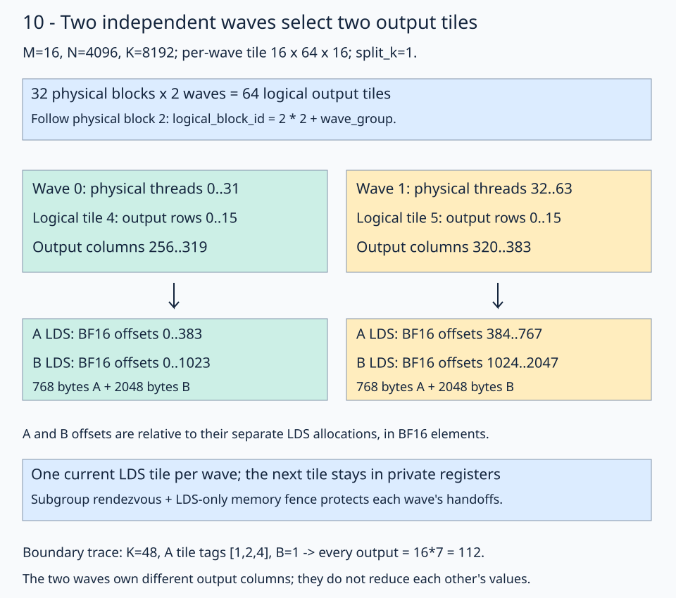
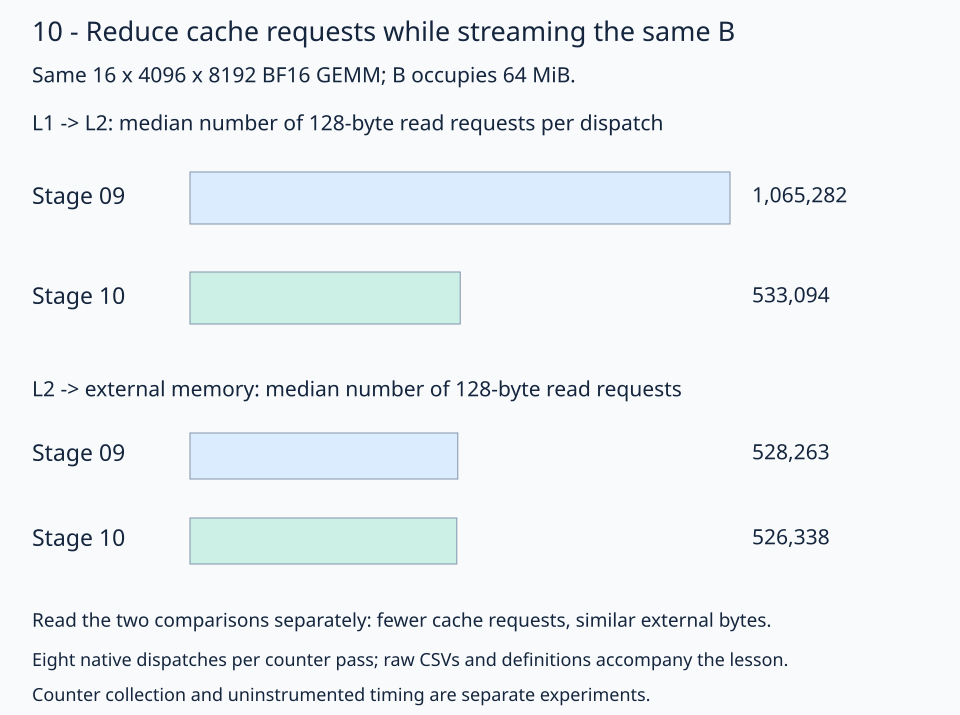

> **Original combined wave-local prefetch experiment.** This is research outside the main course. See the [research index](../README.md) for current run commands and [lesson 12](../../lessons/01-gpu-programming/13-matmul/12-operand-paths/README.md#why-the-course-keeps-prefetch) for the measured reason the course retains prefetch. Raw records preserve their original paths.

# 10 · Stream skinny tiles with independent waves

For a skinny GEMM, more split-K blocks help until memory delivery becomes the limit. [Stage 09](../../lessons/01-gpu-programming/13-matmul/09-split-k/README.md) wins on the two N=1024 workloads, while its **M=16, N=4096, K=8192** fallback remains slightly slower than GPU Torch. This lesson profiles that wider case and gives neighboring output tiles independent wave32 groups inside one physical block.

The question is: **can each wave retain its own small tile and synchronization domain while the block covers more output columns?** Keep row-major BF16 inputs/output, FP32 accumulation, 128-bit global staging copies, and one current LDS tile per operand **per wave**. The next tile stays in private registers. The result still takes **one kernel per GEMM**.

## Follow block 2 and its two waves

The wide configuration uses a **16×64×16 tile per wave**, `wave_groups=2`, `split_k=1`, and 64 physical threads. Each wave computes four 16×16 WMMA output fragments, owning 1024 output values collectively and 32 FP32 accumulator values per lane. There are 64 logical output tiles and 32 physical blocks.



Follow physical thread 35: it belongs to wave 1 and has local thread ID 3. Its logical block ID is `2*2+1=5`. Stage 09's native layouts then decode that ID into output tile 5, selecting matrix rows 0–15 and columns 320–383.

```python
wave_group = fx.thread_idx.x // THREADS_PER_GROUP
compute_thread_id = fx.thread_idx.x % THREADS_PER_GROUP
logical_block_id = fx.block_idx.x * WAVE_GROUPS + wave_group
split_block_coords = fx.idx2crd(logical_block_id, split_block_layout)
```

The launch remains one-dimensional: `grid=(logical_blocks // WAVE_GROUPS, 1, 1)`. Copy and MMA plans use `compute_thread_id`, so their ownership maps stay local to each compute group.

| Configuration field | Work it assigns |
| --- | --- |
| `waves_m`, `waves_n` | Cooperative WMMA waves within one logical tile |
| `wave_groups` | Independent logical tiles or split partitions within one physical block |
| `split_k` | Equal, disjoint K ranges contributing to an output tile |
| `group_m` | Ordering of output tile rows for cache reuse |

With `wave_groups>1`, validation requires exactly one wave per compute group. `wave_groups=1` also supports the earlier cooperative multiwave strategy. Logical blocks must fill complete physical groups; this lesson continues to require complete tiles and equal K partitions.

## Give each wave its own LDS region

The [solution](solution.py) retains the named views and helpers from 07c–09. It offsets each wave's views inside the shared allocation:

```python
left_lds_view = fx.make_view(
    fx.get_iter(left_lds_view) + wave_group * BLOCK_M * (BLOCK_K + 8),
    left_lds_view.layout,
)
right_lds_view = fx.make_view(
    fx.get_iter(right_lds_view) + wave_group * BLOCK_K * BLOCK_N,
    right_lds_view.layout,
)
```

These offsets are **BF16 element offsets**, relative to separate A and B allocations. In the illustrated configuration, each A region contains 384 BF16 elements, including padding; each B region contains 1024. Wave 1 therefore starts at A offset 384 and B offset 1024. Both waves together allocate **5632 LDS bytes**.

`gmem2reg_load_tile`, `reg2lds_copy_tile`, and `compute_lds` operate on those views. A wave never consumes another wave's LDS tile. Adding independent regions increases spatial ownership; each region still holds only one current K tile.

## Match the barrier to the actual communication

The two waves exchange no LDS values. Their handoffs need a subgroup execution barrier and an LDS memory fence:

```python
lds_address_spaces = ir.ArrayAttr.get(
    [ir.Attribute.parse("#gpu.address_space<workgroup>")]
)
barrier_scope = (
    gpu.BarrierScope.Subgroup if WAVE_GROUPS > 1 else gpu.BarrierScope.Workgroup
)
fx.barrier(address_spaces=lds_address_spaces, scope=barrier_scope)
```

Here, **workgroup address space** means LDS, while **subgroup scope** identifies the participating wave. These are separate choices. The installed FlyDSL 0.4.1 wrapper forwards both arguments to MLIR's [`gpu.barrier`](https://mlir.llvm.org/docs/Dialects/GPU/#gpubarrier-gpubarrierop). A group containing cooperative waves instead uses workgroup scope.

The generic stage-09 barrier emits global-cache invalidations in the wide K loop. LLVM's [address-space fence annotations](https://llvm.org/docs/AMDGPUUsage.html#fence-and-address-spaces) allow the LDS-only version to avoid that extra global ordering. The captured wide ISA contains wavefront fences with local-memory metadata, BF16 WMMA, zero private scratch, and no workgroup rendezvous or global-cache invalidation. The [inspector](inspect_kernel.py) checks the emitted code.

For `split_k>1`, global FP32 publication still uses stage 09's **agent-scope acquire/release atomics**. An LDS fence cannot publish workspace to another block. Logical tile IDs and local thread IDs select the partial/counter regions; physical wave grouping does not merge their ownership. The last arriving peer still reduces FP32 partials, stores BF16, and resets its counter in the same kernel. Workspace reuse remains serialized on one stream.

## Use the profile to choose the memory path

The initial wide capture reports **97.90% MemUnitBusy** for native and **98.51%** for Torch. That metric includes stalls. Native has fewer LDS instructions and only **0.75% ALUStalledByLDS**, compared with Torch's 22.35%, so bank-conflict reduction alone is a weak explanation for its remaining slowdown. These observations point toward the memory/cache path; they do not prove peak bandwidth utilization.



Both panels use the same scale and count **128-byte requests**, not elements. B alone occupies 64 MiB. The wider per-wave N tile and selected memory policy reduce cache requests while external traffic stays close to that input size. This explains why adding more K partitions, LDS stages, or register lookahead is not automatically useful here.

The wide configuration also selects:

```python
gmem_right_load_128b = fx.make_copy_atom(
    fx.rocdl.BufferCopy128b(RIGHT_CACHE_MODIFIER), fx.BFloat16
)
```

`RIGHT_CACHE_MODIFIER=2` emits the **SLC** modifier on this gfx11 target; A uses modifier 0. This is a measured, architecture-specific choice. Clang's [buffer-intrinsic documentation](https://clang.llvm.org/docs/AMDGPUBuiltinReference.html) describes the target-dependent bits; the same integer has a different interpretation on newer architectures. The two N=1024 defaults retain modifier 0.

`k_unroll=4` expands four ordinary prefetch/compute/handoff steps in the steady-state loop. A separate remainder handles the final steps before the drain. It increases scheduling freedom while retaining one prefetched tile and one LDS stage per operand. [The shuffled ablation](results/README.md#add-the-changes-one-at-a-time) measures each addition separately; LDS-only fences alone barely improve the original geometry.

## The measured configurations

On Radeon 8060S (`gfx1151`), FlyDSL 0.4.1 and PyTorch 2.13.0+rocm10.0.0, locked **graph-host** verification produced:

| Shape (M,N,K) | Native / Torch, µs | Torch time / native time | Worst round ratio |
| --- | --- | --- | --- |
| 16,1024,8192 | 22.78 / 34.39 | 1.51× | 0.6825 |
| 32,1024,8192 | 28.90 / 64.99 | 2.25× | 0.4593 |
| 16,4096,8192 | 273.47 / 290.39 | 1.06× | 0.9443 |

All **27 rounds** on seeds 2026111301–2026111303 meet the declared criterion: each round's median paired native/Torch ratio is below 0.95. An earlier nine-round wide verification also passed. The narrow cases retain stage 09's split-K geometry; the wide case uses two independent waves, a 64-column per-wave tile, four-step unrolling, and cache modifier 2.

Each graph contains 32 kernel nodes for 32 GEMMs, including any split-K finalization. Timings use synchronized host batches of warm graph replay with preallocated buffers. They measure captured throughput. Wide **direct-host** verification measured 275.78/290.87 µs, but its worst round ratio was 0.9556, so it meets the 5% parity criterion rather than the all-round win criterion. See [raw measurements, counter definitions, source hashes, and limitations](results/README.md).

## Practice

[practice.py](practice.py) supplies the full kernel, configuration validation, launch, stores, and checker. Fill two expressions:

1. `logical_block_id`: combine the physical block ID with `wave_group`.
2. `lds_address_spaces`: construct the array containing the workgroup address-space attribute.

The default full-size trace checkpoint is **`[8,5,2,-1]`**, the first four completed outputs in row 0. For the smaller K=48 boundary example, A has tile tags `[1,2,4]` and B contains 1, giving `16*(1+2+4)=112` for every output in both wave tiles.

The checker compares complete trace/random products with CPU FP32 arithmetic on the actual BF16 inputs, rounded to BF16. It changes inputs between workspace reuses, poisons outputs, checks sentinels/counter reset, and checks tagged partial planes for split K. Default wide boundary checks cover 1–6 K tiles per split, including the unrolled-loop and remainder boundaries. The course checker runs all three shapes with split counts 1, 2, and 4. Random tolerances are `rtol=0.016, atol=0.03125`.

From the repository root:

```bash
pixi run python experiments/wave-local-prefetch/practice.py --check-only
pixi run python experiments/wave-local-prefetch/solution.py
pixi run python experiments/wave-local-prefetch/solution.py --split-k 4 --check-only
pixi run gpu-check
```

An unfinished starter reports `Practice not finished:`; a complete program reports `Exercise passed:`. Compare with the [worked solution](solution.py).

## Revision question

The narrow default has `wave_groups=1` and `waves_n=2`. Why would changing its handoff barrier to subgroup scope be incorrect?

<details><summary>Answer</summary>

Those two waves cooperate on one logical tile. Its staging plan distributes A/B values across both waves, and the MMA consumers need values written by their peers. A subgroup barrier synchronizes only one wave. The supplied helper uses workgroup scope for this configuration and subgroup scope only when each independent compute group is exactly one wave with its own LDS region.

</details>

[Previous: skinny split-K](../../lessons/01-gpu-programming/13-matmul/09-split-k/README.md) · [Next: wave specialization](../wave-specialization/README.md) · [Matmul series](../../lessons/01-gpu-programming/13-matmul/README.md)
