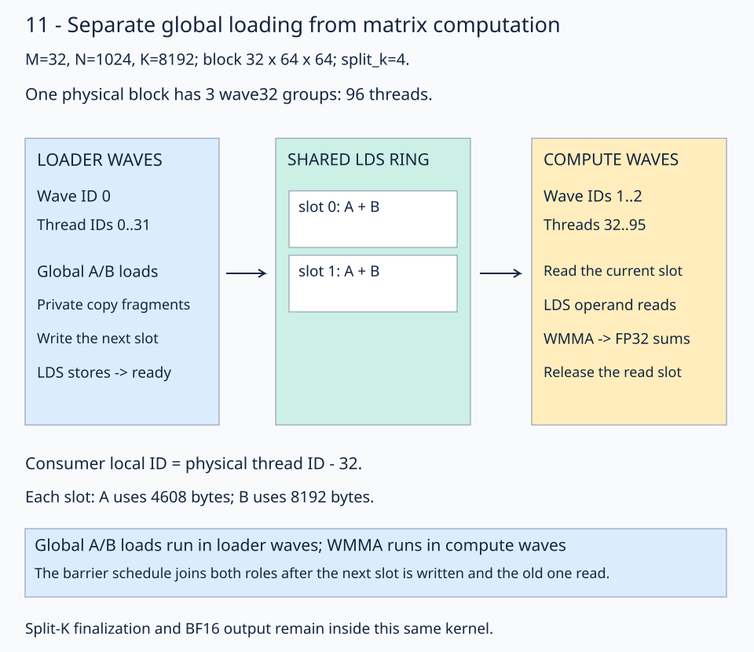
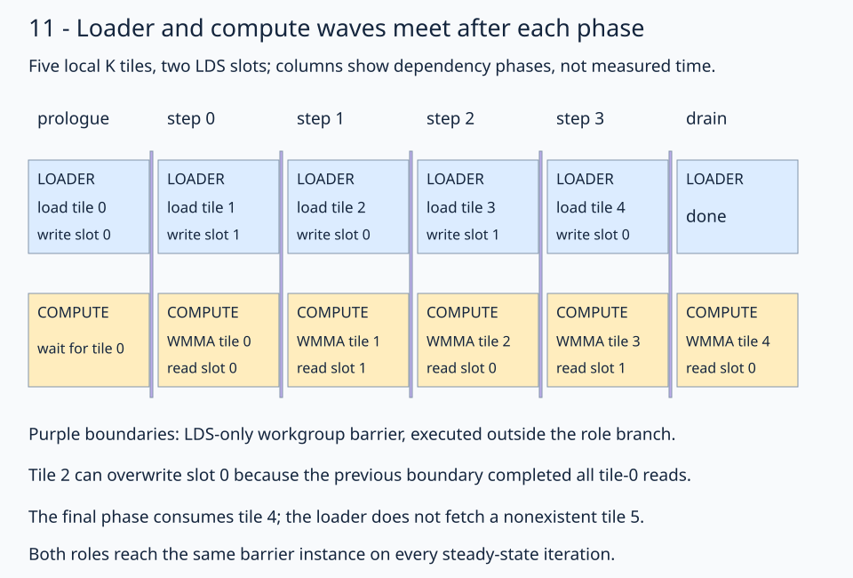
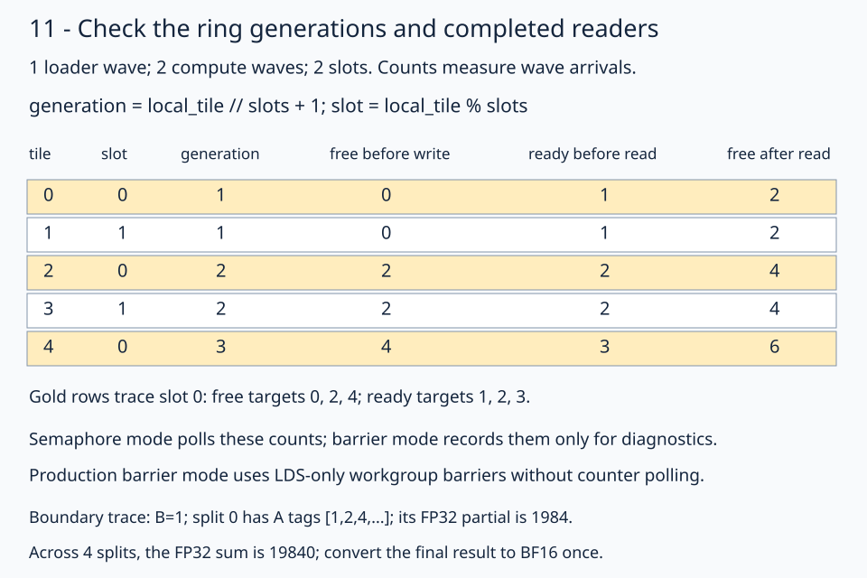

> **Archived wave-specialization experiment.** This is research outside the main course. See the [research index](../README.md) for current run commands and [lesson 12](../../lessons/01-gpu-programming/13-matmul/12-operand-paths/README.md#why-the-course-keeps-prefetch) for the measured reason the course retains prefetch. Raw records preserve their original paths.

# 11 · Give loading and computation their own waves

[Stage 10](../wave-local-prefetch/README.md) lets each compute group prefetch its next A/B tile into private registers. Wave specialization assigns those global loads and LDS stores to **dedicated loader waves**. Compute waves read LDS and issue WMMA. Can separating the roles improve skinny GEMM enough to pay for the extra waves and synchronization?

This lesson implements and searches two producer/consumer protocols. On Radeon 8060S (`gfx1151`), the selected two-slot barrier schedule takes **25.63 µs** for `(M,N,K)=(32,1024,8192)`, versus **27.66 µs** for retuned prefetch. An independent repetition confirms the gain. The other two declared shapes meet parity against retuned prefetch. These are warm graph-replay throughput results; ordinary Python calls give a different outcome.

Keep the preceding lessons' contiguous row-major BF16 inputs/output, FP32 accumulation, flat block mapping, and single-kernel split-K finalizer. The new strategy changes who moves the operands and how their LDS lifetime is synchronized.

## Follow one block and its three waves

The default workload is **32×1024×8192**. Each block computes a **32×64 output tile**, processing K in chunks of 64. `split_k=4` gives each block 2048 K values, or 32 local K tiles. Sixteen output tiles times four K partitions produce 64 physical blocks.



Read the blue loader group first, then follow its tile through LDS to the gold compute groups. The two compute waves cooperate on the same output tile. This differs from stage 10's wide configuration, where independent waves own disjoint output tiles and disjoint LDS regions.

| Physical wave | Thread IDs | Responsibility |
| --- | --- | --- |
| 0 | 0–31 | Buffer-addressed global A/B loads and LDS stores |
| 1 | 32–63 | LDS operand reads, WMMA, output/finalization |
| 2 | 64–95 | LDS operand reads, WMMA, output/finalization |

The native copy and MMA ownership domains start at zero. Loader IDs already start there; compute IDs must subtract the loader prefix:

```python
loader_thread_id = fx.thread_idx.x
compute_thread_id = fx.thread_idx.x - LOADER_THREADS
thread_mma = mma.thr_slice(compute_thread_id)
```

Follow physical thread 35: its compute ID is `35-32=3`. Both `mma.thr_slice` and `lds2reg_*_thread_copy.get_slice` use that ID. Only the compute branch executes their memory accesses and WMMA. The loader branch uses a separate copy plan sized for **32 loader threads**, rather than all 96 physical threads.

Block selection continues to use layout algebra:

```python
split_block_layout = fx.make_layout((SPLIT_K, tiles_m * tiles_n), (1, SPLIT_K))
split_block_coords = fx.idx2crd(fx.block_idx.x, split_block_layout)
```

For physical block 0, the split and output-tile IDs are both 0. It selects output rows 0–31, columns 0–63, and K values 0–2047. The launch remains `grid=(64,1,1)`, `block=(96,1,1)`; no two-dimensional physical block index is needed.

## Select the next LDS slot

Each slot contains padded A with shape `(32,64)` and BF16 strides `(72,1)`, plus packed B with shape `(64,64)` and strides `(64,1)`. A occupies 2304 BF16 elements including padding; B occupies 4096. Two slots use **25600 LDS bytes**.

The [solution](solution.py) retains `gmem2reg_load_tile`, `reg2lds_copy_tile`, and `compute_lds`. It constructs the global views, divides them into tiles, selects the block's views, and partitions them with the loader copy plans. The selected geometry uses 128-bit global loads and LDS stores. Smaller search geometries choose the widest complete vector their loader domain supports: 8, 4, 2, or 1 BF16 values.

Inside `reg2lds_copy_tile(stage)`, advance the pointer by one **whole padded slot**, then retain its within-slot layout:

```python
left_destination_ptr = left_lds_base + stage * LEFT_STAGE_VALUES
left_destination = fx.make_view(
    left_destination_ptr, left_loader_lds_view.layout
)
```

`LEFT_STAGE_VALUES` is 2304, measured in BF16 elements. Slot 1 starts 4608 bytes after slot 0. The right operand uses its own `RIGHT_STAGE_VALUES=4096`; its slot step is 8192 bytes. Compute views apply the same slot offsets before selecting their 16-wide K fragments. The WMMA atom remains 16×16×16.

## Join the roles at a common barrier

The selected `protocol="barrier"` schedule uses two slots. In the prologue, loader waves fill slot 0. A common LDS-only workgroup barrier makes it available to compute waves. Each steady-state phase then gives the roles different work:

```text
loader waves:  load next tile from global; store it into the next slot
compute waves: read the current slot; update FP32 accumulators
all threads:   LDS-only workgroup barrier
```

This is scheduling pseudocode. The runnable program uses `scf.IfOp` to emit the role branches, followed by the native barrier **outside** the branch:

```python
spaces = ir.ArrayAttr.get([ir.Attribute.parse("#gpu.address_space<workgroup>")])
fx.barrier(address_spaces=spaces)
```

The memory address space selects LDS; the default execution scope includes the entire workgroup. [MLIR's barrier contract](https://mlir.llvm.org/docs/Dialects/GPU/#gpubarrier-gpubarrierop) requires participating threads to reach the same dynamic barrier instance. Putting a workgroup barrier separately in each role branch would not satisfy that contract.



Trace tile 2. It can overwrite slot 0 because the previous phase's barrier completed all reads of tile 0. At the next barrier, tile 2 is ready and tile 1's readers have finished. The drain consumes tile 4 without fetching tile 5. Columns describe dependencies, not measured cycle durations.

With **one slot**, loaders can issue the next global reads into private registers while computation uses LDS, but must wait for readers before overwriting it. That needs two steady-state barriers: reader completion, then publication. With **two or more slots**, writing the next slot and consuming the current one can proceed in the same phase, followed by one common barrier. The full default partition executes 32 barriers: one prologue plus 31 handoffs. Three/four-slot variants rotate through more storage and unroll more phases; this barrier protocol still prepares only the next tile per phase.

Production barrier mode has no ready/free polling or diagnostic counter writes. Extra waves and ring storage still have a cost: this is an opportunity for the hardware to schedule independent work, not a guarantee of overlap on every GPU.

## Compare an independent semaphore protocol

`protocol="semaphore"` gives the roles independent loops. For local K tile `t`, use:

```text
slot = t % lds_stages
generation = t // lds_stages + 1
producer waits for free >= (generation-1) * compute_waves
producer writes A/B, then publishes ready arrivals
consumer waits for ready >= generation * loader_waves
consumer reads A/B and computes, then publishes free arrivals
```

Ready/free counters count **wave arrivals** monotonically, avoiding ambiguous reuse of a Boolean flag. Each wave completes an LDS-only subgroup barrier before lane 0 signals. Single-writer signals use release stores in `signal_mode="auto"`; multiple waves use acquire/release atomic increments. Polling uses acquire loads with `fx.rocdl.SyncScope.WorkgroupOneAs`. All operands and flags involved in these handoffs are in LDS. LLVM documents the [single-address-space scope and its limits](https://llvm.org/docs/AMDGPUUsage.html).

The producer can load the next global tile into private registers before waiting for its destination slot to become free. More slots let it publish farther ahead, but polling, wave imbalance, and storage can outweigh that freedom. The selected wide configuration uses two loader waves, four compute waves, one slot, a 16×128×16 tile, and `split_k=1`. It reaches parity with retuned stage 10; it does not establish a specialization gain there.



Gold rows follow slot 0. These counts enforce the semaphore protocol. In a **debug build of the barrier protocol**, the same counts only record completed handoffs for checking. They do not synchronize the production barrier kernel.

For the illustrated boundary check, B contains 1 and split 0's five A tiles contain tags `[1,2,4,8,16]`. Its FP32 partial is `64*(1+2+4+8+16)=1984`. Splits 1–3 multiply those tags by 2, 3, and 4, producing partials 3968, 5952, and 7936. The complete sum is **19840**, converted to BF16 once after reduction.

Both protocols retain stage 09's **agent-scope acquire/release** publication of global FP32 partials and its last-arriver finalizer. LDS ordering cannot replace that cross-block ordering. Counter reset and reduction remain inside the same kernel, with workspace reuse serialized on one stream.

## Search both strategies and retune the control

The experiment measured **1643 wave-specialized configurations** across semaphore and hardware-barrier implementations, then **362 prefetch controls**. It searched tile geometry, loader/compute balance, split counts 1/2/4, one to four LDS slots, B cache policy, polling, and signal choices. Invalid copy/WMMA geometry and LDS allocations were pruned before launch. All 2005 measured candidates passed numerical checks.

The separate [HipKittens four-wave interleave experiment](../hipkittens-four-wave/README.md) keeps every wave loading and computing, with finer instruction granularity. Its gfx1151 adaptation reaches prefetch parity across these shapes after tuning; it does not change this lesson's defaults.

Retuning prefetch matters: some apparent gains against the historical stage-10 defaults came from better tiles/cache choices. The final comparison includes both those historical defaults and a separately selected prefetch control. Training uses seed 13 and longer three-round confirmation; configurations are locked before fresh verification seeds. See the [search bounds, source snapshots, selection, and complete samples](results/README.md).

Fresh **graph-host** verification on gfx1151 gives:

| Shape (M,N,K) | Wave specialized, µs | Retuned prefetch, µs | GPU Torch, µs | Versus retuned prefetch |
| --- | --- | --- | --- | --- |
| 16,1024,8192 | 21.03 | 21.46 | 34.48 | Parity |
| **32,1024,8192** | **25.63** | **27.66** | **59.06** | **Win in all 9 rounds** |
| 16,4096,8192 | 272.23 | 273.46 | 289.98 | Parity |

A win requires every round's median paired time ratio below 0.95; parity requires every round at or below 1.05. A second independent M=32 verification measures **25.76 / 27.57 µs**, making **18/18 rounds** below 0.95 against retuned prefetch. The improvement is about **7% lower time** for this workload. All 27 primary graph rounds also pass the Torch win criterion.

Each capture contains exactly 32 kernel nodes for 32 GEMMs, including split-K finalization. Synchronized host timing measures warm replay throughput with preallocated buffers. Direct-host calls expose Python dispatch: the two N=1024 wave-specialized cases are slower than prefetch, and the wide case remains at parity with it. Choose the strategy for the workload and launch path actually measured.

## Check what changed in the generated kernel

The selected M=32 ISA has BF16 WMMA and buffer loads in separate role paths, **25600 LDS bytes**, 198 compiler VGPRs, 22 SGPRs, and zero private scratch. The [inspector and retained dumps](results/README.md#inspect-the-native-kernels) check local barrier annotations and the global split-K ordering. These resource counts do not establish occupancy or cycle-level overlap.

Compared with retuned prefetch at the same tile/wave/split/cache geometry, the profiler records **49152 global-load instructions** and **638976 LDS instructions** for both kernels. External 128-byte read requests are also almost equal: 135202 versus 135187. Wave count rises from 128 to 192 per dispatch. The `ALUStalledByLDS` metric falls from 65.23% to 49.47%, while scalar instruction count rises. This supports investigating the changed schedule; it does not imply less arithmetic or a large reduction in memory traffic. The metric covers different wave mixtures and is not a fraction of wall time.

## Practice

[practice.py](practice.py) supplies both protocols, input views, copy plans, finalization, launch, and checker. Fill two expressions in this order:

1. `compute_thread_id`: translate the physical ID into the compute domain.
2. `left_destination_ptr`: select the padded A slot in `reg2lds_copy_tile`.

Both protocols execute these expressions. The default checkpoint is **`[7,4,1,-2]`**, the first four completed BF16 outputs in row 0 for the full-size trace input. The wide selector has checkpoint `[8,5,2,-1]`.

The checker compares complete trace/random products against CPU FP32 arithmetic on the actual quantized BF16 inputs, rounded to BF16. It changes input signs between workspace reuses, poisons output with NaNs, checks output/workspace sentinels and counter reset, and inspects exact FP32 partials in tagged boundary cases. Debug builds also check every slot's ready/free count and guards. Boundary lengths include `1,2,3,S-1,S,S+1,2*S+1` local K tiles, keeping only positive unique lengths. The course checker runs all three shapes with split counts 1, 2, and 4. Random tolerances are `rtol=0.016, atol=0.03125`. Complete tiles and contiguous inputs are required; general tails are outside this kernel's contract.

## Revision question

Why does putting the loader's workgroup barrier in its `if` branch and the compute barrier in the `else` branch fail, even if each wave executes the same number of barriers?

<details><summary>Answer</summary>

The workgroup must reach the same dynamic barrier instance. Distinct branch-local barriers are different instances, and neither branch includes all workgroup threads. The supplied schedule rejoins the branches before its common barrier. That one handoff completes current reads and next-slot writes before any role advances.

</details>

Run from the repository root:

```bash
pixi run python experiments/wave-specialization/practice.py --check-only
pixi run python experiments/wave-specialization/solution.py
pixi run python experiments/wave-specialization/solution.py --shape 16 4096 8192 --check-only
pixi run gpu-check
```

The starter reports `Practice not finished:` until completed; a complete program reports `Exercise passed:`. Compare the [worked solution](solution.py), then use the [reproduction commands](results/README.md#repeat-the-measurements) to search or verify a declared shape.

[Previous: independent wave tiles](../wave-local-prefetch/README.md) · [Matmul series](../../lessons/01-gpu-programming/13-matmul/README.md) · [Next: operand paths](../../lessons/01-gpu-programming/13-matmul/12-operand-paths/README.md)
