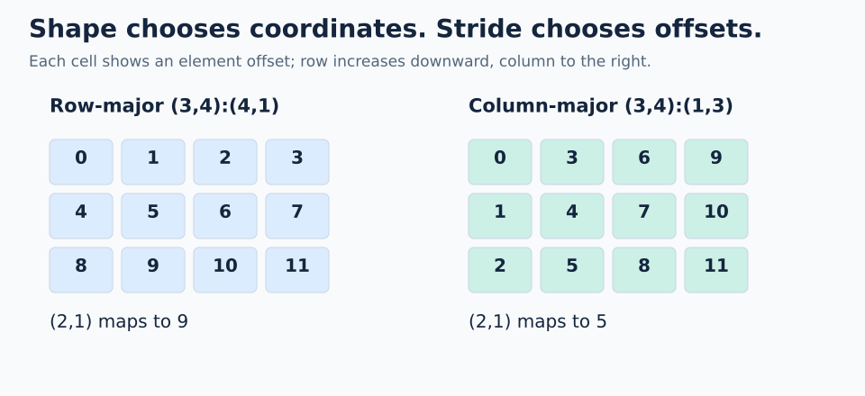

# 00 · Shapes and strides

A layout starts with two choices: **shape** gives the valid coordinates, and **stride** gives the offset change for one step along each axis. Begin with a small matrix, then change its strides to see how the same coordinates reach different positions.

A layout is written as `Shape:Stride`. For ordinary integer strides:

```text
L = (3,4):(4,1)
L(row,col) = row*4 + col*1
```

The first axis has 3 positions, the second has 4. `(2,1)` maps to `2*4 + 1 = 9`.



Follow one step down or right in each grid. The coordinate axes stay the same; the change in the printed offset reveals the stride.

## Same shape, different indexing blueprint

| Layout | Step along row | Step along column | Offset of `(2,1)` |
| --- | --- | --- | --- |
| `(3,4):(4,1)` | +4 | +1 | 9 |
| `(3,4):(1,3)` | +1 | +3 | 5 |

In these diagrams, the first coordinate runs vertically and the second horizontally. The stride chooses the memory order; the shape alone does not.

```python
# Inside a FlyDSL tracing context
row_major = fx.make_layout((3, 4), (4, 1))
col_major = fx.make_layout((3, 4), (1, 3))
offset = fx.crd2idx(fx.make_coord(2, 1), row_major)  # 9
```

## Count and span are different

`size(L)` counts logical positions. For the nonnegative integer strides used here, `cosize(L)` is the largest reachable offset plus one.

| Layout | Reachable offsets | Size | Cosize |
| --- | --- | --- | --- |
| `4:1` | 0, 1, 2, 3 | 4 | 4 |
| `4:2` | 0, 2, 4, 6 | 4 | 7 |
| `(2,3):(0,1)` | 0, 1, 2, each twice | 6 | 3 |

Gaps are possible; repeated offsets are possible too. A zero stride means stepping along that axis leaves the offset unchanged.

**Common mistake:** strides here count elements, not bytes. For a float32 tensor, element offset 9 corresponds to byte displacement 36 from its base pointer. A layout by itself has no dtype or allocation.

**Check yourself:** for `(3,4):(5,1)`, what are `L(2,3)`, size, and cosize?

<details><summary>Answer</summary>

Offset 13, size 12, cosize 14. The row pitch introduces holes at offsets 4 and 9.

</details>

## Practice

Measure every coordinate of `(3,4):(5,1)` with 12 GPU threads. The expected checkpoint is `(offset_at_2_3, logical_size, storage_span) = (13,12,14)`.

Open [`practice.py`](practice.py) and complete the numbered expressions in **`_shape_stride_offsets()`** using the native APIs introduced below. The scaffold supplies allocation, launch, output stores, and host checks, so the exercise can focus on the layout operation.

### Native APIs and output

Read the kernel as **describe the data mapping → assign thread coordinates → evaluate the mapping → record results**. The `out` tensor records the calculated offsets for the host checker. This exercise evaluates an indexing rule; input data views and loads are introduced in later lessons.

The kernel separates thread ownership from data storage:

```python
thread_id = fx.thread_idx.x
thread_layout = fx.make_ordered_layout((3, 4), (0, 1))
coordinate = fx.idx2crd(thread_id, thread_layout)
data_layout = fx.make_layout((3, 4), (5, 1))
element_offset = fx.crd2idx(coordinate, data_layout)
```

`make_layout(shape, stride)` uses the exact strides supplied. `make_ordered_layout(shape, order)` calculates compact strides from a speed rank for each axis: rank 0 is fastest. Order `(0,1)` produces thread strides `(1,3)`; order `(1,0)` would produce `(4,1)`. The order is a rank per axis, not a list of axis numbers.

The thread layout maps `(row,column)` to its owning thread ID. `idx2crd` reverses that mapping, giving each thread its coordinate. The data layout maps that coordinate to a storage offset, including padding. Thread 5 owns `(2,1)` and addresses offset 11. The GPU launch is still one-dimensional; the thread layout supplies its logical organization.

`fx.crd2idx` maps a coordinate to an element offset. `fx.get_scalar` extracts a scalar from a FlyDSL integer tuple for storage. Shape and strides are static here, so size and cosize can fold at compile time; the coordinate depends on the GPU thread.

### Complete the kernel

1. Trace `(2,3)` by hand: `2*5 + 3 = 13`. Identify the padding holes at 4 and 9.
2. Fill `element_offset` with `fx.crd2idx(coordinate, data_layout)`.
3. Fill `logical_size` with `fx.size(data_layout)` and `storage_span` with `fx.cosize(data_layout)`.
4. Keep the output stores and host checker. Each output row contains offset, size, and span.

### Run and check

From the repository root, using the [configured GPU environment](../../../README.md):

```bash
pixi run python lessons/00-layout-algebra/00-shapes-and-strides/practice.py
pixi run python lessons/00-layout-algebra/00-shapes-and-strides/solution.py
```

An unfinished starter exits with `Practice not finished: ...` during tracing. Fill each TODO with a native API expression, then rerun. A correct exercise prints `Exercise passed:` and its checkpoint. Compare with the commented [worked solution](solution.py) after your attempt.

`@flyc.kernel` traces the device computation; `@flyc.jit` traces its launch. `solve()` allocates a PyTorch GPU output, launches exactly as many threads as there are positions, synchronizes, and copies results to the host for assertions. PyTorch uses the device name `cuda` on ROCm too. These tiny launches need no tail predicate because each thread has one valid output row. General-sized launches will need bounds handling.

### Troubleshooting and another case

If span equals size, revisit the padding holes; span includes the highest offset plus one. Try strides `(4,1)` in a scratch copy and predict which columns change.

For the variation, make a scratch copy and update its launch size and expected results together. Compute the mapping with FlyDSL operations and use the expected values only in the host checker. Static layout construction may fold during compilation; evaluation uses `fx.thread_idx.x` to check every position in this example.

[Next: coordinates and views →](../01-coordinates-and-views/README.md)
