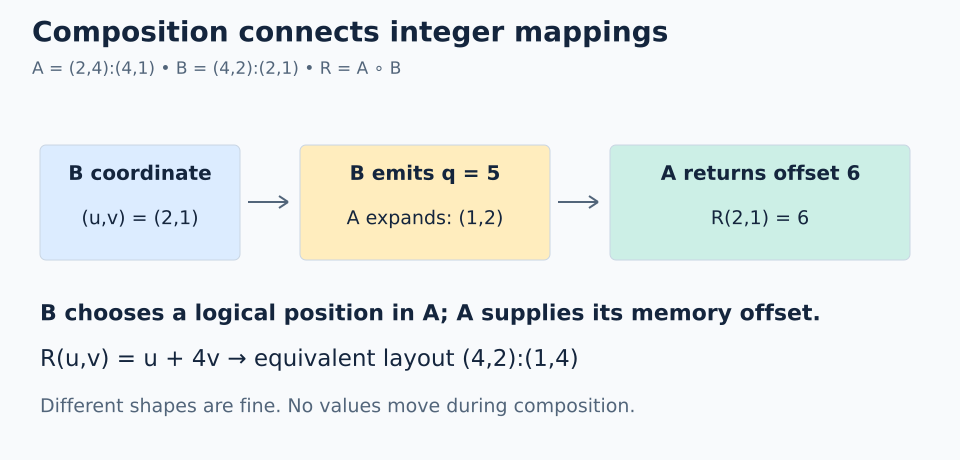

# 03 · Composition: indexing a layout

Composition connects two indexing rules. Let A map logical positions to data offsets, and let B choose which logical positions in A to visit. The composed layout follows B first, then A. A thread/value ownership plan is one later use of this pattern.

```text
R = composition(A,B)
R(c) = A(B(c))
```

B runs first. Its output is a **scalar logical coordinate for A**, not a physical address to dereference.

## Different shapes work

Use `A = (2,4):(4,1)` and `B = (4,2):(2,1)`. Their shapes differ, so follow the intermediate scalar carefully: it connects the two mappings without matching their axes.



Follow the arrows from left to right. B emits the intermediate scalar `q=5`; A expands that scalar using its own shape before returning offset 6. The middle number names a logical position in A.

Let B's coordinate be `(u,v)`:

```text
q = B(u,v) = 2*u + v
A(q) = (q % 2)*4 + (q // 2)
     = 4*v + u                # 0 <= v < 2
R = (4,2):(1,4)
```

| B coordinate | B output `q` | A coordinate | Final offset |
| --- | --- | --- | --- |
| `(0,0)` | 0 | `(0,0)` | 0 |
| `(1,0)` | 2 | `(0,1)` | 1 |
| `(0,1)` | 1 | `(1,0)` | 4 |
| `(2,1)` | 5 | `(1,2)` | 6 |
| `(3,1)` | 7 | `(1,3)` | 7 |

The shapes do not need to match: B emits integers that A knows how to interpret.

```python
# Inside a FlyDSL tracing context
A = fx.make_layout((2, 4), (4, 1))
B = fx.make_layout((4, 2), (2, 1))
R = fx.composition(A, B)  # equivalent mapping to (4,2):(1,4)
```

## Must B cover all of A?

A composition can select a subset. For example, `B_small = 2:2` emits only `0,2`. Passing those through A gives offsets `0,1`: a valid subset of the eight logical positions.

For an in-bounds view, every emitted B index must lie in A's logical domain (`0 <= B(c) < size(A)` in these scalar examples). Full coverage is a separate requirement if the application needs every element. Also, the composition must meet the algebra/compiler's representability and divisibility constraints; matching sizes or checking bounds alone does not prove every arbitrary pair will compile.

Use **A's logical size**, not its physical cosize, to reason about this intermediate coordinate.

## Composition with a nested A

Take `A = ((2,2),3):((1,4),8)` from lesson 02 and `B = (2,3):(2,4)`.

```text
B(u,v) = 2*u + 4*v
A expands this q to ((0,u),v)
R(u,v) = 4*u + 8*v
R is equivalent to (2,3):(4,8)
```

For `(u,v)=(1,2)`: B emits 10, A interprets `((0,1),2)`, final offset 20. The nested grouping introduces no data movement.

**Common mistake:** multiplying A and B strides component by component does not compute composition. The intermediate scalar coordinate must be interpreted through A's shape.

**Check yourself:** in the first example, compute `R(3,0)` and explain why B does not need shape `(2,4)`.

<details><summary>Answer</summary>

B emits 6; A expands it to `(0,3)` and returns offset 3. Composition connects the integer mappings, not matching axis names.

</details>

## Practice

Build `fx.composition(A,B)` for `A=(2,4):(4,1)` and `B=(4,2):(2,1)`, then evaluate it for all eight coordinates of B.

Open [`practice.py`](practice.py) and complete the numbered expressions in **`_compose_offsets()`** using the native APIs introduced below. The scaffold supplies allocation, launch, output stores, and host checks, so the exercise can focus on the layout operation.

### Native APIs and output

Read the kernel as **describe the data mapping → assign thread coordinates → evaluate the mapping → record results**. The `out` tensor records the calculated offsets for the host checker. This exercise evaluates an indexing rule; input data views and loads are introduced in later lessons.

The supplied `thread_layout = fx.make_ordered_layout(fx.get_shape(b), (0,1))` has shape `(4,2)` and strides `(1,4)`. `coordinate = fx.idx2crd(thread_id, thread_layout)` assigns each thread a coordinate in B's domain. Follow the chain: thread ID → B coordinate → B's output (A's scalar logical coordinate) → data offset. The thread layout describes ownership; B describes which logical positions in A those owners visit.

This exercise invokes FlyDSL's symbolic composition operation. The host checks the intermediate sequence `0,2,4,6,1,3,5,7` as well as the final sequence `0..7`. `solve()` returns the eight final offsets. The intermediate values must fit A's logical size, not its storage span.

### Complete the kernel

1. Trace thread `thread_id=1`: its coordinate is `(1,0)`, so B emits 2, which A expands to `(0,1)`, giving offset 1.
2. Fill `composed` with `fx.composition(a, b)`.
3. Fill `intermediate` with `fx.crd2idx(coordinate, b)`.
4. Fill `final_offset` with `fx.crd2idx(coordinate, composed)`. Keep the separate `fx.crd2idx(intermediate, a)` store as a cross-check.

### Run and check

From the repository root, using the [configured GPU environment](../../../README.md):

```bash
pixi run python lessons/00-layout-algebra/03-composition/practice.py
pixi run python lessons/00-layout-algebra/03-composition/solution.py
```

An unfinished starter exits with `Practice not finished: ...` during tracing. Fill each TODO with a native API expression, then rerun. A correct exercise prints `Exercise passed:` and its checkpoint. Compare with the commented [worked solution](solution.py) after your attempt.

`@flyc.kernel` traces the device computation; `@flyc.jit` traces its launch. `solve()` allocates a PyTorch GPU output, launches exactly as many threads as there are positions, synchronizes, and copies results to the host for assertions. PyTorch uses the device name `cuda` on ROCm too. These tiny launches need no tail predicate because each thread has one valid output row. General-sized launches will need bounds handling.

### Troubleshooting and another case

Reversing A and B happens to produce the same final sequence in this example, so trace the intermediate stage too. Try native composition with `fx.make_layout(2,2)` as B, or use the nested example above; the GPU regression check covers both.

For the variation, make a scratch copy and update its launch size and expected results together. Compute the mapping with FlyDSL operations and use the expected values only in the host checker. Static layout construction may fold during compilation; evaluation uses `fx.thread_idx.x` to check every position in this example.

[← Nested layouts](../02-nested-layouts/README.md) · [Next: coalescing →](../04-coalescing/README.md)
