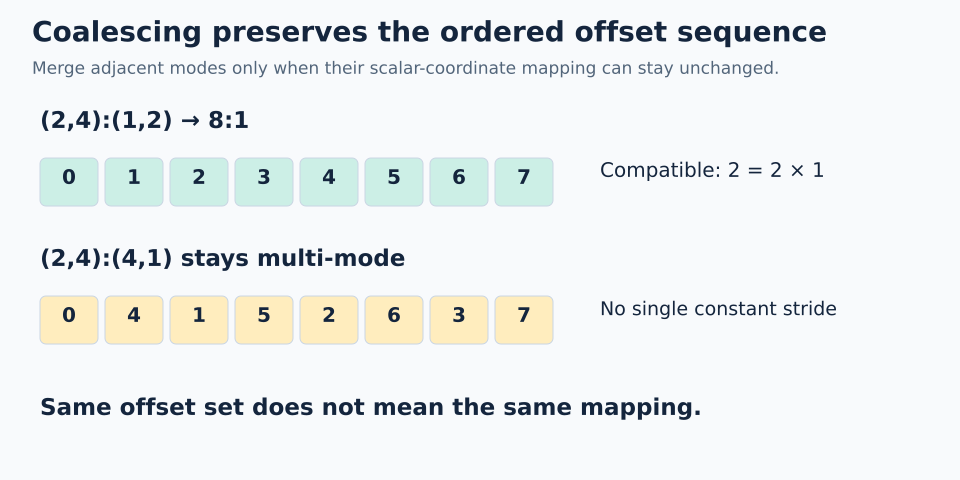

# 04 · Coalescing: simplify the blueprint

**Mental model from our discussion:** like flattening an indexing blueprint while preserving the offset sequence. No tensor values move. Unlike NumPy's `flatten()`, this operation does not copy array data.

For valid **scalar logical coordinates** q, coalescing preserves:

```text
coalesced(q) = original(q)
size(coalesced) = size(original)
```

The coordinate tree may change. An old nested tuple coordinate is not necessarily valid for the result.



## When can two adjacent leaf modes merge?

For `(s0,s1):(d0,d1)`, if `d1 = s0*d0`, they become `(s0*s1):d0`. A statically known size-1 mode can also disappear because its coordinate is always zero.

| Original | Result | Reason |
| --- | --- | --- |
| `(2,4):(1,2)` | `8:1` | `2 = 2*1` |
| `(2,3):(2,4)` | `6:2` | `4 = 2*2`; contiguous bytes are not required |
| `((2,1),4):((1,99),2)` | `8:1` | Remove size-1 mode, then merge |
| `(2,4):(4,1)` | remains multi-mode | `1 != 2*4` |

## Worked non-example

`(2,4):(4,1)` visits offsets `0,4,1,5,2,6,3,7` in scalar-coordinate order. No single constant stride generates that sequence.

Even though it covers a compact set of eight memory offsets, it cannot coalesce to `8:1` without changing the function. **Same set of offsets is weaker than same ordered mapping.**

For the nested layout `((2,2),3):((1,4),8)`, the first two leaves cannot merge. The last two can: `8 = 2*4`. A simplified mapping is `(2,6):(1,4)`.

```python
# Inside a FlyDSL tracing context
simple = fx.coalesce(fx.make_layout((2, 4), (1, 2)))  # 8:1
```

**Trap:** flattening a tuple hierarchy and merging all modes are different steps. Coalescing may stop with several modes.

**Check yourself:** can `(2,3):(3,6)` coalesce? What is the result?

<details><summary>Answer</summary>

Yes: `6:3`, because `6 = 2*3`. Offsets remain `0,3,6,9,12,15`.

</details>

## Practice

Ask FlyDSL to coalesce `(2,3):(3,6)` and compare both mappings over all six scalar coordinates.

Open [`practice.py`](practice.py) and complete the numbered TODOs in **`exercise_kernel()`**. The allocation, launch, stores, and host checker are supplied; the algebra belongs inside the kernel's FlyDSL tracing context.

### Native APIs and output

The supplied `thread_layout = fx.make_ordered_layout(fx.get_shape(original), (0,1))` assigns the six threads to `(2,3)` coordinates with strides `(1,2)`. `coordinate = fx.idx2crd(q, thread_layout)` decodes that ownership map. For example, thread 3 owns `(1,1)`, whose original data offset is 9.

Coalescing changes the data coordinate structure from `(2,3)` to `6`, so do not pass the old tuple to the simplified layout. Evaluate the original at `coordinate` and the simplified layout at scalar q. These refer to the same logical position because the thread layout uses first-mode-fastest order. A different thread order would require converting its coordinate to the original scalar logical index before applying the simplified layout.

The kernel also records `fx.size(simplified)` and `fx.cosize(simplified)`; expect 6 and 16. Coalescing preserves the mapping at each scalar coordinate, not just the set of offsets. The layout algebra is compile-time work for these static layouts; evaluation at thread-dependent q runs on the GPU.

### Complete the kernel

1. Predict the result: `6 = 2*3`, so the merged layout should be `6:3`.
2. Fill `simplified` with `fx.coalesce(original)`; let the compiler construct the result.
3. Fill `original_offset` with `fx.crd2idx(coordinate, original)` and `simplified_offset` with `fx.crd2idx(q, simplified)`. The tuple and scalar represent the same logical position here.
4. Keep the stores and checker. The returned pair of lists must contain the same ordered offsets `[0,3,6,9,12,15]`.

### Run and check

From the repository root, using the [configured GPU environment](../../../README.md):

```bash
pixi run python lessons/00-layout-algebra/04-coalescing/practice.py
pixi run python lessons/00-layout-algebra/04-coalescing/solution.py
```

An unfinished starter exits with `Practice not finished: ...` during tracing. Fill each TODO with a native API expression, then rerun. A correct exercise prints `Exercise passed:` and its checkpoint. Compare with the commented [worked solution](solution.py) after your attempt.

`@flyc.kernel` traces the device computation; `@flyc.jit` traces its launch. `solve()` allocates a PyTorch GPU output, launches exactly as many threads as there are positions, synchronizes, and copies results to the host for assertions. PyTorch uses the device name `cuda` on ROCm too. These tiny launches need no tail predicate because each thread has one valid output row. General-sized launches will need bounds handling.

### Troubleshooting and another case

If the simplified sequence is `0..5`, the stride was lost. Try the size-1 example and the unmergeable row-major layout from the table above; the GPU regression check covers both.

Use a scratch copy for extensions and update its launch size and expected results together. Do not replace computations with the expected constants. Static layout construction may fold during compilation; mappings depend on `fx.thread_idx.x` and are checked across the complete small domain.

[← Composition](../03-composition/README.md) · [Next: logical divide →](../05-logical-divide/README.md)
