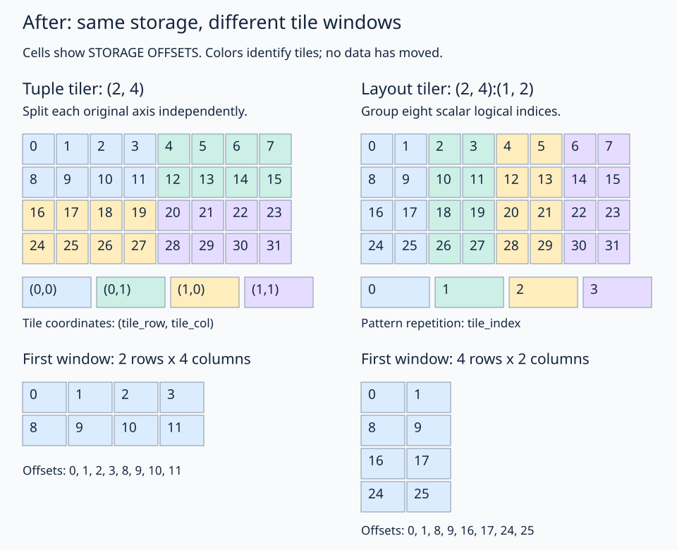

# 05 · Divide layouts into tile windows

Divide introduces two kinds of coordinates: **where inside a tile** and **which tile**. The four divide APIs organize those coordinates differently. Learn them separately, then compare them at corresponding positions.

## Tutorial sequence

Each tutorial has its own explanation, unfinished practice kernel, and GPU-tested solution. Follow this order:

| Tutorial | What it teaches |
| --- | --- |
| [1 · Logical divide](01-logical/README.md) | Split each original axis into its local and tile coordinates. |
| [2 · Zipped divide](02-zipped/README.md) | Group the local position and tile position separately; select a whole tile. |
| [3 · Tiled divide](03-tiled/README.md) | Keep the local tile grouped while exposing tile-grid axes separately. |
| [4 · Flat divide](04-flat/README.md) | Expose all four coordinates and match a flat thread ownership layout. |

Every focused tutorial follows the same four steps: describe the matrix layout, create its view, divide it into windows, and select one tile. Eight threads then read the selected tile using the same simple local thread layout. Their host checkers validate all eight loaded values; the combined exercise checks all 32 original positions across the variants.

The existing [practice.py](practice.py) and [solution.py](solution.py) remain as a **combined comparison exercise** after the four tutorials. The practice files provide TODOs for the divide and slice expressions. All practice files have been reset for a fresh attempt.

## First understand one-dimensional windowing

Take `original = fx.make_layout(16,1)` and tiles containing four consecutive logical positions:

```python
original = fx.make_layout(16, 1)
divided = fx.logical_divide(original, fx.make_layout(4, 1))
# Result: shape (4,4), strides (1,4).
```

The new coordinate is `(local_index, tile_index)`:

```text
original_index = local_index + 4 * tile_index
```

Tile 2 addresses indices `8,9,10,11`. There are still 16 positions, now described by two coordinates. No values have moved. A tensor slice `(None,2)` keeps the local positions and fixes the tile index.

The tiler describes the within-tile pattern. A repetition pattern, called a complement, accounts for the remaining positions. Here these patterns are `4:1` and `4:4`; together they form the logical index `local_index + 4*tile_index`. Composition passes that index through the original layout to obtain a storage offset. If the original stride were 2, the resulting data strides would be `(2,8)` instead of `(1,4)`.

## Choose the tiler before choosing the grouping

All four matrix tutorials use:

```python
original = fx.make_layout((4, 8), (8, 1))
tile_shape = (2, 4)
```

The **tuple tiler** `(2,4)` independently splits the original row axis into groups of 2 and the column axis into groups of 4. It creates a 2-by-2 grid of tiles, each containing 2 rows and 4 columns.

A **layout tiler** such as `fx.make_layout((2,4),(1,2))` instead describes a pattern in the original layout's scalar logical domain. For this matrix it creates different windows. The [visual tuple-versus-layout comparison](tuple-vs-layout.md) shows the before and after:



Tiler choice and coordinate grouping are separate decisions. The four tutorials hold the tuple tiler fixed to isolate the grouping differences. The shapes below apply to this original layout and this tiler, not every possible use of these APIs.

## The shared position behind every variant

Use descriptive names:

| Name | Meaning | Extent |
| --- | --- | --- |
| `local_row` | Row within a tile | 2 |
| `local_col` | Column within a tile | 4 |
| `tile_row` | Tile row in the grid | 2 |
| `tile_col` | Tile column in the grid | 2 |

They reconstruct the original position as:

```text
row = local_row + 2 * tile_row
col = local_col + 4 * tile_col

offset = 8 * local_row + local_col + 16 * tile_row + 4 * tile_col
```

A local row step advances 8 elements, a local column step advances 1, a tile row step advances 16, and a tile column step advances 4. Grouping rearranges these terms without changing the corresponding position.

For local `(1,2)` in tile `(1,1)`, every variant must map to original `(3,6)`, offset 30.

## Four ways to express that position

```python
# logical_divide: keep each original axis together
((local_row, tile_row), (local_col, tile_col))

# zipped_divide: group the local position, then the tile position
((local_row, local_col), (tile_row, tile_col))

# tiled_divide: group the local position, expose each tile-grid axis
((local_row, local_col), tile_row, tile_col)

# flat_divide: expose every axis separately
(local_row, local_col, tile_row, tile_col)
```

| Variant | Result shape | Result stride |
| --- | --- | --- |
| Logical | `((2,2),(4,2))` | `((8,16),(1,4))` |
| Zipped | `((2,4),(2,2))` | `((8,1),(16,4))` |
| Tiled | `((2,4),2,2)` | `((8,1),16,4)` |
| Flat | `(2,4,2,2)` | `(8,1,16,4)` |

Equal scalar coordinates need not identify the same position across these layouts. For example, scalar 2 produces offset 16 in logical divide but offset 1 in flat divide. Compare corresponding named coordinates instead.

## Quick guide: which one should I use?

- Choose **logical** when you want the split of each original axis to remain visible.
- Choose **zipped** when the next operation treats local position and tile position as two groups—for example, selecting a tile with one grouped tile coordinate.
- Choose **tiled** when the next operation needs the local tile grouped but tile-row and tile-column modes separate.
- Choose **flat** when your next operation or thread layout addresses the four axes separately.

No variant is inherently a faster copy. These operations construct views and mappings; generated memory instructions depend on the subsequent accesses and copy plan.

## Slice syntax must match the variant

Given a divided **tensor view** called `windows`, these select the same tile `(1,1)`:

| Variant | Slice coordinate |
| --- | --- |
| Logical | `((None,1),(None,1))` |
| Zipped | `(None,(1,1))` |
| Tiled | `(None,1,1)` |
| Flat | `(None,None,1,1)` |

`None` retains the relevant local coordinate or group. Fixed entries remove the tile coordinates. All four return a local `(2,4):(8,1)` view with its base advanced to offset 20. It addresses:

```text
20 21 22 23
28 29 30 31
```

The row stride stays 8. Slicing does not pack the tile into a new contiguous buffer. The tensor view carries its selected base; a bare layout has no pointer to advance.

## Optional: thread layouts before selecting a tile

The focused tutorials select a tile first, leaving shape `(2,4)` and a shared local thread layout. If you instead want to assign threads across **all windows before slicing**, use the matching nested shapes below. This is the approach used in the combined comparison.

These layouts preserve one ownership order: local column fastest, then local row, then tile column, then tile row. Only the shape tree and corresponding speed-rank tree change:

| Variant | Thread shape | Speed ranks per leaf |
| --- | --- | --- |
| Logical | `((2,2),(4,2))` | `((1,3),(0,2))` |
| Zipped | `((2,4),(2,2))` | `((1,0),(3,2))` |
| Tiled | `((2,4),2,2)` | `((1,0),3,2)` |
| Flat | `(2,4,2,2)` | `(1,0,3,2)` |

Construct with `fx.make_ordered_layout`, decode with `fx.idx2crd(thread_id, thread_layout)`, and pass the result directly to the matching divided layout. Each group of eight threads owns one tile in all four tutorials. A change in coordinate nesting does not require a change in ownership.

## Run the tutorials and combined check

Start with [logical divide](01-logical/README.md):

```bash
pixi run python lessons/00-layout-algebra/05-logical-divide/01-logical/practice.py
pixi run python lessons/00-layout-algebra/05-logical-divide/01-logical/solution.py
```

Each subsequent tutorial lists its own run commands. After completing all four, revisit the original combined exercise:

```bash
pixi run python lessons/00-layout-algebra/05-logical-divide/practice.py
pixi run python lessons/00-layout-algebra/05-logical-divide/solution.py
```

Its checkpoint remains the selected tile's offsets `[20,21,22,23,28,29,30,31]`. The focused tutorials additionally load values from an input containing `100 + offset`, so their checkpoint is `[120,121,122,123,128,129,130,131]`.

`pixi run lessons-check` runs the full course including all four focused tutorials. `pixi run gpu-check` adds the extra regression mappings and sliced-view checks.

## Bounds and next steps

All tiles here divide evenly, and the launches exactly cover the intended coordinate domains. A divided view does not protect an out-of-bounds load. Later lessons add coordinate-based predicates for partial tiles.

[← Coalescing](../04-coalescing/README.md) · [Start: logical divide →](01-logical/README.md) · [Next lesson: select a block tile](../06-select-block-tile/README.md)
