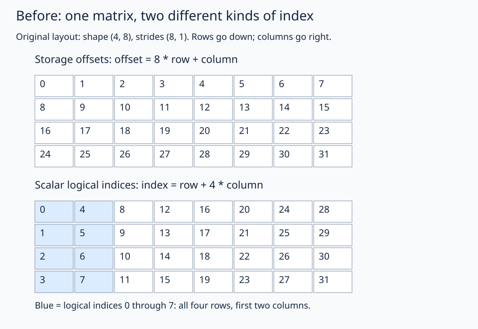
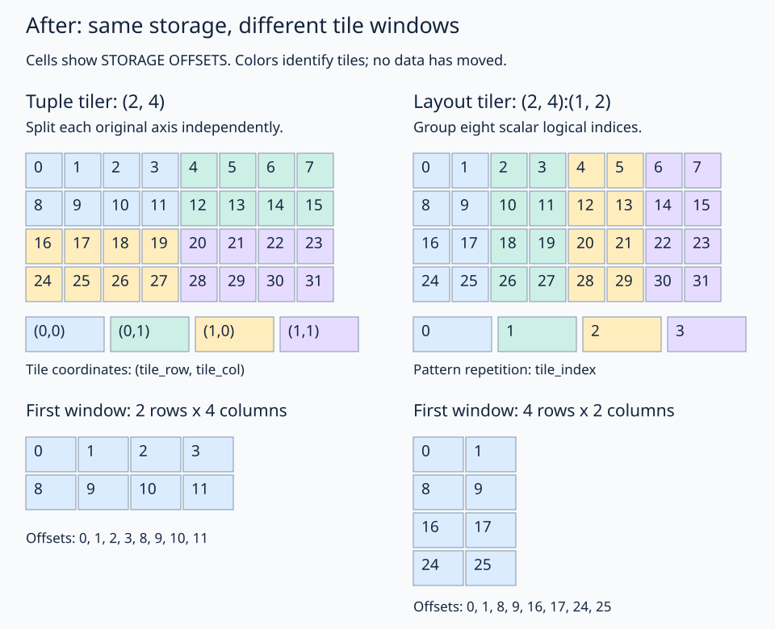

# Tuple tiler versus layout tiler: a visual comparison

Both examples start with **the same matrix** and create four windows of eight elements. The windows cover different positions because the dividers mean different things.

```python
# Inside a FlyDSL tracing context.
original = fx.make_layout((4, 8), (8, 1))

by_axis = fx.logical_divide(original, (2, 4))
by_pattern = fx.logical_divide(original, fx.make_layout((2, 4), (1, 2)))
```

A layout needs strides as well as a shape. This comparison specifically uses `(2,4):(1,2)` for the layout tiler. Changing its strides changes its pattern.

## Before: distinguish logical indices from storage offsets

The original matrix has four rows and eight columns. Its storage mapping is:

```text
storage_offset = 8 * row + column
```

But scalar **logical** indices enumerate the shape first-axis-fastest:

```text
logical_index = row + 4 * column
```

These are two labels for positions in the same matrix. They are not generally the same number.



The highlighted positions in the lower grid are logical indices `0..7`. Their **storage offsets**, read from the upper grid, are `0,8,16,24,1,9,17,25` in logical-index order.

## After: compare the four windows side by side

Every number below is a **storage offset**, not a logical index. Matching colors identify positions in the same tile within each example. The smaller grids isolate each example's first window; they do not represent newly allocated or packed data.



## Left: tuple `(2,4)` splits the original axes

Read the tuple as:

```text
2 positions from the original ROW axis per tile
4 positions from the original COLUMN axis per tile
```

The first tile contains rows `0..1` and columns `0..3`. Each axis gets its own local coordinate and tile coordinate:

```text
row    = local_row + 2 * tile_row
column = local_col + 4 * tile_col

coordinate = ((local_row, tile_row), (local_col, tile_col))
```

FlyDSL returns:

```text
Shape:  ((2,2), (4,2))
Stride: ((8,16), (1,4))
```

There are two tile rows and two tile columns. The blue window is tile `(0,0)`; the purple window is tile `(1,1)`.

**Trace one position:** original `(row=1, column=2)` is local `(1,2)` in tile `(0,0)`. It belongs to the blue window and has offset 10.

## Right: layout `(2,4):(1,2)` selects logical indices

The tiler has its **own** two coordinate axes. They are not automatically the original matrix's row and column axes. Call them `pattern_axis_0` and `pattern_axis_1`:

```text
tiler_index = pattern_axis_0 + 2 * pattern_axis_1
```

For the first window, it selects these scalar logical indices:

| `pattern_axis_0` | `pattern_axis_1=0` | `pattern_axis_1=1` | `pattern_axis_1=2` | `pattern_axis_1=3` |
| --- | --- | --- | --- | --- |
| 0 | 0 | 2 | 4 | 6 |
| 1 | 1 | 3 | 5 | 7 |

These indices go through the **original shape** to find matrix coordinates. They do not go directly to storage:

```text
Tiler emits logical index 6
          ↓ expand through original shape (4,8)
Original coordinate (row=2, column=1)
          ↓ apply original strides (8,1)
Storage offset 17
```

The eight logical positions cover all four rows in columns 0 and 1. The next repetition selects logical indices `8..15`, which cover columns 2 and 3. The remaining repetitions cover columns 4–5 and 6–7.

**Trace the same position as before:** original `(row=1, column=2)` has logical index 9. It belongs to the second window, `tile_index=1`, shown in teal. Its storage offset is still 10.

### Why does the returned layout have extra nesting?

FlyDSL returns:

```text
Shape:  ((2,(2,2)), 4)
Stride: ((8,(16,1)), 2)
```

The outer structure is `(within_pattern, tile_index)`. The first group still has eight positions: `2 * (2*2) = 8`. The final mode has four repetitions.

The tiler's second axis crosses an original row-axis boundary, so FlyDSL splits it into two nested modes. One way to read the resulting coordinate is:

```text
((row_within_pair, (row_pair, local_col)), tile_index)
```

Here `row_within_pair`, `row_pair`, and `local_col` each range from 0 to 1. They reconstruct the original position as:

```text
row    = row_within_pair + 2 * row_pair
column = local_col + 2 * tile_index

offset = 8 * row_within_pair + 16 * row_pair + local_col + 2 * tile_index
```

The nested result describes the blue 4-row × 2-column window and how to repeat it across the matrix. It is not a transpose or a copy of the original data.

## Compare the meanings

| Question | Tuple `(2,4)` | Layout `(2,4):(1,2)` |
| --- | --- | --- |
| What do the two axes describe? | Original row and column modes | The tiler's own logical-index pattern |
| First window in this matrix | Rows 0–1, columns 0–3 | Rows 0–3, columns 0–1 |
| Positions per window | 8 | 8 |
| Window identifiers | `(tile_row, tile_col)` | `tile_index` |
| Is data moved by division? | No | No |

The **same number of positions does not imply the same window**. Choose the tuple when you mean “split these original axes independently.” Choose a layout tiler when you mean “apply this pattern of scalar logical indices.”

These result layouts were compiled and their mappings checked with FlyDSL 0.4.1 on the Radeon 860M. The window geometry above is specific to the chosen original layout and tiler strides.

[Back to logical divide](README.md)

Graphics source: [`tools/draw_divide_comparison.py`](../../../tools/draw_divide_comparison.py). Regenerate with `python tools/draw_divide_comparison.py` from the repository root (requires Pillow). SVGs are embedded here; matching PNG previews are in `assets/`.
