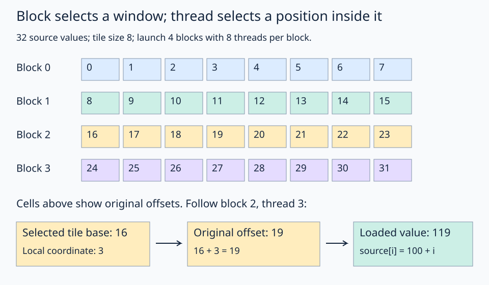

# 06 · Select a block tile

A divided view exposes every tile window. A GPU launch distributes those windows across blocks: the block ID selects one window, and the thread ID selects a position inside it. This lesson follows that two-stage selection through a complete copy.

## From one window to a grid of windows

The input contains 32 float32 values. A tile has 8 values, so launch 4 blocks with 8 threads each. The launch is one-dimensional; the view supplies the window interpretation.



Read one colored row as one selected block window. The block chooses the base; the thread indexes locally within that view.

```python
# source and out already have the needed one-dimensional layouts.
block_id = fx.block_idx.x
tile_layout = fx.make_layout(8, 1)
source_windows = fx.logical_divide(source, tile_layout)
destination_windows = fx.logical_divide(out, tile_layout)
source_tile = fx.slice(source_windows, (None, block_id))
destination_tile = fx.slice(destination_windows, (None, block_id))
```

`source_windows` and `destination_windows` have shape `(8,4)` and strides `(1,8)`. The first coordinate is `local_index`; the second is `block_id`. Fixing the second selects one tile and advances the tensor view's base pointer.

| Block ID | Original indices | Base offset |
| --- | --- | --- |
| 0 | 0–7 | 0 |
| 1 | 8–15 | 8 |
| 2 | 16–23 | 16 |
| 3 | 24–31 | 24 |

The thread layout `fx.make_ordered_layout(8, 0)` is `8:1`. `idx2crd(thread_id, thread_layout)` gives `local_coordinate`. Block 2, thread 3 loads `source_tile[3]`, which reads original offset 19. The base has already moved to 16: do not add it a second time.

After selecting the windows, assign eight local positions to eight threads, then access the selected views:

```python
thread_id = fx.thread_idx.x
thread_layout = fx.make_ordered_layout(8, 0)
local_coordinate = fx.idx2crd(thread_id, thread_layout)
destination_tile[local_coordinate] = source_tile[local_coordinate]
```

The full path is **reuse the incoming views → divide → select this block's tiles → assign local ownership → load and store**. No `make_view` is needed: both incoming tensors already have the correct 1-D indexing. The source and destination views carry their own block offsets, so the kernel does not manually add a base to either access.

The solution copies each loaded value into its corresponding output slot. The input values are `100 + index`, so the checkpoint for block 2 is **116 through 123**, not 16 through 23. This distinguishes loaded data from an offset calculation.

## Practice

Fill `source_windows = fx.logical_divide(source, tile_layout)` and `source_tile = fx.slice(source_windows, (None, block_id))`. The destination setup is supplied. Keep the supplied thread layout and load/store. `solve()` checks the entire copied vector, then returns block 2's values.

**Check yourself:** what does block 3, thread 1 read?

<details><summary>Answer</summary>

Original index 25, value 125. The tile base is 24 and the local index is 1.

</details>

Try tile size 4 in a scratch copy. Update the grid to 8 blocks, the block size to 4, the thread layout, both window layouts, and checkpoint together. This example is evenly divisible; changing only the launch is not sufficient.

## Run and compare

From the repository root in the pinned FlyDSL/ROCm environment:

```bash
pixi run python lessons/00-layout-algebra/06-select-block-tile/practice.py
pixi run python lessons/00-layout-algebra/06-select-block-tile/solution.py
```

In the starter exercise, an incomplete expression raises `Practice not finished` during tracing. Complete the TODOs, run the checker, then compare the [worked solution](solution.py). The supplied launch and checker define the example: the kernel performs the GPU work, while the host prepares buffers and validates the result.

[← Previous lesson](../05-logical-divide/README.md) · [Next lesson →](../07-thread-value-layouts/README.md)
