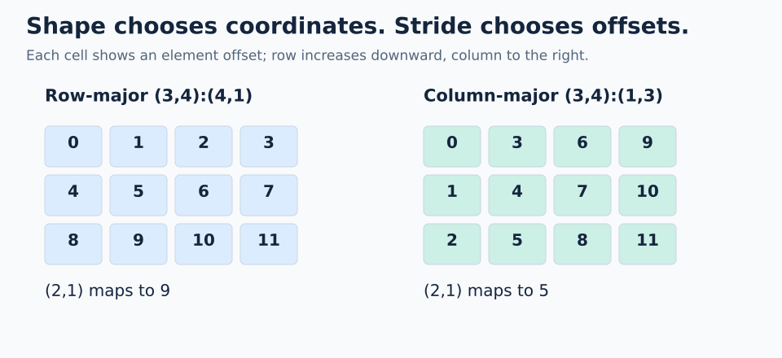

# 00 · Shapes and strides

**Mental model:** shape tells you the valid coordinates; stride tells you the offset change for one step along each coordinate axis.

We write a layout as `Shape:Stride`. For ordinary integer strides:

```text
L = (3,4):(4,1)
L(row,col) = row*4 + col*1
```

The first axis has 3 positions, the second has 4. `(2,1)` maps to `2*4 + 1 = 9`.



## Same shape, different indexing blueprint

| Layout | Step along row | Step along column | Offset of `(2,1)` |
| --- | --- | --- | --- |
| `(3,4):(4,1)` | +4 | +1 | 9 |
| `(3,4):(1,3)` | +1 | +3 | 5 |

We draw the first coordinate vertically and the second horizontally. The stride chooses the memory order; the shape alone does not.

```python
# Inside a FlyDSL tracing context
row_major = fx.make_layout((3, 4), (4, 1))
col_major = fx.make_layout((3, 4), (1, 3))
offset = fx.crd2idx(fx.make_coord(2, 1), row_major)  # 9
```

## Count and span are different

`size(L)` counts logical positions. For the nonnegative integer strides used here, `cosize(L)` is the largest reachable offset plus one.

| Layout | Reachable offsets | Size | Cosize |
| --- | --- | --- | --- |
| `4:1` | 0, 1, 2, 3 | 4 | 4 |
| `4:2` | 0, 2, 4, 6 | 4 | 7 |
| `(2,3):(0,1)` | 0, 1, 2, each twice | 6 | 3 |

Gaps are possible; repeated offsets are possible too. A zero stride means stepping along that axis leaves the offset unchanged.

**Trap:** strides here count elements, not bytes. For a float32 tensor, element offset 9 corresponds to byte displacement 36 from its base pointer. A layout by itself has no dtype or allocation.

**Check yourself:** for `(3,4):(5,1)`, what are `L(2,3)`, size, and cosize?

<details><summary>Answer</summary>

Offset 13, size 12, cosize 14. The row pitch introduces holes at offsets 4 and 9.

</details>

## Practice

Measure every coordinate of `(3,4):(5,1)` with 12 GPU threads. The checkpoint remains `(offset_at_2_3, logical_size, storage_span) = (13,12,14)`.

Open [`practice.py`](practice.py) and complete the numbered TODOs in **`exercise_kernel()`**. All practice files start unfinished. The allocation, launch, stores, and host checker are supplied; the algebra belongs inside the kernel's FlyDSL tracing context.

### Native APIs and output

`fx.make_layout(shape, stride)` constructs the compiler layout. `fx.make_coord(...)` constructs a coordinate; `fx.crd2idx` maps it to an element offset. `fx.get_scalar` extracts a scalar from a FlyDSL integer tuple for storage. Shape and strides are static here, so size and cosize can fold at compile time; the coordinate depends on the GPU thread.

### Complete the kernel

1. Trace `(2,3)` by hand: `2*5 + 3 = 13`. Identify the padding holes at 4 and 9.
2. Fill `element_offset` with `fx.crd2idx(coordinate, layout)`.
3. Fill `logical_size` with `fx.size(layout)` and `storage_span` with `fx.cosize(layout)`.
4. Keep the output stores and host checker. Each output row contains offset, size, and span.

### Run and check

From the repository root, using the [configured GPU environment](../../README.md):

```bash
pixi run python lessons/00-shapes-and-strides/practice.py
pixi run python lessons/00-shapes-and-strides/solution.py
```

An unfinished starter exits with `Practice not finished: ...` during tracing. Fill each TODO with a native API expression, then rerun. A correct exercise prints `Exercise passed:` and its checkpoint. Compare with the commented [worked solution](solution.py) after your attempt.

`@flyc.kernel` traces the device computation; `@flyc.jit` traces its launch. `solve()` allocates a PyTorch GPU output, launches exactly as many threads as there are positions, synchronizes, and copies results to the host for assertions. PyTorch uses the device name `cuda` on ROCm too. These tiny launches need no tail predicate because each thread has one valid output row. General-sized launches will need bounds handling.

### Troubleshooting and another case

If span equals size, revisit the padding holes; span includes the highest offset plus one. Try strides `(4,1)` in a scratch copy and predict which columns change.

Use a scratch copy for extensions and update its launch size and expected results together. Do not replace computations with the expected constants. Static layout construction may fold during compilation; mappings depend on `fx.thread_idx.x` and are checked across the complete small domain.

[Next: coordinates and views →](../01-coordinates-and-views/README.md)
