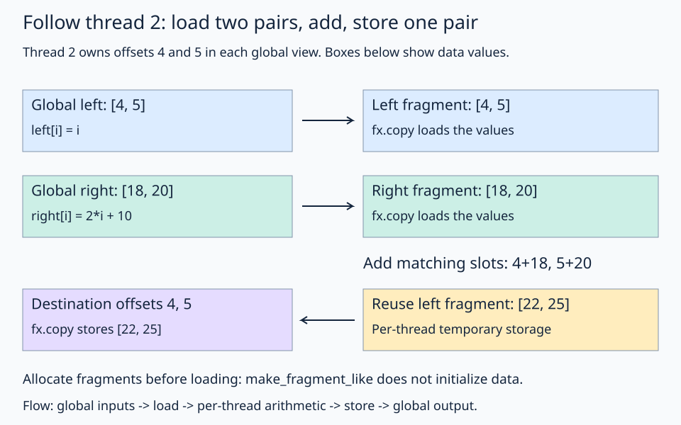

# 09 · Load, compute, and store with register fragments

Arithmetic needs values to work on after a load and before a store. A **register fragment** provides per-thread temporary storage for those values. This lesson loads two input pairs, adds matching slots, and stores the resulting pair. Global views describe the memory accesses; fragments hold the intermediate values.

## 1. Create the three tile views

There is one full tile in each input. The destination holds one full tile too:

```python
tile_layout = fx.make_layout((2, 4), (1, 2))
left_tile = fx.make_view(fx.get_iter(left), tile_layout)
right_tile = fx.make_view(fx.get_iter(right), tile_layout)
destination_tile = fx.make_view(fx.get_iter(out), tile_layout)
```

Each view combines an existing storage pointer with the same indexing rule. These are three separate allocations with corresponding logical positions. No values have been read yet.

## 2. Assign ownership and partition the views

Reuse lesson 08's copy plan, then specialize it to this thread:

```python
thread_copy = plan.get_slice(thread_id)
left_part = thread_copy.partition_S(left_tile)
right_part = thread_copy.partition_S(right_tile)
destination_part = thread_copy.partition_D(destination_tile)
```

`left_part` and `right_part` describe the input positions this thread owns. `destination_part` describes where to write its results. Naming each view separately keeps pointer setup distinct from thread partitioning.

## 3. Follow one thread through load, compute, and store

Reuse lesson 08's tiled copy. Thread 2 owns positions 4 and 5. Inputs are `left[index] = index` and `right[index] = 2*index + 10`.



Follow each input into its fragment, then follow the result back to the destination. The fragment allocation and the copy into it are separate steps.

| Stage | Thread 2's values |
| --- | --- |
| Global left view | Addresses values 4, 5 |
| Global right view | Addresses values 18, 20 |
| Allocate fragments | Storage exists, contents not initialized |
| Copy both inputs to fragments | Registers hold `[4,5]` and `[18,20]` |
| Add corresponding values | Result `[22,25]` |
| Copy result to destination | Output positions 4 and 5 become 22 and 25 |

```python
left_registers = fx.make_fragment_like(left_part)
right_registers = fx.make_fragment_like(right_part)
fx.copy(atom, left_part, left_registers)
fx.copy(atom, right_part, right_registers)
for value_id in range(2):
    left_registers[value_id] = left_registers[value_id] + right_registers[value_id]
fx.copy(atom, left_registers, destination_part)
```

`make_fragment_like` creates suitable fragment storage for the partition. It does not load its values. The kernel reuses the left fragment for the result after its input value has been consumed. Each thread owns its fragment; no inter-thread communication or barrier is needed for this elementwise operation.

Register fragments express storage intent. A compiler may optimize values or spill under register pressure; an allocation in source alone is not proof of physical register usage. Lesson 12 introduces inspecting generated output.

The full sequence is **create views → assign ownership → partition → allocate fragments → load → compute → store**. Only the copies and register arithmetic manipulate values; constructing the global views and partitions does not load them.

## Practice

Fill `result` inside the value loop with the sum of the two register values. Keep both input copies before the loop and the output copy after it. Expected output is `[10,13,16,19,22,25,28,31]`.

**Check yourself:** why can't the first copy from global memory be omitted when `make_fragment_like` was constructed from that global view?

<details><summary>Answer</summary>

The view supplies the fragment's shape/type requirements, not its contents. Reading the fragment before loading or initializing it reads undefined values.

</details>

Try subtraction in a scratch copy and change the host reference accordingly. This lesson has exactly one full tile. Partial tiles need a predicate before any potentially invalid memory access.

## Run and compare

From the repository root in the pinned FlyDSL/ROCm environment:

```bash
pixi run python lessons/01-gpu-programming/09-register-fragments/practice.py
pixi run python lessons/01-gpu-programming/09-register-fragments/solution.py
```

In the starter exercise, an incomplete expression raises `Practice not finished` during tracing. Complete the TODOs, run the checker, then compare the [worked solution](solution.py). The supplied launch and checker define the example: the kernel performs the GPU work, while the host prepares buffers and validates the result.

[← Previous lesson](../08-tiled-copy/README.md) · [Next lesson →](../10-predicates-and-tails/README.md)
