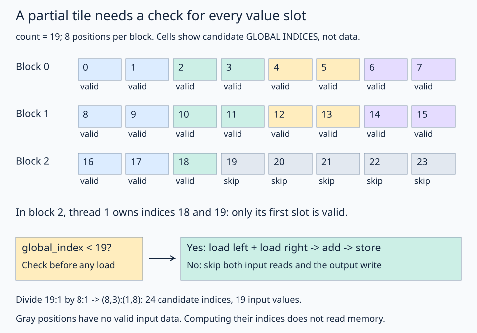

# 10 · Protect the last partial tile

When the element count is not a multiple of the tile size, the final block has only part of a tile to process. For **19 elements and 8-element tiles**, three blocks cover the work, but only three positions in the last block are valid. Use a per-value predicate to guard every input read and output write.



The last row makes the boundary visible: thread 1 straddles it, so check each value slot separately. Gray cells describe candidate indices with no valid input element.

## Follow the kernel in order

1. Reuse `left`, `right`, and `out` as memory views: their incoming contiguous 1-D layouts already fit the computation.
2. Create a separate coordinate-only view, divide it, and select this block's coordinate window.
3. Apply the `(thread_id, value_id)` ownership layout to find local positions and their global indices.
4. Check whether each global index is valid.
5. Inside that bounds branch, load the two input values, add them, and store the result.

The coordinate view is only for deriving indices. Its padded shape does **not** enlarge either input allocation. Real reads and writes use the original memory views after the predicate succeeds. This avoids creating padded data views that could look safe to read unconditionally.

## Coordinates can be a tensor without an allocation

```python
coordinate_layout = fx.make_layout(24, 1)
index_origin = fx.make_int_tuple(0)
coordinates = fx.make_view(index_origin, coordinate_layout)
coordinate_tiles = fx.logical_divide(coordinates, fx.make_layout(8, 1))
block_coordinates = fx.slice(coordinate_tiles, (None, block_id))
```

`coordinate_layout` describes indexing. `index_origin` is an integer iterator, not a memory pointer: it starts at zero. Indexing this coordinate view produces an index, rather than loading a float from memory. Its padded domain covers the launch: 24 positions. This makes it possible to ask which positions are valid without accessing either input allocation.

Use ownership `(4,2):(2,1)` to get each thread's local positions, then index `block_coordinates` to obtain their global indices.

| Thread in block 2 | Global indices | Valid for count 19 |
| --- | --- | --- |
| 0 | 16, 17 | Both |
| 1 | 18, 19 | Only 18 |
| 2 | 20, 21 | Neither |
| 3 | 22, 23 | Neither |

The predicate is `global_index < count`. All indices here are nonnegative by construction. In particular, thread 1 needs a **per-value** predicate; one boolean for the entire thread would be insufficient.

## Guard the reads and the write

The solution emits a native structured-control-flow branch around the two loads, addition, and store. It uses `scf.IfOp`, an IR insertion point, and `scf.yield_` from the MLIR bindings shipped with FlyDSL 0.4.1. These are low-level compiler APIs, provided in the scaffold so the exercise stays focused on the predicate. A Python `if` in this directly traced kernel cannot choose a branch based on a runtime GPU value.

The important placement is:

```text
if global_index < count, on the GPU:
    load left[global_index]
    load right[global_index]
    add the loaded values
    store out[global_index]
```

Do not load first and only guard the store. An output allocation with spare capacity does not make reads beyond the two exact-sized input allocations valid.

## Practice

Fill `valid` with the bound comparison. Keep all memory accesses inside the supplied branch. The checker uses exact-sized input arrays and eight sentinel output elements after the logical result. It checks the 19 sums and verifies the sentinels are unchanged.

Sentinels detect invalid writes; they do not prove the absence of every invalid read. The code structure supplies that guarantee here: both loads are inside the same bounds branch. All valid positions have exactly one owner under the thread/value layout.

**Check yourself:** what predicate would `global_index <= count` produce for index 19?

<details><summary>Answer</summary>

True, incorrectly. The last valid index is 18. An array of count elements has valid indices from 0 to count minus one.

</details>

This deliberately uses scalar guarded loads rather than applying a wide unmasked copy atom to a partial tile. Lesson 11 combines the same predicate with a complete vector-add launch.

## Run and compare

From the repository root in the pinned FlyDSL/ROCm environment:

```bash
pixi run python lessons/01-gpu-programming/10-predicates-and-tails/practice.py
pixi run python lessons/01-gpu-programming/10-predicates-and-tails/solution.py
```

In the starter exercise, an incomplete expression raises `Practice not finished` during tracing. Complete the TODOs, run the checker, then compare the [worked solution](solution.py). The supplied launch and checker define the example: the kernel performs the GPU work, while the host prepares buffers and validates the result.

[← Previous lesson](../09-register-fragments/README.md) · [Next lesson →](../11-vector-addition/README.md)
