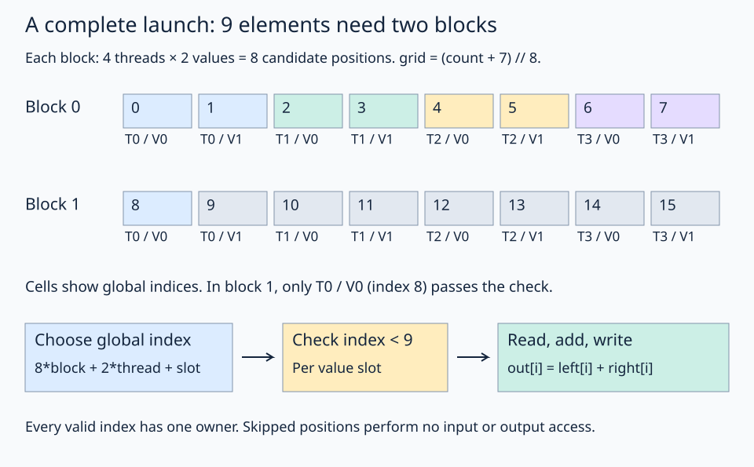

# 11 · Launch a bounds-safe vector addition

Vector addition brings the preceding steps together: select a block's coordinate window, assign positions to thread/value slots, check each index, then compute `out[index] = left[index] + right[index]`. Follow a nine-element input to see how one launch handles both a full tile and a partial tile.



Use count 9 to trace the whole launch. Colors identify thread owners within each block; `V0` and `V1` identify their two slots. Only positions that pass the per-value check reach the arithmetic.

## Follow the kernel in order

1. Reuse `left`, `right`, and `out` as memory views: their incoming contiguous 1-D layouts already fit the computation.
2. Create a separate coordinate-only view, divide it, and select this block's coordinate window.
3. Apply the `(thread_id, value_id)` ownership layout to find local positions and their global indices.
4. Check whether each global index is valid.
5. Inside that bounds branch, load the two input values, add them, and store the result.

The coordinate view is only for deriving indices. Its padded shape does **not** enlarge either input allocation. Real reads and writes use the original memory views after the predicate succeeds. This avoids creating padded data views that could look safe to read unconditionally.

## The launch and input contract

| Layer | Responsibility |
| --- | --- |
| Host `solve()` | Allocate contiguous float32 inputs and output; choose count; compare results |
| `@flyc.jit run` | Convert PyTorch arguments through FlyDSL's runtime and launch enough blocks |
| `@flyc.kernel` | Build coordinate tiles and compute each thread's owned positions |
| Bounds branch | Allow input loads and output stores only for valid indices |

The block has four threads and each thread owns two values. Therefore `grid = ((count + 7) // 8, 1, 1)` covers count elements. Count is passed as `fx.Constexpr`, so this lesson specializes compiled code to each tested count. It is not demonstrating one dynamically shaped binary for all sizes.

Inputs are contiguous one-dimensional float32 tensors on the same GPU. The lesson allocates them that way. Supporting arbitrary strides, dtypes, overlapping inputs/outputs, or empty inputs would need an explicit extended contract; the worked examples use positive counts and distinct output storage.

## Why the tail-safe path uses scalar accesses

Lesson 09 demonstrates full-tile copies into register fragments. Here each thread's individual values may cross the boundary, so the kernel uses lesson 10's native per-value branch around scalar loads and stores. Values loaded this way are GPU computation values too; a fragment allocation is not required for every arithmetic operation.

This is the simple correct path for both full tiles and tails. A later optimization can use tiled copies for full blocks and dispatch a separate guarded tail path. Do not make a wide copy cross the end of an input merely because most of its values are valid.

## Practice

Fill `result` with `left[global_index] + right[global_index]` **inside** the guarded region. Keep the launch and predicate unchanged. The checker tests counts `1,7,8,9,19,32,257,4099`, including tiny inputs, exact tile boundaries, and partial final blocks. It checks results against PyTorch and verifies eight sentinel output elements after each result.

At count 9, block 1 has only index 8 valid: thread 0's first value. The other seven potential positions must perform no input load or output store.

**Check yourself:** how many blocks are required for 257 elements, and how many values are valid in the last block?

<details><summary>Answer</summary>

33 blocks. The first 32 cover 256 elements; the final block has only index 256 valid.

</details>

This is a correctness-oriented teaching kernel, not a tuned vector-add implementation. The next lesson changes a controlled copy parameter and measures the result separately from compilation.

## Run and compare

From the repository root in the pinned FlyDSL/ROCm environment:

```bash
pixi run python lessons/01-gpu-programming/11-vector-addition/practice.py
pixi run python lessons/01-gpu-programming/11-vector-addition/solution.py
```

In the starter exercise, an incomplete expression raises `Practice not finished` during tracing. Complete the TODOs, run the checker, then compare the [worked solution](solution.py). The supplied launch and checker define the example: the kernel performs the GPU work, while the host prepares buffers and validates the result.

[← Previous lesson](../10-predicates-and-tails/README.md) · [Next lesson →](../12-inspect-and-tune/README.md)
