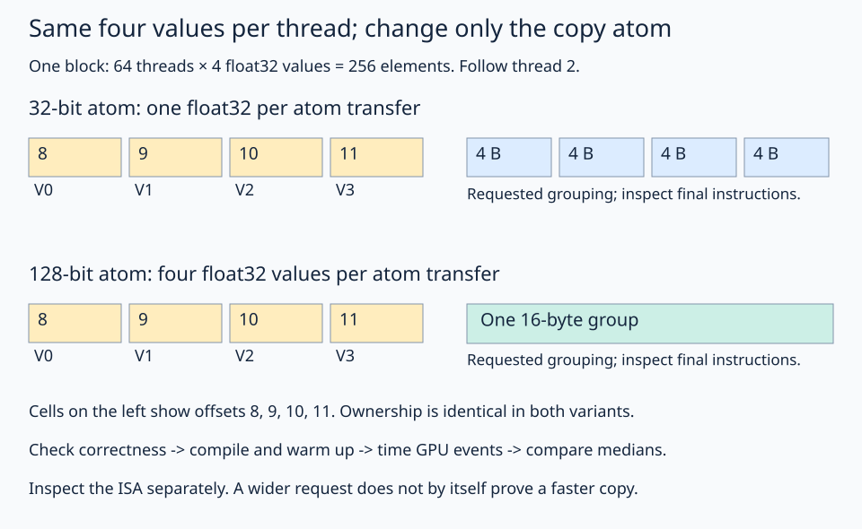

# 12 · Inspect generated code and measure copy widths

Copy width is a parameter that can be studied while keeping ownership and input size fixed. This lesson compares 32-bit and 128-bit copy atoms in three steps: check both results, inspect the generated memory instructions, and measure execution with GPU events. Use those observations to explain the behavior of each specialization.

## Follow the same view-to-copy flow

The inputs already have contiguous 1-D layouts. First expose their 256-element windows, then select this block's windows:

```python
window_layout = fx.make_layout(256, 1)
source_windows = fx.logical_divide(source, window_layout)
destination_windows = fx.logical_divide(out, window_layout)
source_window = fx.slice(source_windows, (None, block_id))
destination_window = fx.slice(destination_windows, (None, block_id))
```

Next give each selected window the indexing expected by the copy plan:

```python
tile_layout = fx.make_layout((4, 64), (1, 4))
source_tile = fx.make_view(fx.get_iter(source_window), tile_layout)
destination_tile = fx.make_view(fx.get_iter(destination_window), tile_layout)
```

These pointers already include the selected block's offset. `make_view` changes the indexing of each 256-element window; it does not copy data or add the block offset again.

Finally build ownership and the copy atom, partition `source_tile` and `destination_tile` into `source_part` and `destination_part`, and call `fx.copy(atom, source_part, destination_part)`. Each stage has a named intermediate; the read/write happens at the final copy.

## Hold ownership constant

Each block has 64 threads and owns 256 float32 values. Each thread owns four adjacent values. `make_layout_tv` combines thread shape `(1,64)` and value shape `(4,1)` into tile shape `(4,64)` and adjacent thread/value ownership.

Both variants copy the same values. The parameter `width` only changes the requested atom:

```python
atom = fx.make_copy_atom(fx.UniversalCopy(width), fx.Float32)
```

32 bits is one float32; 128 bits is four float32 values, or 16 bytes. The test uses aligned PyTorch allocations, contiguous per-thread groups, block offsets that are multiples of 256 elements, and a count divisible by 256. These conditions matter. This example does not attempt a wide copy on an arbitrary misaligned slice or a partial tail.



Both rows assign the same four positions to thread 2. The diagram changes the requested transfer grouping while keeping ownership fixed; generated instructions and timings supply the evidence about the result.

## Practice

Fill `atom` with the expression above. The checker compares each variant's complete output against the source before timing. Keep that correctness check when experimenting.

The benchmark warms up each specialization, then takes the median of five batches of 20 launches using GPU events. Compilation occurs before timing. Effective bandwidth is `2 * count * sizeof(float32) / elapsed_seconds`, counting one read and one write. It is an application-level byte rate, not a measurement of physical DRAM transactions.

Repeated buffers can be cached. Event intervals can include gaps between host launches, and GPU clocks, contention, and thermal state affect results. There is deliberately no assertion that one width must win. Repeat runs and compare distributions before making a performance claim.

## Inspect what actually compiled

From the repository root:

```bash
FLYDSL_DUMP_IR=1 FLYDSL_DUMP_DIR=/tmp/flydsl-lesson12-isa/32 \
  pixi run python lessons/01-gpu-programming/12-inspect-and-tune/solution.py --width 32
FLYDSL_DUMP_IR=1 FLYDSL_DUMP_DIR=/tmp/flydsl-lesson12-isa/128 \
  pixi run python lessons/01-gpu-programming/12-inspect-and-tune/solution.py --width 128
rg --files /tmp/flydsl-lesson12-isa
rg 'global_load|global_store|buffer_load|buffer_store' /tmp/flydsl-lesson12-isa -g '*.s'
```

FlyDSL's dump includes intermediate IR and, when available, final GPU assembly. Use separate processes and dump directories, as above: specializations share a kernel name and can overwrite each other's dumps in one directory. Inspect the specializations separately: first find their copy operations and requested widths in the early IR, then follow lowering to the final memory instructions. A requested copy width is not proof of a particular instruction until you inspect the generated output. The compiler can combine or simplify operations.

### Observed instructions on the reference GPU

Validated on Radeon 860M (`gfx1152`), FlyDSL 0.4.1, ROCm 10. The separate final-ISA dumps showed:

| Requested atom | Memory instructions per thread for four float32 values |
| --- | --- |
| 32 bits | Four `global_load_b32` and four `global_store_b32` instructions |
| 128 bits | One `global_load_b128` and one `global_store_b128` instruction |

This establishes that the two tested specializations generated different memory instructions. It does not predict the winner for every buffer size or GPU.

Record GPU name, FlyDSL version, element count, atom width, timing method, median time, and observed memory instructions. The measured values are hardware- and run-specific; do not copy one run's bandwidth into a general claim.

**Check yourself:** does doubling reported effective bandwidth prove that the GPU doubled its DRAM bandwidth?

<details><summary>Answer</summary>

No. It describes elapsed time for this workload and byte-count convention. Caches, launch gaps, instruction count, and other effects can change it without doubling physical DRAM traffic.

</details>

For another experiment, vary the buffer size while preserving divisibility and alignment. Separate the question of ownership from the question of atom width; changing both at once makes it harder to explain the result.

## Run and compare

From the repository root in the pinned FlyDSL/ROCm environment:

```bash
pixi run python lessons/01-gpu-programming/12-inspect-and-tune/practice.py
pixi run python lessons/01-gpu-programming/12-inspect-and-tune/solution.py
```

In the starter exercise, an incomplete expression raises `Practice not finished` during tracing. Complete the TODOs, run the checker, then compare the [worked solution](solution.py). The supplied launch and checker define the example: the kernel performs the GPU work, while the host prepares buffers and validates the result.

[← Previous lesson](../11-vector-addition/README.md)
