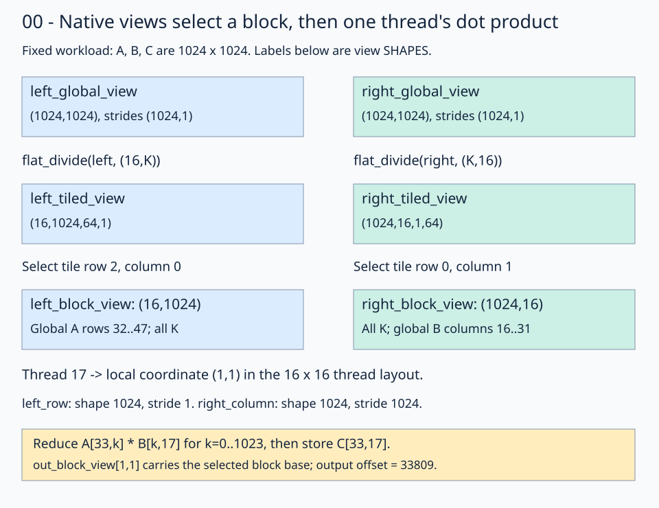
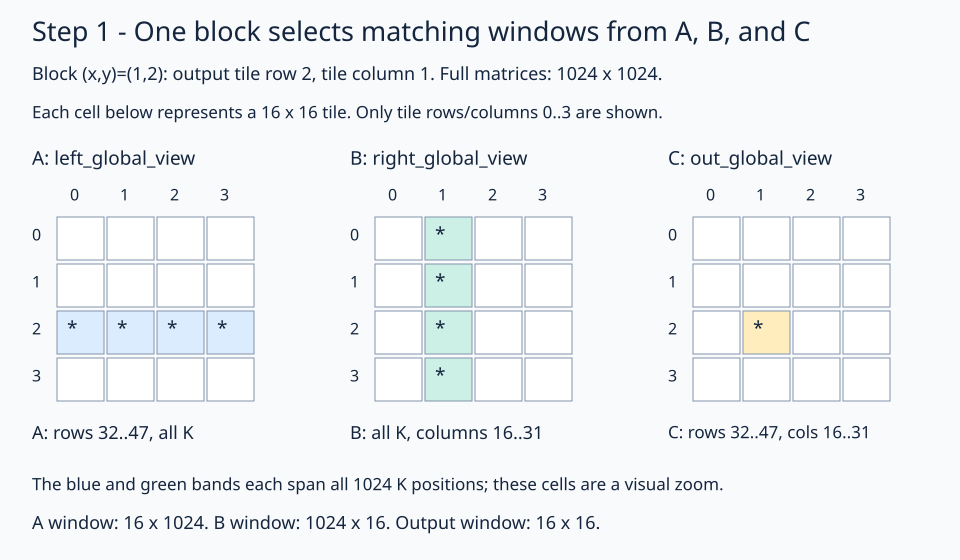
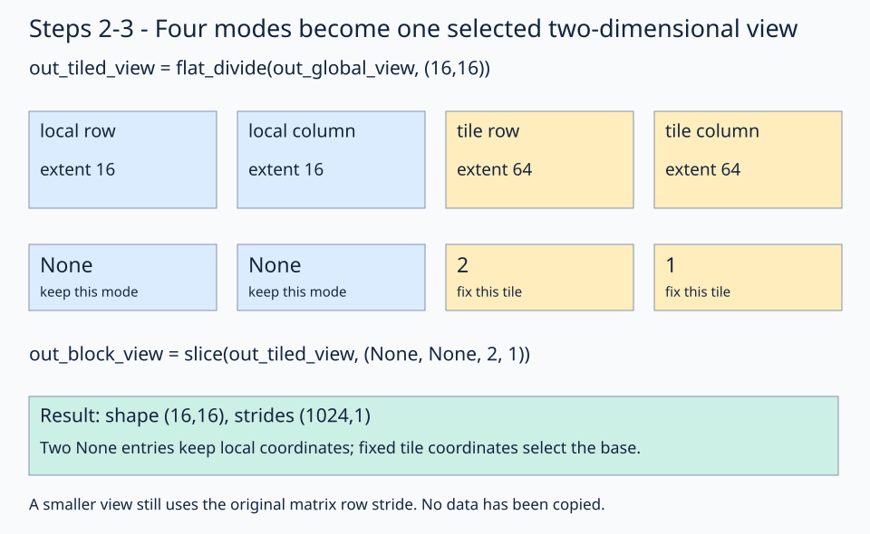
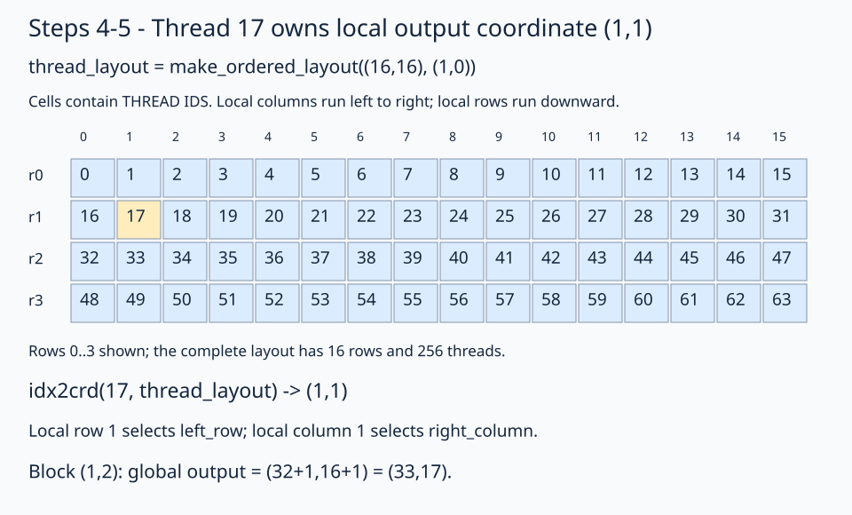
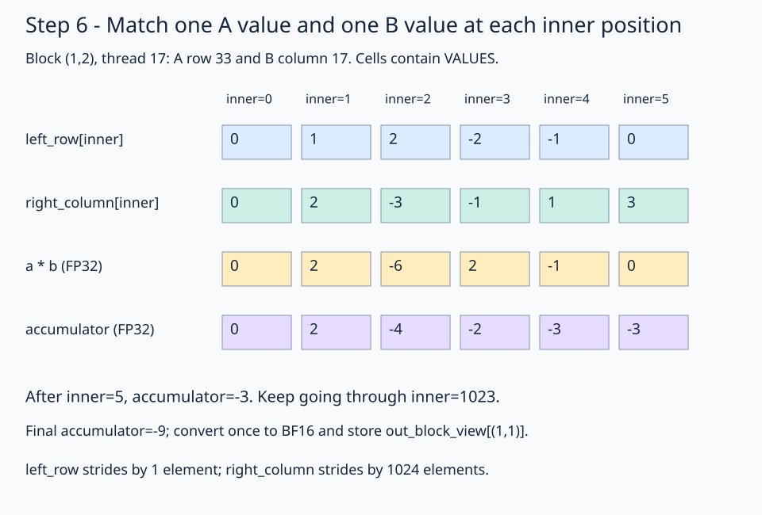

# 00 · Compute BF16 matmul through native tiled views

Matrix multiplication combines a row of A with a column of B. For `A[M,K]`, `B[K,N]`, and `C[M,N]`, output `(r,c)` is `sum(A[r,inner] * B[inner,c])` over K. This lesson computes **M=N=K=1024**, using row-major BF16 inputs/output and FP32 arithmetic inside each thread's dot product.

For the walkthrough, keep three names in mind: **A is `left`, B is `right`, and C is `out`**. Rows run downward and columns run to the right. M counts output rows, N counts output columns, and K counts the pairs multiplied to make one output.

We will follow **one block, `(x,y)=(1,2)`, and one thread, ID 17**, from the start of the kernel to its final store. Its job is:

```text
C[33,17] = A[33,0] * B[0,17]
         + A[33,1] * B[1,17]
         + ...
         + A[33,1023] * B[1023,17]
```

That is one output value, built from 1024 matching pairs. The other 255 threads in the block compute the other positions in its output tile.

The kernel describes the access path with native FlyDSL layouts and views:

```text
global matrix views -> tiled views -> selected block views
                    -> thread row and column views -> loads, math, store
```

A block owns a 16×16 output tile. Its 256 threads each own one output, so the launch uses a 64×64 block grid. The computation is naive because every output performs its own full dot product directly from global memory; this version has no LDS staging, cross-thread input reuse, or matrix instructions. Native tiling describes ownership and access even in a simple kernel.

Prerequisites: [block tile selection](../../../../lessons/00-layout-algebra/06-select-block-tile/README.md), [flat division](../../../../lessons/00-layout-algebra/05-logical-divide/04-flat/README.md), and [inspect and measure](../../12-inspect-and-tune/README.md).

<details>
<summary>See the whole view hierarchy before walking through the code</summary>



Follow block `(block_x,block_y)=(1,2)` and thread 17 through the figure. Shape labels describe coordinate domains, not arrays of copied values. The final global output coordinate is `(33,17)`.

</details>

## 1. Describe the global matrices

Start with the three full matrices. In this picture each small square represents a 16×16 region, not a scalar element. The stars mark the regions our block needs. Only the first four tile rows and columns are drawn; the full matrices have 64 of each.



Read the picture from left to right: the block needs A rows 32–47 and B columns 16–31 to produce C rows 32–47, columns 16–31. A and B each span the full reduction axis.

`fx.get_iter(left)` supplies the storage iterator. A layout supplies the coordinate-to-element-offset rule; `fx.make_view` combines them:

```python
left_global_view = fx.make_view(fx.get_iter(left), fx.make_layout((m, k), (k, 1)))
right_global_view = fx.make_view(fx.get_iter(right), fx.make_layout((k, n), (n, 1)))
out_global_view = fx.make_view(fx.get_iter(out), fx.make_layout((m, n), (n, 1)))
```

| View | Logical coordinates | Shape | Strides in elements |
| --- | --- | --- | --- |
| `left_global_view` | `(row, inner)` | `(M,K)` | `(K,1)` |
| `right_global_view` | `(inner, column)` | `(K,N)` | `(N,1)` |
| `out_global_view` | `(row, column)` | `(M,N)` | `(N,1)` |

At 1024³, each row stride is 1024 elements and each column stride is 1. BF16 occupies two bytes per element, but layout strides and indexing here use **elements**, not bytes. Creating these views does not load, transpose, or copy any matrix data.

**After this code:** each name describes how to address the original matrix. No per-thread input values have been loaded yet.

## 2. Expose the tiled coordinate domains

A block needs 16 A rows over the **entire K axis**, 16 B columns over the entire K axis, and a 16×16 output window:

```python
left_tiled_view = fx.flat_divide(left_global_view, (16, k))
right_tiled_view = fx.flat_divide(right_global_view, (k, 16))
out_tiled_view = fx.flat_divide(out_global_view, (16, 16))
```

A **mode** is one coordinate position in a shape. For a two-dimensional input, `flat_divide` exposes four top-level modes:

```text
(local_axis_0, local_axis_1, tile_axis_0, tile_axis_1)
```

| Tiled view | Shape at 1024³ | Meaning of its four coordinates |
| --- | --- | --- |
| `left_tiled_view` | `(16,1024,64,1)` | `(local_row, inner, tile_row, tile_k)` |
| `right_tiled_view` | `(1024,16,1,64)` | `(inner, local_column, tile_k, tile_column)` |
| `out_tiled_view` | `(16,16,64,64)` | `(local_row, local_column, tile_row, tile_column)` |

These are **tiled tensor views**, each with one storage iterator and a structured layout. They are not Python lists of separately allocated tiles. “Flat” means the four modes appear at the top level, rather than being grouped into nested coordinate pairs; it does not mean the result is a contiguous one-dimensional buffer.

The K tile coordinate has extent 1 for both inputs because the tilers already span all 1024 reduction positions. This kernel tiles M and N across blocks; it does **not** split K into 16-wide stages. The per-thread reduction still visits all 1024 values.

## 3. Select this block's views

Grid x selects output tile columns; grid y selects output tile rows:

```python
block_row = fx.block_idx.y
block_col = fx.block_idx.x
left_block_view = fx.slice(left_tiled_view, (None, None, block_row, 0))
right_block_view = fx.slice(right_tiled_view, (None, None, 0, block_col))
out_block_view = fx.slice(out_tiled_view, (None, None, block_row, block_col))
```



Read one column of the picture at a time. The first two coordinates are `None`, so local row and column remain available. The final two coordinates are fixed to 2 and 1, so this view addresses only that block's output window.

Each `None` retains a local mode. Fixing the final two coordinates selects the tile and removes those tile modes from the returned view.

| Selected view | Shape | Strides in elements | Selected data for block `(1,2)` |
| --- | --- | --- | --- |
| `left_block_view` | `(16,1024)` | `(1024,1)` | A rows 32–47, all K |
| `right_block_view` | `(1024,16)` | `(1024,1)` | All K, B columns 16–31 |
| `out_block_view` | `(16,16)` | `(1024,1)` | C rows 32–47, columns 16–31 |

The output window has only 16 columns, but its row stride remains **1024**, not 16. It is a window into the original matrix, not a new packed tile. Slicing carries the selected base offset forward; later indexing must not add that block displacement again.

**After this code:** `out_block_view` is our selected 16×16 output window. We still need to choose which of those 256 positions belongs to this thread.

## 4. Assign the 256 threads with a layout

The thread layout is separate from the matrix storage layout:

```python
thread_layout = fx.make_ordered_layout((16, 16), (1, 0))
thread_coordinate = fx.idx2crd(fx.thread_idx.x, thread_layout)
```



Find the gold cell: thread 17 sits at local `(1,1)`. These cell labels are **thread IDs**, not matrix values. Follow the same row across: thread IDs increase as columns increase.

`thread_layout` maps local `(row,column)` coordinates to thread IDs. Order `(1,0)` makes the column axis fastest, producing strides `(16,1)`. `idx2crd` inverts that mapping so each thread gets its local output coordinate.

| Thread ID | `thread_coordinate` |
| ---: | --- |
| 0 | `(0,0)` |
| 1 | `(0,1)` |
| 15 | `(0,15)` |
| 16 | `(1,0)` |
| 17 | `(1,1)` |
| 255 | `(15,15)` |

These thread strides describe **ownership**, not matrix storage. The output block still has storage strides `(1024,1)`. `fx.make_layout_tv` is unnecessary here: each thread owns one output coordinate, with no additional per-thread value dimension.

## 5. Select each thread's row and column

Use the local output coordinate to slice the selected block views:

```python
left_row = fx.slice(left_block_view, (thread_coordinate[0], None))
right_column = fx.slice(right_block_view, (None, thread_coordinate[1]))
```

For our thread, read the two slices as:

```text
left_block_view[local row 1, all K]    -> left_row
right_block_view[all K, local col 1]   -> right_column
```

The two `None` positions are different: the A slice keeps its column/reduction axis, while the B slice keeps its row/reduction axis. Both resulting views have shape `1024`. `left_row` has stride 1, while `right_column` has stride 1024: consecutive reduction positions advance across an A row and down a B column.

For block `(1,2)`, thread 17 has local coordinate `(1,1)`. It selects global A row `32+1=33` and global B column `16+1=17`. At `inner=5`, the loads read A coordinate `(33,5)` and B coordinate `(5,17)`. Their global element offsets are 33797 and 5137. Those offsets explain the layout's result; the kernel does not need to calculate them manually.

**After this code:** thread 17 has two one-dimensional views—global A row 33 and global B column 17. Selecting them has not performed the dot product.

## 6. Load scalar values and reduce in FP32

```python
accumulator = fx.Float32(0)
for inner in range(k):
    a = fx.Float32(left_row[inner])
    b = fx.Float32(right_column[inner])
    accumulator = accumulator + a * b
out_block_view[thread_coordinate] = accumulator.to(fx.BFloat16)
```



Read **down one column** to follow one loop iteration: load the A value, load the matching B value, multiply, then add to the running sum. Read the bottom row **left to right** to follow the accumulator. At `inner=2`, the product is `2 * -3 = -6`, which changes the sum from 2 to -4. The picture stops after six terms for readability; the actual loop continues through `inner=1023` and finishes at -9.

All view operations above describe accesses. The scalar expressions `left_row[inner]` and `right_column[inner]` actually request loads. They return BF16 values; the explicit conversions widen them **before** multiplication. Converting `a*b` afterward would preserve the rounding already incurred by a BF16 product. The accumulator remains FP32 across the entire reduction and is converted once for the final BF16 store.

An explicit `fx.copy` atom is not needed to request these scalar loads. Copy atoms become useful when transferring register fragments or specifying wider grouped transfers. A register fragment is a storage/ownership choice, not a prerequisite for every scalar arithmetic expression.

### Store the result at this thread's local position

```python
out_block_view[thread_coordinate] = accumulator.to(fx.BFloat16)
```

For thread 17, this is `out_block_view[(1,1)] = -9` under the trace inputs. The view already addresses the correct block, so the store reaches global `C[33,17]`. It does not write global `C[1,1]`.

The store uses the local coordinate through `out_block_view`. For the running trace, its selected base offset is `32*1024+16=32784`, and local `(1,1)` contributes `1*1024+1=1025`. The final output offset is 33809, corresponding to global `C[33,17]`.

Scalar indexing of a multidimensional view is a **logical coordinate**, not necessarily a flat storage offset. For example, `out_block_view[1]` expands first-mode-fastest to local `(1,0)`, whereas `out_block_view[(0,1)]` selects the next column. The kernel avoids that ambiguity by passing `thread_coordinate` explicitly. After slicing to a one-dimensional row or column, `inner` has one clear logical mode.


For this second trace, block `(0,0)`, thread 1 owns `C[0,1]`. The first 16 products contribute 4; continuing through all 1024 positions gives -6 for the supplied trace pattern. The picture shows input values, not offsets or thread IDs.

## Track what each name means

Use this table as a checkpoint while reading the kernel. All shapes are for the fixed 1024³ problem.

| After calling… | Name to inspect | Shape | Meaning for our thread/block |
| --- | --- | --- | --- |
| `make_view` | `left_global_view` | `(1024,1024)` | The full A matrix |
| `flat_divide` | `left_tiled_view` | `(16,1024,64,1)` | Local A coordinates plus tile coordinates |
| `slice` | `left_block_view` | `(16,1024)` | A rows 32–47, all K |
| `idx2crd` | `thread_coordinate` | Two-coordinate tuple | Local output position `(1,1)` |
| `slice` | `left_row` | `1024` | A row 33, with element stride 1 |
| `slice` | `right_column` | `1024` | B column 17, with element stride 1024 |
| Scalar indexing and conversion | `a`, `b` | One FP32 value each | The current matching pair |
| Repeated multiply/add | `accumulator` | One FP32 value | The running dot-product sum |
| Indexed assignment | `out_block_view[thread_coordinate]` | One output position | BF16 result at global C `(33,17)` |

View creation, division, slicing, and coordinate decoding establish addressing and ownership. Scalar indexing requests the data loads; indexed assignment requests the store. That distinction is what lets the kernel express tiling without manually recomputing every global offset.

## Practice and checkpoint

`practice.py` uses the same native-view structure and names as the worked solution. Its numbered load expressions are `a = fx.Float32(left_row[inner])` and `b = fx.Float32(right_column[inner])`. Keep the selected views, FP32 accumulator, output store, and checker together when experimenting. A load left as `None` reports `Practice not finished: ...`; the completed expressions produce `Exercise passed: ...`. Diagnostic Python `print` calls inside the kernel run during tracing, not once for every GPU thread; their displayed layouts may therefore appear only when a specialization compiles.

Both programs evaluate every one of the 1,048,576 outputs for two input patterns at **1024³**. The trace inputs use `A[r,inner]=((r*1024+inner)%5)-2` and `B[inner,c]=((inner*1024+c)%7)-3`; output row 0 begins `[3,-6,-1,-3]`. A second pattern uses seeded random inputs quantized to BF16. The independent CPU FP32 reference uses those quantized values and rounds its result to BF16. Trace tolerance is `rtol=0, atol=0.001`; random tolerance is `rtol=0.016, atol=0.03125`. These tolerances accommodate the course's different accumulation implementations; they do not establish arbitrary-input accuracy.

Output data starts as NaN to catch missing writes, and sixteen trailing sentinels must remain unchanged. All dimensions divide evenly into the block tiles; no tails or general strided host tensors are supported here.

The [next lesson](../01-coalesced-access/README.md) keeps this native tiling and thread ownership but packs B column-major, making the per-thread K walk contiguous for both inputs. It distinguishes that property from coalesced requests across neighboring lanes.

## Compare this kernel with GPU PyTorch

Running this lesson's solution, or a completed practice, prints a timing table after the correctness checkpoint. The two rows compare **this file's kernel** with **GPU `torch.matmul`**, reporting milliseconds and effective TFLOP/s. A completed practice benchmarks your implementation, not the worked solution. Both implementations use the same 1024×1024 BF16 GPU inputs and preallocated BF16 GPU output; CPU reference arithmetic and allocations stay outside timing.

```bash
pixi run python lessons/01-gpu-programming/13-matmul/00-naive/solution.py
# Select the timing method explicitly or skip performance measurement:
pixi run python lessons/01-gpu-programming/13-matmul/00-naive/solution.py --timing host
pixi run python lessons/01-gpu-programming/13-matmul/00-naive/practice.py --check-only
```

The default `--timing auto` tries GPU events first. If either row has an unavailable event duration, **both rows** are retimed with synchronized host batches, and the fallback is printed. Host timing still runs GPU computation but includes dispatch and synchronization overhead. `--timing gpu-event` disables fallback and reports unavailable values if events return zero. Each implementation gets three warm-ups and five batches of 20 launches; `--repeats` changes launches per batch. TFLOP/s is `2 * 1024**3 / (milliseconds * 1e9)`. Higher throughput means less time for this fixed operation count; it does not imply a universal speedup.

`pixi run gpu-check` and `pixi run lessons-check` run correctness only for the matmul stages. For the full-series comparison and measurement limits, see the [benchmark guide](../README.md#compare-the-stages).

**Check yourself:** After selecting `out_block_view`, should its store add `block_row*16` and `block_col*16` to `thread_coordinate`?

<details><summary>Answer</summary>

No. Slicing the tiled view has already selected the block base. `thread_coordinate` is local to that 16×16 block view. Adding the block displacement again would select a different location or go out of bounds. The retained row stride of 1024 handles movement between local rows.

</details>

Run from the repository root:

```bash
pixi run python lessons/01-gpu-programming/13-matmul/00-naive/practice.py
pixi run python lessons/01-gpu-programming/13-matmul/00-naive/solution.py
```

A completed practice prints `Exercise passed:` with `shapes_MNK: [(1024, 1024, 1024)]`, two patterns, and the first-four checkpoint. Compare your implementation with the [worked solution](solution.py).

[Previous](../../12-inspect-and-tune/README.md) · [Matmul series](../README.md) · [Next](../01-coalesced-access/README.md)

Sources: [FlyDSL 0.4.1 kernel guide](https://github.com/ROCm/FlyDSL/blob/888d7d80528f0cf2abab8a86610d5ccca47f205d/docs/kernel_authoring_guide.md). API expressions were checked against the installed 0.4.1 package.
