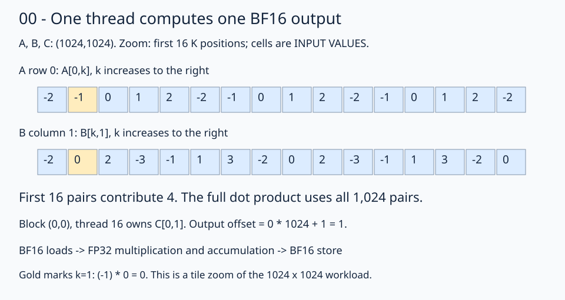

# 00 · Compute a BF16 matrix product one output at a time

Matrix multiplication combines an A row with a B column. For `A[M,K]`, `B[K,N]`, and `C[M,N]`, output `(r,c)` is `sum(A[r,k] * B[k,c])` over the K axis. Begin after [inspect and measure](../../12-inspect-and-tune/README.md): this lesson assembles a correct GPU kernel before changing its access pattern.

The full problem is **1024 × 1024 × 1024**. Each block computes a 16×16 output tile; the grid has 64 columns and 64 rows of blocks. A block launches 256 threads, each responsible for one output. The diagram zooms into the first 16 terms of one dot product; it does not replace the full workload with a smaller multiplication.



Follow block `(0,0)`, thread 16. Its local row is `16 % 16 = 0`; its local column is `16 // 16 = 1`. The first 16 products contribute 4. Continuing through all 1024 K positions gives `C[0,1] = -6` for the supplied trace inputs.

## Describe storage before indexing

A scalar index into a multidimensional FlyDSL view is a logical coordinate, which need not equal a row-major storage offset. Give each input a flat view before using explicit offsets:

```python
left = fx.make_view(fx.get_iter(left), fx.make_layout(m * k, 1))
right = fx.make_view(fx.get_iter(right), fx.make_layout(k * n, 1))
```

Both views retain their original pointers. They map scalar positions directly to element offsets; no values move. For output row `row`, column `col`, and reduction coordinate `inner`, A's offset is `row*k + inner`; B's offset is `inner*n + col`. Multiply these offsets by two only when discussing byte addresses: BF16 occupies two bytes, but view indexing uses elements.

## Reduce in FP32

The solution initializes `accumulator = fx.Float32(0)`, then loops over K. The important expressions are:

```python
a = fx.Float32(left[row * k + inner])
b = fx.Float32(right[inner * n + col])
accumulator = accumulator + a * b
```

BF16 inputs are widened before multiplication. The accumulator stays FP32 across the entire reduction, and `accumulator.to(fx.BFloat16)` converts once at the output store. Accumulating repeatedly into BF16 storage would change the arithmetic contract.

The initial ownership deliberately makes consecutive threads walk down rows. It is easy to trace, but at a fixed K position neighboring threads read A addresses separated by a whole row. The next lesson changes ownership while preserving the same mathematical operation.

TODO 1 is the A load and FP32 conversion, `a`; TODO 2 is the corresponding B load and conversion, `b`.

## Practice and checkpoint

Complete the two numbered expressions in `practice.py`. Keep the supplied launch, initialization, stores, and checker. The unfinished starter reports `Practice not finished: ...` and exits with status 1.

Every exercise runs **M = N = K = 1024**: row-major BF16 inputs, FP32 accumulation, and BF16 output. The checker evaluates all 1,048,576 outputs for two input patterns. The trace pattern uses `A[r,k] = ((r*1024+k) % 5)-2` and `B[k,c] = ((k*1024+c) % 7)-3`; the first four values of output row 0 are `[3, -6, -1, -3]`. A second pattern uses seeded random values quantized to BF16 before either implementation sees them. An independent CPU FP32 matrix product, rounded to BF16, supplies the untimed reference. Trace checks use `rtol=0, atol=0.001` to accommodate the small WMMA residue near zero; random checks use `rtol=0.016, atol=0.03125` for BF16 rounding and accumulation differences. These are exercise tolerances, not a numerical guarantee for arbitrary inputs.

Sixteen output sentinels must remain unchanged. Output data starts as NaN, so incomplete writes fail the reference comparison. The sentinel checks writes; full-tile dimension constraints make all input reads in these programs valid. No tails are implemented here.

**Check yourself:** For output (0,1), should B use offset `1*k + inner`?

<details><summary>Answer</summary>

No. Physical B is `(K,N)`, so its row is `inner` and column is 1. The offset is `inner*n + 1`. The output column does not select a contiguous B row.

</details>

Run from the repository root:

```bash
pixi run python lessons/01-gpu-programming/13-matmul/00-naive/practice.py
pixi run python lessons/01-gpu-programming/13-matmul/00-naive/solution.py
```

A completed practice prints `Exercise passed:` with `shapes_MNK: [(1024, 1024, 1024)]`, two patterns, and the first-four checkpoint. Compare your implementation with the [worked solution](solution.py).

[Previous](../../12-inspect-and-tune/README.md) · [Matmul series](../README.md) · [Next](../01-coalesced-access/README.md)

Sources: [FlyDSL 0.4.1 kernel guide](https://github.com/ROCm/FlyDSL/blob/888d7d80528f0cf2abab8a86610d5ccca47f205d/docs/kernel_authoring_guide.md). API expressions were checked against the installed 0.4.1 package.
