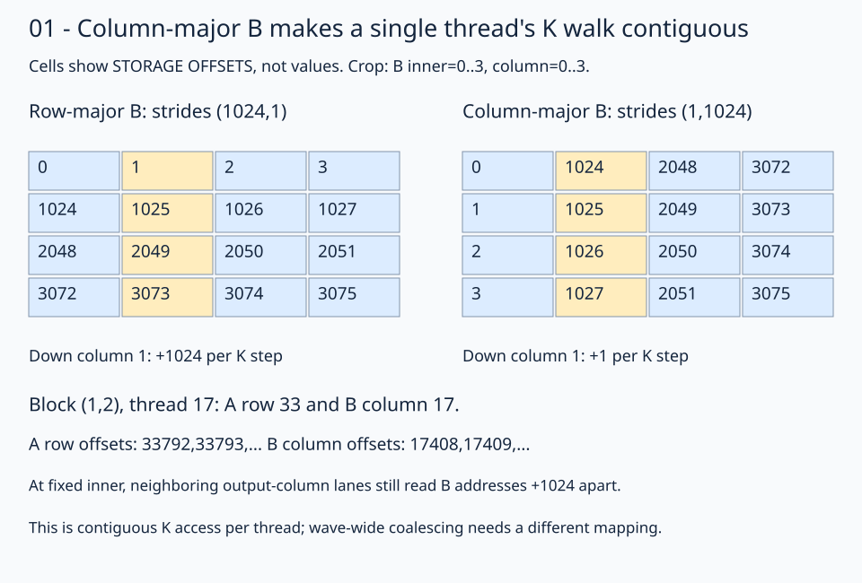

# 01 · Make both dot-product inputs contiguous along K

Keep **M=N=K=1024**, BF16 inputs/output, FP32 arithmetic, one output per thread, and the native tiling from the [naive lesson](../00-naive/README.md). Change B's **physical storage** to column-major. A remains row-major. Each thread then walks through its A row and B column with stride 1 along K.

This lesson lives in `01-coalesced-access`, but distinguishes two different properties. **Contiguous K access** describes successive loop positions within one thread. **Coalescing** describes the addresses neighboring GPU lanes request at the same instruction. This simple kernel demonstrates the first property. Packing B column-major does not make both operands coalesced across lanes under one-output-per-thread ownership.



Read down the gold column in each grid. The logical B coordinates stay the same; their storage offsets change. The first four cells along K are adjacent only in the right-hand representation.

## 1. Pack a real column-major B on the GPU

The host creates the same logical BF16 matrix as before, then packs it before launching:

```python
left = a_cpu.cuda()
right = b_cpu.cuda().t().contiguous().t()
assert right.shape == (k, n) and right.stride() == (1, k)
```

Trace the three operations on B. The first `.t()` gives a view of shape `(N,K)`. `.contiguous()` physically packs that transposed view. The final `.t()` returns a view of shape `(K,N)` with strides `(1,K)` over the new storage. The logical values are again `B[inner,column]`, not `B.T`. A single transpose would change the mathematical input; these two transposes preserve it while changing storage order.

At 1024³, `right.stride()` is `(1,1024)` in **elements**. This storage is column-major even though PyTorch's default row-major `is_contiguous()` would be false. The packing operation allocates/copies data; it is setup work outside every timed interval. The reported TFLOP/s measures the prepared-input multiplication, not packing plus multiplication.

## 2. Describe the actual storage with native global views

```python
left_global_view = fx.make_view(fx.get_iter(left), fx.make_layout((m, k), (k, 1)))
right_global_view = fx.make_view(fx.get_iter(right), fx.make_layout((k, n), (1, k)))
out_global_view = fx.make_view(fx.get_iter(out), fx.make_layout((m, n), (n, 1)))
```

| View | Shape | Strides in elements | Storage |
| --- | --- | --- | --- |
| `left_global_view` | `(1024,1024)` | `(1024,1)` | Row-major A |
| `right_global_view` | `(1024,1024)` | `(1,1024)` | Column-major B |
| `out_global_view` | `(1024,1024)` | `(1024,1)` | Row-major C |

`make_view` must agree with the physical allocation. Merely writing `(1,k)` over a row-major pointer does not move values into columns and would compute a different result. The CPU reference still uses the original logical matrices to catch that error, including on random, nonsymmetric inputs.

## 3. Keep the same full-K tiled and block views

```python
left_tiled_view = fx.flat_divide(left_global_view, (16, k))
right_tiled_view = fx.flat_divide(right_global_view, (k, 16))
out_tiled_view = fx.flat_divide(out_global_view, (16, 16))
left_block_view = fx.slice(left_tiled_view, (None, None, block_row, 0))
right_block_view = fx.slice(right_tiled_view, (None, None, 0, block_col))
out_block_view = fx.slice(out_tiled_view, (None, None, block_row, block_col))
```

The tiled shapes remain A `(16,1024,64,1)`, B `(1024,16,1,64)`, C `(16,16,64,64)`. Shapes describe coordinate extents; changing storage strides does not change the number of tiles. Each block still spans all K rather than using K staging.

For block `(x,y)=(1,2)`, A covers rows 32–47, B covers columns 16–31, and C covers their output window. Their selected block shapes/strides are:

| Block view | Shape | Strides in elements |
| --- | --- | --- |
| `left_block_view` | `(16,1024)` | `(1024,1)` |
| `right_block_view` | `(1024,16)` | `(1,1024)` |
| `out_block_view` | `(16,16)` | `(1024,1)` |

The two leading `None` entries retain local coordinates. Native slicing carries the chosen tile base; no handwritten global offset is needed.

## 4. Select one output coordinate, A row, and B column per thread

```python
thread_layout = fx.make_ordered_layout((16, 16), (1, 0))
thread_coordinate = fx.idx2crd(fx.thread_idx.x, thread_layout)
left_row = fx.slice(left_block_view, (thread_coordinate[0], None))
right_column = fx.slice(right_block_view, (None, thread_coordinate[1]))
```

The thread layout still maps local output coordinates to thread IDs; `idx2crd` inverts it. Thread 17 gets `(1,1)`, selecting global A row 33, B column 17, and output C `(33,17)` in the running block.

Both `left_row` and `right_column` now have shape `1024` and **stride 1**. A row 33 starts at element offset 33792. In column-major B, column 17 starts at offset `17*1024=17408`. Increasing `inner` by one advances each address by one element. These offsets explain the views; the kernel only indexes `left_row[inner]` and `right_column[inner]`.

## 5. Load, widen, reduce, and store

```python
accumulator = fx.Float32(0)
for inner in range(k):
    a = fx.Float32(left_row[inner])
    b = fx.Float32(right_column[inner])
    accumulator = accumulator + a * b
out_block_view[thread_coordinate] = accumulator.to(fx.BFloat16)
```

The math is unchanged. Widen both BF16 values before multiplication, retain FP32 across all K, and round once at the output store. The selected output view retains the original block base and row stride. Each of the 256 threads writes one unique output, so no reduction between lanes or synchronization is introduced.

## Contiguous per thread does not mean coalesced across lanes

At the same `inner`, neighboring threads 0–15 compute the same output row and different columns. A is the same requested value for those threads. In column-major B, their requested addresses are `inner + column*K`, separated by 1024 elements, not adjacent. The B loads therefore do not acquire a coalesced lane pattern merely because each individual thread walks a contiguous column over time.

A design that coalesces both operands could instead assign neighboring lanes to neighboring K positions and reduce their partial dot products together. That is a different ownership and arithmetic decomposition, beyond this one-output-per-thread exercise. Compare measured results without assuming this storage change must win.

TODO 1 builds the 16×16 column-fast thread layout; TODO 2 obtains its inverse coordinate with `idx2crd`. B packing and its matching global layout are supplied. Keep the native full-K windows and FP32 load conversions around your expressions.

## Practice and checkpoint

Complete the two numbered expressions in `practice.py`. Keep the supplied launch, initialization, stores, and checker. The unfinished starter reports `Practice not finished: ...` and exits with status 1.

Every exercise runs **M = N = K = 1024**: row-major A, column-major B, FP32 accumulation, and row-major BF16 output. The checker evaluates all 1,048,576 outputs for two input patterns. The trace pattern uses `A[r,k] = ((r*1024+k) % 5)-2` and `B[k,c] = ((k*1024+c) % 7)-3`; the first four values of output row 0 are `[3, -6, -1, -3]`. A second pattern uses seeded random values quantized to BF16 before either implementation sees them. An independent CPU FP32 matrix product, rounded to BF16, supplies the untimed reference. Trace checks use `rtol=0, atol=0.001` to accommodate the small WMMA residue near zero; random checks use `rtol=0.016, atol=0.03125` for BF16 rounding and accumulation differences. These are exercise tolerances, not a numerical guarantee for arbitrary inputs.

Sixteen output sentinels must remain unchanged. Output data starts as NaN, so incomplete writes fail the reference comparison. The sentinel checks writes; full-tile dimension constraints make all input reads in these programs valid. No tails are implemented here.

## Compare this kernel with GPU PyTorch

Running this lesson's solution, or a completed practice, prints a timing table after the correctness checkpoint. The two rows compare **this file's kernel** with **GPU `torch.matmul`**, reporting milliseconds and effective TFLOP/s. A completed practice benchmarks your implementation, not the worked solution. Both implementations use the same 1024×1024 BF16 GPU inputs and preallocated BF16 GPU output; The PyTorch row uses the same column-major B and row-major A as this kernel. CPU reference arithmetic, allocations, and B packing stay outside timing.

```bash
pixi run python lessons/01-gpu-programming/13-matmul/01-coalesced-access/solution.py
# Select the timing method explicitly or skip performance measurement:
pixi run python lessons/01-gpu-programming/13-matmul/01-coalesced-access/solution.py --timing host
pixi run python lessons/01-gpu-programming/13-matmul/01-coalesced-access/practice.py --check-only
```

The default `--timing auto` tries GPU events first. If either row has an unavailable event duration, **both rows** are retimed with synchronized host batches, and the fallback is printed. Host timing still runs GPU computation but includes dispatch and synchronization overhead. `--timing gpu-event` disables fallback and reports unavailable values if events return zero. Each implementation gets three warm-ups and five batches of 20 launches; `--repeats` changes launches per batch. TFLOP/s is `2 * 1024**3 / (milliseconds * 1e9)`. Higher throughput means less time for this fixed operation count; it does not imply a universal speedup.

`pixi run gpu-check` and `pixi run lessons-check` run correctness only for the matmul stages. For the full-series comparison and measurement limits, see the [benchmark guide](../README.md#compare-the-stages).

**Check yourself:** Does changing only the FlyDSL B view to strides `(1,K)` convert a row-major allocation into column-major storage?

<details><summary>Answer</summary>

No. `make_view` changes addressing, not the physical values. The host must supply column-major storage, or the layout will address different matrix values. Use the transpose/contiguous/transpose packing before launch, preserve logical shape `(K,N)`, and check against the original logical B.

</details>

Run from the repository root:

```bash
pixi run python lessons/01-gpu-programming/13-matmul/01-coalesced-access/practice.py
pixi run python lessons/01-gpu-programming/13-matmul/01-coalesced-access/solution.py
```

A completed practice prints `Exercise passed:` with `shapes_MNK: [(1024, 1024, 1024)]`, two patterns, and the first-four checkpoint. Compare your implementation with the [worked solution](solution.py).

[Previous](../00-naive/README.md) · [Matmul series](../README.md) · [Next](../02-register-tiling/README.md)

Sources: [FlyDSL 0.4.1 kernel guide](https://github.com/ROCm/FlyDSL/blob/888d7d80528f0cf2abab8a86610d5ccca47f205d/docs/kernel_authoring_guide.md). API expressions were checked against the installed 0.4.1 package.
