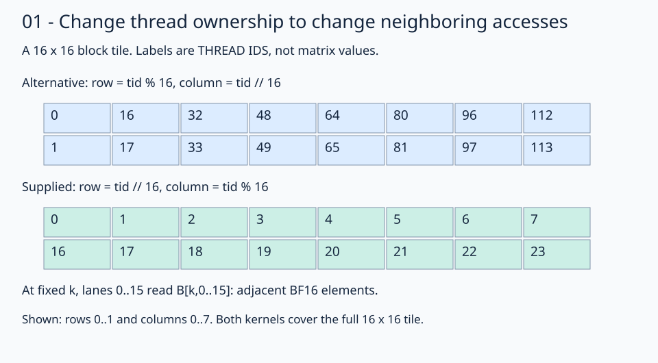

# 01 · Put neighboring threads on neighboring columns

The [naive kernel](../00-naive/README.md) is correct, but its thread order need not match contiguous storage. Keep the same **1024×1024×1024** problem, 16×16 output tiles, 256-thread blocks, K loop, and arithmetic. Change only the mapping from thread ID to output coordinate.



Read each cell as an owning thread ID, not an output value or storage offset. The picture shows rows 0–1 and columns 0–7 of block `(0,0)`; the block still covers all 256 outputs.

## Map the lane to a column

Previously thread 1 owned `(1,0)` and thread 16 owned `(0,1)`. Use this mapping instead:

```python
row = row_base + tid // 16
col = col_base + tid % 16
```

Now thread 1 owns `(0,1)` and thread 16 owns `(1,0)`. At a fixed `inner`, threads 0–15 read B positions `(inner,0)` through `(inner,15)`. Their element offsets are `inner*1024 + 0..15`: consecutive BF16 values, separated by two bytes. They read the same A value at that K position because they share an output row. The second half of a wave32 computes the next output row and reads the same B column range.

The output stores follow the same contiguous column order. This supplies a more favorable spatial access pattern for B and C. It does not establish a specific memory transaction count or a guaranteed speedup: caches, compiler decisions, and launch geometry still matter.

## Change ownership, preserve coverage

Division by 16 selects one of 16 rows; remainder selects one of 16 columns. Every ID from 0 through 255 maps to a distinct output, so the block needs neither atomics nor inter-thread synchronization. All K reductions are still private to a thread.

For block `(1,2)` in `(block_x,block_y)` order, the row base is 32 and column base is 16. Thread 1 owns `(32,17)`, whose output element offset is `32*1024 + 17 = 32785`. Bases select the tile once; they must not be added again to an already adjusted offset.

TODO 1 is `row`; TODO 2 is `col`. The flat views and the FP32 dot-product loop are supplied unchanged.

## Practice and checkpoint

Complete the two numbered expressions in `practice.py`. Keep the supplied launch, initialization, stores, and checker. The unfinished starter reports `Practice not finished: ...` and exits with status 1.

Every exercise runs **M = N = K = 1024**: row-major BF16 inputs, FP32 accumulation, and BF16 output. The checker evaluates all 1,048,576 outputs for two input patterns. The trace pattern uses `A[r,k] = ((r*1024+k) % 5)-2` and `B[k,c] = ((k*1024+c) % 7)-3`; the first four values of output row 0 are `[3, -6, -1, -3]`. A second pattern uses seeded random values quantized to BF16 before either implementation sees them. An independent CPU FP32 matrix product, rounded to BF16, supplies the untimed reference. Trace checks use `rtol=0, atol=0.001` to accommodate the small WMMA residue near zero; random checks use `rtol=0.016, atol=0.03125` for BF16 rounding and accumulation differences. These are exercise tolerances, not a numerical guarantee for arbitrary inputs.

Sixteen output sentinels must remain unchanged. Output data starts as NaN, so incomplete writes fail the reference comparison. The sentinel checks writes; full-tile dimension constraints make all input reads in these programs valid. No tails are implemented here.

## Compare this kernel with GPU PyTorch

Running this lesson's solution, or a completed practice, prints a timing table after the correctness checkpoint. The two rows compare **this file's kernel** with **GPU `torch.matmul`**, reporting milliseconds and effective TFLOP/s. A completed practice benchmarks your implementation, not the worked solution. Both implementations use the same 1024×1024 BF16 GPU inputs and preallocated BF16 GPU output; CPU reference arithmetic and allocations stay outside timing.

```bash
pixi run python lessons/01-gpu-programming/13-matmul/01-coalesced-access/solution.py
# Select the timing method explicitly or skip performance measurement:
pixi run python lessons/01-gpu-programming/13-matmul/01-coalesced-access/solution.py --timing host
pixi run python lessons/01-gpu-programming/13-matmul/01-coalesced-access/practice.py --check-only
```

The default `--timing auto` tries GPU events first. If either row has an unavailable event duration, **both rows** are retimed with synchronized host batches, and the fallback is printed. Host timing still runs GPU computation but includes dispatch and synchronization overhead. `--timing gpu-event` disables fallback and reports unavailable values if events return zero. Each implementation gets three warm-ups and five batches of 20 launches; `--repeats` changes launches per batch. TFLOP/s is `2 * 1024**3 / (milliseconds * 1e9)`. Higher throughput means less time for this fixed operation count; it does not imply a universal speedup.

`pixi run gpu-check` and `pixi run lessons-check` run correctness only for the matmul stages. For the full-series comparison and measurement limits, see the [benchmark guide](../README.md#compare-the-stages).

**Check yourself:** Does swapping the quotient and remainder change the dot product for C[0,1]?

<details><summary>Answer</summary>

No. It changes which thread computes that output. The same A row and B column participate in its reduction. The complete output check must remain unchanged.

</details>

Run from the repository root:

```bash
pixi run python lessons/01-gpu-programming/13-matmul/01-coalesced-access/practice.py
pixi run python lessons/01-gpu-programming/13-matmul/01-coalesced-access/solution.py
```

A completed practice prints `Exercise passed:` with `shapes_MNK: [(1024, 1024, 1024)]`, two patterns, and the first-four checkpoint. Compare your implementation with the [worked solution](solution.py).

[Previous](../00-naive/README.md) · [Matmul series](../README.md) · [Next](../02-register-tiling/README.md)

Sources: [FlyDSL 0.4.1 kernel guide](https://github.com/ROCm/FlyDSL/blob/888d7d80528f0cf2abab8a86610d5ccca47f205d/docs/kernel_authoring_guide.md). API expressions were checked against the installed 0.4.1 package.
