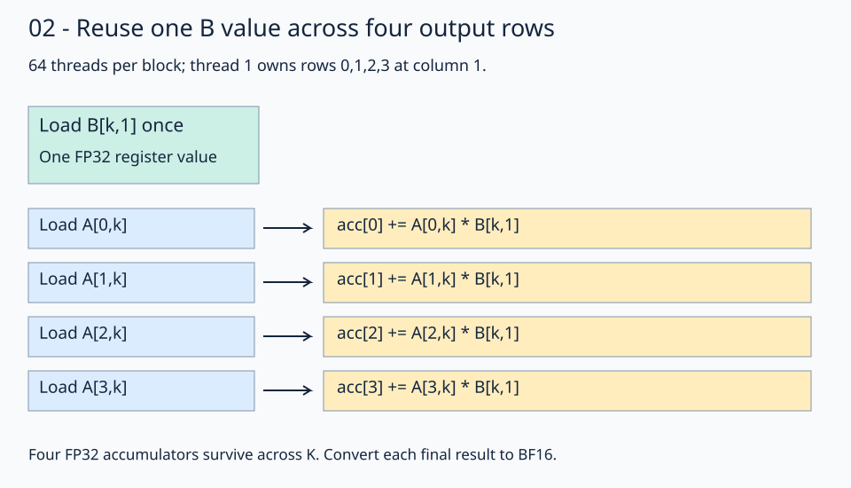

# 02 · Reuse a B value across four output rows

The [column-oriented ownership](../01-coalesced-access/README.md) gives each thread one output. Computing several outputs per thread allows reuse before returning to memory. Keep **M=N=K=1024** and a 16×16 output tile, but launch 64 threads and assign four rows at one column to each thread.



Follow thread 1 in block `(0,0)`. It owns `(0,1)`, `(1,1)`, `(2,1)`, and `(3,1)`. Each K iteration loads `B[inner,1]` once and combines it with four different A rows.

## Separate thread ownership from accumulator slots

```python
row = row_base + (tid // 16) * 4
col = col_base + tid % 16
accumulators = fx.make_rmem_tensor(fx.make_layout(4, 1), fx.Float32)
accumulators.fill(0)
```

`row` is the first owned row. Slot `s` corresponds to output `(row+s,col)`; a register slot is not a global storage offset. The four thread groups own rows 0–3, 4–7, 8–11, and 12–15. Sixteen columns times four groups times four slots cover 256 outputs exactly once.

Allocation alone does not initialize a fragment. `fill(0)` establishes the reduction's initial value. The runtime K loop keeps these four values alive until the final stores.

## Reuse inside the K loop

Load and widen B before the unrolled slot loop. Within that loop, load A for the slot's row and update:

```python
updated = accumulators[slot] + a * b
accumulators[slot] = updated
```

`fx.range_constexpr(4)` expands the four slot operations during tracing; it does not launch four threads. Each thread performs all four updates. The final stores convert each completed FP32 accumulator to BF16.

This reduces the source-level B loads per four outputs from four to one for each K position. It trades more per-thread state for explicit reuse, and it changes the block from eight wave32 groups to two. It does not prove four times less physical DRAM traffic: caches may already satisfy repeated loads, and resource usage changes too.

TODO 1 is the first owned `row`; TODO 2 is `updated`. Keep B's load outside the slot loop and keep all four output stores.

## Practice and checkpoint

Complete the two numbered expressions in `practice.py`. Keep the supplied launch, initialization, stores, and checker. The unfinished starter reports `Practice not finished: ...` and exits with status 1.

Every exercise runs **M = N = K = 1024**: row-major BF16 inputs, FP32 accumulation, and BF16 output. The checker evaluates all 1,048,576 outputs for two input patterns. The trace pattern uses `A[r,k] = ((r*1024+k) % 5)-2` and `B[k,c] = ((k*1024+c) % 7)-3`; the first four values of output row 0 are `[3, -6, -1, -3]`. A second pattern uses seeded random values quantized to BF16 before either implementation sees them. An independent CPU FP32 matrix product, rounded to BF16, supplies the untimed reference. Trace checks use `rtol=0, atol=0.001` to accommodate the small WMMA residue near zero; random checks use `rtol=0.016, atol=0.03125` for BF16 rounding and accumulation differences. These are exercise tolerances, not a numerical guarantee for arbitrary inputs.

Sixteen output sentinels must remain unchanged. Output data starts as NaN, so incomplete writes fail the reference comparison. The sentinel checks writes; full-tile dimension constraints make all input reads in these programs valid. No tails are implemented here.

## Compare this kernel with GPU PyTorch

Running this lesson's solution, or a completed practice, prints a timing table after the correctness checkpoint. The two rows compare **this file's kernel** with **GPU `torch.matmul`**, reporting milliseconds and effective TFLOP/s. A completed practice benchmarks your implementation, not the worked solution. Both implementations use the same 1024×1024 BF16 GPU inputs and preallocated BF16 GPU output; CPU reference arithmetic and allocations stay outside timing.

```bash
pixi run python lessons/01-gpu-programming/13-matmul/02-register-tiling/solution.py
# Select the timing method explicitly or skip performance measurement:
pixi run python lessons/01-gpu-programming/13-matmul/02-register-tiling/solution.py --timing host
pixi run python lessons/01-gpu-programming/13-matmul/02-register-tiling/practice.py --check-only
```

The default `--timing auto` tries GPU events first. If either row has an unavailable event duration, **both rows** are retimed with synchronized host batches, and the fallback is printed. Host timing still runs GPU computation but includes dispatch and synchronization overhead. `--timing gpu-event` disables fallback and reports unavailable values if events return zero. Each implementation gets three warm-ups and five batches of 20 launches; `--repeats` changes launches per batch. TFLOP/s is `2 * 1024**3 / (milliseconds * 1e9)`. Higher throughput means less time for this fixed operation count; it does not imply a universal speedup.

`pixi run gpu-check` and `pixi run lessons-check` run correctness only for the matmul stages. For the full-series comparison and measurement limits, see the [benchmark guide](../README.md#compare-the-stages).

**Check yourself:** Can four threads share the same four accumulators without synchronization?

<details><summary>Answer</summary>

These accumulators are private to each thread. Each thread owns four distinct outputs. Cross-thread reuse would need a different storage and ownership design; register tiling does not make registers block-shared.

</details>

Run from the repository root:

```bash
pixi run python lessons/01-gpu-programming/13-matmul/02-register-tiling/practice.py
pixi run python lessons/01-gpu-programming/13-matmul/02-register-tiling/solution.py
```

A completed practice prints `Exercise passed:` with `shapes_MNK: [(1024, 1024, 1024)]`, two patterns, and the first-four checkpoint. Compare your implementation with the [worked solution](solution.py).

[Previous](../01-coalesced-access/README.md) · [Matmul series](../README.md) · [Next](../03-shared-memory/README.md)

Sources: [FlyDSL 0.4.1 kernel guide](https://github.com/ROCm/FlyDSL/blob/888d7d80528f0cf2abab8a86610d5ccca47f205d/docs/kernel_authoring_guide.md). API expressions were checked against the installed 0.4.1 package.
