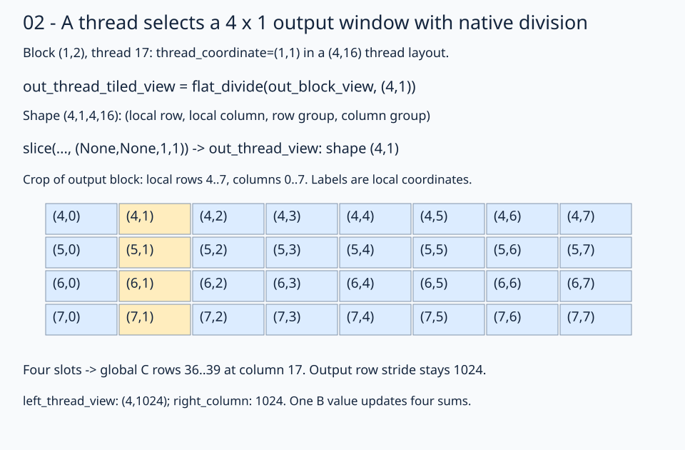

# 02 · Select four output rows per thread with native views

The [previous lesson](../01-coalesced-access/README.md) assigns one output to each of 256 threads and experiments with column-major B. This stage returns to row-major A/B storage for register and later LDS tiling; its GPU PyTorch comparison uses that same row-major layout. This kernel still computes **1024³** BF16 matmul, but uses 64 threads per 16×16 output window. Each thread owns a **4×1 output window**, so one B value can update four independent FP32 sums.

The access path stays visible:

```text
global views -> full-K tiled views -> block views
             -> four-row thread views -> scalar loads -> four accumulators -> stores
```

## 1. Select the same block windows

The native global layouts and `flat_divide` calls match lesson 01:

```python
left_tiled_view = fx.flat_divide(left_global_view, (16, k))
right_tiled_view = fx.flat_divide(right_global_view, (k, 16))
out_tiled_view = fx.flat_divide(out_global_view, (16, 16))
left_block_view = fx.slice(left_tiled_view, (None, None, block_row, 0))
right_block_view = fx.slice(right_tiled_view, (None, None, 0, block_col))
out_block_view = fx.slice(out_tiled_view, (None, None, block_row, block_col))
```

A block sees A `(16,1024)`, B `(1024,16)`, and C `(16,16)`. Their row strides remain 1024. We still reduce over the complete K axis directly from global memory; no LDS storage exists yet.

## 2. Name the thread's row group and column

```python
thread_layout = fx.make_ordered_layout((4, 16), (1, 0))
thread_coordinate = fx.idx2crd(fx.thread_idx.x, thread_layout)
```

Here the first coordinate means **row group**, not an individual output row. Four groups times 16 columns give 64 threads. Thread 17 gets `(1,1)`: row group 1 and output column 1.

```python
out_thread_tiled_view = fx.flat_divide(out_block_view, (4, 1))
out_thread_view = fx.slice(
    out_thread_tiled_view, (None, None, thread_coordinate[0], thread_coordinate[1])
)
```



Read the four modes of `out_thread_tiled_view` as `(within_row, within_column, row_group, column_group)`. Its shape is `(4,1,4,16)`. Fixing the final two modes selects a `(4,1)` view. The first dimension keeps four positions, so `slot=0..3` names the four output values owned by this one thread.

In block `(1,2)`, row group 1 corresponds to local rows 4–7, hence global rows 36–39. Local column 1 becomes global column 17. Slicing carries the block and group bases; no `block_row*16` or `group*4` appears in the load/store expressions.

## 3. Select matching A rows and one B column

```python
left_thread_tiled_view = fx.flat_divide(left_block_view, (4, k))
left_thread_view = fx.slice(
    left_thread_tiled_view, (None, None, thread_coordinate[0], 0)
)
right_column = fx.slice(right_block_view, (None, thread_coordinate[1]))
```

| View | Shape | Strides in elements | Meaning for block `(1,2)`, thread 17 |
| --- | --- | --- | --- |
| `left_thread_tiled_view` | `(4,1024,4,1)` | Inherited from A | Four-row A groups, each spanning K |
| `left_thread_view` | `(4,1024)` | `(1024,1)` | A rows 36–39 |
| `right_column` | `1024` | `1024` | B column 17 |
| `out_thread_view` | `(4,1)` | `(1024,0)` | C rows 36–39 at column 17 |

FlyDSL canonicalizes the single-column mode of `out_thread_view` to stride 0: its only valid column coordinate is 0, so this does not change any address. Its row stride remains 1024.

These views describe where this thread reads and writes. They do not allocate register storage or move any input values.

## 4. Allocate four private accumulators and reuse B

```python
accumulators = fx.make_rmem_tensor(fx.make_layout(4, 1), fx.Float32)
accumulators.fill(0)
for inner in range(k):
    b = fx.Float32(right_column[inner])
    for slot in fx.range_constexpr(4):
        a = fx.Float32(left_thread_view[fx.make_coord(slot, inner)])
        updated = accumulators[slot] + a * b
        accumulators[slot] = updated
```


Read the picture as the same rule for a different row group: four distinct A rows share one B column. In the running thread-17 example, `slot=2, inner=5` loads A `(38,5)` and B `(5,17)` and updates the accumulator for C `(38,17)`.

`make_rmem_tensor` allocates per-thread storage; `fill(0)` initializes it. `fx.range_constexpr(4)` expands four slot operations, not four GPU threads. B is loaded once outside that slot loop and reused four times. The compiler decides physical register allocation; the source expresses four live FP32 sums.

## 5. Store through the selected thread window

```python
for slot in fx.range_constexpr(4):
    out_thread_view[fx.make_coord(slot, 0)] = accumulators[slot].to(fx.BFloat16)
```

The local column is zero because the selected view is only one column wide. The view carries the global row stride and all base displacements. Four groups × 16 columns × four slots cover the block's 256 outputs exactly once. Larger private state and fewer threads change resource use; they do not promise a speedup.

TODO 1 selects `left_thread_view` from its four-mode tiled view. TODO 2 forms `updated` from the current FP32 sum and widened A/B values. The same `slot` must refer to the A row, accumulator, and output row.

## Practice and checkpoint

Complete the two numbered expressions in `practice.py`. Keep the supplied launch, initialization, stores, and checker. The unfinished starter reports `Practice not finished: ...` and exits with status 1.

Every exercise runs **M = N = K = 1024**: row-major BF16 inputs, FP32 accumulation, and BF16 output. The checker evaluates all 1,048,576 outputs for two input patterns. The trace pattern uses `A[r,k] = ((r*1024+k) % 5)-2` and `B[k,c] = ((k*1024+c) % 7)-3`; the first four values of output row 0 are `[3, -6, -1, -3]`. A second pattern uses seeded random values quantized to BF16 before either implementation sees them. An independent CPU FP32 matrix product, rounded to BF16, supplies the untimed reference. Trace checks use `rtol=0, atol=0.001` to accommodate the small WMMA residue near zero; random checks use `rtol=0.016, atol=0.03125` for BF16 rounding and accumulation differences. These are exercise tolerances, not a numerical guarantee for arbitrary inputs.

Sixteen output sentinels must remain unchanged. Output data starts as NaN, so incomplete writes fail the reference comparison. The sentinel checks writes; full-tile dimension constraints make all input reads in these programs valid. No tails are implemented here.

## Compare this kernel with GPU PyTorch

Running this lesson's solution, or a completed practice, prints a timing table after the correctness checkpoint. The two rows compare **this file's kernel** with **GPU `torch.matmul`**, reporting milliseconds and effective TFLOP/s. A completed practice benchmarks your implementation, not the worked solution. Both implementations use the same 1024×1024 BF16 GPU inputs and preallocated BF16 GPU output; CPU reference arithmetic and allocations stay outside timing.

```bash
pixi run python lessons/01-gpu-programming/13-matmul/02-register-tiling/solution.py
# Select the timing method explicitly or skip performance measurement:
pixi run python lessons/01-gpu-programming/13-matmul/02-register-tiling/solution.py --timing host
pixi run python lessons/01-gpu-programming/13-matmul/02-register-tiling/practice.py --check-only
```

The default `--timing auto` tries GPU events first. If either row has an unavailable event duration, **both rows** are retimed with synchronized host batches, and the fallback is printed. Host timing still runs GPU computation but includes dispatch and synchronization overhead. `--timing gpu-event` disables fallback and reports unavailable values if events return zero. Each implementation gets three warm-ups and five batches of 20 launches; `--repeats` changes launches per batch. TFLOP/s is `2 * 1024**3 / (milliseconds * 1e9)`. Higher throughput means less time for this fixed operation count; it does not imply a universal speedup.

`pixi run gpu-check` and `pixi run lessons-check` run correctness only for the matmul stages. For the full-series comparison and measurement limits, see the [benchmark guide](../README.md#compare-the-stages).

**Check yourself:** Can four threads share the same four accumulators without synchronization?

<details><summary>Answer</summary>

These accumulators are private to each thread. Each thread owns four distinct outputs. Cross-thread reuse would need a different storage and ownership design; register tiling does not make registers block-shared.

</details>

Run from the repository root:

```bash
pixi run python lessons/01-gpu-programming/13-matmul/02-register-tiling/practice.py
pixi run python lessons/01-gpu-programming/13-matmul/02-register-tiling/solution.py
```

A completed practice prints `Exercise passed:` with `shapes_MNK: [(1024, 1024, 1024)]`, two patterns, and the first-four checkpoint. Compare your implementation with the [worked solution](solution.py).

[Previous](../01-coalesced-access/README.md) · [Matmul series](../README.md) · [Next](../03-shared-memory/README.md)

Sources: [FlyDSL 0.4.1 kernel guide](https://github.com/ROCm/FlyDSL/blob/888d7d80528f0cf2abab8a86610d5ccca47f205d/docs/kernel_authoring_guide.md). API expressions were checked against the installed 0.4.1 package.
