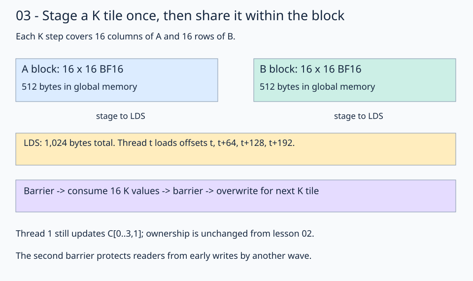

# 03 · Share input tiles through LDS

[Register tiling](../02-register-tiling/README.md) reuses B inside one thread. Local Data Share (LDS) lets threads in the same block reuse staged input values. Keep the same **1024×1024×1024** multiplication, 16×16 output tile, 64-thread block, and four outputs per thread. Change where the K loop obtains its operands.



Each iteration stages 16 K positions. A tile contains 16 output rows × 16 K positions; B contains 16 K positions × 16 output columns. Each occupies 512 bytes, so the block allocates 1024 bytes of LDS. There are 64 such K tiles in the full reduction.

## Allocate workgroup storage

The native allocator creates shared storage inside the kernel:

```python
allocator = fx.SharedAllocator()
shared_a = (
    allocator.allocate(fx.Array[fx.BFloat16, 256]).peek().view(fx.make_layout(256, 1))
)
```

B has an equivalent allocation. Static allocation lets the launcher infer the required shared storage; no host buffer stands in for LDS. Views describe positions in that storage. Stores move values into it.

## Cooperatively populate each tile

Each thread loads four positions from each operand. In slot `s`:

```python
position = tid + slot * 64
tile_row = position // 16
tile_col = position % 16
```

The 64 threads cover positions 0–255 exactly once. At `tile_k=0`, thread 1 stages positions 1, 65, 129, and 193. Position 65 means local `(4,1)`: A comes from global `(row_base+4,1)` and B from `(4,col_base+1)`. At `tile_k=1`, A's global column and B's global row each advance by 16.

After all staging stores, `fx.gpu.barrier()` makes the complete tiles available before consumption. Thread 1 reads B's local column 1 and updates the same four output rows as in lesson 02. Its A access for slot `s` and local reduction coordinate `inner` is:

```python
a = fx.Float32(shared_a[(row_local + slot) * 16 + inner])
```

LDS indexing uses the tile's row length of 16; global A indexing uses K=1024. Mixing these strides reads a different location.

## Protect both sides of tile reuse

The first barrier prevents consumers from reading an incomplete tile. The second prevents early threads from overwriting LDS for the next K tile while other threads still consume the current tile. Both are outside per-thread conditions, so every thread reaches them in the same order. The two wave32 groups may progress at different rates.

Staging reduces explicit global input loads within this block, but adds LDS traffic, barriers, and shared storage. The benchmark decides whether that trade helps for this workload. This version has one staging buffer per operand and does not overlap loading with computation.

TODO 1 is `position`; TODO 2 is the FP32 A load `a` from LDS. Allocation, global staging expressions, and both barriers are supplied.

## Practice and checkpoint

Complete the two numbered expressions in `practice.py`. Keep the supplied launch, initialization, stores, and checker. The unfinished starter reports `Practice not finished: ...` and exits with status 1.

Every exercise runs **M = N = K = 1024**: row-major BF16 inputs, FP32 accumulation, and BF16 output. The checker evaluates all 1,048,576 outputs for two input patterns. The trace pattern uses `A[r,k] = ((r*1024+k) % 5)-2` and `B[k,c] = ((k*1024+c) % 7)-3`; the first four values of output row 0 are `[3, -6, -1, -3]`. A second pattern uses seeded random values quantized to BF16 before either implementation sees them. An independent CPU FP32 matrix product, rounded to BF16, supplies the untimed reference. Trace checks use `rtol=0, atol=0.001` to accommodate the small WMMA residue near zero; random checks use `rtol=0.016, atol=0.03125` for BF16 rounding and accumulation differences. These are exercise tolerances, not a numerical guarantee for arbitrary inputs.

Sixteen output sentinels must remain unchanged. Output data starts as NaN, so incomplete writes fail the reference comparison. The sentinel checks writes; full-tile dimension constraints make all input reads in these programs valid. No tails are implemented here.

## Compare this kernel with GPU PyTorch

Running this lesson's solution, or a completed practice, prints a timing table after the correctness checkpoint. The two rows compare **this file's kernel** with **GPU `torch.matmul`**, reporting milliseconds and effective TFLOP/s. A completed practice benchmarks your implementation, not the worked solution. Both implementations use the same 1024×1024 BF16 GPU inputs and preallocated BF16 GPU output; CPU reference arithmetic and allocations stay outside timing.

```bash
pixi run python lessons/01-gpu-programming/13-matmul/03-shared-memory/solution.py
# Select the timing method explicitly or skip performance measurement:
pixi run python lessons/01-gpu-programming/13-matmul/03-shared-memory/solution.py --timing host
pixi run python lessons/01-gpu-programming/13-matmul/03-shared-memory/practice.py --check-only
```

The default `--timing auto` tries GPU events first. If either row has an unavailable event duration, **both rows** are retimed with synchronized host batches, and the fallback is printed. Host timing still runs GPU computation but includes dispatch and synchronization overhead. `--timing gpu-event` disables fallback and reports unavailable values if events return zero. Each implementation gets three warm-ups and five batches of 20 launches; `--repeats` changes launches per batch. TFLOP/s is `2 * 1024**3 / (milliseconds * 1e9)`. Higher throughput means less time for this fixed operation count; it does not imply a universal speedup.

`pixi run gpu-check` and `pixi run lessons-check` run correctness only for the matmul stages. For the full-series comparison and measurement limits, see the [benchmark guide](../README.md#compare-the-stages).

**Check yourself:** Why is a barrier after the last read needed if there was already one after loading?

<details><summary>Answer</summary>

The load barrier only establishes that the current tile is ready. A later wave can still be reading it when an earlier wave begins the next iteration. The second barrier finishes all readers before any thread overwrites the staging buffer.

</details>

Run from the repository root:

```bash
pixi run python lessons/01-gpu-programming/13-matmul/03-shared-memory/practice.py
pixi run python lessons/01-gpu-programming/13-matmul/03-shared-memory/solution.py
```

A completed practice prints `Exercise passed:` with `shapes_MNK: [(1024, 1024, 1024)]`, two patterns, and the first-four checkpoint. Compare your implementation with the [worked solution](solution.py).

[Previous](../02-register-tiling/README.md) · [Matmul series](../README.md) · [Next](../04-matrix-instructions/README.md)

Sources: [FlyDSL 0.4.1 kernel guide](https://github.com/ROCm/FlyDSL/blob/888d7d80528f0cf2abab8a86610d5ccca47f205d/docs/kernel_authoring_guide.md). API expressions were checked against the installed 0.4.1 package.
