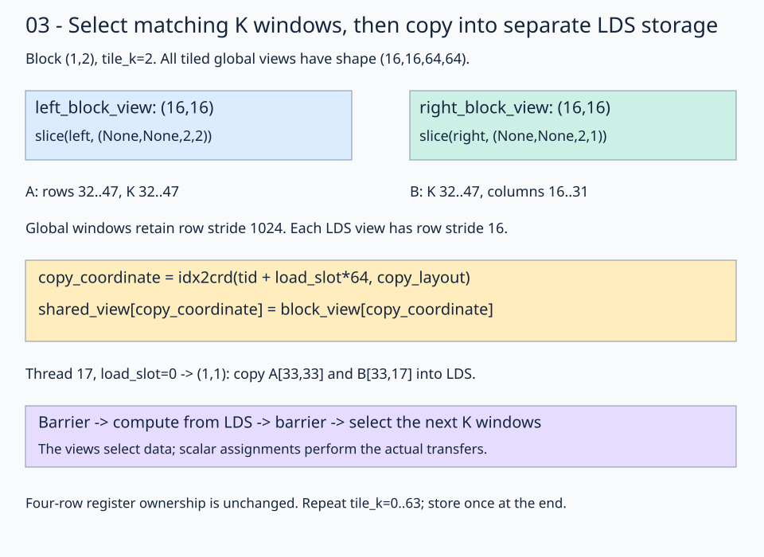

# 03 · Select K windows and stage them in LDS

[Register tiling](../02-register-tiling/README.md) reuses B inside one thread. This lesson shares input values between threads by copying selected windows into Local Data Share (LDS), storage visible to the whole block. Keep **M=N=K=1024**, 16×16 output windows, 64 threads, and four FP32 output sums per thread.

The new distinction is between a **global block view**, which addresses existing matrix storage, and a **shared view**, which addresses a separate LDS allocation. Native views select coordinates; assignments transfer the data.

## 1. Divide both inputs along K as well

Global layouts are still `(M,K):(K,1)`, `(K,N):(N,1)`, and `(M,N):(N,1)`. The tilers now use `(16,16)` for every matrix:

```python
left_tiled_view = fx.flat_divide(left_global_view, (16, 16))
right_tiled_view = fx.flat_divide(right_global_view, (16, 16))
out_tiled_view = fx.flat_divide(out_global_view, (16, 16))
out_block_view = fx.slice(out_tiled_view, (None, None, block_row, block_col))
```

All tiled shapes are `(16,16,64,64)`, but the final modes have different meanings:

| View | Four coordinate modes |
| --- | --- |
| `left_tiled_view` | `(local_row, local_inner, output_tile_row, K_tile)` |
| `right_tiled_view` | `(local_inner, local_column, K_tile, output_tile_column)` |
| `out_tiled_view` | `(local_row, local_column, output_tile_row, output_tile_column)` |

Unlike lesson 02's full-K windows, each input window now covers **16** K positions. There are 64 K windows in the reduction. Select the output once; select the matching input windows anew on each iteration.

## 2. Declare shared storage and create row-major LDS views

Declare the two tile buffers together with `@fx.struct`, outside the kernel:

```python
@fx.struct
class SharedStorage:
    left: fx.Array[fx.BFloat16, 256]
    right: fx.Array[fx.BFloat16, 256]
```

Each field describes storage for 256 BF16 values. The declaration allocates no memory. Inside `@flyc.kernel`, allocate that storage in LDS and attach a logical layout to each field:

```python
lds = fx.SharedAllocator().allocate(SharedStorage).peek()
left_shared_view = lds.left.view(fx.make_layout((16, 16), (16, 1)))
right_shared_view = lds.right.view(fx.make_layout((16, 16), (16, 1)))
```

`SharedAllocator` reserves the storage, `.peek()` exposes its typed fields, and `.view(...)` describes how coordinates address each buffer. Creating a view does not initialize or copy values into LDS; cooperative stores fill the tiles later.

Each tile occupies 256 BF16 values, or 512 bytes; both total 1024 bytes per block. Global windows retain row stride 1024, while the packed LDS views have row stride 16. Their coordinate domains match even though their storage layouts differ. The allocator defaults to static shared allocation, so the compiler supplies the required LDS size without an explicit launch `smem` argument.

## 3. Keep the four-row thread ownership

The `(4,16)` thread layout and `(4,1)` output tiler from lesson 02 stay unchanged. Thread 17 still owns row group 1, column 1; in block `(1,2)` that is global C rows 36–39 at column 17.

The compute views now refer to LDS:

```python
left_thread_tiled_view = fx.flat_divide(left_shared_view, (4, 16))
left_thread_view = fx.slice(
    left_thread_tiled_view, (None, None, thread_coordinate[0], 0)
)
right_column = fx.slice(right_shared_view, (None, thread_coordinate[1]))
```

| View | Shape | Strides in elements |
| --- | --- | --- |
| `left_thread_tiled_view` | `(4,16,4,1)` | Derived from the LDS layout |
| `left_thread_view` | `(4,16)` | `(16,1)` |
| `right_column` | `16` | `16` |
| `out_thread_view` | `(4,1)` | `(1024,0)` |

FlyDSL canonicalizes the single-column mode of `out_thread_view` to stride 0: its only valid column coordinate is 0, so this does not change any address. Its row stride remains 1024.

The input thread views keep addressing the same LDS allocation across iterations. Each iteration replaces the values in that storage with the next global K windows; the views themselves do not need rebuilding.

## 4. Select global windows, then cooperatively populate LDS

```python
for tile_k in range(k // 16):
    left_block_view = fx.slice(left_tiled_view, (None, None, block_row, tile_k))
    right_block_view = fx.slice(right_tiled_view, (None, None, tile_k, block_col))
```



Follow block `(1,2)`, `tile_k=2`: A covers rows 32–47 and K 32–47; B covers K 32–47 and columns 16–31. The common K window is what makes these inputs a matching partial product.

A separate copy layout distributes the tile's 256 positions among the 64 threads:

```python
copy_layout = fx.make_ordered_layout((16, 16), (1, 0))
for load_slot in fx.range_constexpr(4):
    copy_coordinate = fx.idx2crd(fx.thread_idx.x + load_slot * 64, copy_layout)
    left_shared_view[copy_coordinate] = left_block_view[copy_coordinate]
    right_shared_view[copy_coordinate] = right_block_view[copy_coordinate]
```

Thread 17's first load has coordinate `(1,1)`. It copies global A `(33,33)` and B `(33,17)` to local LDS `(1,1)` in their respective allocations. Across four load slots, every tile position has one loader. The copy layout assigns loading work; the `(4,16)` compute layout assigns output work. They serve different purposes.

## 5. Synchronize, compute, then protect reuse

```python
fx.gpu.barrier()
for inner in range(16):
    b = fx.Float32(right_column[inner])
    for slot in fx.range_constexpr(4):
        a = fx.Float32(left_thread_view[fx.make_coord(slot, inner)])
        accumulators[slot] = accumulators[slot] + a * b
fx.gpu.barrier()
```

The first barrier completes cooperative staging before consumers read any tile position. The second finishes all consumers before the next iteration overwrites LDS. Both are reached uniformly by all threads, including the block's two wave32 groups.

At `tile_k=2`, thread 17's `slot=0, inner=1` updates C `(36,17)` using global A `(36,33)` and B `(33,17)`. `inner` is local to the selected K window. Native slicing supplies its global base automatically.

Initialize accumulators before the K-tile loop, keep them FP32 across all 64 iterations, then convert and store through `out_thread_view` once. Initializing inside that loop would discard prior partial sums. This version adds real data reuse but also LDS traffic and barriers; performance remains measured separately.

TODO 1 is `copy_coordinate`, the inverse of the copy ownership layout. TODO 2 is `a`, loaded and widened through the four-row LDS thread view. Keep both barriers and all output stores supplied.

## Practice and checkpoint

Complete the two numbered expressions in `practice.py`. Keep the supplied launch, initialization, stores, and checker. The unfinished starter reports `Practice not finished: ...` and exits with status 1.

Every exercise runs **M = N = K = 1024**: row-major BF16 inputs, FP32 accumulation, and BF16 output. The checker evaluates all 1,048,576 outputs for two input patterns. The trace pattern uses `A[r,k] = ((r*1024+k) % 5)-2` and `B[k,c] = ((k*1024+c) % 7)-3`; the first four values of output row 0 are `[3, -6, -1, -3]`. A second pattern uses seeded random values quantized to BF16 before either implementation sees them. An independent CPU FP32 matrix product, rounded to BF16, supplies the untimed reference. Trace checks use `rtol=0, atol=0.001` to accommodate the small WMMA residue near zero; random checks use `rtol=0.016, atol=0.03125` for BF16 rounding and accumulation differences. These are exercise tolerances, not a numerical guarantee for arbitrary inputs.

Sixteen output sentinels must remain unchanged. Output data starts as NaN, so incomplete writes fail the reference comparison. The sentinel checks writes; full-tile dimension constraints make all input reads in these programs valid. No tails are implemented here.

## Compare this kernel with GPU PyTorch

Running this lesson's solution, or a completed practice, prints a timing table after the correctness checkpoint. The two rows compare **this file's kernel** with **GPU `torch.matmul`**, reporting milliseconds and effective TFLOP/s. A completed practice benchmarks your implementation, not the worked solution. Both implementations use the same 1024×1024 BF16 GPU inputs and preallocated BF16 GPU output; CPU reference arithmetic and allocations stay outside timing.

```bash
pixi run python lessons/01-gpu-programming/13-matmul/03-shared-memory/solution.py
# Select the timing method explicitly or skip performance measurement:
pixi run python lessons/01-gpu-programming/13-matmul/03-shared-memory/solution.py --timing host
pixi run python lessons/01-gpu-programming/13-matmul/03-shared-memory/practice.py --check-only
```

The default `--timing auto` tries GPU events first. If either row has an unavailable event duration, **both rows** are retimed with synchronized host batches, and the fallback is printed. Host timing still runs GPU computation but includes dispatch and synchronization overhead. `--timing gpu-event` disables fallback and reports unavailable values if events return zero. Each implementation gets three warm-ups and five batches of 20 launches; `--repeats` changes launches per batch. TFLOP/s is `2 * 1024**3 / (milliseconds * 1e9)`. Higher throughput means less time for this fixed operation count; it does not imply a universal speedup.

`pixi run gpu-check` and `pixi run lessons-check` run correctness only for the matmul stages. For the full-series comparison and measurement limits, see the [benchmark guide](../README.md#compare-the-stages).

**Check yourself:** Why is a barrier after the last read needed if there was already one after loading?

<details><summary>Answer</summary>

The load barrier only establishes that the current tile is ready. A later wave can still be reading it when an earlier wave begins the next iteration. The second barrier finishes all readers before any thread overwrites the staging buffer.

</details>

Run from the repository root:

```bash
pixi run python lessons/01-gpu-programming/13-matmul/03-shared-memory/practice.py
pixi run python lessons/01-gpu-programming/13-matmul/03-shared-memory/solution.py
```

A completed practice prints `Exercise passed:` with `shapes_MNK: [(1024, 1024, 1024)]`, two patterns, and the first-four checkpoint. Compare your implementation with the [worked solution](solution.py).

[Previous](../02-register-tiling/README.md) · [Matmul series](../README.md) · [Next](../04-vectorized-copy/README.md)

Sources: [FlyDSL 0.4.1 kernel guide](https://github.com/ROCm/FlyDSL/blob/888d7d80528f0cf2abab8a86610d5ccca47f205d/docs/kernel_authoring_guide.md). API expressions were checked against the installed 0.4.1 package.
