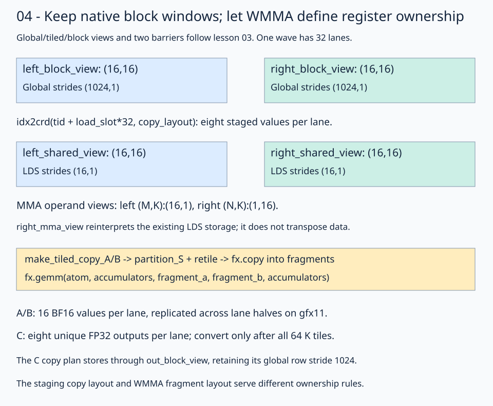
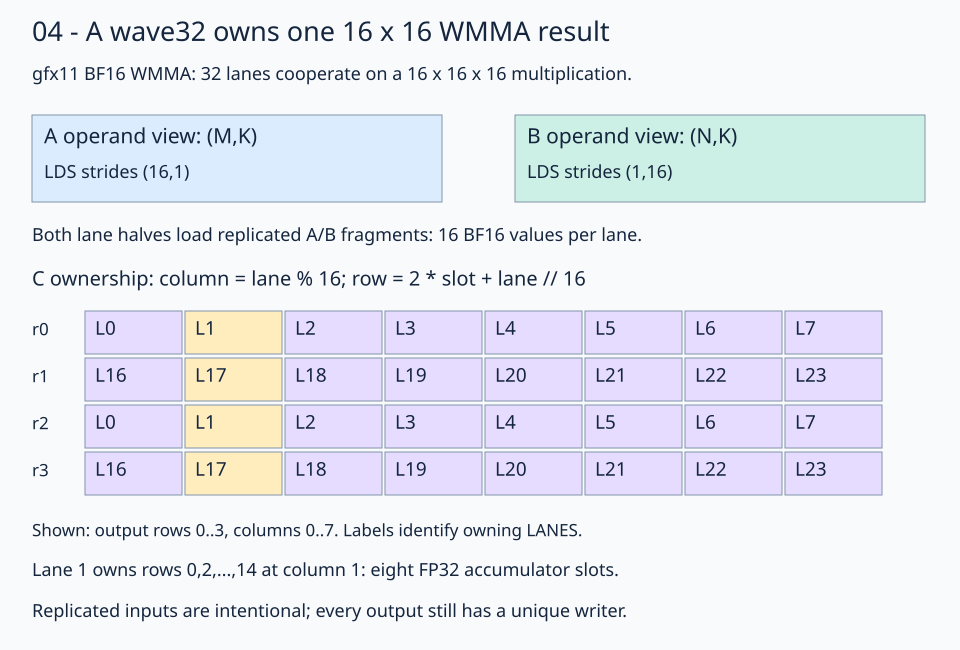

# 04 · Feed native block windows into a BF16 matrix instruction

The [LDS lesson](../03-shared-memory/README.md) shares inputs but performs scalar arithmetic. This lesson keeps its **1024³** problem, first-class global/tiled/block views, 16-wide K staging, and barriers. A wave32 WMMA instruction replaces scalar dot-product arithmetic with a collective 16×16×16 BF16 matrix operation and FP32 accumulator fragments.

The gfx11 fragment convention here targets **gfx1151/gfx1152**. Execution was checked on gfx1151; these refactored lessons still need gfx1152 hardware validation. One block launches 32 lanes and computes one 16×16 output window over 64 K stages.

## 1. Keep the same native global and block views

```python
left_tiled_view = fx.flat_divide(left_global_view, (16, 16))
right_tiled_view = fx.flat_divide(right_global_view, (16, 16))
out_tiled_view = fx.flat_divide(out_global_view, (16, 16))
out_block_view = fx.slice(out_tiled_view, (None, None, block_row, block_col))
```

The three global views are ordinary row-major matrices. Each tiled shape is `(16,16,64,64)`. Inside the K loop, A fixes `(block_row,tile_k)` and B fixes `(tile_k,block_col)`, with two leading `None` entries to keep local coordinates. The selected global windows remain `(16,16)` with row stride 1024. No handwritten global storage offsets are needed.



Read top to bottom: block views select global data, shared views address actual LDS allocations, MMA views give that same LDS storage an operand-specific coordinate convention, and copies load the required register fragments.

## 2. Stage into ordinary LDS layouts

Allocate `left_shared_view` and `right_shared_view` as `(16,16):(16,1)`, the same physical layouts as lesson 03. The 32 lanes now load eight values each instead of four:

```python
copy_coordinate = fx.idx2crd(fx.thread_idx.x + load_slot * 32, copy_layout)
left_shared_view[copy_coordinate] = left_block_view[copy_coordinate]
right_shared_view[copy_coordinate] = right_block_view[copy_coordinate]
```

Here `copy_layout` is still a column-fast `(16,16)` layout over 256 logical positions. Lane 17's first load is local `(1,1)`; later slots visit `(3,1)`, `(5,1)`, …, `(15,1)`. At block `(1,2)`, `tile_k=2`, the first pair comes from global A `(33,33)` and B `(33,17)`. All lanes reach the first barrier after staging.

This copy layout describes **staging ownership**. It does not define the register fragment distribution required by WMMA.

## 3. Describe the instruction's operand views

The physical staged B tile uses coordinates `(K,N)`. The MMA API expects B coordinates `(N,K)`:

```python
left_mma_view = left_shared_view
right_mma_view = fx.make_view(
    fx.get_iter(right_shared_view), fx.make_layout((16, 16), (1, 16))
)
```

| Name | Coordinate meaning | Shape | Strides in elements |
| --- | --- | --- | --- |
| `left_shared_view` / `left_mma_view` | `(M,K)` | `(16,16)` | `(16,1)` |
| `right_shared_view` | `(K,N)` | `(16,16)` | `(16,1)` |
| `right_mma_view` | `(N,K)` | `(16,16)` | `(1,16)` |
| `out_block_view` | `(M,N)` | `(16,16)` | `(1024,1)` |

For right operand coordinate `(n,k)=(1,2)`, the MMA view reaches LDS offset `1+2*16=33`, the same stored value as physical B coordinate `(k,n)=(2,1)`. No transpose allocation or data movement happens in this view construction. Equal square shapes can hide the difference; the mode meanings and strides make it explicit.

## 4. Let WMMA define the compute ownership

```python
atom = fx.make_mma_atom(fx.rocdl.WMMA(16, 16, 16, fx.BFloat16, fx.Float32))
mma = fx.make_tiled_mma(atom, fx.make_layout((1, 1, 1), (0, 0, 0)))
thread_mma = mma.thr_slice(fx.thread_idx.x)
```

The `(1,1,1)` atom layout adds no repetitions; it describes a single wave's matrix tile. Unlike lesson 03's four adjacent output rows per thread, WMMA requires its own operand and accumulator layouts. `make_fragment_A/B/C` derives those register fragments from the MMA views and output block view.



A/B fragments hold 16 BF16 values per lane, replicated across the two lane halves on gfx11. Replication is part of the instruction convention. C has eight FP32 slots per lane with local `column=lane%16`, `row=2*slot+lane//16`. In block `(1,2)`, lane 17 owns global C rows 33,35,…,47 at column 17. The 256 output positions still have unique writers.

## 5. Copy into register fragments, then execute WMMA

```python
copy_ab = fx.make_copy_atom(fx.UniversalCopy(16), fx.BFloat16)
thread_a = fx.make_tiled_copy_A(copy_ab, mma).get_slice(fx.thread_idx.x)
source_a = thread_a.partition_S(left_mma_view)
register_a = thread_a.retile(fragment_a)
```

B has the corresponding copy plan and views. `partition_S` selects source positions for this lane; `retile` presents its register fragment with compatible copy ownership. Those steps describe access. After the cooperative LDS staging barrier, the copies perform the transfers:

```python
fx.copy(copy_ab, source_a, register_a)
fx.copy(copy_ab, source_b, register_b)
fx.gemm(atom, accumulators, fragment_a, fragment_b, accumulators)
fx.gpu.barrier()
```

The 16-bit copy width matches BF16 elements; the WMMA atom separately specifies FP32 accumulation. `fx.gemm` performs the current 16-wide K update. Initialize accumulators once before the 64-stage loop, and retain them across all stages. The second barrier protects LDS reuse after the operand reads and computation.

## 6. Convert and copy through the output block view

After all K stages, convert the eight accumulator slots to a BF16 result fragment. `make_tiled_copy_C` supplies the instruction's output ownership:

```python
destination = thread_c.partition_S(out_block_view)
fx.copy(copy_c, thread_c.retile(result), destination)
```

The output block view retains row stride 1024 and its selected base; the C copy maps the instruction's unique results into that view. Do not replace it with lesson 03's four-row scalar ownership rule.

## Inspect the actual instruction

```bash
FLYDSL_DUMP_IR=1 FLYDSL_DUMP_DIR=/tmp/flydsl-native-matmul-wmma \
  pixi run python lessons/01-gpu-programming/13-matmul/04-matrix-instructions/solution.py --check-only
rg 'v_wmma' /tmp/flydsl-native-matmul-wmma -g '*.s'
```

The gfx1151 final assembly contains `v_wmma_f32_16x16x16_bf16` and LDS staging operations. Instruction selection is evidence of the intended operation, not a speedup or a win over a library. The per-lesson benchmark compares GPU `torch.matmul` under the same shape and timing method.

TODO 1 constructs `right_mma_view` with the `(N,K)` stride convention. TODO 2 constructs the BF16-input, FP32-accumulating WMMA `atom`. Keep native K-window selection, staging, fragment copies, barriers, and output conversion supplied.

## Practice and checkpoint

Complete the two numbered expressions in `practice.py`. Keep the supplied launch, initialization, stores, and checker. The unfinished starter reports `Practice not finished: ...` and exits with status 1.

Every exercise runs **M = N = K = 1024**: row-major BF16 inputs, FP32 accumulation, and BF16 output. The checker evaluates all 1,048,576 outputs for two input patterns. The trace pattern uses `A[r,k] = ((r*1024+k) % 5)-2` and `B[k,c] = ((k*1024+c) % 7)-3`; the first four values of output row 0 are `[3, -6, -1, -3]`. A second pattern uses seeded random values quantized to BF16 before either implementation sees them. An independent CPU FP32 matrix product, rounded to BF16, supplies the untimed reference. Trace checks use `rtol=0, atol=0.001` to accommodate the small WMMA residue near zero; random checks use `rtol=0.016, atol=0.03125` for BF16 rounding and accumulation differences. These are exercise tolerances, not a numerical guarantee for arbitrary inputs.

Sixteen output sentinels must remain unchanged. Output data starts as NaN, so incomplete writes fail the reference comparison. The sentinel checks writes; full-tile dimension constraints make all input reads in these programs valid. No tails are implemented here.

## Compare this kernel with GPU PyTorch

Running this lesson's solution, or a completed practice, prints a timing table after the correctness checkpoint. The two rows compare **this file's kernel** with **GPU `torch.matmul`**, reporting milliseconds and effective TFLOP/s. A completed practice benchmarks your implementation, not the worked solution. Both implementations use the same 1024×1024 BF16 GPU inputs and preallocated BF16 GPU output; CPU reference arithmetic and allocations stay outside timing.

```bash
pixi run python lessons/01-gpu-programming/13-matmul/04-matrix-instructions/solution.py
# Select the timing method explicitly or skip performance measurement:
pixi run python lessons/01-gpu-programming/13-matmul/04-matrix-instructions/solution.py --timing host
pixi run python lessons/01-gpu-programming/13-matmul/04-matrix-instructions/practice.py --check-only
```

The default `--timing auto` tries GPU events first. If either row has an unavailable event duration, **both rows** are retimed with synchronized host batches, and the fallback is printed. Host timing still runs GPU computation but includes dispatch and synchronization overhead. `--timing gpu-event` disables fallback and reports unavailable values if events return zero. Each implementation gets three warm-ups and five batches of 20 launches; `--repeats` changes launches per batch. TFLOP/s is `2 * 1024**3 / (milliseconds * 1e9)`. Higher throughput means less time for this fixed operation count; it does not imply a universal speedup.

`pixi run gpu-check` and `pixi run lessons-check` run correctness only for the matmul stages. For the full-series comparison and measurement limits, see the [benchmark guide](../README.md#compare-the-stages).

**Check yourself:** Do replicated A/B fragments mean every output is computed and stored twice?

<details><summary>Answer</summary>

No. Replicated inputs satisfy the gfx11 instruction convention. C ownership is injective: lane 1 and lane 17 own different row parities, with eight accumulator slots each. The result copy uses that C ownership.

</details>

Run from the repository root:

```bash
pixi run python lessons/01-gpu-programming/13-matmul/04-matrix-instructions/practice.py
pixi run python lessons/01-gpu-programming/13-matmul/04-matrix-instructions/solution.py
```

A completed practice prints `Exercise passed:` with `shapes_MNK: [(1024, 1024, 1024)]`, two patterns, and the first-four checkpoint. Compare your implementation with the [worked solution](solution.py).

[Previous](../03-shared-memory/README.md) · [Matmul series](../README.md) · [Next steps](../../../../ROADMAP.md#matmul-continuation-planned)

Sources: [FlyDSL 0.4.1 kernel guide](https://github.com/ROCm/FlyDSL/blob/888d7d80528f0cf2abab8a86610d5ccca47f205d/docs/kernel_authoring_guide.md), [gfx11 WMMA tests and fragment convention](https://github.com/ROCm/FlyDSL/blob/888d7d80528f0cf2abab8a86610d5ccca47f205d/tests/kernels/test_rdna3_wmma_atom.py). API expressions were checked against the installed 0.4.1 package.
