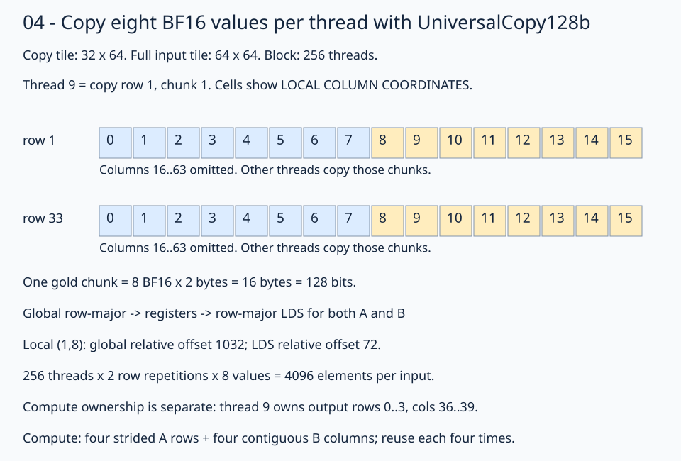

# 04 · Stage BF16 tiles with 128-bit copies

Shared-memory tiling reuses inputs across a block; register tiling keeps each thread's output sums local. This lesson keeps both and uses `TiledCopy` plans for global → LDS staging, LDS → register operand reads, and register → global output stores. Complete the [shared-memory lesson](../03-shared-memory/README.md), especially its optional [4×4 practice](../03-shared-memory/practice-4x4.py), and recall [tiled copies](../../08-tiled-copy/README.md).

The fixed problem remains **M=N=K=1024**, row-major BF16 A/B/C, with FP32 accumulation. Here each block computes a **64×64** output tile using **256 threads**, each owning **4×4** outputs. Each K stage loads a 64×64 tile of A and B into LDS. This matches the shared-memory 4×4 practice; the standard lesson-03 solution instead uses 16×16 block tiles and 4×1 thread windows. Changes in block size affect resource usage, so this is not an isolated performance comparison against that standard solution.



Follow the gold chunk: the numbers inside cells are local column coordinates, not values or byte offsets. One 128-bit copy carries eight BF16 elements. Thread 9 handles columns 8–15 in rows 1 and 33 of each input tile.

## Declare copy ownership separately from compute ownership

A and B both use row-major LDS layouts: `(M,K):(64,1)` and `(K,N):(64,1)`. The logical coordinates still mean `(M,K)` and `(K,N)` respectively. Each field uses 16-byte alignment (`fx.Array[fx.BFloat16, 4096, 16]`) and occupies 8192 bytes; both together use 16 KiB. Global input windows retain row stride 1024. Copy partitioning respects those different strides.

```python
copy_128b = fx.make_copy_atom(fx.UniversalCopy128b(), fx.BFloat16)
gmem2lds_thread_layout = fx.make_ordered_layout((32, 8), (1, 0))
gmem2lds_val_layout = fx.make_ordered_layout((1, 8), (1, 0))
gmem2lds_tilemn, gmem2lds_tv_layout = fx.make_layout_tv(
    gmem2lds_thread_layout, gmem2lds_val_layout
)
gmem2lds_copy_plan = fx.make_tiled_copy(
    copy_128b, gmem2lds_tv_layout, gmem2lds_tilemn
)
gmem2lds_thread_copy = gmem2lds_copy_plan.get_slice(fx.thread_idx.x)
```

The thread layout distributes 256 threads across 32 rows and eight column chunks. The value layout gives each thread eight adjacent columns. Together they cover **32×64** positions. Partitioning a 64×64 view supplies a second repetition along the row dimension.

For thread `tid` and repetition `repeat`, its chunk starts at:

```text
row = tid // 8 + repeat * 32       repeat = 0, 1
column = (tid % 8) * 8            eight consecutive columns
```

Thread 9 therefore owns `(1,8..15)` and `(33,8..15)`. All threads together cover every element once: `256 × 2 × 8 = 4096`. This differs from scalar striping, where a thread visited `tid + load_slot * 256` for 16 scalar slots. The new plan deliberately groups adjacent values per thread so each global load can move 16 bytes. Both operands also use contiguous 128-bit LDS stores.

The compute thread layout remains `(16,16):(16,1)`. Thread 9 computes rows 0–3 and columns 36–39 of the output block, regardless of which input chunks it copied. The first barrier makes cooperatively loaded values available to every thread.

## Partition views, then move values

The complete [solution](solution.py) names source and destination views before copying:

```python
left_lds_source = gmem2lds_thread_copy.partition_S(left_block_view)
left_lds_destination = gmem2lds_thread_copy.partition_D(left_lds_view)
left_fragment = fx.make_fragment_like(left_lds_destination)
fx.copy(copy_128b, left_lds_source, left_fragment)
fx.copy(copy_128b, left_fragment, left_lds_destination)
```

These are API fragments; the runnable solution allocates the reusable fragment and partitions the LDS destination outside the K loop. It places source partitioning in `create_gmem2lds_sources`, a tracing-time helper: the installed compiler otherwise attempts to carry the `ThrCopy` wrapper through the runtime loop. The helper selects views without loading values.

`partition_S` and `partition_D` select matching logical elements under the plan. Global A coordinate `(1,8)` has relative element offset `1*1024+8=1032`; shared A uses `1*64+8=72`. Shared B still uses `1*64+8=72` for its local `(K,N)=(1,8)` coordinate. The selected global view already contains its block and K-stage base. There is no additional base arithmetic in the copies.

`make_fragment_like` allocates per-thread temporary storage without initializing it. The first `fx.copy` loads from global memory into that fragment. The second `fx.copy` stores the contiguous register chunks into row-major LDS. `UniversalCopy128b` specifies a 128-bit transfer operation, not an asynchronous global-to-LDS operation. The contiguous global chunks and LDS staging stores have 16-byte boundaries; each four-value B compute group starts at an 8-byte boundary in LDS. No tail handling is provided.

B follows the same staging path. Then the original two-barrier protocol remains:

```text
load both global tiles into register fragments → store both to LDS → barrier
→ accumulate 64 K positions into 4×4 FP32 sums → barrier → next K tile
```

## Give LDS-to-register copies their own logical thread slots

The compute layout is `fx.make_ordered_layout((16,16), (1,0))`, equivalent to `(16,16):(16,1)`. Its coordinates are **output row group, output column group**. Columns vary fastest:

```text
thread_row = tid // 16
thread_col = tid % 16
output rows = 4*thread_row .. 4*thread_row+3
output columns = 4*thread_col .. 4*thread_col+3
```

Each K position contributes an outer product: four A values times four B values update the thread's 4×4 accumulator. A depends only on the output row group; B depends only on the output column group. The operand plans therefore each need just **16 logical copy slots**, even though all 256 physical threads execute the loads:

| Operand | Thread layout | Value layout | Copy tile | Atom |
| --- | --- | --- | --- | --- |
| A / left | `(16,1)` | `(4,1)` | `(64,1)` | `UniversalCopy16b` |
| B / right | `(1,16)` | `(1,4)` | `(1,64)` | `UniversalCopy64b` |

All four layouts use `fx.make_ordered_layout(shape, (1,0))`. The thread and value layouts are combined with `make_layout_tv`, then passed to `make_tiled_copy`, just as for staging. A's four rows are strided in row-major LDS, so its atom transfers one BF16 at a time. B's four columns are contiguous, so its atom transfers four BF16 together.

The native API fragment selecting each physical thread's operand ownership is:

```python
compute_thread_layout = fx.make_ordered_layout((16, 16), (1, 0))
thread_coord = fx.idx2crd(fx.thread_idx.x, compute_thread_layout)
lds2reg_left_thread_copy = lds2reg_left_copy_plan.get_slice(thread_coord[0])
lds2reg_right_thread_copy = lds2reg_right_copy_plan.get_slice(thread_coord[1])
```

`get_slice` chooses a logical slot in a copy plan; it does not launch a thread, loop over 0–15, or load data. The row or column coordinate is already in 0–15. Many physical threads intentionally choose the same slot, then load the same shared elements into their own private registers.

Follow **thread 17**: `17 // 16 = 1`, `17 % 16 = 1`, so its coordinate is `(1,1)` using zero-based indexing—the second thread row and second thread column. It owns output rows 4–7 and columns 4–7 within its block. At `inner_k=2`:

| Physical threads | Logical slot | Elements read from the current LDS tile |
| --- | --- | --- |
| 16–31, all in thread row 1 | A slot 1 | `A[4,2]`, `A[5,2]`, `A[6,2]`, `A[7,2]` |
| 1, 17, 33, …, 241, all in thread column 1 | B slot 1 | `B[2,4]`, `B[2,5]`, `B[2,6]`, `B[2,7]` |

For thread 17, these are A element offsets **258, 322, 386, 450**, and B offsets **132–135**, relative to their respective LDS buffers. A is reused across thread columns; B is reused across thread rows. Each physical thread has its own four-value `left_r_tile` and `right_r_tile`, and each loaded operand value is reused four times in that thread's outer product. The logical slot is shared; register storage is private.

## Select one K position, partition, then load

First divide the LDS views into whole columns of A and whole rows of B:

```python
left_lds_tiled_view = fx.flat_divide(left_lds_view, (64, 1))
right_lds_tiled_view = fx.flat_divide(right_lds_view, (1, 64))
```

Their shapes are `(64,1,1,64)` and `(1,64,64,1)`. Inside the K loop, slice the appropriate tile modes:

```python
left_lds_innerk_view = fx.slice(
    left_lds_tiled_view, (None, None, 0, inner_k)
)
right_lds_innerk_view = fx.slice(
    right_lds_tiled_view, (None, None, inner_k, 0)
)
left_r_source, right_r_source = create_lds2reg_sources(
    left_lds_innerk_view, right_lds_innerk_view
)
fx.copy(copy_16b, left_r_source, left_r_tile)
fx.copy(copy_64b, right_r_source, right_r_tile)
```

`create_lds2reg_sources` calls each selected thread copy's `partition_S` on the incoming view. Slicing chooses the K position; partitioning chooses the four rows or columns. Both describe accesses without moving data. The two `fx.copy` calls actually load the private fragments. The view already carries the selected K base; do not add it again.

The fragments are allocated once with `make_fragment_like` from partitions of the initial K=0 slices. Those initial views provide the shape and type; allocation does not read K=0. Every inner iteration overwrites the fragments before computing:

```python
for row in range(4):
    for col in range(4):
        coord = fx.make_coord(row, col)
        accumulator[coord] += fx.Float32(left_r_tile[row]) * fx.Float32(
            right_r_tile[col]
        )
```

Conversion to FP32 happens before multiplication and accumulation. The first barrier ensures staging is complete before operand reads. The second ensures every thread has finished reading before the next K stage overwrites LDS.

The upstream RDNA3 GEMM's default A LDS layout is padded row-major with K contiguous; its alternative groups K into blocks of eight. Its WMMA operand loads walk contiguous K values, and it accepts an already-transposed B input. This lesson uses row-major B and scalar outer products, so its compute ownership differs. See the [upstream layout and operand loads](https://github.com/ROCm/FlyDSL/blob/main/kernels/gemm/rdna3_f16_gemm.py).

Bank conflicts depend on the addresses issued together by the lanes of an instruction, including any broadcast behavior; a single thread's row stride alone does not establish a conflict. Instruction count and width, bandwidth, dependencies, and latency hiding also affect performance. Keep the row-major staging baseline and measure any later padding, swizzling, or ownership change. See [AMD's LDS hardware description](https://rocmdocs.amd.com/projects/HIP/en/latest/understand/hardware_implementation.html).

## Copy the output from registers to global memory

The 16 output accumulators survive all 16 K stages. Afterward, `flat_divide(out_block_view, (4,4))` and `thread_coord` select this physical thread's unique 4×4 output window. Convert the accumulator into a BF16 `out_registers` fragment before copying.

The output plan uses one logical thread with layout `(1,1):(1,1)` and a `(4,4)` value layout ordered by `(1,0)`. Every physical thread calls `reg2gmem_copy_plan.get_slice(0)`: its output view already selects its own window. `partition_S(out_registers)` and `partition_D(out_thread_view)` pair the values, then `fx.copy(copy_64b, reg2gmem_source, reg2gmem_dest)` stores four contiguous BF16 elements per row. Reusing slot 0 here does not make different physical threads write the same output addresses.

## Practice and verification

The completed [practice.py](practice.py) and worked [solution.py](solution.py) use the same three copy paths: 128-bit global-to-LDS staging through temporary registers, separate A/B LDS-to-register plans, and 64-bit output stores after BF16 conversion. Trace `gmem2lds_thread_copy`, `lds2reg_left_thread_copy`, `lds2reg_right_thread_copy`, and `reg2gmem_thread_copy` to compare which ID each plan receives. The practice file contains the completed implementation rather than unfilled TODOs.

```bash
pixi run python lessons/01-gpu-programming/13-matmul/04-vectorized-copy/practice.py --check-only
pixi run python lessons/01-gpu-programming/13-matmul/04-vectorized-copy/solution.py --check-only
# Omit --check-only to compare this kernel with GPU torch.matmul.
```

Both programs print `Exercise passed:` with `shapes_MNK: [(1024,1024,1024)]`, two patterns, and `first_four: [3,-6,-1,-3]`. The checker compares every output against CPU FP32 matmul on the quantized inputs, rounded to BF16. Trace tolerance is `rtol=0, atol=0.001`; seeded random tolerance is `rtol=0.016, atol=0.03125`. Output starts as NaN, and 16 trailing sentinels check stray writes.

To inspect lowering rather than infer it from the atom's name:

```bash
FLYDSL_DUMP_IR=1 FLYDSL_DUMP_DIR=/tmp/flydsl-vector-copy \
  pixi run python lessons/01-gpu-programming/13-matmul/04-vectorized-copy/solution.py --check-only
rg 'global_load_b128|ds_store_b128|ds_load' /tmp/flydsl-vector-copy -g '*.s'
```

Inspect the global staging loads, LDS stores, and compute reads separately. Instruction inspection establishes transfer width on the tested target; it does not establish a speedup. The [series benchmark](../README.md#compare-the-stages) holds the logical problem fixed while reporting each stage's timing.

**Check yourself:** Why do threads 16 and 17 choose the same A copy slot, but different B copy slots?

<details><summary>Answer</summary>

Their compute coordinates are `(1,0)` and `(1,1)`. Both need A rows 4–7, so both use A slot 1 and load the same four A values into separate private fragments. They need different B columns: thread 16 uses B slot 0 for columns 0–3; thread 17 uses B slot 1 for columns 4–7. Each computes its own 4×4 output tile.

</details>

[Previous: shared memory](../03-shared-memory/README.md) · [Matmul series](../README.md) · [Next: matrix instructions](../05-matrix-instructions/README.md)

Sources: [upstream RDNA3 GEMM copy pipeline](https://github.com/ROCm/FlyDSL/blob/main/kernels/gemm/rdna3_f16_gemm.py#L257-L309), [tiled-copy example](https://github.com/ROCm/FlyDSL/blob/main/examples/02-tiledCopy.py). API expressions and native execution were checked against installed FlyDSL 0.4.1 on gfx1151.
