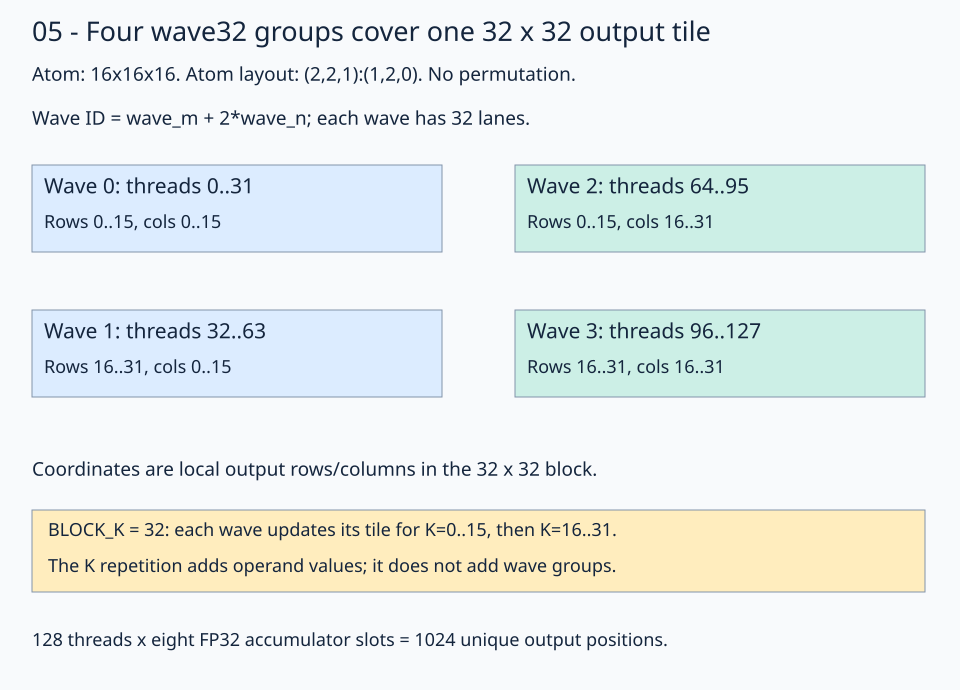
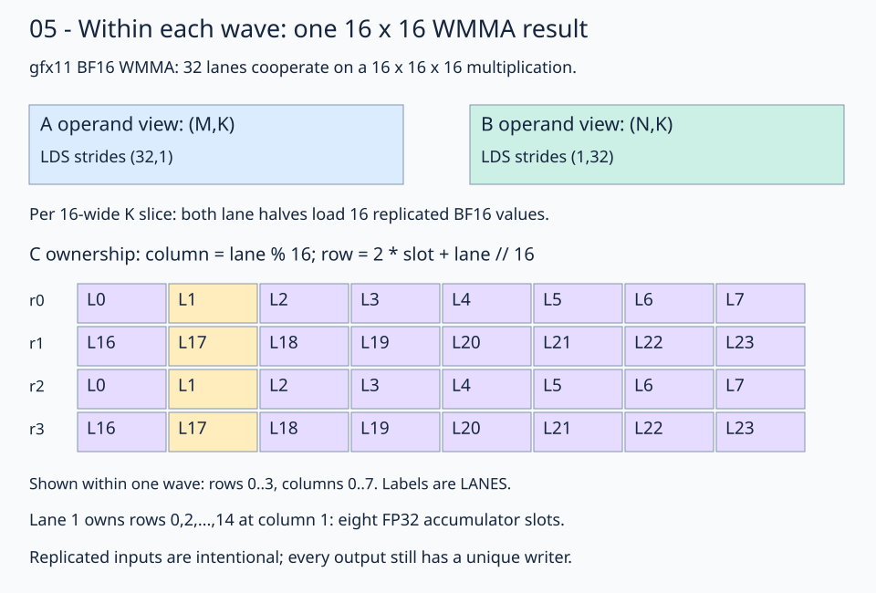

# 05 · Feed LDS tiles into BF16 matrix instructions

The [vectorized-copy lesson](../04-vectorized-copy/README.md) stages inputs through global → registers → LDS, then uses scalar arithmetic. This lesson keeps that staging pipeline and replaces the arithmetic with wave32 WMMA instructions. The learning question is how a large LDS tile feeds several instruction-sized register fragments without manually defining each lane's operand layout.

The problem is **M=N=K=1024**, with row-major BF16 inputs, FP32 accumulation, and BF16 output. Each block has **128 threads** and computes **64×64 outputs**, staging **64 K positions** at a time. The WMMA atom remains **16×16×16**. An explicit inner loop consumes four K=16 slices before the next outer iteration replaces LDS.

## 1. Select global windows and stage them in LDS

The global views use `(M,K):(K,1)`, `(K,N):(N,1)`, and `(M,N):(N,1)` layouts. Divide them into block windows:

```python
left_tiled_view = fx.flat_divide(left_global_view, (BLOCK_M, BLOCK_K))
right_tiled_view = fx.flat_divide(right_global_view, (BLOCK_K, BLOCK_N))
out_tiled_view = fx.flat_divide(out_global_view, (BLOCK_M, BLOCK_N))
out_block_view = fx.slice(out_tiled_view, (None, None, block_row, block_col))
```

With `BLOCK_M = BLOCK_N = BLOCK_K = 64`, each divided view has shape `(64,64,16,16)`. Selecting a block retains its global row stride of 1024. Inside the outer K loop, A fixes `(block_row,tile_k)` and B fixes `(tile_k,block_col)`. No handwritten global pointer offsets are needed.

`SharedStorage` allocates two aligned arrays of 4096 BF16 elements. Each LDS view is row-major `(64,64):(64,1)`, for **16 KiB total LDS per block**. Staging uses:

```python
copy_128b = fx.make_copy_atom(fx.UniversalCopy128b(), fx.BFloat16)
gmem2lds_thread_layout = fx.make_ordered_layout((16, 8), (1, 0))
gmem2lds_val_layout = fx.make_ordered_layout((1, 8), (1, 0))
```

The thread layout has strides `(8,1)`. Together with eight contiguous values per thread, it covers a 16×64 copy tile that repeats four times along the rows. Thread 17 starts at local row `17//8=2`, columns `(17%8)*8=8` through 15. Its other groups use rows 18, 34, and 50. Each thread stages 32 BF16 elements per operand.

At block `(x,y)=(1,2)` and `tile_k=2`, thread 17's first group reads A row 130, columns 136–143, and B row 130, columns 72–79. The selected views already carry those block offsets.

`make_tiled_copy` builds staging ownership; its thread slice partitions the source and LDS destination views. Copies move each input through a reusable register fragment:

```python
fx.copy(copy_128b, left_lds_source, left_fragment)
fx.copy(copy_128b, right_lds_source, right_fragment)
fx.copy(copy_128b, left_fragment, left_lds_destination)
fx.copy(copy_128b, right_fragment, right_lds_destination)
fx.barrier()
```

The barrier makes all cooperative LDS writes visible before operand loads.

## 2. Describe B using the MMA coordinate convention

The staged B storage is physically `(K,N)`. WMMA's B operand view uses `(N,K)`:

```python
right_mma_lds_view = fx.make_view(
    fx.get_iter(right_lds_view),
    fx.make_layout((BLOCK_N, BLOCK_K), (1, BLOCK_N)),
)
```

For coordinate `(n,k)=(1,2)`, this reaches element offset `1+2*64=129`, the same value as physical B coordinate `(k,n)=(2,1)`. Creating the view moves no data and allocates no transpose buffer.

## 3. Let WMMA define thread and value ownership

```python
mma_atom = fx.make_mma_atom(
    fx.rocdl.WMMA(MMA_M, MMA_N, MMA_K, fx.BFloat16, fx.Float32)
)
mma = fx.make_tiled_mma(mma_atom, fx.make_layout((2, 2, 1), (1, 2, 0)))
thread_mma = mma.thr_slice(fx.thread_idx.x)
accumulator = thread_mma.make_fragment_C(out_block_view)
accumulator.fill(0)
```

`MMA_M = MMA_N = MMA_K = 16`. The atom layout maps wave-group coordinates to `wave_id = wave_m + 2*wave_n`. Four wave32 groups give 128 threads and a natural **32×32×16** MMA footprint.



The illustration shows one natural 32×32 footprint and K=32. The runnable kernel repeats that footprint across a **64×64 output tile** and explicitly processes **four** K=16 slices per LDS stage. Wave ownership repeats every 32 rows and columns:

| Wave | Threads | Local output row ranges | Local output column ranges |
| --- | --- | --- | --- |
| 0 | 0–31 | 0–15, 32–47 | 0–15, 32–47 |
| 1 | 32–63 | 16–31, 48–63 | 0–15, 32–47 |
| 2 | 64–95 | 0–15, 32–47 | 16–31, 48–63 |
| 3 | 96–127 | 16–31, 48–63 | 16–31, 48–63 |

Each wave computes four 16×16 output subtiles. Each thread owns **32 FP32 accumulator values**, giving `128*32=4096` unique outputs. Pass the full scalar `fx.thread_idx.x` to MMA and copy-plan thread slices.



The diagram uses a smaller LDS example with strides `(32,1)` and `(1,32)`; the runnable tile uses `(64,1)` and `(1,64)`. Read its lane grid within one instruction-sized subtile: lane 1 owns even rows at column 1 and lane 17 owns odd rows. Repeating the subtile across M/N increases each thread's accumulator count; it does not change the atom's lane convention.

## 4. Allocate registers for one K slice

Give fragment allocation views whose K extent is only 16:

```python
left_mma_lds_view = fx.slice(
    fx.flat_divide(left_lds_view, (BLOCK_M, MMA_K)), (None, None, 0, 0)
)
right_mma_slice = fx.slice(
    fx.flat_divide(right_mma_lds_view, (BLOCK_N, MMA_K)), (None, None, 0, 0)
)
left_r_tile = thread_mma.make_fragment_A(left_mma_lds_view)
right_r_tile = thread_mma.make_fragment_B(right_mma_slice)
```

The A/B views have shape `(64,16)` with their respective operand conventions. `make_fragment_A/B` allocates instruction-compatible registers; it does not load or initialize them. Copies supply the values.

```python
copy_16b = fx.make_copy_atom(fx.UniversalCopy16b(), fx.BFloat16)
lds2reg_left_copy_plan = fx.make_tiled_copy_A(copy_16b, mma)
lds2reg_right_copy_plan = fx.make_tiled_copy_B(copy_16b, mma)
lds2reg_left_thread_copy = lds2reg_left_copy_plan.get_slice(fx.thread_idx.x)
lds2reg_right_thread_copy = lds2reg_right_copy_plan.get_slice(fx.thread_idx.x)
left_r_destination = lds2reg_left_thread_copy.retile(left_r_tile)
right_r_destination = lds2reg_right_thread_copy.retile(right_r_tile)
```

The A/B helpers derive thread/value ownership from `mma`. `retile` creates a copy-compatible alias of an existing register fragment, without another allocation or data transfer. Staging ownership stays independent of WMMA ownership.

## 5. Consume four slices in an explicit inner K loop

After staging each 64-wide K tile and synchronizing, run this inner loop directly inside the outer `tile_k` loop:

```python
for inner_k in fx.range_constexpr(BLOCK_K // MMA_K):
    left_subview = fx.slice(
        fx.flat_divide(left_lds_view, (BLOCK_M, MMA_K)),
        (None, None, 0, inner_k),
    )
    right_subview = fx.slice(
        fx.flat_divide(right_mma_lds_view, (BLOCK_N, MMA_K)),
        (None, None, 0, inner_k),
    )
    left_r_source = lds2reg_thread_copies[0].partition_S(left_subview)
    right_r_source = lds2reg_thread_copies[1].partition_S(right_subview)
    fx.copy(copy_16b, left_r_source, left_r_destination)
    fx.copy(copy_16b, right_r_source, right_r_destination)
    fx.gemm(mma_atom, accumulator, left_r_tile, right_r_tile, accumulator)
fx.barrier()
```

These API fragments use the tuple defined before the outer loop:

```python
lds2reg_thread_copies = (lds2reg_left_thread_copy, lds2reg_right_thread_copy)
```

Tuple access avoids FlyDSL 0.4.1 treating method calls on copy wrappers as loop-carried state. The loads and WMMA calls remain inline. `range_constexpr` unrolls the four steps during compilation.

Follow `tile_k=2`: the staged global K interval is 128–191. `inner_k=0,1,2,3` selects intervals 128–143, 144–159, 160–175, and 176–191. Each step refills the same operand registers and accumulates into the same C fragment. Each `fx.gemm` processes one K slice across the wave's four output subtiles. Initialize C once before the outer loop; the 16 outer stages together cover K=1024. The final barrier protects LDS from being overwritten while other waves still read it.

An explicit inner loop is needed here because each register fragment contains only K=16. Passing full K=64 views to `make_fragment_A/B` would instead allocate registers for all four K fragments; after copies populate them, `fx.gemm` can traverse those fragments internally. Both approaches compute the same reduction. Loading one slice at a time reduces live operand storage for the same tile dimensions, while accumulator storage remains unchanged. A performance claim requires comparing identical tile dimensions and inspecting register allocation and spills.

Larger M/N dimensions provide reuse: each staged A value contributes across 64 output columns, and each B value across 64 rows. Advancing `inner_k` consumes different values; the K loop itself does not create reuse of the same operand values.

## 6. Convert and store with C ownership

```python
out_registers = fx.make_rmem_tensor(accumulator.layout, fx.BFloat16)
for slot in fx.range_constexpr(ACCUMULATOR_VALUES):
    out_registers[slot] = accumulator[slot].to(fx.BFloat16)
rmem2gmem_copy_plan = fx.make_tiled_copy_C(copy_16b, mma)
rmem2gmem_thread_copy = rmem2gmem_copy_plan.get_slice(fx.thread_idx.x)
rmem2gmem_source = rmem2gmem_thread_copy.retile(out_registers)
rmem2gmem_dest = rmem2gmem_thread_copy.partition_D(out_block_view)
fx.copy(copy_16b, rmem2gmem_source, rmem2gmem_dest)
```

`ACCUMULATOR_VALUES = BLOCK_M * BLOCK_N // THREADS_PER_BLOCK = 32`. The C plan derives output ownership from MMA and maps all 4096 values into the selected global block view, retaining row stride 1024.

## Practice, validation, and timing

The completed [practice](practice.py) and [worked solution](solution.py) implement the same larger tile and inline inner loop. Trace the K slices, the `(N,K)` B view, and the instruction-derived A/B/C copy plans.

The checker compares every output with an independent CPU FP32 matrix product of the quantized BF16 inputs, rounded to BF16. It uses two patterns: a trace pattern with `A[r,k]=((r*1024+k)%5)-2` and `B[k,c]=((k*1024+c)%7)-3`, and seeded random inputs. The first four trace outputs are **[3, -6, -1, -3]**. Trace tolerances are `rtol=0, atol=0.001`; random tolerances are `rtol=0.016, atol=0.03125`. Output starts as NaN to detect missing writes, and sixteen trailing sentinels detect writes past its end. The fixed dimensions contain only complete tiles; this kernel implements no tails.

Run from the repository root:

```bash
pixi run python lessons/01-gpu-programming/13-matmul/05-matrix-instructions/practice.py --check-only
pixi run python lessons/01-gpu-programming/13-matmul/05-matrix-instructions/solution.py --check-only
pixi run gpu-check
```

Without `--check-only`, each file compares its GPU kernel with GPU `torch.matmul` on the same 1024³ problem and preallocated output. The default timing mode tries GPU events and retimes both rows with synchronized host batches if event durations are unavailable. Use `--timing host` to request that mode explicitly. CPU references and allocation remain outside timing. See the [benchmark guide](../README.md#compare-the-stages) for measurement limits.

To inspect generated instructions:

```bash
FLYDSL_DUMP_IR=1 FLYDSL_DUMP_DIR=/tmp/flydsl-native-matmul-wmma \
  pixi run python lessons/01-gpu-programming/13-matmul/05-matrix-instructions/solution.py --check-only
rg 'v_wmma' /tmp/flydsl-native-matmul-wmma -g '*.s'
```

This lesson targets gfx1151/gfx1152 using the gfx11 wave32 fragment convention. The adjacent LDS-layout experiment keeps this 64×64×64 tile and inner K loop while changing A's physical placement.

**Check yourself:** If the inner loop is removed but the operand fragments still cover only K=16, will `fx.gemm` automatically consume the remaining LDS slices?

<details><summary>Answer</summary>

No. `fx.gemm` sees the supplied register fragments, not the remaining LDS tile. Only the loaded K=16 slice contributes. Either explicitly load and compute every slice, or allocate and populate fragments covering the complete staged K extent before calling `fx.gemm`.

</details>

[Previous](../04-vectorized-copy/README.md) · [Matmul series](../README.md) · [Next: LDS bank conflicts](../06-lds-swizzle/README.md)

Sources: [FlyDSL 0.4.1 kernel guide](https://github.com/ROCm/FlyDSL/blob/888d7d80528f0cf2abab8a86610d5ccca47f205d/docs/kernel_authoring_guide.md), [gfx11 WMMA tests](https://github.com/ROCm/FlyDSL/blob/888d7d80528f0cf2abab8a86610d5ccca47f205d/tests/kernels/test_rdna3_wmma_atom.py). API patterns also follow the installed FlyDSL 0.4.1 package and the course's parameter-tuning implementation.
