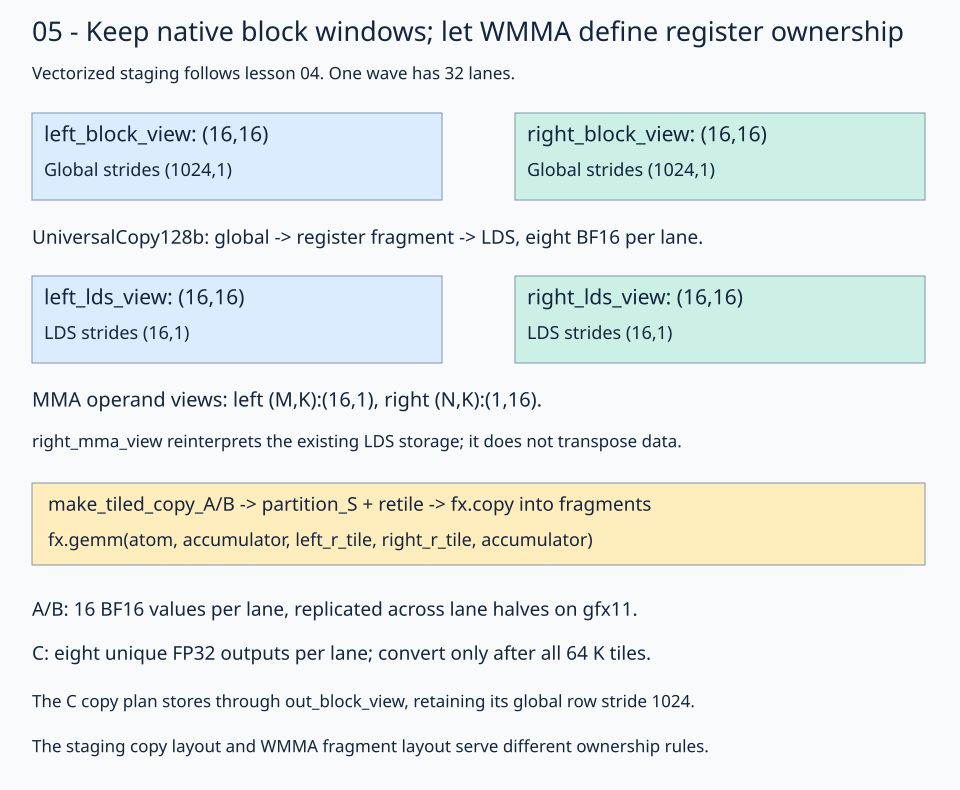

# 05 · Feed native block windows into a BF16 matrix instruction

The [vectorized-copy lesson](../04-vectorized-copy/README.md) stages BF16 inputs with `UniversalCopy128b` and performs scalar arithmetic into 4×4 register tiles. This lesson retains its global → register fragment → LDS copy pipeline and two barriers, then derives operand/output copy plans from `mma` and replaces scalar arithmetic with a collective 16×16×16 wave32 WMMA operation and FP32 accumulator fragments. The **1024³** logical problem and row-major input/output contract remain the same.

To isolate one instruction's ownership, the block shrinks from 64×64 with 256 threads to 16×16 with 32 threads, and K staging shrinks from 64 to 16. This single-wave example uses row-major LDS for both operands, as in stage 04, while replacing its scalar outer-product compute fragments; WMMA supplies its own operand ownership. The copy thread layout becomes `(16,2):(2,1)` with `(1,8)` values per thread: each lane moves one eight-BF16 chunk per operand. Copy ownership and WMMA ownership remain separate.

The gfx11 fragment convention here targets **gfx1151/gfx1152**. Execution was checked on gfx1151; these refactored lessons still need gfx1152 hardware validation. One block launches 32 lanes and computes one 16×16 output window over 64 K stages.

## Follow stage 04's seven steps

The [solution](solution.py) keeps stage 04's named block constants, `SharedStorage` struct, intermediate view names, and seven numbered kernel sections. The important ownership changes are:

| Copy path | Stage 04 | This lesson |
| --- | --- | --- |
| Global → registers → LDS | `make_tiled_copy(copy_128b, tv, tile)` | Same generic builder, adapted to 32 lanes |
| LDS → A registers | Manual `(16,1)` / `(4,1)` layouts | `make_tiled_copy_A(copy_16b, mma)` |
| LDS → B registers | Manual `(1,16)` / `(1,4)` layouts | `make_tiled_copy_B(copy_16b, mma)` |
| Registers → global C | One logical slot in an already-selected 4×4 window | `make_tiled_copy_C(copy_16b, mma)` over the output block |

The A/B/C helpers derive thread/value ownership and tile shape from `mma`; they still produce tiled copy plans. `get_slice`, source/destination partitioning, and `fx.copy` keep their roles. The atom width remains a separate choice: operand and output copies use `UniversalCopy16b` here because WMMA's element distribution differs from stage 04's contiguous B/output groups.

This changes more than the builder names. Full lane IDs replace stage 04's row/column copy slots; MMA allocates its required register fragments; `retile` exposes them to copies; and one collective `fx.gemm` consumes a complete 16-wide K tile. There is no scalar `inner_k` loop or per-thread 4×4 output selection.

## 1. Keep the same native global and block views

```python
left_tiled_view = fx.flat_divide(left_global_view, (BLOCK_M, BLOCK_K))
right_tiled_view = fx.flat_divide(right_global_view, (BLOCK_K, BLOCK_N))
out_tiled_view = fx.flat_divide(out_global_view, (BLOCK_M, BLOCK_N))
out_block_view = fx.slice(out_tiled_view, (None, None, block_row, block_col))
```

The three global views are ordinary row-major matrices. Each tiled shape is `(16,16,64,64)`. Inside the K loop, A fixes `(block_row,tile_k)` and B fixes `(tile_k,block_col)`, with two leading `None` entries to keep local coordinates. The selected global windows remain `(16,16)` with row stride 1024. No handwritten global storage offsets are needed.



Read top to bottom: block views select global data, shared views address actual LDS allocations, MMA views give that same LDS storage an operand-specific coordinate convention, and copies load the required register fragments.

## 2. Stage into ordinary LDS layouts

Set `BLOCK_M = BLOCK_N = BLOCK_K = 16` and `THREADS_PER_BLOCK = 32`. Declare the two aligned arrays in `SharedStorage`, allocate once, and attach `left_lds_view` and `right_lds_view` with row-major `(16,16):(16,1)` layouts, following stage 04. Both buffers together occupy 1024 bytes. Adapt lesson 04's staging plan to 32 lanes:

```python
copy_128b = fx.make_copy_atom(fx.UniversalCopy128b(), fx.BFloat16)
gmem2lds_thread_layout = fx.make_ordered_layout((16, 2), (1, 0))
gmem2lds_val_layout = fx.make_ordered_layout((1, 8), (1, 0))
gmem2lds_tilemn, gmem2lds_tv_layout = fx.make_layout_tv(
    gmem2lds_thread_layout, gmem2lds_val_layout
)
gmem2lds_copy_plan = fx.make_tiled_copy(
    copy_128b, gmem2lds_tv_layout, gmem2lds_tilemn
)
gmem2lds_thread_copy = gmem2lds_copy_plan.get_slice(fx.thread_idx.x)
```

Lane 17 copies local row 8, columns 8–15: `row=17//2`, `column_start=(17%2)*8`. At block `(x,y)=(1,2)` and `tile_k=2`, its first pair comes from global A `(40,40)` and B `(40,24)`. The two 256-element tiles are completely covered by 32 lanes moving eight elements each.

As in lesson 04, `create_gmem2lds_sources` selects each lane's source views, and `partition_D` selects its LDS destination views. Each operand is copied through a reusable register fragment:

```python
fx.copy(copy_128b, left_lds_source, left_fragment)
fx.copy(copy_128b, right_lds_source, right_fragment)
fx.copy(copy_128b, left_fragment, left_lds_destination)
fx.copy(copy_128b, right_fragment, right_lds_destination)
fx.barrier()
```

These are synchronous 128-bit transfers. Staging ownership does not define the register distribution required by WMMA. The later operand copies retain their separate 16-bit atoms because their instruction-derived layouts differ.

## 3. Describe the instruction's operand views

The physical staged B tile uses coordinates `(K,N)`. The MMA API expects B coordinates `(N,K)`:

```python
left_mma_view = left_lds_view
right_mma_view = fx.make_view(
    fx.get_iter(right_lds_view), fx.make_layout((BLOCK_N, BLOCK_K), (1, BLOCK_N))
)
```

| Name | Coordinate meaning | Shape | Strides in elements |
| --- | --- | --- | --- |
| `left_lds_view` / `left_mma_view` | `(M,K)` | `(16,16)` | `(16,1)` |
| `right_lds_view` | `(K,N)` | `(16,16)` | `(16,1)` |
| `right_mma_view` | `(N,K)` | `(16,16)` | `(1,16)` |
| `out_block_view` | `(M,N)` | `(16,16)` | `(1024,1)` |

For right operand coordinate `(n,k)=(1,2)`, the MMA view reaches LDS offset `1+2*16=33`, the same stored value as physical B coordinate `(k,n)=(2,1)`. No transpose allocation or data movement happens in this view construction. Equal square shapes can hide the difference; the mode meanings and strides make it explicit.

## 4. Let WMMA define the compute ownership

```python
atom = fx.make_mma_atom(fx.rocdl.WMMA(16, 16, 16, fx.BFloat16, fx.Float32))
mma = fx.make_tiled_mma(atom, fx.make_layout((1, 1, 1), (0, 0, 0)))
thread_mma = mma.thr_slice(fx.thread_idx.x)
```

The `(1,1,1)` atom layout adds no repetitions; it describes a single wave's matrix tile. Unlike lesson 04's 4×4 scalar output window per thread, WMMA requires its own operand and accumulator layouts. `make_fragment_A/B/C` derives those register fragments from the MMA views and output block view.


A/B fragments hold 16 BF16 values per lane, replicated across the two lane halves on gfx11. Replication is part of the instruction convention. C has eight FP32 slots per lane with local `column=lane%16`, `row=2*slot+lane//16`. In block `(1,2)`, lane 17 owns global C rows 33,35,…,47 at column 17. The 256 output positions still have unique writers.

## 5. Copy into register fragments, then execute WMMA

```python
copy_16b = fx.make_copy_atom(fx.UniversalCopy16b(), fx.BFloat16)
lds2reg_left_copy_plan = fx.make_tiled_copy_A(copy_16b, mma)
lds2reg_right_copy_plan = fx.make_tiled_copy_B(copy_16b, mma)
lds2reg_left_thread_copy = lds2reg_left_copy_plan.get_slice(fx.thread_idx.x)
lds2reg_right_thread_copy = lds2reg_right_copy_plan.get_slice(fx.thread_idx.x)
left_r_tile = thread_mma.make_fragment_A(left_mma_view)
right_r_tile = thread_mma.make_fragment_B(right_mma_view)
left_r_source = lds2reg_left_thread_copy.partition_S(left_mma_view)
right_r_source = lds2reg_right_thread_copy.partition_S(right_mma_view)
left_r_destination = lds2reg_left_thread_copy.retile(left_r_tile)
right_r_destination = lds2reg_right_thread_copy.retile(right_r_tile)
```

`partition_S` selects source positions for this lane; `retile` presents its MMA register fragment with compatible copy ownership. It aliases the fragment without allocating another buffer or moving values. Unlike stage 04's `make_fragment_like(source)`, `make_fragment_A/B` ensures that `fx.gemm` receives the instruction's required layout. Those steps describe access. After the cooperative LDS staging barrier, the copies perform the transfers:

```python
fx.copy(copy_16b, left_r_source, left_r_destination)
fx.copy(copy_16b, right_r_source, right_r_destination)
fx.gemm(atom, accumulator, left_r_tile, right_r_tile, accumulator)
fx.barrier()
```

The sources cover the whole LDS tile and are partitioned once before the K loop. Each stage overwrites that same LDS storage, so the source views read the new values after the barrier. The 16-bit copy width matches BF16 elements; the WMMA atom separately specifies FP32 accumulation. `fx.gemm` performs the current 16-wide K update. Initialize `accumulator` once before the 64-stage loop, and retain its values across all stages. The second barrier protects LDS reuse after the operand reads and computation.

## 6. Convert and copy through the output block view

After all K stages, convert the eight accumulator slots to a BF16 output fragment. `make_tiled_copy_C` supplies the instruction's output ownership:

```python
out_registers = fx.make_rmem_tensor(accumulator.layout, fx.BFloat16)
for slot in fx.range_constexpr(8):
    out_registers[slot] = accumulator[slot].to(fx.BFloat16)
reg2gmem_copy_plan = fx.make_tiled_copy_C(copy_16b, mma)
reg2gmem_thread_copy = reg2gmem_copy_plan.get_slice(fx.thread_idx.x)
reg2gmem_source = reg2gmem_thread_copy.retile(out_registers)
reg2gmem_dest = reg2gmem_thread_copy.partition_D(out_block_view)
fx.copy(copy_16b, reg2gmem_source, reg2gmem_dest)
```

`partition_D` describes the global store destination; `retile` describes the private register source. Every lane supplies its full lane ID to the C plan. The output block view retains row stride 1024 and its selected base; the C copy maps the instruction's unique results into that view. Do not replace it with lesson 04's scalar output ownership rule.

## Inspect the actual instruction

```bash
FLYDSL_DUMP_IR=1 FLYDSL_DUMP_DIR=/tmp/flydsl-native-matmul-wmma \
  pixi run python lessons/01-gpu-programming/13-matmul/05-matrix-instructions/solution.py --check-only
rg 'v_wmma' /tmp/flydsl-native-matmul-wmma -g '*.s'
```

The gfx1151 final assembly contains `v_wmma_f32_16x16x16_bf16` and LDS staging operations. Instruction selection is evidence of the intended operation, not a speedup or a win over a library. The per-lesson benchmark compares GPU `torch.matmul` under the same shape and timing method.

TODO 1 constructs `right_mma_view` with the `(N,K)` stride convention. TODO 2 constructs the BF16-input, FP32-accumulating WMMA `atom`. Keep native K-window selection, staging, fragment copies, barriers, and output conversion supplied.

## Practice and checkpoint

Complete the two numbered expressions in `practice.py`. Keep the supplied launch, initialization, stores, and checker. The unfinished starter reports `Practice not finished: ...` and exits with status 1.

Every exercise runs **M = N = K = 1024**: row-major BF16 inputs, FP32 accumulation, and BF16 output. The checker evaluates all 1,048,576 outputs for two input patterns. The trace pattern uses `A[r,k] = ((r*1024+k) % 5)-2` and `B[k,c] = ((k*1024+c) % 7)-3`; the first four values of output row 0 are `[3, -6, -1, -3]`. A second pattern uses seeded random values quantized to BF16 before either implementation sees them. An independent CPU FP32 matrix product, rounded to BF16, supplies the untimed reference. Trace checks use `rtol=0, atol=0.001` to accommodate the small WMMA residue near zero; random checks use `rtol=0.016, atol=0.03125` for BF16 rounding and accumulation differences. These are exercise tolerances, not a numerical guarantee for arbitrary inputs.

Sixteen output sentinels must remain unchanged. Output data starts as NaN, so incomplete writes fail the reference comparison. The sentinel checks writes; full-tile dimension constraints make all input reads in these programs valid. No tails are implemented here.

## Compare this kernel with GPU PyTorch

Running this lesson's solution, or a completed practice, prints a timing table after the correctness checkpoint. The two rows compare **this file's kernel** with **GPU `torch.matmul`**, reporting milliseconds and effective TFLOP/s. A completed practice benchmarks your implementation, not the worked solution. Both implementations use the same 1024×1024 BF16 GPU inputs and preallocated BF16 GPU output; CPU reference arithmetic and allocations stay outside timing.

```bash
pixi run python lessons/01-gpu-programming/13-matmul/05-matrix-instructions/solution.py
# Select the timing method explicitly or skip performance measurement:
pixi run python lessons/01-gpu-programming/13-matmul/05-matrix-instructions/solution.py --timing host
pixi run python lessons/01-gpu-programming/13-matmul/05-matrix-instructions/practice.py --check-only
```

The default `--timing auto` tries GPU events first. If either row has an unavailable event duration, **both rows** are retimed with synchronized host batches, and the fallback is printed. Host timing still runs GPU computation but includes dispatch and synchronization overhead. `--timing gpu-event` disables fallback and reports unavailable values if events return zero. Each implementation gets three warm-ups and five batches of 20 launches; `--repeats` changes launches per batch. TFLOP/s is `2 * 1024**3 / (milliseconds * 1e9)`. Higher throughput means less time for this fixed operation count; it does not imply a universal speedup.

`pixi run gpu-check` and `pixi run lessons-check` run correctness only for the matmul stages. For the full-series comparison and measurement limits, see the [benchmark guide](../README.md#compare-the-stages).

**Check yourself:** Do replicated A/B fragments mean every output is computed and stored twice?

<details><summary>Answer</summary>

No. Replicated inputs satisfy the gfx11 instruction convention. C ownership is injective: lane 1 and lane 17 own different row parities, with eight accumulator slots each. The result copy uses that C ownership.

</details>

Run from the repository root:

```bash
pixi run python lessons/01-gpu-programming/13-matmul/05-matrix-instructions/practice.py
pixi run python lessons/01-gpu-programming/13-matmul/05-matrix-instructions/solution.py
```

A completed practice prints `Exercise passed:` with `shapes_MNK: [(1024, 1024, 1024)]`, two patterns, and the first-four checkpoint. Compare your implementation with the [worked solution](solution.py).

[Previous](../04-vectorized-copy/README.md) · [Matmul series](../README.md) · [Next steps](../../../../ROADMAP.md#matmul-continuation-planned)

Sources: [FlyDSL 0.4.1 kernel guide](https://github.com/ROCm/FlyDSL/blob/888d7d80528f0cf2abab8a86610d5ccca47f205d/docs/kernel_authoring_guide.md), [gfx11 WMMA tests and fragment convention](https://github.com/ROCm/FlyDSL/blob/888d7d80528f0cf2abab8a86610d5ccca47f205d/tests/kernels/test_rdna3_wmma_atom.py). API expressions were checked against the installed 0.4.1 package, including `flydsl/expr/derived.py` for the A/B/C plan builders and `retile`.
