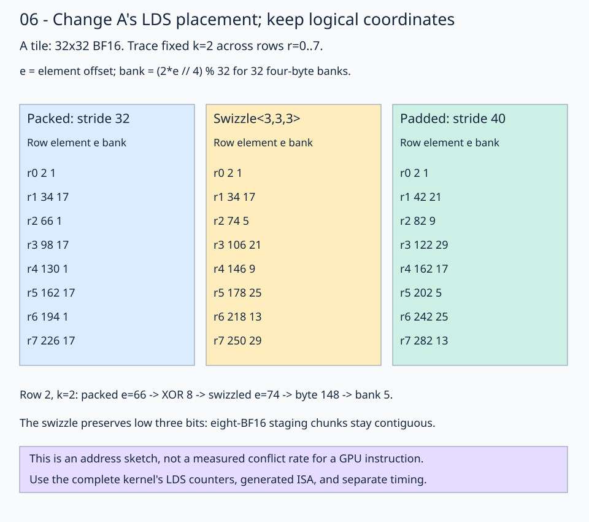

# 06 · Measure LDS bank conflicts before choosing a layout

Build on [stage 05's four-wave WMMA kernel](../05-matrix-instructions/README.md). Keep **M=N=K=1024**, BF16 inputs/output, FP32 accumulation, a **64×64×64** block tile, **128 threads**, and the MMA atom layout `(2,2,1):(1,2,0)`. Keep its inline inner loop: stage K=64 in LDS, then load and compute four K=16 slices using the same operand registers. Change only A's physical LDS placement. Does a native FlyDSL swizzle reduce bank conflicts, and does that make the whole kernel faster?

The [solution](solution.py) includes three compile-time `layout_mode` choices. The normal lesson CLI uses `"swizzle"`; the [profiling driver](profile.py) checks and measures all three:

| Mode | Logical A shape | Physical A element mapping | Total block LDS |
| --- | --- | --- | --- |
| `packed` | `(64,64)` | `e = row*64 + k` | 16384 bytes |
| `swizzle` | `(64,64)` | `e ^ ((e & 0x1c0) >> 3)`, starting from packed `e` | 16384 bytes |
| `padded` | `(64,64)` | `row*72 + k` | 17408 bytes |

B remains packed row-major in all modes. The three modes share global storage, staging ownership, MMA ownership, barriers, accumulator conversion, and output stores. Changing the A layout affects both the cooperative LDS stores and the instruction-compatible operand reads.



Read row 2 first: the same logical A element `(row,k)=(2,2)` uses packed element offset 130, swizzled offset 146, or padded offset 146. These numbers are storage offsets, not matrix values. The drawing sketches bank placement; the measured instruction access pattern determines actual conflicts.

## 1. Why row-major LDS can conflict

For this target's 32 four-byte banks, a byte address maps to `bank = (byte_address // 4) % 32`. A BF16 occupies two bytes, so a relative element offset `e` maps to `(e // 2) % 32`, up to the buffer base's bank rotation. A 64-element row occupies 128 bytes: at fixed K, adjacent rows map to the same bank. By contrast, adjacent columns of packed B walk neighboring words.

A conflict involves different addresses served through the same bank in the same instruction service phase. Reads of the same word can broadcast; vector instructions have their own lane/address grouping. Counting duplicate bank numbers across an entire wave is therefore only an address sketch. Inspect the emitted loads and collect counters from the complete kernel, including staging writes, rather than declaring a conflict rate from one thread's stride.

## 2. Compose a native swizzle with A's element-offset layout

Inside the tracing-time `create_lds_views` helper, the swizzled path constructs:

```python
left_lds_base_layout = fx.make_layout((BLOCK_M, BLOCK_K), (BLOCK_K, 1))
swizzle = fx.static(fx.SwizzleType.get(3, 3, 3))
left_lds_layout = fx.make_composed_layout(swizzle, 0, left_lds_base_layout)
left_lds_view = lds.left.view(left_lds_layout)
```

`SwizzleType.get(B,M,S)` describes an XOR swizzle. Here `B=3` selects three bits, `M=3` leaves the lowest three bits unchanged, and `S=3` places the source bits three positions above the destination bits. The packed layout first computes an **element** offset. The composition then XORs offset bits 6–8 into bits 3–5:

```text
packed e      = row*64 + k
physical e    = e XOR ((e AND 0x1c0) >> 3)
byte offset   = physical e * 2
```

The standalone native [layout checker](layout_check.py) evaluates all 4096 coordinates, checks the XOR formula and permutation coverage, and verifies that all 512 eight-value chunks stay contiguous. Run it with `pixi run python lessons/01-gpu-programming/13-matmul/06-lds-swizzle/layout_check.py`; its trace is `[130,146,146]` for packed/swizzled/padded `(2,2)`.

At `(2,2)`, packed `e=130`; its selected source bits produce XOR mask 16, so `130 XOR 16 = 146`. The BF16 value lives at byte offset 292, bank 9. The matrix coordinates and value have not changed.

This swizzle permutes the 4096-element allocation without expanding it. Preserving the low three bits keeps each aligned eight-BF16 staging chunk contiguous: a 128-bit store still writes the intended eight logical elements. A swizzle that changes those low bits would require a different staging transfer; retaining the wide store blindly can corrupt the tile. The runnable checker validates the entire result, not just one address.

The storage declaration stays `fx.Array[fx.BFloat16, BLOCK_M * BLOCK_K, 16]`. Layout construction and attaching a view allocate no additional data buffer and load no values. The helper runs while tracing the compile-time mode; it introduces no runtime layout branch.

## 3. Reuse that layout for both writes and reads

The existing generic staging plan partitions the swizzled LDS view:

```python
left_lds_destination = thread_staging_copy.partition_D(left_lds_view)
fx.copy(copy_128b, left_global_source, left_staging_fragment)
fx.copy(copy_128b, left_staging_fragment, left_lds_destination)
fx.barrier()
```

The source retains global row stride 1024. The destination maps the same logical coordinates to the new physical locations. After the barrier, each inner K step slices that same composed view:

```python
for inner_k in fx.range_constexpr(BLOCK_K // MMA_K):
    left_subview = fx.slice(
        fx.flat_divide(left_lds_view, (BLOCK_M, MMA_K)),
        (None, None, 0, inner_k),
    )
    left_r_source = lds2reg_thread_copies[0].partition_S(left_subview)
    fx.copy(copy_16b, left_r_source, left_r_destination)
    # Load the corresponding B slice, then call fx.gemm as in stage 05.
```

This API fragment shows A's changed access path; the runnable solution supplies B and GEMM inline in the same loop. Preserve the composed layout when dividing and slicing: reconstructing A as a plain row-major view after staging would discard the swizzle and read the wrong values.

`make_fragment_A/B` allocates registers for only K=16. The source view supplies physical addresses; `retile` supplies a copy-compatible alias of the existing register storage. Each `fx.gemm` consumes one K slice across four output subtiles per wave. All four waves participate; the accumulator has 32 FP32 values per thread. The final barrier protects LDS reuse after the four inner steps.

B retains its packed `(K,N):(64,1)` LDS view and `(N,K):(1,64)` MMA view. Global staging uses the same `(16,8)` thread layout and `(1,8)` value layout as stage 05; each thread stages 32 BF16 elements per operand.

## 4. Compare padding as a separate layout

The padded mode reserves `64*72` BF16 elements for A and attaches:

```python
left_lds_layout = fx.make_layout((BLOCK_M, BLOCK_K), (BLOCK_K + 8, 1))
```

The logical domain remains 64×64; the eight extra positions per physical row are unused. Reserve the larger allocation before applying the stride: changing a view alone does not enlarge its buffer. B still reserves 64×64 BF16 elements. Together they use `(64*72 + 64*64)*2 = 17408` bytes.

A 72-element row starts on a 144-byte boundary relative to the previous row. Every row still starts at a multiple of 16 bytes, preserving the staging alignment. At `(2,2)`, offset `2*72+2=146` reaches bank 9. Padding and swizzling are measured independently here; combining them is not automatically better.

## 5. Reproduce the counter evidence

Run from the repository root in the pinned environment. `rocprofv3` is supplied by its ROCm SDK; check counter availability on the actual GPU:

```bash
pixi run rocprofv3 --list-avail
pixi run python lessons/01-gpu-programming/13-matmul/06-lds-swizzle/profile.py \
  --collect --output /tmp/flydsl-lds-profile-new
```

Use a fresh output directory. For each mode, the driver first checks every output for trace and seeded random inputs against CPU FP32 matmul on the quantized inputs, rounded to BF16, including 16 trailing sentinels. It then launches three warm-ups and five sampled matmuls on the same seeded BF16 inputs. The profiler filters `_matmul_bf16`; the summary requires ten matmul dispatches, discards the two checker dispatches and three warm-ups, and reports the final five. An unsuccessful correctness check or incomplete collection fails the driver.

The exact profiler argv is recorded in `summary.json`. Its essential counter request is:

```bash
pixi run rocprofv3 \
  --pmc LDSBankConflict SQC_LDS_BANK_CONFLICT_sum SQC_LDS_IDX_ACTIVE_sum SQ_INSTS_LDS_sum \
  --kernel-include-regex _matmul_bf16 --output-format csv \
  -d /tmp/flydsl-one-layout -o swizzle -- \
  python lessons/01-gpu-programming/13-matmul/06-lds-swizzle/profile.py --worker swizzle
```

On this SDK, the metric is defined as:

```text
LDSBankConflict = 100 * sum(SQC_LDS_BANK_CONFLICT) / sum(SQC_LDS_IDX_ACTIVE)
```

The raw counter descriptions mark these gfx1151 events **emulated, C1**. Treat the result as the profiler's defined conflict ratio, not a percentage of total wall time or a count of conflicting lanes. The driver retains the raw numerator, denominator, instruction count, LDS allocation, and register count. Counters cover the entire matmul dispatch, including LDS staging and both operands; they do not isolate A-load cycles.

## 6. Inspect lowering and measure the complete kernel separately

The driver dumps each mode's IR and final ISA under `<output>/<mode>/assembly/`. It records block dimensions, register counts, scratch, LDS usage, instruction counts, and raw counters in `summary.json`. Compare instruction widths as well as the conflict metric: a layout can reduce conflicts while increasing instruction count or register usage.

After profiling subprocesses exit, the driver benchmarks all three layouts and GPU `torch.matmul` separately, using preallocated outputs and warm repeated buffers. Host timing includes dispatch and synchronization overhead. Counter collection and timing are separate experiments.

The [measurement notes](results.md) summarize the current tile, environment, and reproduction steps. Earlier measurements used a smaller tile and are listed separately there.

| Mode | Conflict ratio | LDS instructions | VGPRs | LDS bytes | Host median ms |
| --- | ---: | ---: | ---: | ---: | ---: |
| packed | 66.666667% | 2,490,368 | 176 | 16384 | 0.2398 |
| swizzle | 28.571429% | 4,096,000 | 192 | 16384 | 0.1394 |
| padded | 0.000000% | 2,490,368 | 200 | 17408 | 0.1124 |

All modes reported zero scratch. The swizzle reduced the conflict numerator by 75% relative to packed, while changing the denominator and increasing LDS instruction count. Padding reported zero for this defined conflict metric and the lowest native host median in this capture. These observations do not isolate the cause of a speedup or establish a stable timing ranking.

## Practice and checkpoint

In [practice.py](practice.py), TODO 1 constructs the native swizzle descriptor. TODO 2 composes it with `left_lds_base_layout` and zero offset. The surrounding staging, MMA, padded comparison path, and checker are supplied. The default `swizzle` path reaches both TODOs; leave the compile-time mode unchanged while completing them.

```bash
pixi run python lessons/01-gpu-programming/13-matmul/06-lds-swizzle/practice.py --check-only
pixi run python lessons/01-gpu-programming/13-matmul/06-lds-swizzle/solution.py --check-only
# Omit --check-only for the usual per-file GPU PyTorch timing comparison.
```

The starter reports `Practice not finished:`. A completed practice and solution report `Exercise passed:` with `shapes_MNK: [(1024,1024,1024)]`, two patterns, and `first_four: [3,-6,-1,-3]`. Trace tolerances are `rtol=0, atol=0.001`; random tolerances are `rtol=0.016, atol=0.03125`. Output starts as NaN. The profiling driver additionally checks all three layout modes; it never treats a performance improvement as a correctness requirement.

**Check yourself:** Why can a correct swizzle reduce the bank-conflict metric without making the whole kernel consistently faster?

<details><summary>Answer</summary>

The compiler can change LDS instruction widths and address arithmetic. The swizzle can change A's load widths and register requirements. Padding uses 1024 extra LDS bytes for this tile. A result measured for a smaller tile does not establish which layout wins here. Compare correctness, raw counters, ISA, resources, and separately measured kernel time together.

</details>

[Previous: matrix instructions](../05-matrix-instructions/README.md) · [Matmul series](../README.md) · [Next: interleaved loads](../07-interleaved-loads/README.md)

Sources: [FlyDSL composed layouts and swizzles](https://github.com/ROCm/FlyDSL/blob/888d7d80528f0cf2abab8a86610d5ccca47f205d/python/flydsl/expr/primitive.py), [AMD LDS and bank conflicts](https://rocm.docs.amd.com/projects/HIP/en/latest/understand/performance_optimization.html), [rocprofv3 counter collection](https://rocmdocs.amd.com/projects/rocprofiler-sdk/en/latest/how-to/using-rocprofv3.html). The installed 0.4.1 implementation and captured counter definitions take precedence over newer documentation.
