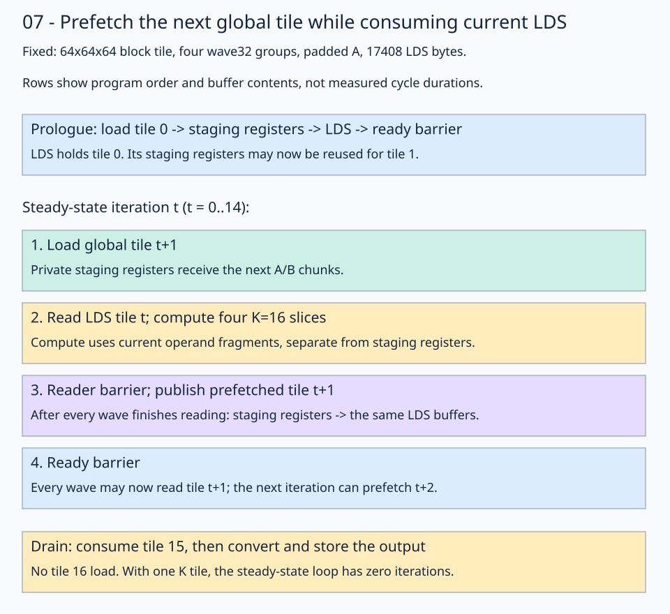

# 07 · Interleave next-tile loads with current-tile compute

[Stage 06](../06-lds-swizzle/README.md) compared A's LDS layouts and measured aligned padding as the stronger candidate on gfx1151. Keep its padded view and **64×64×64 block tile, 128 threads, four-wave `(2,2,1)` WMMA layout, and 1024³ problem**. This lesson changes the schedule: issue the next tile's global loads before computing from the current LDS tile.

The [solution](solution.py) supplies `schedule="serial"` and `schedule="prefetch"` specializations. Both use padded A `(M,K):(72,1)`, packed B `(K,N):(64,1)`, **17408 LDS bytes**, BF16 inputs/output, and FP32 accumulation. The normal lesson CLI uses `prefetch`. The [profiling driver](profile.py) compares both schedules with the same input storage, ownership, arithmetic, and tile dimensions.



Read the buffer contents as well as the arrows. During steady-state computation, **LDS holds tile t while private staging registers hold tile t+1**. These are different storage locations. The diagram describes program order, not measured clock cycles.

## 1. Separate the storage roles

The input path remains the one established in stages 04–06:

```text
selected global block view → per-thread staging registers → LDS
→ instruction-compatible operand registers → WMMA → accumulator
```

| Storage | Variables | Contents during steady-state compute |
| --- | --- | --- |
| Private global staging registers | `left_fragment`, `right_fragment` | Next global K tile, `t+1` |
| Shared LDS buffers | `left_lds_view`, `right_lds_view` | Current K tile, `t` |
| Private MMA operand registers | `left_r_tile`, `right_r_tile` | One K=16 slice of the current tile |
| Private FP32 accumulator | `accumulator` | 32 owned output sums across all processed K tiles |

Each thread stages 32 BF16 values per operand, using the same `(16,8)` thread layout and `(1,8)` value layout as stage 06. Operand fragments are allocated for K=16, and the inner loop in `compute_lds()` refills them for four slices of the staged K=64 tile. A global staging fragment cannot replace an MMA operand fragment: their ownership and register layouts differ.

There is one shared tile per operand. Future data waits in private registers until every wave has finished reading the current LDS contents. This first pipeline step does not allocate a second LDS tile or require a new asynchronous-copy API.

## 2. Separate global loads, LDS publication, and current-tile compute

Three tracing-time helpers name the global-load, LDS-publication, and compute steps without changing the copy plans:

```python
def gmem2reg_load_tile(tile_k):
    left_block_view = fx.slice(left_tiled_view, (None, None, block_row, tile_k))
    right_block_view = fx.slice(right_tiled_view, (None, None, tile_k, block_col))
    left_lds_source, right_lds_source = create_gmem2lds_sources(
        left_block_view, right_block_view
    )
    fx.copy(copy_128b, left_lds_source, left_fragment)
    fx.copy(copy_128b, right_lds_source, right_fragment)
```

`gmem2reg_load_tile` writes only the calling thread's staging registers. It does not overwrite LDS. Slicing and partitioning select the global addresses; the two `fx.copy` calls load values.

```python
def reg2lds_copy_tile():
    fx.copy(copy_128b, left_fragment, gmem2lds_left_destination)
    fx.copy(copy_128b, right_fragment, gmem2lds_right_destination)
    fx.barrier()

```

`reg2lds_copy_tile` stores the staged values and waits until the block can consume them. All three helpers expand into the same kernel during tracing; they do not launch extra kernels.

Prepare the divided LDS views once, then slice one K=16 region per inner step:

```python
left_lds_tiled = fx.flat_divide(left_lds_view, (BLOCK_M, MMA_K))
right_lds_tranposed_view = fx.make_view(
    fx.get_iter(right_lds_view),
    fx.make_layout((BLOCK_N, BLOCK_K), (1, BLOCK_N)),
)
right_lds_transposed_tiled = fx.flat_divide(
    right_lds_tranposed_view, (BLOCK_N, MMA_K)
)
```

The initial slices at `(None, None, 0, 0)` define `left_lds_initial_view` and `right_lds_transposed_initial_view`. `make_fragment_A/B` allocates their K=16 operand registers. The copy plan's `retile` supplies compatible aliases of those same registers; it allocates no additional operand buffer and moves no data.

The practice and solution name the compute helper `compute_lds`:

```python
def compute_lds():
    for inner_k in fx.range_constexpr(BLOCK_K // MMA_K):
        left_mma_view = fx.slice(left_lds_tiled, (None, None, 0, inner_k))
        right_mma_view = fx.slice(
            right_lds_transposed_tiled, (None, None, 0, inner_k)
        )
        left_r_source = lds2reg_left_thread_copy.partition_S(left_mma_view)
        right_r_source = lds2reg_right_thread_copy.partition_S(right_mma_view)
        fx.copy(copy_16b, left_r_source, left_r_destination)
        fx.copy(copy_16b, right_r_source, right_r_destination)
        fx.gemm(mma_atom, accumulator, left_r_tile, right_r_tile, accumulator)
```

The helper uses `lds2reg_left_thread_copy` and `lds2reg_right_thread_copy` directly. It slices the existing views, preserving A's padding and B's `(N,K)` convention, then refills the same operand fragments for four K slices. Each schedule calls this helper instead of repeating the compute block.

## 3. Compare serial order with one-tile lookahead

The serial specialization matches stage 06 with `layout_mode="padded"`: load the current global tile into registers, copy it into LDS and synchronize, compute its four K=16 slices, then synchronize before replacing LDS. The tracing helpers name the same copy and compute steps; they preserve stage 06's order. `reg2lds_copy_tile()` includes the ready barrier after its copies.

The serial schedule is:

```python
for tile_k in range(k // BLOCK_K):
    gmem2reg_load_tile(tile_k)
    reg2lds_copy_tile()
    compute_lds()
    fx.barrier()
```

Each stage must obtain and publish its input before doing useful compute. The prefetch specialization moves the next global read earlier:

```python
# Prologue: establish a valid first tile in LDS.
initial_tile_k = 0
gmem2reg_load_tile(initial_tile_k)
reg2lds_copy_tile()

# Steady state: consume t while the staging registers hold t+1.
for tile_k in range(k // BLOCK_K - 1):
    next_tile_k = tile_k + 1
    gmem2reg_load_tile(next_tile_k)
    compute_lds()
    fx.barrier()  # All readers must finish before LDS is reused.
    reg2lds_copy_tile()  # Store t+1, then wait until it is ready.

# Drain: the last tile is already in LDS; no future global read is needed.
compute_lds()
fx.barrier()
```

The separate staging registers allow the next tile's global loads to be issued without overwriting the current LDS tile or its MMA operands. Within a wave, independent LDS reads and WMMA can execute while those global requests are outstanding. The compiler inserts the global-memory wait before the staging values are consumed by the LDS stores. Scheduling other ready waves can also hide latency; overlap does not require assigning different waves to loading and compute.

The drain must remain outside the steady-state loop. With one K tile, the loop is empty and the drain performs all computation. Placing the drain inside would skip that case and count middle tiles twice for longer reductions.

The loop invariant is: **at the start of iteration t, LDS contains tile t**. The prefetch writes the private staging registers while that LDS tile remains intact. Once tile t is consumed and all readers reach the barrier, publishing those registers establishes tile t+1 for the following iteration.

For 1024³, there are 16 K tiles. The loop runs for `t=0..14`, loading future tiles `1..15`; the drain computes tile 15. It never loads tile 16. The one-tile boundary has a zero-trip steady-state loop: only the prologue and drain execute.

Both schedules load each tile once and consume it once. Each executes 32 block barriers for the 16-stage workload. The prefetch source has separate prologue and drain instructions, so its static ISA listing contains additional instruction sites; that does not mean it doubles the dynamic data movement.

## 4. Follow thread 17 at the handoff

In block `(x,y)=(1,2)`, the output window is global rows 128–191 and columns 64–127. The staging layout is `(16,8):(8,1)` with eight contiguous values per group and four row repetitions. Thread 17 begins at local row `17//8=2`, column `(17%8)*8=8`, with further groups at rows 18, 34, and 50.

During steady-state iteration `t=2`:

| Location | K tile | Thread-17 trace |
| --- | --- | --- |
| Current A/B LDS storage | 2 | Global K=128–191, consumed in four K=16 steps |
| Future A staging fragment | 3 | First group loads global `A[130,200..207]` |
| Future B staging fragment | 3 | First group loads global `B[194,72..79]` |
| Current WMMA output ownership | Current K=128–191 | Lane 17 in wave 0 contributes to rows 129,131,…,143 at column 65, plus its other three output subtiles |

The future staging coordinates differ from this thread's MMA ownership. WMMA is collective across all lanes. It uses current LDS-derived operand fragments, while the global loads obtain chunks for the next cooperative LDS tile. After the reader barrier, all 128 threads publish those future chunks together.

The first barrier cannot be replaced by a single thread's memory wait: another wave might still be reading the shared tile. The ready barrier after publication cannot be removed either: another wave might not have finished its cooperative stores.

## 5. Inspect whether the compiler preserves useful instruction order

Moving Python statements is only the source-level schedule. The final machine instructions and waits determine whether independent compute can proceed before the prefetched values are required. The compiler handles the memory dependencies; this lesson adds no manually encoded `s_waitcnt` or scheduling assembly.

Run from the repository root:

```bash
pixi run python lessons/01-gpu-programming/13-matmul/07-interleaved-loads/profile.py \
  --collect --output /tmp/flydsl-interleaved-new
```

Add `--implementation practice.py` to profile your completed practice instead of the solution; both serial and prefetch schedules are selected explicitly.

Use a fresh output directory. The driver checks both schedules, captures rocprofv3 counters, dumps final ISA and origin IR, and records a main-loop excerpt with source line numbers. It verifies that the dump is the full 1024³ specialization rather than an overwritten boundary-case specialization. It also checks that prefetch global loads precede WMMA and that the first VMEM wait follows all sixteen WMMA instructions in the main loop, before the LDS stores.

The [measurement notes](results.md) on gfx1151 show:

| Serial main-loop order | Prefetch main-loop order |
| --- | --- |
| Issue current global loads | Issue next global loads |
| VMEM waits, then LDS stores | Read current LDS operands |
| Ready barrier | Compute all four current K slices |
| Read LDS, execute WMMA | VMEM wait, then reader barrier |
| Reader barrier | Publish next LDS tile; ready barrier |

The [annotated assembly excerpt](results.md#read-the-generated-schedule) shows next-tile global loads, current LDS reads and WMMA, then the VMEM wait and future LDS stores. Generate the complete assembly with the profiling command above to inspect the intervening loads and waits.

This confirms an **opportunity to overlap global-memory latency with current-tile work**: the explicit VMEM wait no longer blocks before WMMA. It does not prove how many cycles overlapped, that the loads remained outstanding throughout compute, or that global latency was completely hidden. That would need a suitable cycle-level hardware trace.

## 6. Check that the improvement is scheduling, then measure time

Both schedules retain the padded layout's profiler conflict ratio and dynamic LDS instruction total:

| Property | Serial | Prefetch |
| --- | ---: | ---: |
| Block LDS bytes | 17408 | 17408 |
| Profiler-reported VGPR count | 200 | 208 |
| Scratch bytes | 0 | 0 |
| `LDSBankConflict` | 0% | 0% |
| Conflict numerator | 0 | 0 |
| Indexed LDS denominator | 3,670,016 | 3,670,016 |
| Dynamic LDS instruction count | 2,490,368 | 2,490,368 |

The events use the SDK's **emulated/C1** definitions. Their ratio is not a wall-time percentage. Identical counters support that the schedule change preserved LDS work. Both schedules retain stage 06's padded view, copy ownership, four K slices, accumulator dimensions, and output stores; only the order of global loading and current-tile computation changes.

Separate host timing uses preallocated outputs, three warm-ups, and five batches of 20 launches:

| GPU implementation | Host median, ms |
| --- | ---: |
| Serial padded | 0.1166 |
| Prefetch padded | 0.1040 |
| GPU torch.matmul | 0.0803 |

The prefetch schedule had about **10.8% lower host-observed time** in this capture on Radeon 8060S Graphics (`gfx1151`), FlyDSL 0.4.1, and PyTorch 2.13.0+rocm10.0.0. Host timing includes dispatch and synchronization. This single capture does not establish a stable speedup or a cycle-level overlap duration. The extra live staging values may increase register pressure, as reflected in the 200→208 VGPR count; gfx1152 remains unverified.

The driver writes counter data, assembly, IR, loop-order excerpts, logs, and a machine-readable summary into your chosen output directory. It checks three small boundary dispatches and ten full-workload dispatches per schedule; only the final five full-workload dispatches contribute counter samples. Counter collection and timing do not run concurrently.

## Practice and verification

The completed [practice.py](practice.py) and [solution.py](solution.py) use the same three tracing helpers and prologue/steady-state/drain structure. Follow `initial_tile_k = 0` and `next_tile_k = tile_k + 1`, then trace which values occupy the staging registers and LDS at each helper call. The `run()` and `solve()` defaults select prefetch; use `solve("serial")` to check the stage-06 ordering explicitly.
```bash
pixi run python lessons/01-gpu-programming/13-matmul/07-interleaved-loads/practice.py --check-only
pixi run python lessons/01-gpu-programming/13-matmul/07-interleaved-loads/solution.py --check-only
# Omit --check-only for the usual per-file GPU PyTorch comparison.
```

The completed practice and solution report `Exercise passed:` with the fixed main comparison `shapes_MNK: [(1024,1024,1024)]`, two patterns, and `first_four: [3,-6,-1,-3]`. Trace tolerances remain `rtol=0, atol=0.001`; seeded BF16 random checks use `rtol=0.016, atol=0.03125`, against independent CPU FP32 matmul rounded to BF16. Output starts as NaN; 16 trailing sentinels check stray writes.

The additional `pipeline_boundaries` checkpoint covers 64×64 outputs with **one, two, and three K tiles**. A's successive K tiles contain values 1,2,4 and B contains 1, so every output must equal 64, 192, or 448 exactly. These checks exercise the zero-trip loop, first handoff, and repeated handoff without changing the 1024³ performance comparison. No partial tile or K=0 path is implemented.

**Check yourself:** Why does the final tile need a separate drain instead of one more prefetch iteration?

<details><summary>Answer</summary>

The steady-state iteration loads tile `t+1`. For the final current tile, that would address a nonexistent next tile. After the loop's last publication, the final valid tile is already in LDS, so compute it once without another global load. With only one K tile, the same rule makes the steady-state loop empty while prologue and drain still do all required work.

</details>

[Previous: LDS bank conflicts](../06-lds-swizzle/README.md) · [Matmul series](../README.md) · [Next: buffer access](../07a-buffer-access/README.md)

Sources: [FlyDSL global-prefetch/compute pipeline example](https://github.com/ROCm/FlyDSL/blob/888d7d80528f0cf2abab8a86610d5ccca47f205d/kernels/gemm/rdna3_f16_gemm.py), [native tiled-copy and MMA helpers](https://github.com/ROCm/FlyDSL/blob/888d7d80528f0cf2abab8a86610d5ccca47f205d/python/flydsl/expr/derived.py), [rocprofv3 counter collection](https://rocmdocs.amd.com/projects/rocprofiler-sdk/en/latest/how-to/using-rocprofv3.html). The upstream production pipeline also uses two LDS buffers and other optimizations; this teaching kernel isolates one shared-tile lookahead into registers. API expressions were checked against installed FlyDSL 0.4.1.
