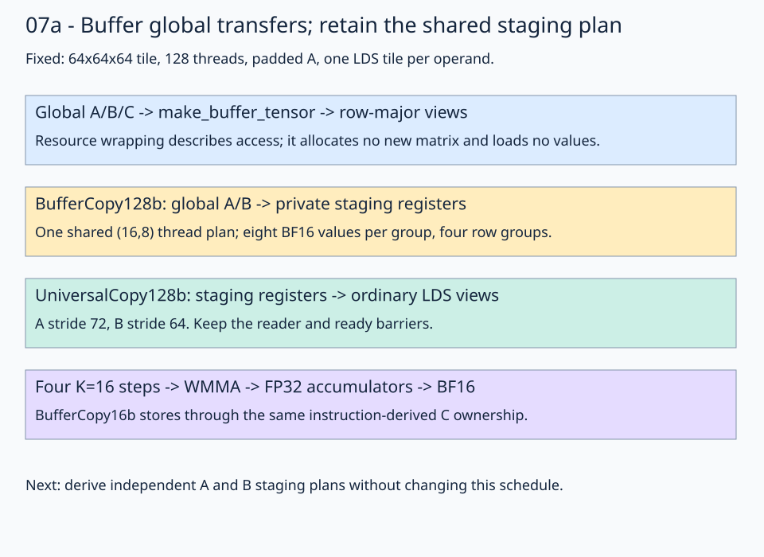

# 07a · Use buffer-based global access

Build on [stage 07](../07-interleaved-loads/README.md) by changing the global access representation. Keep its shared staging plan, **64×64×64 tile**, **128 threads**, `(2,2,1)` waves, padded A stride 72, packed B stride 64, and register-prefetch schedule. The problem remains **1024³**, with row-major BF16 inputs/output and FP32 accumulation.



Follow the global-to-register boundary first. The buffer representation changes there; staging ownership and the rest of the pipeline retain the preceding lesson's structure.

## 1. Keep layouts while wrapping global resources

The [solution](solution.py) creates buffer-backed views:

```python
left_buffer = fx.rocdl.make_buffer_tensor(left)
right_buffer = fx.rocdl.make_buffer_tensor(right)
out_buffer = fx.rocdl.make_buffer_tensor(out)
left_global_view = fx.make_view(
    fx.get_iter(left_buffer), fx.make_layout((m, k), (k, 1))
)
```

B and C retain `(k,n):(n,1)` and `(m,n):(n,1)`. Wrapping provides the resource representation required by the buffer-copy atoms. It allocates no replacement matrix and performs no loading, packing, or transposition. Divide and slice these views as before; the selected view carries its base offset.

A buffer resource is distinct from staging registers and from an additional LDS buffer. This lesson still allocates one LDS tile per operand.

## 2. Retain one shared staging plan

```python
staging_thread_layout = fx.make_ordered_layout((16, 8), (1, 0))
staging_value_layout = fx.make_ordered_layout((1, 8), (1, 0))
```

The same `thread_staging_copy` partitions both global sources and both LDS destinations. Each natural copy tile covers 16×64 values, repeating four times down each operand. Thread 17 owns local row 2, columns 8–15, then rows 18, 34, and 50: 32 BF16 elements per operand.

At block `(x,y)=(1,2)` and K tile 2, its first group reads `A[130,136..143]` and `B[130,72..79]`. Their first global element offsets are 133256 and 133192; byte offsets are twice those values. The trace pattern's first values are -1 and 0. The padded A view maps local `(2,8)` to element offset 152; packed B maps it to 136. Changing the resource representation does not change those logical coordinates or values.

## 3. Select global copy atoms

```python
copy_128b = fx.make_copy_atom(fx.UniversalCopy128b(), fx.BFloat16)
gmem_load_128b = fx.make_copy_atom(fx.rocdl.BufferCopy128b(), fx.BFloat16)
```

Ownership is supplied by the existing copy plan; the equal-width buffer atom selects the global transfer path:

```python
# Inside gmem2reg_load_tile: buffer global -> private staging registers.
fx.copy(gmem_load_128b, left_global_source, left_staging_fragment)
fx.copy(gmem_load_128b, right_global_source, right_staging_fragment)

# Inside reg2lds_copy_tile: ordinary staging registers -> LDS.
fx.copy(copy_128b, left_staging_fragment, left_lds_destination)
fx.copy(copy_128b, right_staging_fragment, right_lds_destination)
fx.barrier()
```

Keep global source views buffer-backed when using the buffer atom. Ordinary LDS pointers retain universal-copy atoms. Operand reads still use `UniversalCopy16b`, MMA-derived A/B plans, and `retile` aliases of the K=16 operand registers.

C uses a 16-bit buffer store through the existing MMA output ownership:

```python
gmem_store_16b = fx.make_copy_atom(fx.rocdl.BufferCopy16b(), fx.BFloat16)
reg2gmem_copy_plan = fx.make_tiled_copy_C(gmem_store_16b, mma)
# Slice the plan, retile the registers, and partition the buffer-backed output.
fx.copy(gmem_store_16b, reg2gmem_source, reg2gmem_dest)
```

All 32 BF16 output slots per thread are stored. The prologue, four K=16 steps in `compute_lds()`, reader/ready barriers, and final drain retain stage 07's order. Buffer wrapping itself does not introduce overlap or a general tail-handling policy.

## Practice and verification

Fill two expressions in [practice.py](practice.py):

1. `left_buffer`: wrap A like the supplied B/C resources.
2. `gmem_load_128b`: construct the BF16 buffer global-load atom.

The shared staging plan, output atom, LDS mapping, compute, prefetch schedule, and checker are supplied. Compare with the [solution](solution.py).

```bash
pixi run python lessons/01-gpu-programming/13-matmul/07a-buffer-access/practice.py --check-only
pixi run python lessons/01-gpu-programming/13-matmul/07a-buffer-access/solution.py --check-only
```

Run from the repository root. The unfinished starter reports `Practice not finished:`. The completed program reports two patterns and `first_four: [3,-6,-1,-3]` for the 1024³ problem. Every output is compared with CPU FP32 matmul of the quantized BF16 inputs, rounded to BF16. Trace tolerances are `rtol=0, atol=0.001`; random tolerances are `rtol=0.016, atol=0.03125`. NaN initialization catches missing stores; sixteen sentinels check stray writes. One-, two-, and three-stage boundary checks produce 64, 192, and 448 exactly. Dimensions contain full aligned tiles; no tails or K=0 path are implemented.

Omit `--check-only` for the common GPU PyTorch timing comparison. This lesson makes no speedup claim. To inspect instruction selection:

```bash
FLYDSL_DUMP_IR=1 FLYDSL_DUMP_DIR=/tmp/flydsl-buffer-access \
  pixi run python lessons/01-gpu-programming/13-matmul/07a-buffer-access/solution.py --check-only
rg 'buffer_load|buffer_store|ds_store|v_wmma' /tmp/flydsl-buffer-access -g '*.s'
```

**Check yourself:** Does creating a buffer view load the next tile into registers?

<details><summary>Answer</summary>

No. It describes a resource and its logical addressing. The `fx.copy` calls using `gmem_load_128b` perform the loads. Separate staging registers and the prefetch schedule permit overlap with current-tile compute.

</details>

[Previous: interleaved loads](../07-interleaved-loads/README.md) · [Matmul series](../README.md) · [Next: separate A/B staging plans](../07b-operand-staging/README.md)

Sources: installed FlyDSL 0.4.1 and the [native RDNA3 GEMM example](https://github.com/ROCm/FlyDSL/blob/888d7d80528f0cf2abab8a86610d5ccca47f205d/kernels/gemm/rdna3_f16_gemm.py). Validated on gfx1151; gfx1152 execution remains pending.
