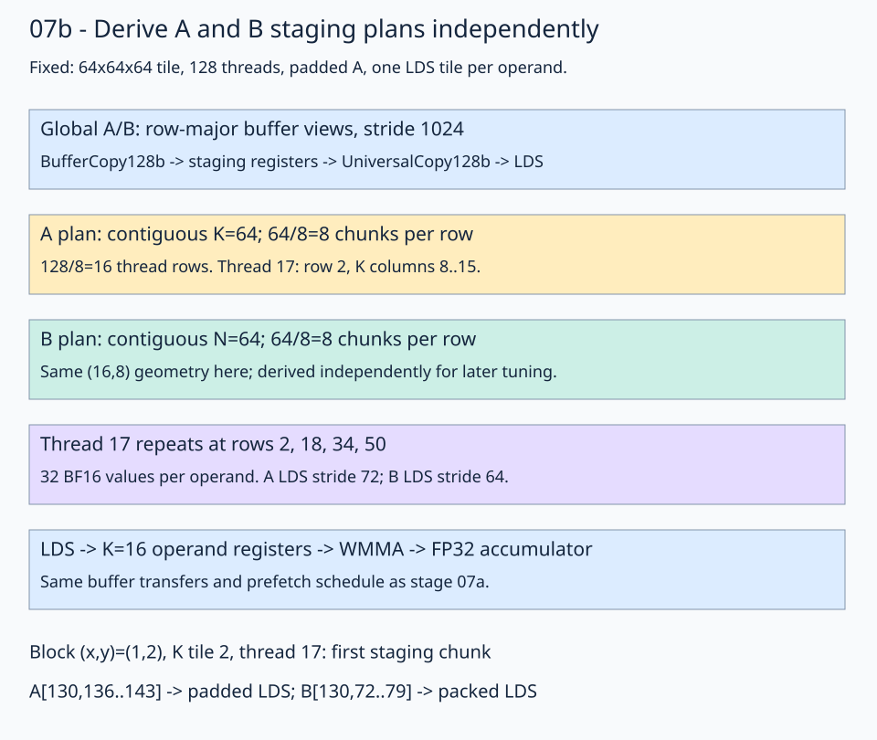

# 07b · Derive separate A and B staging plans

[Stage 07a](../07a-buffer-access/README.md) introduced buffer global transfers using one shared staging plan. This lesson keeps those transfers and derives A and B staging ownership independently. The load/compute schedule remains the same; separate staging plans do not assign different waves or different times to the two operands.

Keep **M=N=K=1024**, row-major BF16 inputs/output, FP32 accumulation, **64×64×64 block tiles**, **128 threads**, and the `(2,2,1)` wave arrangement. A retains padded LDS stride 72; B retains packed stride 64. There is one LDS tile per operand, four K=16 compute steps per stage, and 32 accumulator values per thread. The block grid remains 16×16, with ordinary `block_row=y`, `block_col=x` placement.



Read the transfer path first, then compare the A/B formulas. Both resolve to the same ownership for this tile. Separate derivations become useful when K and N differ in the tuning lesson. Next, [stage 07c](../07c-grouped-traversal/README.md) keeps these dimensions fixed and changes block traversal for cache reuse.

## 1. Retain the buffer access path

Global A/B/C views remain backed by `fx.rocdl.make_buffer_tensor`. Global loads use `BufferCopy128b`, output uses `BufferCopy16b`, and ordinary LDS copies use universal atoms. View layouts, block placement, padded A, and prefetch timing match stage 07a. Only the staging plans are split in the [solution](solution.py).

## 2. Derive each operand's copy geometry

Eight BF16 elements occupy 128 bits. Physical A `(M,K)` is contiguous along K; physical B `(K,N)` is contiguous along N:

```python
left_copy_threads = fx.make_ordered_layout(
    (THREADS_PER_BLOCK // (BLOCK_K // 8), BLOCK_K // 8), (1, 0)
)
right_copy_threads = fx.make_ordered_layout(
    (THREADS_PER_BLOCK // (BLOCK_N // 8), BLOCK_N // 8), (1, 0)
)
copy_values = fx.make_ordered_layout((1, 8), (1, 0))
```

| Operand | Contiguous extent | Eight-value chunks per row | Thread layout |
| --- | --- | --- | --- |
| A | K=64 | 8 | `(16,8):(8,1)` |
| B | N=64 | 8 | `(16,8):(8,1)` |

Each plan's natural copy tile is 16×64, repeating four times down its 64×64 operand. Thread 17 owns local row 2, columns 8–15, then the same columns in rows 18, 34, and 50. It stages 32 BF16 values per operand.

Build and slice the two plans independently:

```python
left_copy_tile, left_copy_tv = fx.make_layout_tv(left_copy_threads, copy_values)
right_copy_tile, right_copy_tv = fx.make_layout_tv(right_copy_threads, copy_values)
left_copy_plan = fx.make_tiled_copy(copy_128b, left_copy_tv, left_copy_tile)
right_copy_plan = fx.make_tiled_copy(copy_128b, right_copy_tv, right_copy_tile)
left_thread_copy = left_copy_plan.get_slice(fx.thread_idx.x)
right_thread_copy = right_copy_plan.get_slice(fx.thread_idx.x)
```

The plans use a `UniversalCopy128b` atom to describe eight-value transfers and LDS publication. Their source partitions can also feed the equal-width buffer global-load atom. Thread/value ownership and the selected global transfer instruction are separate choices.

At block `(x,y)=(1,2)` and `tile_k=2`, thread 17's first group reads A row 130, K columns 136–143, and B K row 130, N columns 72–79. Their first global element offsets are `130*1024+136=133256` and `130*1024+72=133192`; BF16 byte offsets are twice those values. In the trace input pattern, these first values are -1 and 0, respectively.

The A destination view sends local `(2,8)` to padded LDS element offset `2*72+8=152`. B sends the same local coordinate to packed element offset `2*64+8=136`. The separate plans describe logical ownership; each destination view supplies its physical LDS mapping.

## 3. Use buffer atoms only for global transfers

```python
copy_128b = fx.make_copy_atom(fx.UniversalCopy128b(), fx.BFloat16)
gmem_load_128b = fx.make_copy_atom(fx.rocdl.BufferCopy128b(), fx.BFloat16)
```

The existing helpers now use:

```python
# gmem2reg_load_tile: buffer global source -> private staging registers
fx.copy(gmem_load_128b, left_lds_source, left_fragment)
fx.copy(gmem_load_128b, right_lds_source, right_fragment)

# reg2lds_copy_tile: private staging registers -> ordinary LDS views
fx.copy(copy_128b, left_fragment, gmem2lds_left_destination)
fx.copy(copy_128b, right_fragment, gmem2lds_right_destination)
fx.barrier()
```

`create_gmem2lds_sources` uses `left_thread_copy.partition_S(left_block_view)` and `right_thread_copy.partition_S(right_block_view)`. LDS destinations come from the matching plans. Keep both global sources buffer-backed: replacing the copy atom alone on an ordinary pointer view is insufficient for this API path.

Operand reads retain `UniversalCopy16b` and instruction-derived A/B plans. The `compulte_lds()` helper still slices four K=16 regions, refills the operand registers, and calls WMMA. Neither A padding nor the `(N,K)` B operand convention changes.

C uses a buffer store atom through the same MMA output ownership:

```python
gmem_store_16b = fx.make_copy_atom(fx.rocdl.BufferCopy16b(), fx.BFloat16)
reg2gmem_copy_plan = fx.make_tiled_copy_C(gmem_store_16b, mma)
# Slice, retile the BF16 registers, and partition the buffer-backed output view.
fx.copy(gmem_store_16b, reg2gmem_source, reg2gmem_dest)
```

The 16-bit store width matches one BF16 output value. Copying the results still covers all 32 accumulator slots per thread.

## 4. Retain the prefetch schedule

The prologue loads and publishes tile 0. Each steady-state iteration issues global loads for tile `t+1`, computes tile `t` from LDS, protects current readers with a barrier, then publishes the staged future tile. The drain computes the final tile outside the loop. Both serial and prefetch specializations are supplied, with prefetch selected by default.

Buffer access does not itself make a pipeline asynchronous. Independent operands and the placement of loads, compute, waits, and LDS publication enable overlap. This lesson changes the global access representation and expresses two staging plans while retaining stage 07's dataflow. It makes no speedup claim.

## Practice and checkpoint

In [practice.py](practice.py), fill two expressions:

1. `left_copy_threads`: derive A's thread layout from contiguous K and eight-value chunks.
2. `right_copy_threads`: derive B's thread layout from contiguous N and eight-value chunks.

The remaining source/destination partitions, transfer atoms, padded LDS, compute, prefetch handoff, output stores, and independent checker are supplied. Compare with the [worked solution](solution.py).

Run from the repository root:

```bash
pixi run python lessons/01-gpu-programming/13-matmul/07b-operand-staging/practice.py --check-only
pixi run python lessons/01-gpu-programming/13-matmul/07b-operand-staging/solution.py --check-only
```

The unfinished practice reports `Practice not finished:`. A completed practice and solution report `Exercise passed:` with `shapes_MNK: [(1024,1024,1024)]`, two input patterns, and `first_four: [3,-6,-1,-3]`. Every output is compared against CPU FP32 matmul on the actual quantized BF16 inputs, rounded to BF16. Trace tolerances are `rtol=0, atol=0.001`; seeded random tolerances are `rtol=0.016, atol=0.03125`. NaN initialization detects missing stores, and sixteen output sentinels detect stray writes.

One-, two-, and three-stage boundary checks produce exact sums 64, 192, and 448. Inputs contain complete aligned tiles; no partial-tile or K=0 path is implemented. Buffer wrapping does not add a general tail-handling policy.

Omit `--check-only` for this kernel's GPU PyTorch comparison. Timing excludes allocation and CPU references; the common harness labels synchronized host timing when GPU-event timing is unavailable. Compare performance only with matching input shape and timing method.

To inspect generated global transfers:

```bash
FLYDSL_DUMP_IR=1 FLYDSL_DUMP_DIR=/tmp/flydsl-buffer-access \
  pixi run python lessons/01-gpu-programming/13-matmul/07b-operand-staging/solution.py --check-only
rg 'buffer_load|buffer_store|ds_store|v_wmma' /tmp/flydsl-buffer-access -g '*.s'
```

**Check yourself:** Why keep two copy plans when both have the same `(16,8)` thread shape?

<details><summary>Answer</summary>

A's formula follows K; B's follows N. They coincide because K=N=64 here. Changing the staged K width later should change A's geometry without changing B's, while changing output N should change B's geometry. Distinct plans express each operand's contiguous storage direction independently of the global transfer atom and the LDS layout.

</details>

[Previous: buffer access](../07a-buffer-access/README.md) · [Matmul series](../README.md) · [Next: grouped traversal](../07c-grouped-traversal/README.md)

Sources: the installed FlyDSL 0.4.1 implementation, the [native RDNA3 GEMM example](https://github.com/ROCm/FlyDSL/blob/888d7d80528f0cf2abab8a86610d5ccca47f205d/kernels/gemm/rdna3_f16_gemm.py), and the course's parameter-tuning kernel. Execution is validated on gfx1151; gfx1152 hardware validation remains pending.
