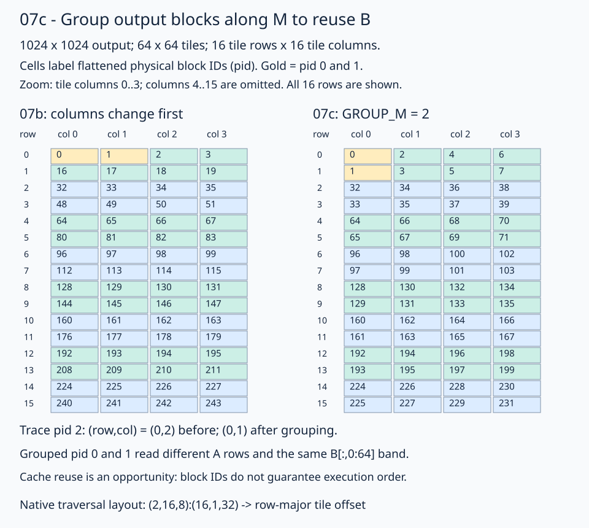

# 07c · Group output blocks with a native layout

Which output tiles should neighboring block IDs select? [Stage 07b](../07b-operand-staging/README.md) selects tile rows and columns directly from the two-dimensional launch grid. This lesson uses a FlyDSL layout to assign neighboring IDs to **two output tile rows at the same column**, creating an opportunity to reuse B through L2 cache.

Keep **M=N=K=1024**, row-major BF16 inputs/output, FP32 accumulation, **64×64×64 block tiles**, **128 threads**, `(2,2,1)` waves, and the prefetch schedule. Separate A/B staging plans, buffer global access, padded A LDS stride 72, packed B LDS stride 64, and one LDS tile per operand carry forward from 07b. The output still contains **16×16 tiles** and launches **256 blocks**. Only the block-to-output-tile mapping changes.



The diagram labels the scalar physical ID as `pid`; the code names it `flat_block_id`. Read each cell as a physical block ID assigned to that logical output tile. All sixteen tile rows and the first four tile columns are shown; the other twelve columns are omitted. Follow gold IDs 0 and 1: they move across columns in 07b and down rows in 07c. These are ID mappings, not a measured execution timeline.

## 1. Launch a one-dimensional block grid

The [solution](solution.py) launches `(tiles_m * tiles_n, 1, 1)`, or `(256,1,1)` for this workload. Each block already has a scalar physical ID:

```python
tiles_m = m // BLOCK_M
tiles_n = n // BLOCK_N
flat_block_id = fx.block_idx.x
```

For `block_idx.x=2`, `pid=2`. In 07b, row-major ID 2 selected output tile `(row,col)=(0,2)`. The grouped mapping assigns it `(0,1)`. The physical block ID and logical tile coordinates describe different positions; the layout determines their relationship.

## 2. Describe traversal with a layout

Set `GROUP_M=2`. This counts **tile rows**, each containing 64 matrix rows, so a group spans 128 matrix rows. There are eight groups in the full output. Describe the traversal domain as `(row_in_group, tile_column, row_group)`:

```python
group_width = min(GROUP_M, tiles_m)
block_tile_order = fx.make_layout(
    (group_width, tiles_n, tiles_m // group_width),
    (tiles_n, 1, group_width * tiles_n),
)
```

For the full product this is **`(2,16,8):(16,1,32)`**. The shape determines how a scalar `pid` expands into a logical coordinate: row within the group changes first, then column, then row group. The strides map that coordinate to a **row-major output-tile offset**:

| Coordinate component | Extent | Stride in output tiles |
| --- | ---: | ---: |
| Row within group | 2 | 16 |
| Tile column | 16 | 1 |
| Row group | 8 | 32 |

Increasing the first component moves one full tile row. Increasing the second moves one tile column. Increasing the third moves two full tile rows. This layout describes positions; constructing it performs no loads or copies.

Apply the layout, then recover the two-dimensional tile coordinate:

```python
output_tile_offset = fx.crd2idx(flat_block_id, block_tile_order)
output_tile_layout = fx.make_layout((tiles_m, tiles_n), (tiles_n, 1))
output_tile_coords = fx.idx2crd(output_tile_offset, output_tile_layout)
block_row = fx.get_scalar(output_tile_coords[0])
block_col = fx.get_scalar(output_tile_coords[1])
```

`crd2idx` accepts a scalar logical coordinate and expands it with the layout's shape, first component fastest. For `pid=2`, the traversal coordinate is `(0,1,0)`, giving offset `0*16+1*1+0*32=1`. In the row-major 16×16 tile grid, offset 1 means `(row,col)=(0,1)`.

The offset is measured in **output tiles**, not matrix elements or bytes. Matrix layouts and block slices supply the actual memory addresses later.

| Physical `pid` | Traversal coordinate | Tile offset | Output tile `(row,col)` |
| --- | --- | ---: | --- |
| 0 | (0,0,0) | 0 | (0,0) |
| 1 | (1,0,0) | 16 | (1,0) |
| 2 | (0,1,0) | 1 | (0,1) |
| 31 | (1,15,0) | 31 | (1,15) |
| 32 | (0,0,1) | 32 | (2,0) |
| 255 | (1,15,7) | 255 | (15,15) |

This layout covers every tile exactly once when the tile row count contains complete two-row groups. `min` supports a one-row grid too. A larger odd row count would need a final partial-group policy; partial matrix tiles are also outside this lesson.

## 3. Follow the shared B accesses

IDs 0 and 1 select tile rows 0 and 1 of column 0. At K stage `t`, both blocks load:

```text
B[64*t : 64*t+64, 0 : 64]
```

Their A tiles come from different row ranges. Each block performs its own global copies into private staging registers and its own LDS. Repeated B requests may be served from cache. Across the whole reduction, these blocks read the same `B[:,0:64]` band.

At `pid=2`, tile `(0,1)` computes `C[0:64,64:128]`. For K stage 2 and staging thread 17, the existing copy plans load the first chunks at:

| Operand | Global coordinates | First element offset | Trace input value |
| --- | --- | ---: | ---: |
| A | row 2, K columns 136–143 | `2*1024+136 = 2184` | 2 |
| B | K row 130, columns 72–79 | `130*1024+72 = 133192` | 0 |

BF16 byte displacements are twice the element offsets: 4368 and 266384 bytes. Destination LDS element offsets remain 152 for A and 136 for B. Slicing the selected block views supplies global base offsets; staging ownership and LDS mapping work as before.

07b's row-major traversal places blocks that share A along neighboring IDs. Grouping trades locality between operands to encourage B reuse within a bounded row group. GPU scheduling, cache capacity, and other traffic determine the benefit. Block IDs do not guarantee serial execution or cache hits, and this lesson makes no speedup claim.

## 4. Feed the existing pipeline

The derived coordinates feed the same selections:

```python
out_block_view = fx.slice(out_tiled_view, (None, None, block_row, block_col))
# In gmem2reg_load_tile(tile_k):
left_block_view = fx.slice(left_tiled_view, (None, None, block_row, tile_k))
right_block_view = fx.slice(right_tiled_view, (None, None, tile_k, block_col))
```

Each selected tile still runs its entire K reduction independently. Loading, prefetch, four K=16 compute steps per LDS stage, barriers, drain, and output ownership retain 07b's behavior. There is no inter-block synchronization or shared LDS allocation.

[Stage 08](../08-parameter-tuning/README.md) uses the same grouped traversal strategy with a group width of eight while tuning tile sizes, wave arrangement, and buffer count. This lesson uses two rows to make the mapping easy to trace.

## Practice and verification

Fill two expressions in [practice.py](practice.py):

1. `block_tile_order`: construct the traversal layout from the group width and tile grid.
2. `output_tile_coords`: invert the row-major output tile layout with `idx2crd`.

The scalar ID, offset calculation, coordinate extraction, views, copies, compute, and checker are supplied. Compare with the [worked solution](solution.py).

```bash
pixi run python lessons/01-gpu-programming/13-matmul/07c-grouped-traversal/practice.py --check-only
pixi run python lessons/01-gpu-programming/13-matmul/07c-grouped-traversal/solution.py --check-only
```

The unfinished starter reports `Practice not finished:`. A completed exercise reports `first_four: [3,-6,-1,-3]` and `pid_0_1_2_31_32_255: [[0,0],[1,0],[0,1],[1,15],[2,0],[15,15]]`.

The checker specializes the **same kernel** with `mapping_only=True` to record every block's tile coordinate without matrix accesses. An independent ordered enumeration checks 16×16, 4×3, and 1×1 tile grids and uniqueness. Ordinary matmul launches specialize the flag to false, with no mapping-record stores.

The full 1024³ product is checked with trace and seeded random inputs against CPU FP32 arithmetic on the actual BF16 inputs, rounded to BF16. Trace tolerances are `rtol=0, atol=0.001`; random tolerances are `rtol=0.016, atol=0.03125`. NaN initialization catches missing stores; sixteen sentinels catch stray writes. One-, two-, and three-K-stage checks produce 64, 192, and 448 exactly. Omit `--check-only` to time against GPU PyTorch with the common harness.

**Check yourself:** Is `output_tile_offset=16` an offset of sixteen BF16 values?

<details><summary>Answer</summary>

It is an offset of sixteen output tiles in the row-major tile grid, meaning tile `(1,0)`. That tile starts at matrix row 64, column 0. Block view selection supplies the corresponding matrix element address. The traversal layout neither moves data nor changes the per-tile pipeline.

</details>

[Previous: operand staging](../07b-operand-staging/README.md) · [Matmul series](../README.md) · [Next: parameter tuning](../08-parameter-tuning/README.md)

Sources: installed FlyDSL 0.4.1 `crd2idx`/`idx2crd`, the earlier [block-selection lesson](../../../00-layout-algebra/06-select-block-tile/README.md), and the existing [stage-08 grouped strategy](../08-parameter-tuning/solution.py). Validated on Radeon 8060S (`gfx1151`); gfx1152 hardware validation remains pending.
