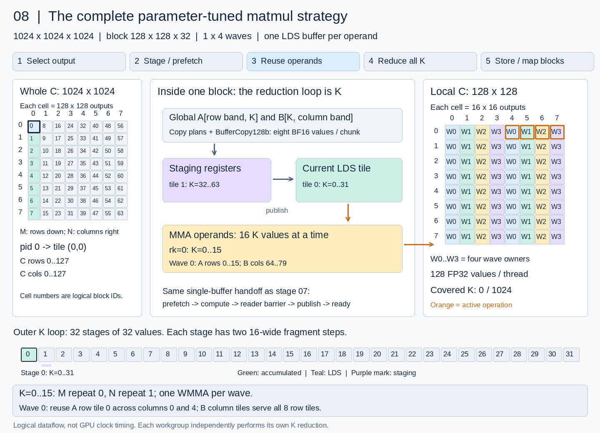
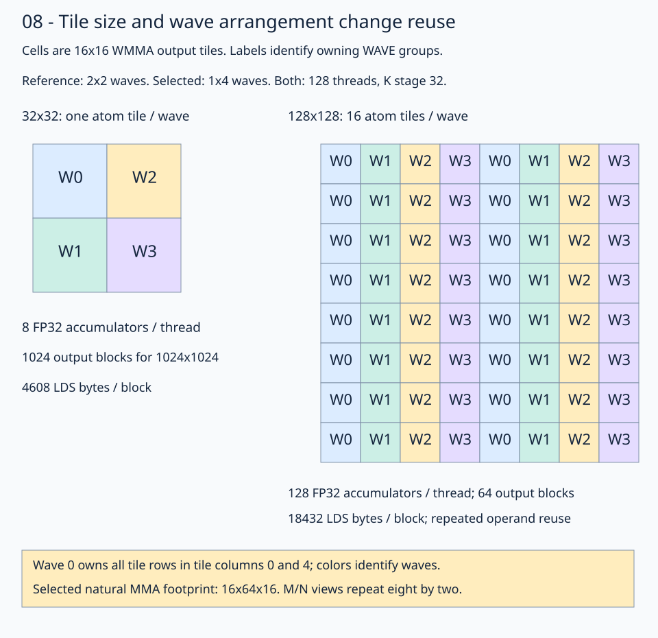
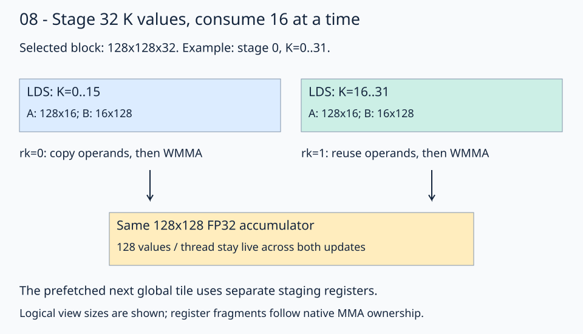

# 08 · Tune register reuse and operand fragments

A larger output tile lets each block reuse its inputs across more results. It also needs more accumulators, so the useful question is: **how much output work can a block own while keeping its operand fragments small?**

Build on [stage 07c](../07c-grouped-traversal/README.md), retaining its grouped block traversal, buffer global access, separate A/B staging plans, global prefetch, padded A LDS, packed B LDS, and native WMMA copies. The standard walkthrough keeps **M=N=K=1024**, row-major BF16 inputs/output, and FP32 accumulation. A separately tuned rectangular workload is described below. The [solution](solution.py) selects:

```python
SELECTED_CONFIG = Config(128, 128, 32, 1, 4, group_m=8)
```

`group_m` is part of `Config`, so each specialization and its report record the traversal choice. This means a **128×128 output tile**, a **32-wide K stage**, **1×4 wave groups**, and **one LDS buffer per operand**. The strategy combines more output reuse with 16-wide operand fragments, vectorized global staging, and grouped block traversal.

## How this relates to stage 07c

The overall strategy is the same as 07c: grouped output-block traversal, buffer global transfers, separate A/B staging plans, register prefetch into a single LDS tile per operand, and instruction-derived WMMA copies. Both lessons consume K=16 operand fragments and keep FP32 accumulators across the full reduction. Stage 08 parameterizes this strategy and measures different configurations.

| Parameter, standard 1024³ workload | Stage 07c | Selected stage 08 |
| --- | --- | --- |
| Block M×N×K | 64×64×64 | 128×128×32 |
| Wave arrangement M×N | 2×2 | 1×4 |
| Threads per block | 128 | 128 |
| FP32 accumulator values per thread | 32 | 128 |
| Output tile grid | 16×16 | 8×8 |
| Outer K stages / K=16 steps per stage | 16 / 4 | 32 / 2 |
| Group M | 2 | 8 |
| LDS bytes per block | 17408 | 18432 |

Changing M/N increases output reuse and accumulator storage; changing K adjusts staging granularity. Wave arrangement redistributes the repeated output tiles, and group size adjusts cache locality. Copy ownership and padded LDS strides follow those dimensions. The `build(Config)` factory, shape selection, optional launch stream, and tuning/profiling tools support these experiments; they do not introduce another compute pipeline.

## Watch the full strategy

[](../../../../assets/01-gpu-programming/13-matmul/08-parameter-tuning/strategy.mp4)

[Open the video](../../../../assets/01-gpu-programming/13-matmul/08-parameter-tuning/strategy.mp4) to play, pause, and scrub through the 4½-minute walkthrough. Read the three panels together: the whole output grid on the left, staging/LDS/operand registers in the middle, and the selected block's accumulator tiles on the right. The first K stage shows every M/N repetition with a two-second hold per update. Later stages summarize those repetitions while tracing all 32 K stages. The final section shows grouped block mapping, with each block independently performing its own K reduction.

<details><summary>Video chapters</summary>

| Time | Strategy step |
| --- | --- |
| 00:00 | Choose an output block |
| 00:06 | Prologue: publish tile 0 to LDS |
| 00:19 | Prefetch the next global tile |
| 00:24 | First K stage: M/N operand reuse |
| 01:36 | Reader barrier and LDS handoff |
| 01:44 | Reduce the remaining K stages |
| 03:44 | Drain the final K stage |
| 03:57 | Convert and store BF16 output |
| 04:03 | Group output blocks along M |
| 04:23 | K reduction and M/N reuse recap |

</details>

Orange borders mark WMMA updates; the bottom strip tracks K stages. The video illustrates logical dataflow, rather than GPU clock timing. A [static overview](../../../../assets/01-gpu-programming/13-matmul/08-parameter-tuning/strategy.svg) is also available.

## 1. Give the same threads more output work



Each cell is a **16×16 output tile**. Follow wave 0 in the larger block: it owns every tile row in tile columns 0 and 4. Repeated labels give the same wave more work. Both illustrated blocks launch 128 threads. The small reference in this diagram is 32×32; the preceding stage 07c uses a 64×64 tile with 32 accumulator values per thread.

For `WM` by `WN` wave groups:

```text
threads             = 32 * WM * WN
register_M_tiles    = BLOCK_M // (16 * WM)
register_N_tiles    = BLOCK_N // (16 * WN)
accumulators/thread = 8 * register_M_tiles * register_N_tiles
```

| Property | Stage 07c | Selected configuration |
| --- | ---: | ---: |
| Block M×N×K | 64×64×64 | 128×128×32 |
| Wave arrangement | 2×2 | 1×4 |
| Threads | 128 | 128 |
| Register M/N repetitions | 2×2 | 8×2 |
| FP32 accumulators per thread | 32 | 128 |
| Blocks for the full output | 256 | 64 |
| LDS bytes per block | 17408 | 18432 |
| Logical staged input payload | 64 MiB | 32 MiB |

Within each selected wave, an A operand fragment serves two output-column tiles, and a B fragment serves eight output-row tiles. The extra accumulators retain those results throughout the K loop.

The staged payload counts input movement before cache reuse. For one K stage, arithmetic per byte of BF16 input is `BLOCK_M*BLOCK_N/(BLOCK_M+BLOCK_N)`: 32 FLOP/byte for the preceding 64×64 output tile and 64 for 128×128. Increasing M/N improves this reuse. Increasing K changes the staging granularity instead.

## 2. Derive ownership from the wave arrangement

The selected MMA uses:

```python
mma = fx.make_tiled_mma(
    atom, fx.make_layout((WAVES_M, WAVES_N, 1), (1, WAVES_M, 0))
)
```

With `(WM,WN)=(1,4)`, the natural footprint is **16×64×16**. The 128×128 output view repeats this footprint eight times along M and twice along N. The hardware instruction remains 16×16×16 WMMA.

Follow thread 17 in block 0. It has lane 17 and wave 0, and owns:

```text
row = 16*m_repeat + 2*slot + 1   m_repeat=0..7, slot=0..7
col = 64*n_repeat + 1           n_repeat=0..1
```

Its positions begin `(1,1),(1,65),(3,1),(3,65),…`: 128 values altogether. The [native ownership checker](ownership.py) checks all 16384 output positions and equal per-thread coverage. The conversion/store path must include every repeated accumulator tile; an eight-slot conversion loop would leave most of this block unwritten.

## 3. Stage K=32, consume K=16

The output accumulators must survive the whole product. Operand registers only need to survive their current WMMA update. Keep those lifetimes separate:

```text
next global K tile → staging registers
current K tile    → LDS → 16-wide operand registers → WMMA → accumulators
```



Trace stage 0. First, copy K=0–15 from LDS into operand registers and update the accumulator. Then reuse those registers for K=16–31 and update the same accumulator again. The prefetched next global tile waits in separate staging registers until the LDS handoff.

The solution allocates MMA operand fragments for K=16 and slices each LDS stage into matching subviews. As in 07c, `left_lds_tiled` and `right_lds_transposed_tiled` name those tiled views. The helpers `gmem2reg_load_tile`, `reg2lds_copy_tile`, and `compute_lds` handle global prefetch, LDS publication, and compute respectively. This API fragment shows the compute step:

```python
for inner_k in fx.range_constexpr(BLOCK_K // MMA_K):
    left_mma_view = fx.slice(left_lds_tiled, (None, None, 0, inner_k))
    right_mma_view = fx.slice(
        right_lds_transposed_tiled, (None, None, 0, inner_k)
    )
    left_r_source = left_lds2reg_thread_copy.partition_S(left_mma_view)
    right_r_source = right_lds2reg_thread_copy.partition_S(right_mma_view)
    fx.copy(copy_16b, left_r_source, left_r_destination)
    fx.copy(copy_16b, right_r_source, right_r_destination)
    fx.gemm(mma_atom, accumulator, left_r_tile, right_r_tile, accumulator)
```

A 32-wide LDS stage amortizes global staging and barriers across two WMMA K updates. Smaller operand fragments limit the register storage needed for each update while all 128 output accumulators remain live.

## 4. Match staging to each operand

Each staging chunk contains eight BF16 values, or 128 bits. A is contiguous along K; B is contiguous along N. Their thread layouts therefore use different extents:

```python
left_staging_thread_layout = fx.make_ordered_layout(
    (THREADS_PER_BLOCK // (BLOCK_K // 8), BLOCK_K // 8), (1, 0)
)
right_staging_thread_layout = fx.make_ordered_layout(
    (THREADS_PER_BLOCK // (BLOCK_N // 8), BLOCK_N // 8), (1, 0)
)
staging_value_layout = fx.make_ordered_layout((1, 8), (1, 0))
```

Build each plan with `make_layout_tv` and `make_tiled_copy`, then partition its own global and LDS views. For the selected tuple, A's thread layout is `(32,4)` and B's is `(8,16)`. Staging thread 17 loads:

| Operand | Block-local positions in one K stage |
| --- | --- |
| A | Rows 4,36,68,100; K columns 8–15 |
| B | K rows 1,9,17,25; output columns 8–15 |

Each thread stages 32 values of each operand in four chunks. These positions differ from its accumulator ownership: staging distributes input chunks across the block, while MMA distributes output arithmetic across waves.

Global views use `fx.rocdl.make_buffer_tensor` with `BufferCopy128b` for loads and `BufferCopy16b` for BF16 output. LDS copies use `UniversalCopy` atoms. The row-major input layouts stay unchanged. A retains the padded LDS row stride `BLOCK_K+8`; B retains stride `BLOCK_N`.

Launch a one-dimensional grid `(tiles_m * tiles_n, 1, 1)` and use `block_idx.x` directly as the physical ID. Block selection follows 07c's native layout pattern with `GROUP_M = config.group_m` (eight in the selected configuration):

```python
tiles_m = m // BLOCK_M
tiles_n = n // BLOCK_N
flat_block_id = fx.block_idx.x
group_width = min(GROUP_M, tiles_m)
block_tile_order = fx.make_layout(
    (group_width, tiles_n, tiles_m // group_width),
    (tiles_n, 1, group_width * tiles_n),
)
output_tile_offset = fx.crd2idx(flat_block_id, block_tile_order)
output_tile_layout = fx.make_layout((tiles_m, tiles_n), (tiles_n, 1))
output_tile_coords = fx.idx2crd(output_tile_offset, output_tile_layout)
```

The selected 128×128 tiles give an 8×8 logical output tile grid and a `(64,1,1)` launch grid. Its traversal layout is `(8,8,1):(8,1,64)`: the single row group spans all eight tile rows. Offsets here count output tiles; the matrix views still supply element addresses. This representation preserves the grouped strategy and the selected tile/wave configuration.

The grouped block traversal introduced with two rows in [stage 07c](../07c-grouped-traversal/README.md) uses eight rows here and encourages reuse between workgroups. With eight output tile rows, logical blocks 0–7 visit `(row,col)=(0,0)` through `(7,0)`, then block 8 visits `(0,1)`. Those first eight blocks read the same B band, giving nearby workgroups an opportunity to reuse it in cache.

## 5. Tune the tradeoffs together

| Parameter | What increasing or changing it does | Cost to weigh |
| --- | --- | --- |
| Block M/N | Reuses operands across more output tiles | More accumulators/LDS and fewer output blocks |
| Block K | Processes more K values per staging handoff | Larger staging fragments and LDS allocation |
| Wave arrangement | Redistributes M/N repetitions among waves | Changes each wave's operand reuse and register demand |
| Group M | Groups nearby IDs along more output tile rows to encourage B cache reuse | Changes cache locality; complete row groups are required |

Each block keeps one LDS tile per operand, occupying `2*(BLOCK_M*(BLOCK_K+8) + BLOCK_K*BLOCK_N)` bytes in total. The next global tile waits in staging registers while WMMA reads the current LDS tile. A reader barrier protects that tile before publication overwrites it, and a ready barrier makes the new tile visible.

Use `Config(..., group_m=2)` to select two-row groups, or pass `--group-m 2` to the tuner. Group size must be positive and form complete row groups after clamping to the chosen shape's tile row count. Shape dimensions must contain complete block tiles; general matrix tails are not implemented. `group_m=1` visits columns first; a group larger than the row count uses all tile rows. Configuration names include `_gm2`, `_gm8`, and so on.

The [tuner](tune.py) searches 76 valid single-stage tile/wave configurations. For the standard shape, the default sweep holds `group_m=8`; `--group-m` selects one fixed group size for all candidates rather than adding a search dimension. It rejects incomplete copy or WMMA groups and allocations above 64 KiB, then checks every candidate before timing. Select on training inputs, lock the tuple, and verify it on new inputs. This distinguishes a useful configuration from a favorable training measurement.

## The measured winner

In the 2026-11-04 measurements, the selected kernel beat GPU `torch.matmul` in both direct-launch verification and GPU kernel traces:

| Measurement | Native | GPU PyTorch |
| --- | ---: | ---: |
| Direct-launch confirmation, host time | 0.0723 ms | 0.0767 ms |
| Profiler confirmation, GPU kernel duration | 59.10 µs | 63.24 µs |

The 18 held-out direct-launch rounds each had more than 5% lower median paired time. Both paths use identical logical inputs and preallocated BF16 output. See [validation notes](../../../../SOURCES.md#stage-08-parameter-tuning-2026-11-04) for measurement details.

The kernel combines output reuse, smaller operand fragments, aligned staging, and cache-friendly block traversal. Its specialization uses **18432 LDS bytes, 212 compiler VGPRs, and zero private scratch**. The larger output tile still needs substantial register storage; the measured combination determines whether that tradeoff pays off.

## Native layout confirmation (2026-11-06)

With block selection expressed through `block_tile_order`, `crd2idx`, and `idx2crd`, the locked 128×128×32, 1×4-wave, one-buffer configuration remained faster than GPU `torch.matmul` on the tested Radeon 8060S (`gfx1151`):

| Measurement | Native | GPU PyTorch |
| --- | ---: | ---: |
| Paired direct-launch host batches | 71.79 µs | 75.64 µs |
| Paired GPU-event batches | 75.22 µs | 79.96 µs |

These are separate captures with different timing scopes. Host batches include dispatch and synchronization; GPU-event batches can include gaps between host launches. Both use warm identical row-major BF16 inputs and a shared preallocated output. Full outputs and sentinels passed before timing.

Host verification used three fresh seeds, three rounds per seed, and seven alternating batches of fifty launches per round. Every round favored native, but the worst paired ratio was 0.9523. The verifier therefore reports **match**: its strict win criterion requires every round below 0.95. GPU-event confirmation used nine alternating batches of one hundred launches per seed across the same three seeds; median paired ratio was 0.9428 and worst was 0.9607. The median time reduction was about 5–6%; these captures do not establish a greater-than-5% gain in every round.

Static inspection reports 212 VGPRs, 18432 LDS bytes, and zero private scratch. The generated instruction stream differs from the arithmetic mapping; expressing the same tile traversal through native layouts does not imply identical assembly. No retuning was performed.

Reproduce the paired host verification with a fresh output path:

```bash
pixi run python lessons/01-gpu-programming/13-matmul/08-parameter-tuning/tune.py \
  --verify --timing direct-host --config 128,128,32,1,4 --group-m 8 \
  --seeds 2026110601 2026110602 2026110603 --output /tmp/native-layout-heldout.json
```

## Select a configuration for a rectangular workload

The standard 1024³ example remains the default. A second locked configuration targets **(M,N,K)=(1024,4096,2048)**:

```python
CONFIGS_BY_SHAPE = {
    (1024, 1024, 1024): Config(128, 128, 32, 1, 4, group_m=8),
    (1024, 4096, 2048): Config(128, 128, 32, 1, 4, group_m=2),
}
```

The block dimensions and wave arrangement coincide, but the traversal config differs. The rectangular output has 8×32 tiles. Its two-row traversal layout is `(2,32,4):(32,1,64)`, grouping 128 matrix rows at a time. Each block performs 64 K stages, still consuming 16-wide operand fragments. Smaller groups trade B reuse against A locality; the timings select this group size rather than assuming eight is always best.

The recorded rectangular search checked 132 base configurations (including the former two-stage variants), 20 wider-tile/eight-wave configurations, and a focused 28-case refinement over promising tile/wave choices with group sizes 1, 2, 4, and 8. Every case passed full trace/random correctness before measurement. Training used seed 13; the selected config was then locked before fresh verification inputs.

| Measurement on Radeon 8060S (`gfx1151`) | Native | GPU Torch | Result |
| --- | ---: | ---: | --- |
| Direct-launch host verification, median across 18 rounds | 488.26 µs | 539.28 µs | 9.46% lower median time; strict win in all rounds |
| GPU-event confirmation, median of five 100-launch batches | 478.06 µs | 570.13 µs | Lower native median in this separate capture |
| Graph-replay host verification, median across nine rounds | 632.00 µs | 691.62 µs | Meets parity; not a strict win in every round |

All comparisons use identical row-major BF16 inputs and preallocated output. CPU FP32 arithmetic on the actual BF16 inputs is the untimed reference; all outputs and sentinels pass. Host times include dispatch/replay and synchronization, while event batches can include gaps between host launches. Captures occur separately, so compare rows within the same measurement. Direct verification used six fresh seeds and three rounds per seed; each round contains seven alternating batches of fifty launches. Its worst paired native/Torch ratio is 0.9198. Graph verification used three further seeds; its worst round is 1.0480, within the 1.05 parity threshold but above the 0.95 win threshold. These observations apply to warmed buffers on this GPU, not every shape or execution mode.

The [saved measurement record](results-1024x4096x2048.json) contains training finalists, raw held-out samples, timing scope, versions, and source hashes. The rectangular trace checkpoint is approximately `[0,-3,8,-2]`; its first value may be a tiny residual within the trace tolerance.

Run the selected configuration or verify it on fresh inputs:

```bash
pixi run python lessons/01-gpu-programming/13-matmul/08-parameter-tuning/solution.py \
  --shape 1024 4096 2048 --timing gpu-event --repeats 100
pixi run python lessons/01-gpu-programming/13-matmul/08-parameter-tuning/tune.py \
  --shape 1024 4096 2048 --verify --timing direct-host \
  --seeds 2026110610 2026110611 2026110612 2026110613 2026110614 2026110615 \
  --output /tmp/rectangular-heldout.json
```

To search again, use fresh output paths and reserve new seeds for verification:

```bash
pixi run python lessons/01-gpu-programming/13-matmul/08-parameter-tuning/tune.py \
  --shape 1024 4096 2048 --sweep --group-m 2 --output /tmp/rectangular-search.json
pixi run python lessons/01-gpu-programming/13-matmul/08-parameter-tuning/tune.py \
  --shape 1024 4096 2048 --sweep --extended \
  --output /tmp/rectangular-wide-search.json
```

`--extended` searches wider output tiles with eight-wave blocks as a separate search space. Validation uses the selected problem dimensions and requires complete matrix tiles and row groups. There is no general tail path. The course-wide correctness checker tests both locked shapes in this lesson; the shared full-series benchmark retains its original 1024³ workload. Both the solution and completed practice accept `--shape M N K`.

## Practice and run commands

[practice.py](practice.py) supplies the selected family. TODO 1 derives `right_staging_thread_layout` from N's extent. TODO 2 derives `ACCUMULATOR_VALUES` inside the kernel from `accumulator.shape`, using `fx.size(accumulator.shape).to_py_value()`. This gives the conversion loop its compile-time bound directly from the fragment. Compare with the [worked solution](solution.py).

Run from the repository root:

```bash
pixi run python lessons/01-gpu-programming/13-matmul/08-parameter-tuning/practice.py --check-only
pixi run python lessons/01-gpu-programming/13-matmul/08-parameter-tuning/solution.py
pixi run python lessons/01-gpu-programming/13-matmul/08-parameter-tuning/ownership.py
```

The starter reports `Practice not finished:`. The solution and completed practice check the full trace/random product against a CPU reference and return the trace checkpoint `[3,-6,-1,-3]`. One-, two-, and three-K-tile cases separately check the prefetch prologue, handoffs, and drain. The ordinary solution command also prints the native/PyTorch timing comparison.

To explore another configuration, run a fresh search and verify its winner. Replace `--config` with the selected tuple and use new verification seeds after each retune:

```bash
pixi run python lessons/01-gpu-programming/13-matmul/08-parameter-tuning/tune.py \
  --sweep --timing direct-host --output /tmp/tile-search.json
pixi run python lessons/01-gpu-programming/13-matmul/08-parameter-tuning/tune.py \
  --verify --timing direct-host --config 128,128,32,1,4 --group-m 8 \
  --seeds 2026110410 2026110411 2026110412 --output /tmp/tile-heldout.json
```

The [profiler](profile.py) compares GPU dispatch durations and LDS counters; the [inspector](inspect_kernel.py) checks generated WMMA and static register/LDS usage:

```bash
pixi run python lessons/01-gpu-programming/13-matmul/08-parameter-tuning/profile.py \
  --collect --output /tmp/tile-profile
pixi run python lessons/01-gpu-programming/13-matmul/08-parameter-tuning/inspect_kernel.py \
  --output /tmp/tile-isa
```

**Check yourself:** Why can a larger output tile help, while a larger operand fragment hurts?

<details><summary>Answer</summary>

A larger output tile reuses each operand across more results, reducing repeated input movement. A larger operand fragment keeps more input values live in registers at once. The selected kernel keeps the output reuse of a 128×128 tile, stages K=32 in LDS, and reuses K=16 operand fragments between WMMA updates. Accumulators survive across those updates; operand registers can be reused.

</details>

[Previous: grouped traversal](../07c-grouped-traversal/README.md) · [Matmul series](../README.md) · [Next: skinny split-K](../09-split-k/README.md) · [Roadmap](../../../../ROADMAP.md#matmul-continuation-planned)

Sources: [FlyDSL RDNA3 register tiling and grouped scheduling](https://github.com/ROCm/FlyDSL/blob/888d7d80528f0cf2abab8a86610d5ccca47f205d/kernels/gemm/rdna3_f16_gemm.py), [FlyDSL tuning guidance](https://github.com/ROCm/FlyDSL/blob/888d7d80528f0cf2abab8a86610d5ccca47f205d/docs/kernel_tuning_guide.md).
