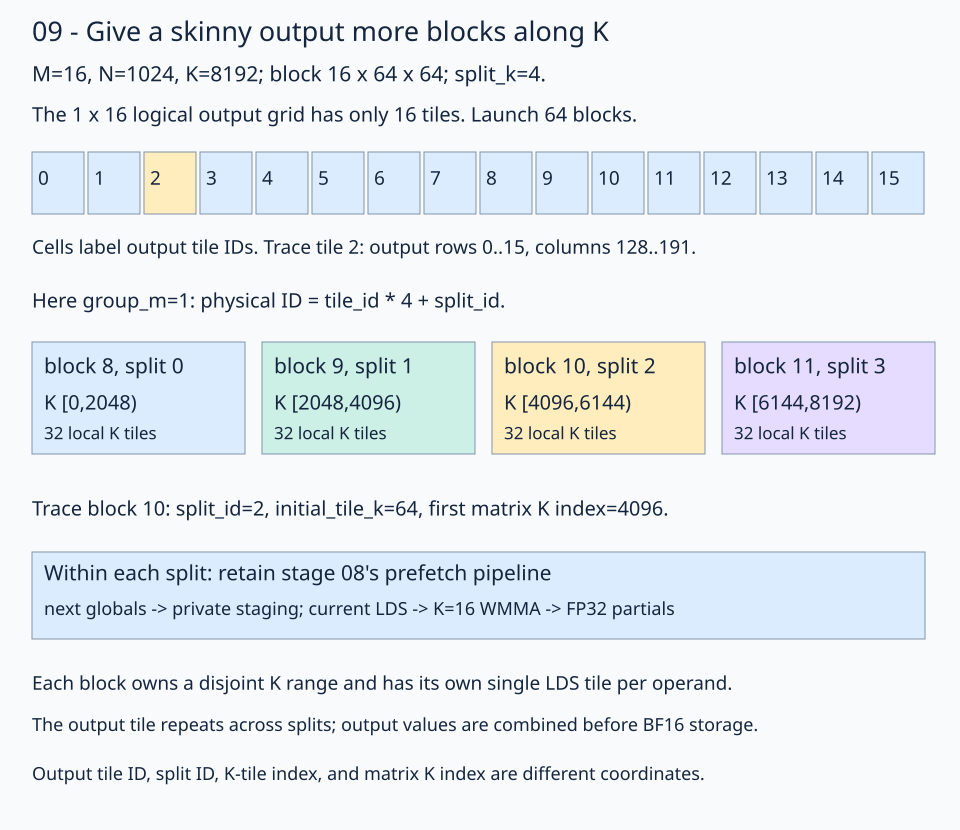
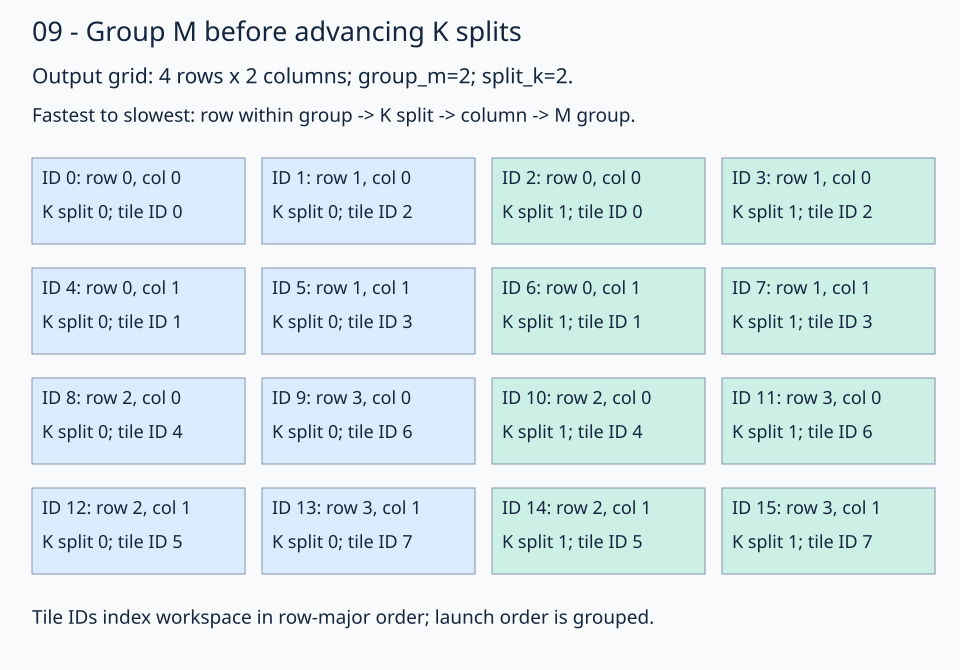
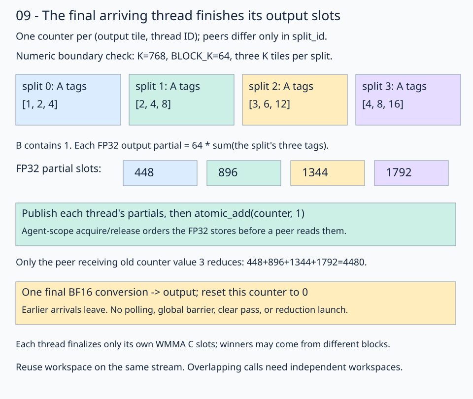

# 09 · Split a skinny GEMM along K in one kernel

A skinny output can leave too few blocks to occupy the GPU. For **M=16, N=1024, K=8192**, a **16×64 output tile** gives only **16 blocks** if each block computes the full K reduction. With `split_k=4`, four blocks share each output tile and compute disjoint K ranges, giving **64 blocks**. The arithmetic stays `C = A @ B`.

Build on [stage 08](../08-parameter-tuning/README.md): retain row-major BF16 A/B, FP32 accumulation, BF16 output, the one-dimensional launch, native layout mapping, buffer global transfers, independent operand copy plans, and one LDS tile per operand. Each split uses the same register-prefetch pipeline and K=16 WMMA fragments. `Config.split_k` accepts **1, 2, or 4**. Complete input/output tiles and equal, nonempty K partitions are required; arbitrary tails and strides are outside this lesson.



Follow output tile 2. Its matrix rows are 0–15 and columns 128–191. Blocks 8–11 compute its four FP32 partial products. Each block has independent registers and LDS. Shared output coordinates do not make their partial sums interchangeable with complete answers.

## 1. Assign each block an output tile and a K partition

The [solution](solution.py) includes M grouping and K partitioning in one launch layout. Its axes are `(row within M group, K split, tile column, M group)`, in that fastest-to-slowest order:

```python
# Visit neighboring M tiles at the same K split before advancing splits.
group_width = min(GROUP_M, tiles_m)
split_block_layout = fx.make_layout(
    (group_width, SPLIT_K, tiles_n, tiles_m // group_width),
    (
        1,
        group_width,
        group_width * SPLIT_K,
        group_width * SPLIT_K * tiles_n,
    ),
)
split_block_coords = fx.idx2crd(fx.block_idx.x, split_block_layout)
row_in_group = fx.get_scalar(split_block_coords[0])
split_id = fx.get_scalar(split_block_coords[1])
block_col = fx.get_scalar(split_block_coords[2])
group_id = fx.get_scalar(split_block_coords[3])
block_row = row_in_group + group_id * group_width
# Workspace IDs follow output coordinates independently of launch order.
output_tile_layout = fx.make_layout((tiles_m, tiles_n), (tiles_n, 1))
flat_block_id = fx.get_scalar(fx.crd2idx((block_row, block_col), output_tile_layout))
```

The grid is `(tiles_m * tiles_n * SPLIT_K, 1, 1)`. Neighboring M tiles in a group read the same B tile and the same K partition before the launch order advances to another split. `group_width` clamps `group_m` to the number of tile rows; complete groups are required. With `SPLIT_K=1`, this is the grouped M traversal from 07c/08. With `group_m=1`, split K advances fastest, matching the single-row skinny example below. The split coordinate selects K work, not another output row or column.



Trace this separate **4×2 output-tile grid**, `group_m=2`, `split_k=2`. IDs 0/1 target rows 0/1 at column 0, split 0; IDs 2/3 keep those rows and advance to split 1. IDs 4–7 repeat the pattern for column 1. ID 8 begins the next M group at row 2. This preserves same-split B reuse across neighboring rows. These are logical launch positions; GPU execution and completion order remain unspecified.

Workspace indexing uses a row-major output tile ID, `block_row * tiles_n + block_col`, independently of launch order. Every split peer for the same output tile therefore shares the same counter region, and distinct output tiles have disjoint partial/counter regions. Later lessons feed their independent-wave `logical_block_id` into this same layout.

For the illustrated **16×64×64 tile**, each partition contains `8192 / (64*4) = 32` K tiles:

```python
tiles_per_split = k // (BLOCK_K * SPLIT_K)
initial_tile_k = split_id * tiles_per_split
```

| Physical block | Output tile | Split ID | K-tile indices | Matrix K indices |
| --- | --- | --- | --- | --- |
| 8 | 2 | 0 | 0–31 | 0–2047 |
| 9 | 2 | 1 | 32–63 | 2048–4095 |
| 10 | 2 | 2 | 64–95 | 4096–6143 |
| 11 | 2 | 3 | 96–127 | 6144–8191 |

Trace block 10: `initial_tile_k=64` means matrix K index `64*64=4096`. `gmem2reg_load_tile` slices the full A/B tiled views at that K-tile coordinate; the sliced view carries its base offset. The prologue loads tile 64, steady state prefetches tiles 65–95, and the drain computes tile 95 exactly once. No block reads another partition's K range.

The focused native check records the actual mapping from temporary copies of the lesson kernels, then verifies grouped launch order, full GEMM output, sentinels, and repeated workspace use:

```bash
pixi run python tools/check_split_k_grouping.py
```

## 2. Publish FP32 partials to a workspace

Converting every partial to BF16 before adding them would introduce repeated rounding. Instead, each thread publishes its FP32 accumulator fragment to a private region of global workspace:

```text
(output tile, split ID, thread ID, accumulator slots)
```

For the illustrated tile, 64 threads each own 16 accumulator values. The workspace holds `16 tiles * 4 splits * 1024 values = 65536` FP32 values, or **256 KiB**, plus **4 KiB** of arrival counters. These are temporary partial results; they do not change the BF16 output contract.

`partial_view` uses `accumulator.layout`. Its base is selected by the output tile, split, and thread ID. `fx.copy(copy_128b_f32, accumulator, partial_view)` publishes the fragment. No two peers write the same partial region. With `split_k=1`, the specialization bypasses this workspace path and stores its complete result directly.

## 3. Finish inside the same kernel

Each `(output tile, thread ID)` has one integer counter, shared by the corresponding thread in all split blocks. Threads have disjoint WMMA C ownership, so each finalizer can finish its own slots independently. Different thread IDs may elect winners from different blocks. Each counter covers only one thread's slots, so its release operation publishes the same thread's stores.



This numeric diagram matches the **three-local-K-tile boundary check**, a smaller K=768 example. In split `p`, A contains the three tile tags `(p+1)*[1,2,4]`; B contains 1. Every output partial is `64*7*(p+1)`. The four partials sum to 4480. Trace the value through its FP32 partial slot before looking at the counter.

After storing its partial fragment, every peer executes:

```python
arrived = fx.atomic_add(
    counter_ptr,
    1,
    ordering=fx.AtomicOrdering.AcqRel,
    syncscope=fx.rocdl.SyncScope.Agent,
)
last_arrival = arrived == SPLIT_K - 1
```

For four splits, the atomic returns old values 0, 1, 2, and 3 in an unspecified arrival order. Only the peer receiving 3 enters the GPU runtime branch. It reads all four FP32 fragments in split-ID order, adds their corresponding slots, converts the complete sums to BF16 once, and stores them through the same instruction-derived C copy plan as 08. It then resets its counter to zero with an agent-scope release store.

The acquire/release atomic is part of correctness: its release publishes the preceding partial stores, and its acquire makes earlier peers' published stores visible to the finalizer. A counter increment with relaxed ordering would not establish that visibility. The ordering follows the [LLVM AMDGPU memory model](https://llvm.org/docs/AMDGPUMemoryModel.html); the installed FlyDSL 0.4.1 implementations are in `expr/llvm.py` (`atomic_add`, `generic_store`) and `expr/rocdl/enum.py` (`SyncScope.Agent`). See the [upstream atomic helpers](https://github.com/ROCm/FlyDSL/blob/main/python/flydsl/expr/llvm.py), which may evolve beyond the installed version.

Earlier arrivals leave without waiting. There is no polling loop or grid-wide barrier, so progress does not require all split blocks to be resident at once. There is **one kernel launch per GEMM**, including publication, reduction, final conversion, output storage, and counter reset. The benchmark checks one GEMM kernel node per call. A new graph capture also records its workspace initialization, which is included in replay timing.

## 4. Reuse the workspace without a clear pass

The public `matmul_bf16` launcher allocates scratch and initializes counters when a Split-K cache entry is first needed. Ordinary repeated calls reuse it; a graph capture owns separate scratch and records its initialization once. Partial storage needs no per-call initialization: every peer overwrites its own region before arriving. Output storage can contain NaNs or results of an earlier GEMM; the finalizer overwrites it completely.

```python
out = matmul_bf16(a, b, config=config)
matmul_bf16(other_a, b, out=out, config=config)  # reuse output and cached scratch
```

The launcher caches scratch separately for each config, shape, device, stream, and graph capture. Calls using one workspace are ordered on its stream. Pass `stream=s` to use a nondefault stream, and establish input dependencies before calling it. Different streams and graph captures receive independent buffers. Unsplit calls allocate no partials or counters. Each Split-K graph captures its workspace initialization once before its matmuls; timing reports record those setup nodes separately from the one compute kernel per GEMM.

The checker changes inputs between workspace reuses, poisons outputs, checks the entire product against CPU FP32 arithmetic on the actual BF16 inputs, and verifies output/workspace sentinels and reset counters. One, two, and three K tiles **per split** exercise prologue, handoffs, and drain; their FP32 partial values are checked independently before the final output comparison. Random-output tolerances are `rtol=0.016, atol=0.03125`; trace and tagged boundary checks use exact BF16 results.

### Compare one counter per CTA

The completed [practice](practice.py) also supports `--counter-scope cta`; its default `thread` mode retains the per-thread baseline. In CTA mode, each thread stores its FP32 partial and executes an agent-scope release fence before a workgroup barrier. Thread 0 performs the agent-scope acquire/release arrival atomic and writes the election result into an aligned word of the now-unused operand LDS. Another workgroup barrier broadcasts that result. All threads of the winning CTA execute an agent-scope acquire fence and reduce their original fragment slots. A final workgroup barrier precedes thread 0's release reset. Earlier CTAs leave without polling. These barriers transfer publication and acquisition between the leader and its workers; see the [AMDGPU execution-barrier rules](https://llvm.org/docs/AMDGPUUsage.html#execution-barriers).

For the 16×64 tile with 64 threads and four splits, this reduces counters per output tile from 64 to 1 and atomic increments from 256 to 4. Partial layout and FP32 traffic stay fixed at 16 KiB of writes plus 16 KiB of reads per output tile. The fragment size is inferred from `accumulator.shape` in both modes.

```bash
pixi run python lessons/01-gpu-programming/13-matmul/09-split-k/practice.py --counter-scope cta --check-only
pixi run python lessons/01-gpu-programming/13-matmul/09-split-k/benchmark_counters.py --output /tmp/split-k-counters.json
```

The [controlled counter comparison](results/cta-counters-20261112/README.md) checks both strategies, including multiwave CTAs, repeated workspace reuse, and one-kernel graph capture. On gfx1151, graph-batched paired timing differences were below 1% across the three workloads; fewer atomics did not establish a useful performance improvement. CTA mode remains an optional experiment.

## 5. Tune split count for the shape

More splits shorten each block's K loop and create more blocks. They also add FP32 workspace traffic, arrival atomics, and finalizer work. A wider output can already have enough blocks; in that case splitting may cost more than it saves. Select among 1, 2, and 4 rather than assuming four always wins.

The supported workloads are **(16,1024,8192)**, **(32,1024,8192)**, and **(16,4096,8192)**. The [tuner](tune.py) checks candidate correctness on trace and seeded random inputs before recording paired timings. Lock a tuple using training seed 13, then verify on fresh seeds. Compilation, allocation, one-time workspace initialization, and CPU reference arithmetic stay outside timing. GPU PyTorch receives identical row-major BF16 inputs and a preallocated BF16 output.

Before the reported cooling repair, the base sweeps checked **102, 225, and 102 valid configurations**, respectively, with no correctness rejections. These training records are retained as historical selection evidence; the configurations have not been retuned for the repeat below. A longer seed-13 confirmation rotated four wide-case candidates to distinguish a stable result from a favorable short sample. The selected narrow-case tuples are near the leading training candidates; they keep the illustrated staging geometry. The wide case selects the stable no-split fallback.

Holding each selected tile/wave geometry fixed, the seed-13 sweep produced these median **paired native/Torch ratios**:

| Shape | Split K = 1 | Split K = 2 | Split K = 4 |
| --- | ---: | ---: | ---: |
| 16,1024,8192 | 1.6354 | 0.7350 | 0.6432 |
| 32,1024,8192 | 0.9783 | 0.5498 | 0.4564 |
| 16,4096,8192 | 0.9661 | 1.0096 | 1.0577 |

These are historical training observations, each paired with its own Torch measurement. The verification below repeats the original held-out seed sets after the reported thermal repair.

### Locked verification on gfx1151

The following observations use **FlyDSL 0.4.1**, **PyTorch 2.13.0+rocm10.0.0**, and **Radeon 8060S Graphics (`gfx1151`)**, rerun on 2026-11-06 after the owner reported repairing a hardware thermal issue. The [new reports and telemetry](results/thermal-rerun-20261106T064532Z/README.md) preserve the original code, locked configurations, verification seeds, and timing modes. This is a repeat of the original held-out verification, with three rounds per seed and seven alternating batches per round; no retuning used these results. A graph replay contains 32 GEMMs; each batch repeats it 20 times. Both captures contain exactly 32 kernel nodes and no clear/reduction nodes. Input mutation, poisoned outputs, sentinels, and reset counters are checked outside timing.

| Shape (M,N,K) | Selected BM,BN,BK / waves / split K | Native µs | GPU Torch µs | Worst paired native/Torch ratio | Result |
| --- | --- | ---: | ---: | ---: | --- |
| 16,1024,8192 | 16,64,64 / 1×2 / 4 | 22.74 | 34.40 | 0.6696 | Win in all 9 rounds |
| 32,1024,8192 | 32,64,64 / 1×2 / 4 | 29.16 | 64.98 | 0.4664 | Win in all 9 rounds |
| 16,4096,8192 | 16,32,16 / 1×1 / 1 | 302.02 | 290.84 | 1.0410 | Within 5% parity band; no split-K win |

Times are medians of round medians from synchronized host timing of graph replay, divided by 32 operations. These measure warmed captured throughput, not isolated instruction durations or ordinary Python calls. The win criterion requires every round's median paired ratio to be below 0.95; parity requires every round to stay at or below 1.05. The two split configurations give about **1.51×** and **2.23×** median throughput relative to their matched GPU Torch captures. The wider case does not establish a split-K win.

Separate **direct-host** verification retains ordinary Python dispatch costs and did **not** establish an all-round win for either split configuration. Its new medians were 52.72/35.70 µs (native/Torch) for 16×1024×8192 and 54.10/59.29 µs for 32×1024×8192; the worst paired ratios were 1.7274 and 1.0425. The second case and the wide fallback met the declared parity criterion in direct mode. GPU edge telemetry ranged from 43 to 72 °C during the rerun. The earlier thermally affected records remain available; the current claims use the repeated locked verification, not the fastest training samples. Neither timing mode implies a win on another GPU or workload.

The complete samples, orders, seeds, configuration fields, source hashes, and capture checks are retained in [the results directory](results/README.md). The [instruction capture](results/inspection.json) records 10496 LDS bytes, 163 compiler VGPRs, zero private scratch, BF16 WMMA, and an agent-scope acquire/release arrival atomic for the default specialization. This is a static resource check, not an occupancy measurement.

Reproduce selection and verification with fresh output paths:

```bash
pixi run python lessons/01-gpu-programming/13-matmul/09-split-k/tune.py \
  --sweep --shape 16 1024 8192 --output /tmp/skinny-training.json
pixi run python lessons/01-gpu-programming/13-matmul/09-split-k/tune.py \
  --verify --shape 16 1024 8192 --config 16,64,64,1,2,4 \
  --seeds 2026110901 2026110902 2026110903 --output /tmp/skinny-heldout.json
pixi run python lessons/01-gpu-programming/13-matmul/09-split-k/tune.py \
  --verify --shape 32 1024 8192 --config 32,64,64,1,2,4 \
  --seeds 2026110901 2026110902 2026110903 --output /tmp/skinny32-heldout.json
pixi run python lessons/01-gpu-programming/13-matmul/09-split-k/tune.py \
  --verify --shape 16 4096 8192 --config 16,32,16,1,1,1 \
  --seeds 2026110901 2026110902 2026110903 --output /tmp/skinny-wide-heldout.json
pixi run python lessons/01-gpu-programming/13-matmul/09-split-k/inspect_kernel.py \
  --output /tmp/skinny-instructions
```

Use `--timing direct-host` for a separate direct-launch verification. Select using seed 13, lock the tuple, and reserve unused seeds after each retune. Earlier stage-08 results remain fixed-shape comparisons; this lesson's skinny timings do not replace them.

### Expanded search for the wider case

After the cooling repair, `tune.py --sweep --exhaustive --shape 16 4096 8192` enumerated **1080** tile/wave/split combinations. **132** satisfy the full-tile, copy, and LDS limits and passed trace/random correctness, including 30 choices missing from the earlier sweep. K tiles of 256/512 and eight-wave blocks were included. The search fixes the existing 128-bit staging copies, A padding, single LDS stage, and K-partition mapping; `group_m=1` is fixed for the single output tile row.

A longer seed-13 confirmation selected `Config(16,64,16,1,1,split_k=1)`. On three new seeds and nine verification rounds it measured **300.98 µs versus Torch's 290.43 µs**, with worst paired ratio **1.0420**. The existing `16×32×16` default measured **301.95/290.15 µs**, with worst ratio **1.0429**, on those same fresh seeds. Neither configuration beats Torch; both remain within the declared 5% parity band. The sub-percent candidate difference leaves the default unchanged.

See the [full search space, pruning reasons, raw samples, telemetry, and reproduction commands](results/wide-exhaustive-20261106T065525Z/README.md). The original 102/225/102-case sweeps remain the default CLI behavior; `--exhaustive` enables the expanded space explicitly. This completes the tile/wave/split parameter search under those limits. Other staging and memory-layout designs fall outside this search.

## Continue with the profile

[Stage 10](../10-wave-local-tiles/README.md) profiles this wide fallback and develops independent wave tiles with LDS-only synchronization. Its retained counters show about half as many L1-to-L2 reads, and two locked wide graph verifications beat Torch by about 6%. Run this lesson's [profiler](profile.py) with `--collect --output /tmp/skinny-profile` to reproduce the baseline; pass `--module` to compare another lesson.

## Practice

[practice.py](practice.py) follows the [solution](solution.py). TODO 1 fills `initial_tile_k` from the split coordinate. TODO 2 fills `last_arrival` using the old arrival count. The native views, prefetch pipeline, FP32 workspace, memory ordering, runtime branch, reduction, and checker are supplied.

For the default trace input, the first four outputs are `[7,4,1,-2]`. This is the complete K reduction, not the contribution of a single split.

From the repository root:

```bash
pixi run python lessons/01-gpu-programming/13-matmul/09-split-k/practice.py --check-only
pixi run python lessons/01-gpu-programming/13-matmul/09-split-k/solution.py
pixi run python lessons/01-gpu-programming/13-matmul/09-split-k/solution.py --split-k 2 --check-only
pixi run gpu-check
```

An unfinished starter reports `Practice not finished:`. A complete program reports `Exercise passed:`; the solution and completed practice also compare their own kernel with GPU PyTorch unless `--check-only` is passed. The course checker exercises all three split counts on all three shapes.

## Revision question

Why is writing a BF16 partial with ordinary stores from each split block incorrect, even if every block computes its assigned K interval correctly?

<details><summary>Answer</summary>

All split blocks target the same output coordinates. Ordinary stores overwrite each other and retain only whichever partial happened to arrive last. Summing separately rounded BF16 partials also changes the arithmetic. This kernel first publishes disjoint FP32 partials, uses acquire/release arrival ordering to identify a peer that can see all of them, sums in FP32, and performs one final BF16 conversion for each output value.

</details>

[Previous: parameter tuning](../08-parameter-tuning/README.md) · [Next: independent wave tiles](../10-wave-local-tiles/README.md) · [Matmul series](../README.md) · [Course roadmap](../../../../ROADMAP.md)
