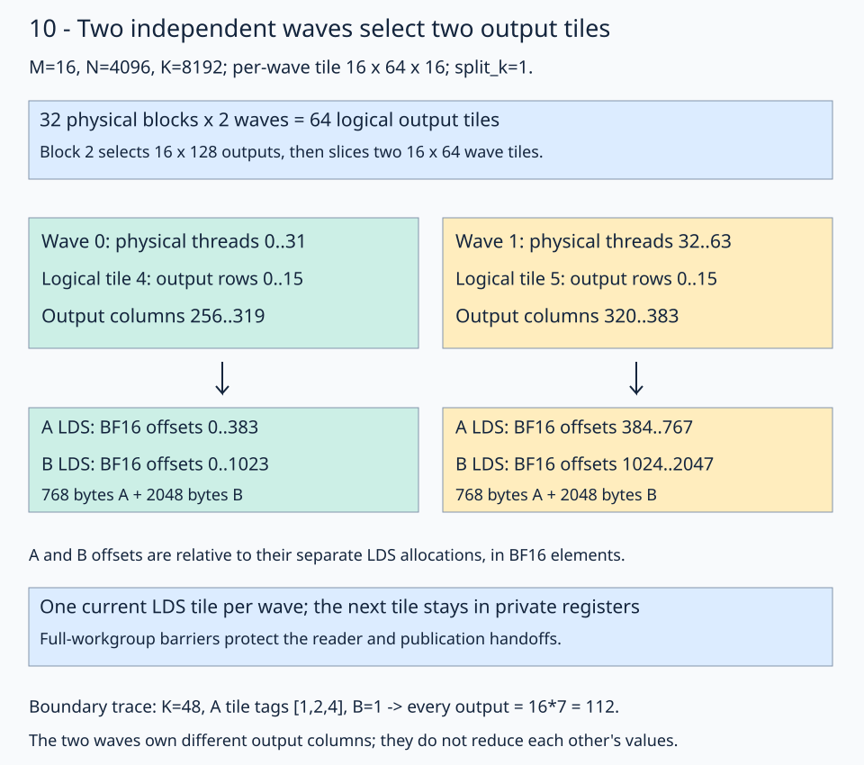
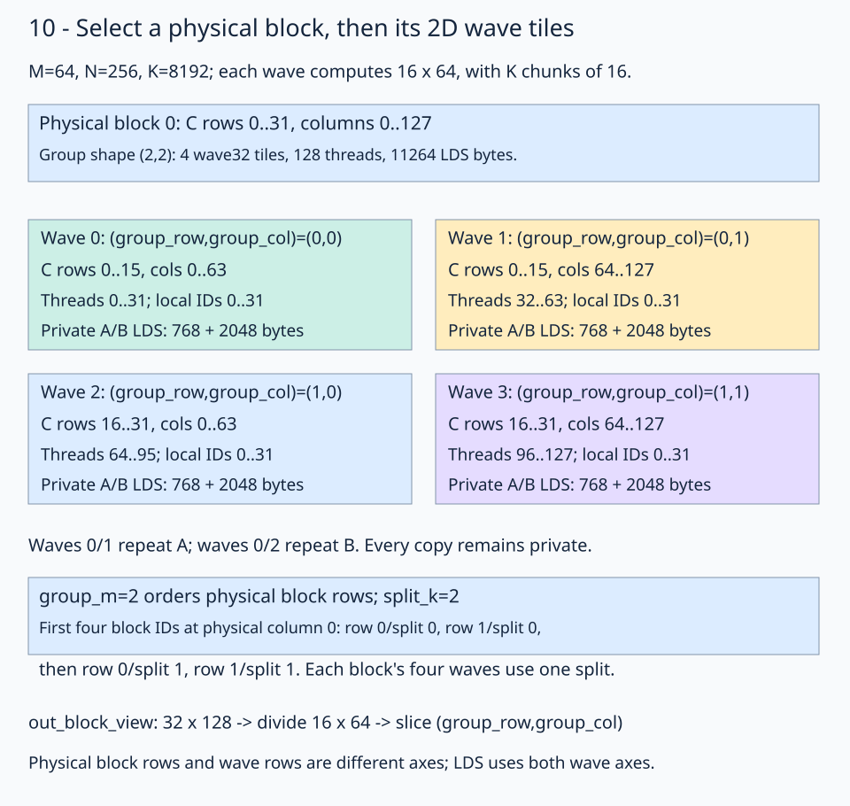

# 10 · Give independent waves their own output tiles

A physical block can contain two waves without making them cooperate on one matrix tile. Give each wave its own output tile, accumulator, and LDS region. This changes the grouping of work while keeping the prefetched K reduction from [split-K](../09-split-k/README.md).

This lesson changes wave ownership only. It keeps the ordinary B cache policy, a rolled K loop, and full-workgroup handoff barriers. [10a](../10a-synchronization-scope/README.md) will narrow those barriers after the independent storage is established.

Wave groups have two dimensions: `wave_groups_m` and `wave_groups_n`. They
place independent tiles along M and N, while `waves_m` and `waves_n` describe
cooperating waves **inside one compute tile**. The physical block covers
`(BLOCK_M*wave_groups_m, BLOCK_N*wave_groups_n)` output values. The four tuning
arrangements are `(1,1)`, `(1,2)`, `(2,1)`, and `(2,2)`.

## Follow physical block 2

Use `(M,N,K)=(16,4096,8192)`, row-major BF16 A/B/C, and FP32 accumulation. Each wave32 computes a 16×64 output tile using 16-wide K chunks. `(wave_groups_m,wave_groups_n)=(1,2)` puts two such waves in each physical block. With `split_k=1`, 64 logical output tiles fit into 32 physical blocks of 64 threads.



Read the wave's output columns first, then follow its private LDS region. Equal A input rows do not imply shared LDS storage.

The walkthrough selects `(1,2)`. The tuned wide CLI default uses `(1,1)` because this lesson retains full-workgroup barriers; its benchmark also measures `(1,2)`. Lesson 10a introduces subgroup scope, where the two-wave selection remains useful. The [sweep results](results/20261116-2d-wave-groups/README.md) separate the teaching configuration from measured defaults.

## Select the physical block before the wave

The [native solution](solution.py) encodes physical-block and wave ownership in
one native layout. For the walkthrough, `WAVE_GROUPS_M=1`, `WAVE_GROUPS_N=2`,
`group_m=1`, and `split_k=1`:

```python
WAVE_GROUPS = WAVE_GROUPS_M * WAVE_GROUPS_N
wave_group = fx.thread_idx.x // THREADS_PER_GROUP
compute_thread_id = fx.thread_idx.x % THREADS_PER_GROUP
launch_coordinate = fx.block_idx.x * WAVE_GROUPS + wave_group
```

`split_block_layout` has axes `(wave_row, wave_col, row_in_group, split_id,
physical_block_col, m_group)`. Its strides make wave column vary first, then wave
row, then the grouped physical-block traversal. `idx2crd` decodes the scalar
`launch_coordinate`. For block 2 the waves decode `(wave_row,wave_col)=(0,0)`
and `(0,1)`, both with `physical_block_row=0`, `physical_block_col=2`, and split 0.

First select the whole physical block's **16×128** view, then each wave's 16×64
view. These expressions describe addresses without loading or copying values:

```python
out_tiled_view = fx.flat_divide(out_global_view, (PHYSICAL_M, PHYSICAL_N))
out_block_view = fx.slice(
    out_tiled_view, (None, None, physical_block_row, physical_block_col)
)
out_wave_tiles = fx.flat_divide(out_block_view, (BLOCK_M, BLOCK_N))
out_wave_view = fx.slice(out_wave_tiles, (None, None, wave_row, wave_col))
```

Block 2 owns C rows 0–15, columns 256–383. Wave 0 slices columns 256–319;
wave 1 slices columns 320–383. Copy/MMA plans use `compute_thread_id`, 0–31,
and the accumulator/output plans consume `out_wave_view`. The two waves have
separate accumulators; neither reduces the other's values.

The operand tile coordinates are `block_row=physical_block_row*WAVE_GROUPS_M+
wave_row` and `block_col=physical_block_col*WAVE_GROUPS_N+wave_col`. Neighbors
along N load the same A tile; neighbors along M load the same B tile. Each wave
still stages its own copies. Packing independent tiles introduces no operand
sharing between waves.

## Arrange four wave tiles in two dimensions

For `(M,N,K)=(64,256,8192)`, per-wave tiles 16×64, and a `(2,2)` wave-group
shape, each 128-thread physical block owns a **32×128** output region.



Read wave columns first, then wave rows. Wave IDs 0,1,2,3 select coordinates
`(0,0),(0,1),(1,0),(1,1)`. With `group_m=2` and split-K enabled, blocks visit the
two physical M rows at the same split and physical N column before advancing
the split. **All four waves within one block process the same split.** This
keeps the physical block's C region explicit for every split count.

`group_m` changes traversal, not storage. It counts physical block rows, each
32 elements tall in this example. A/B LDS and prefetch registers grow with the
number of independent wave tiles per block; logical staging per thread stays
fixed. Full physical tiles are required here. An M=16 workload cannot fit two
16-row wave tiles along M; the tuner records that exclusion rather than using
the second wave row for another K split. Lesson 12 later bounds partial M rows.

## Slice the shared views by group

The allocator reserves one A tile and one B tile per group. Describe the full allocation with a leading group dimension, then slice that dimension to select each group's tile:

```python
left_lds_all = lds.left.view(
    fx.make_layout(
        (WAVE_GROUPS_M, WAVE_GROUPS_N, BLOCK_M, BLOCK_K),
        (WAVE_GROUPS_N * BLOCK_M * (BLOCK_K + 8),
         BLOCK_M * (BLOCK_K + 8), BLOCK_K + 8, 1),
    )
)
right_lds_all = lds.right.view(
    fx.make_layout(
        (WAVE_GROUPS_M, WAVE_GROUPS_N, BLOCK_K, BLOCK_N),
        (WAVE_GROUPS_N * BLOCK_K * BLOCK_N, BLOCK_K * BLOCK_N, BLOCK_N, 1),
    )
)
left_lds_view = fx.slice(left_lds_all, (wave_row, wave_col, None, None))
right_lds_view = fx.slice(right_lds_all, (wave_row, wave_col, None, None))
```

A's full view has coordinates `(wave_row,wave_col,row,k)`; B's has
`(wave_row,wave_col,k,column)`. Adjacent wave columns are separated by one
private tile; adjacent wave rows by `WAVE_GROUPS_N` private tiles. Slicing the
two group axes leaves the 2D operand tile expected by the copy/MMA plans.

For the `(1,2)` walkthrough, wave column 1 starts A at element 384, a 768-byte displacement, and B at element 1024, a 2048-byte displacement. A and B are separate arrays; their relative offsets cannot be compared as one flat address space. Both wave tiles together allocate **5632 LDS bytes**.

Slicing carries the selected group's base offset into the tile view. It allocates no additional storage and copies no values. Subsequent thread partitions use local tile coordinates without adding the group offset again.

## Keep the existing pipeline

Every wave loads its next A/B chunk into private registers while WMMA consumes its current LDS chunk. The handoffs still call `fx.barrier()` for the entire physical block. All groups execute the same number of K steps, so each reaches the same barriers. This is deliberately a conservative synchronization baseline for the next lesson.

With `K=48`, one split, and the same `BLOCK_K=16`, set A's three K chunks to `[1,2,4]` and B to 1. Every output must be `16*(1+2+4)=112`. Tile 0 is prepared in the prologue, two steady steps advance the pipeline, and the drain consumes tile 2 without another global read.

The two narrow workload configurations use two cooperating waves per tile and a `(1,1)` group shape. The new grouping comparison matters on the wide workload, whose tiles need only one wave each. For the wide shape, the benchmark compares valid wave-group shapes while preserving per-tile arithmetic, cache policy, and the K loop. The full 2D tuner also tests one-wave 16-row tiles on the narrow workloads, keeping K chunks and split counts fixed. The existing cooperating configuration remains a control.

## Practice and checking

[practice.py](practice.py) supplies the global views, copy/MMA ownership, prefetch pipeline, single-kernel split-K finalizer, launch, and independent host checker. Fill only these two expressions:

1. `launch_coordinate`: combine the physical block ID with this wave group for the six-axis layout.
2. `right_lds_view`: slice B's full LDS view at `(wave_row,wave_col)`, keeping both tile axes.

The default full-size checkpoint is **`[8,5,2,-1]`**, the first four BF16 output values in row 0 of the wide workload. Both narrow shape selectors return `[7,4,1,-2]`. The tile-tag traces above use different inputs to isolate pipeline boundaries.

The checker compares the entire output with CPU FP32 arithmetic on the quantized BF16 inputs, rounded to BF16. It checks structured/random inputs, changed signs across workspace reuse, NaN output replacement, output/workspace sentinels, reset arrival counters, and exact tagged FP32 partials. Random tolerances are `rtol=0.016, atol=0.03125`. Course checking covers all three shapes with split counts 1,2,4. Contiguous storage, complete tiles, and equal K partitions are required.

Each GEMM remains **one kernel**, including partial reduction and counter reset. Reuse of one workspace is serialized on a single stream.

## Revision question

Why does wave 1 use local thread IDs 0–31 even though its physical threads are 32–63?

<details><summary>Answer</summary>

Its copy and MMA layouts describe one wave. The group base selects its output tile and LDS region; the local thread ID then selects ownership within that tile. These are different selections.

</details>

Run from the repository root:

```bash
pixi run python lessons/01-gpu-programming/13-matmul/10-wave-local-tiles/practice.py --check-only
pixi run python lessons/01-gpu-programming/13-matmul/10-wave-local-tiles/solution.py
pixi run python lessons/01-gpu-programming/13-matmul/10-wave-local-tiles/tune.py --output /tmp/stage-10-comparison.json
pixi run python lessons/01-gpu-programming/13-matmul/10-wave-local-tiles/inspect_kernel.py --output /tmp/stage-10-isa
pixi run python tools/tune_wave_group_shapes.py --output /tmp/wave-group-sweep
pixi run gpu-check
```

The unfinished starter reports `Practice not finished:`; the [worked solution](solution.py) reports `Exercise passed:` before its controlled timing table. Add `--shape 32 1024 8192` to select a narrow workload. Benchmarks use validated 32-node graph replay and synchronized host timing; `--timing direct-host` measures ordinary dispatch separately. Use fresh output paths for instruction captures.

See the [2D wave-group sweep](results/20261116-2d-wave-groups/README.md) and the [focused sequence's historical validation and controlled measurements](../10c-k-unrolling/results/README.md). These are gfx1151 observations with FlyDSL 0.4.1, not a guaranteed speedup on every shape or GPU.

[Previous: skinny split-K](../09-split-k/README.md) · [Matmul series](../README.md) · [Next: synchronization scope](../10a-synchronization-scope/README.md)
