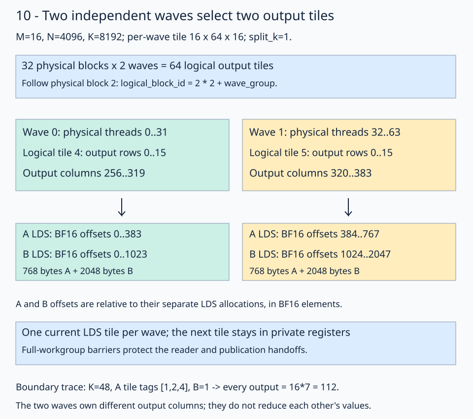

# 10 · Give independent waves their own output tiles

A physical block can contain two waves without making them cooperate on one matrix tile. Give each wave its own output tile, accumulator, and LDS region. This changes the grouping of work while keeping the prefetched K reduction from [split-K](../09-split-k/README.md).

This lesson changes wave ownership only. It keeps the ordinary B cache policy, a rolled K loop, and full-workgroup handoff barriers. [10a](../10a-synchronization-scope/README.md) will narrow those barriers after the independent storage is established.

The launch retains [09's grouped split-K traversal](../09-split-k/README.md#1-assign-each-block-an-output-tile-and-a-k-partition): row within M group first, then K split, tile column, and M group. The layout decodes `logical_block_id` after independent-wave assignment. Workspace tile IDs remain row-major and independent of launch order. The locked skinny configurations use `group_m=1`; the same mapping supports complete larger M groups.

## Follow physical block 2

Use `(M,N,K)=(16,4096,8192)`, row-major BF16 A/B/C, and FP32 accumulation. Each wave32 computes a 16×64 output tile using 16-wide K chunks. `wave_groups=2` puts two such waves in each physical block. With `split_k=1`, 64 logical output tiles fit into 32 physical blocks of 64 threads.



Read the wave's output columns first, then follow its private LDS region. Equal A input rows do not imply shared LDS storage.

These API fragments come from the [native solution](solution.py):

```python
wave_group = fx.thread_idx.x // THREADS_PER_GROUP
compute_thread_id = fx.thread_idx.x % THREADS_PER_GROUP
logical_block_id = fx.block_idx.x * WAVE_GROUPS + wave_group
```

`fx.block_idx.x` remains one-dimensional. Block 2 maps to logical IDs `2*2+0=4` and `2*2+1=5`. The existing split/output layout decodes each logical ID; copy and MMA plans receive the local `compute_thread_id`, 0–31. Passing physical thread 35 to the second wave's one-wave plan would use the wrong ownership domain.

For this wide workload, logical tile 4 selects C rows 0–15 and columns 256–319. Tile 5 selects columns 320–383. Each wave runs its own complete K reduction. The waves do not combine their accumulators.

## Offset the shared views

The allocator reserves a separate region for each group. A retains padded strides `(BLOCK_K+8,1)` and B retains packed strides `(BLOCK_N,1)`. After constructing those local layouts, select the group base:

```python
left_lds_view = fx.make_view(
    fx.get_iter(left_lds_view) + wave_group * BLOCK_M * (BLOCK_K + 8),
    left_lds_view.layout,
)
right_group_ptr = fx.get_iter(right_lds_view) + wave_group * BLOCK_K * BLOCK_N
right_lds_view = fx.make_view(right_group_ptr, right_lds_view.layout)
```

Pointers count BF16 elements. Wave 1 starts A at element 384, a 768-byte displacement, and B at element 1024, a 2048-byte displacement. A and B are separate allocations; their relative offsets cannot be compared as one flat address space. Both groups together allocate **5632 LDS bytes**.

The selected view already carries the group base. Subsequent thread partitions use local coordinates and do not add that base again.

## Keep the existing pipeline

Every wave loads its next A/B chunk into private registers while WMMA consumes its current LDS chunk. The handoffs still call `fx.barrier()` for the entire physical block. All groups execute the same number of K steps, so each reaches the same barriers. This is deliberately a conservative synchronization baseline for the next lesson.

With `K=48`, one split, and the same `BLOCK_K=16`, set A's three K chunks to `[1,2,4]` and B to 1. Every output must be `16*(1+2+4)=112`. Tile 0 is prepared in the prologue, two steady steps advance the pipeline, and the drain consumes tile 2 without another global read.

The two narrow workload configurations use two cooperating waves per tile and `wave_groups=1`. The new grouping comparison matters on the wide workload, whose tiles need only one wave each. For the wide shape, the benchmark changes `wave_groups` between 1 and 2 while preserving per-tile arithmetic, cache policy, and the K loop. Narrow selectors already use one group per block and show only the stage and Torch rows.

## Practice and checking

[practice.py](practice.py) supplies the global views, copy/MMA ownership, prefetch pipeline, single-kernel split-K finalizer, launch, and independent host checker. Fill only these two expressions:

1. `logical_block_id`: combine the physical block ID with this wave group.
2. `right_group_ptr`: offset B by one packed `BLOCK_K*BLOCK_N` region per group.

The default full-size checkpoint is **`[8,5,2,-1]`**, the first four BF16 output values in row 0 of the wide workload. Both narrow shape selectors return `[7,4,1,-2]`. The tile-tag traces above use different inputs to isolate pipeline boundaries.

The checker compares the entire output with CPU FP32 arithmetic on the quantized BF16 inputs, rounded to BF16. It checks structured/random inputs, changed signs across workspace reuse, NaN output replacement, output/workspace sentinels, reset arrival counters, and exact tagged FP32 partials. Random tolerances are `rtol=0.016, atol=0.03125`. Course checking covers all three shapes with split counts 1,2,4. Contiguous storage, complete tiles, and equal K partitions are required.

Each GEMM remains **one kernel**, including partial reduction and counter reset. Reuse of one workspace is serialized on a single stream.

## Revision question

Why does wave 1 use local thread IDs 0–31 even though its physical threads are 32–63?

<details><summary>Answer</summary>

Its copy and MMA layouts describe one wave. The group base selects its output tile and LDS region; the local thread ID then selects ownership within that tile. These are different selections.

</details>

Run from the repository root:

```bash
pixi run python lessons/01-gpu-programming/13-matmul/10-wave-local-tiles/practice.py --check-only
pixi run python lessons/01-gpu-programming/13-matmul/10-wave-local-tiles/solution.py
pixi run python lessons/01-gpu-programming/13-matmul/10-wave-local-tiles/tune.py --output /tmp/stage-10-comparison.json
pixi run python lessons/01-gpu-programming/13-matmul/10-wave-local-tiles/inspect_kernel.py --output /tmp/stage-10-isa
pixi run gpu-check
```

The unfinished starter reports `Practice not finished:`; the [worked solution](solution.py) reports `Exercise passed:` before its controlled timing table. Add `--shape 32 1024 8192` to select a narrow workload. Benchmarks use validated 32-node graph replay and synchronized host timing; `--timing direct-host` measures ordinary dispatch separately. Use fresh output paths for instruction captures.

See the [focused sequence's validation and controlled measurements](../10c-k-unrolling/results/README.md). These are gfx1151 observations with FlyDSL 0.4.1, not a guaranteed speedup on every shape or GPU.

[Previous: skinny split-K](../09-split-k/README.md) · [Matmul series](../README.md) · [Next: synchronization scope](../10a-synchronization-scope/README.md)
