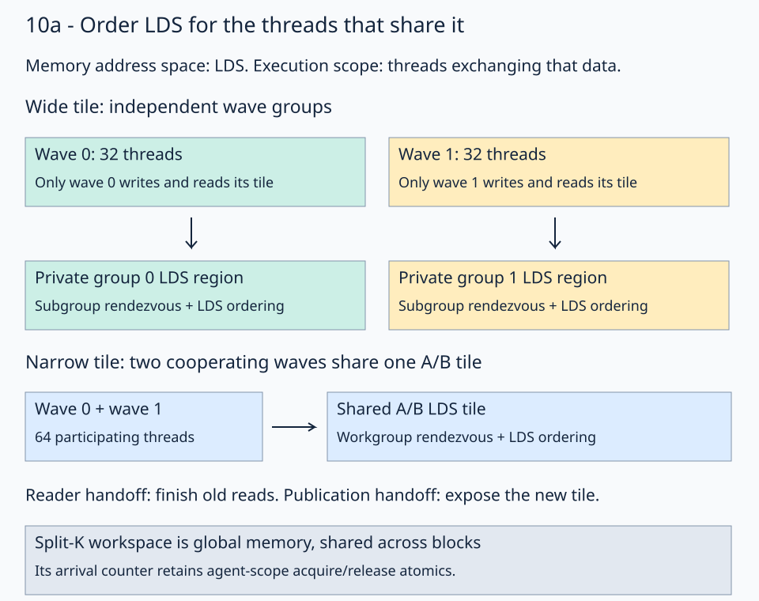

# 10a · Match the barrier to the shared data

The two waves in [lesson 10](../10-wave-local-tiles/README.md) use disjoint LDS regions. They still rendezvous at full-workgroup barriers. This lesson asks which threads actually exchange data, and which memory needs ordering at each handoff. It keeps the same tiles, ordinary cache policy, rolled K loop, and single LDS stage.

## Two independent choices

Use the same `(16,4096,8192)` workload: two independent wave32 groups in a physical block, each computing 16×64 outputs with 16-wide K chunks. Block 2 selects columns 256–319 and 320–383. Its two A/B regions occupy 5632 LDS bytes altogether.



Trace the arrows from writers to readers. A barrier must include every participant in that exchange. Its memory ordering must cover the storage used by those participants.

The solution constructs the LDS address-space attribute and selects an execution scope:

```python
lds_address_spaces = ir.ArrayAttr.get(
    [ir.Attribute.parse("#gpu.address_space<workgroup>")]
)
barrier_scope = (
    gpu.BarrierScope.Subgroup
    if WAVE_GROUPS > 1 and SYNC_MODE == "lds-subgroup"
    else gpu.BarrierScope.Workgroup
)
fx.barrier(address_spaces=lds_address_spaces, scope=barrier_scope)
```

`address_spaces` selects **LDS memory ordering**. `scope` selects **the participating threads**. The word `workgroup` inside the address-space attribute identifies shared storage; it does not force a workgroup execution rendezvous. The [MLIR GPU barrier contract](https://mlir.llvm.org/docs/Dialects/GPU/#gpubarrier-gpubarrierop) defines these two choices; the executable API is checked against installed FlyDSL 0.4.1.

For the wide configuration, each group is exactly one wave. Its own threads publish and consume its LDS tile, so subgroup scope is sufficient. On the two narrow workloads, one output tile is shared by two cooperating waves. They exchange A/B values through the same LDS region and must retain workgroup scope. The config validator allows multiple independent groups only when each contains exactly one wave.

## Preserve both handoffs

The prefetched loop still has this order:

```text
load the next global tile into private registers
consume the current LDS tile with WMMA
finish the current LDS readers
publish the next tile to LDS
make the new LDS values visible
```

Narrowing a barrier does not remove either dependency. The first handoff protects readers from overwrite; the second protects consumers from incomplete publication. In the three-tile trace, A tags `[1,2,4]`, B=1, and `BLOCK_K=16` still produce 112 at every output. Changing the barrier must preserve every tagged contribution.

## Compare one choice at a time

`sync_mode` exposes three legal controls:

| Mode | Memory ordering | Execution participants |
| --- | --- | --- |
| `workgroup` | Default `fx.barrier()` | Entire physical block |
| `lds-workgroup` | LDS only | Entire physical block |
| `lds-subgroup` | LDS only | One independent wave; cooperating tiles retain workgroup scope |

The selected mode is `lds-subgroup`. For the wide case, compare the first two modes to isolate memory ordering, then the latter two to isolate execution scope. The native inspector saves LLVM synchronization attributes and ISA barrier sites. A reduced static barrier count alone does not establish a timing gain.

## Keep split-K ordering global

The handoffs above protect the A/B LDS tiles. Split-K peers reside in different blocks and publish FP32 partials to global workspace. Their arrival counters keep **agent-scope acquire/release ordering**, as taught in [09](../09-split-k/README.md). Replacing those atomics with an LDS fence would break the final reduction. This lesson changes only the tile handoffs.

## Practice and checking

[practice.py](practice.py) supplies the global views, copy/MMA ownership, prefetch pipeline, single-kernel split-K finalizer, launch, and independent host checker. Fill only these two expressions:

1. `lds_address_spaces`: construct the array containing `#gpu.address_space<workgroup>`.
2. `barrier_scope`: select subgroup scope only for independent one-wave groups in `lds-subgroup` mode; otherwise use workgroup scope.

The default full-size checkpoint is **`[8,5,2,-1]`**, the first four BF16 output values in row 0 of the wide workload. Both narrow shape selectors return `[7,4,1,-2]`. The tile-tag traces above use different inputs to isolate pipeline boundaries.

The checker compares the entire output with CPU FP32 arithmetic on the quantized BF16 inputs, rounded to BF16. It checks structured/random inputs, changed signs across workspace reuse, NaN output replacement, output/workspace sentinels, reset arrival counters, and exact tagged FP32 partials. Random tolerances are `rtol=0.016, atol=0.03125`. Course checking covers all three shapes with split counts 1,2,4. Contiguous storage, complete tiles, and equal K partitions are required.

Each GEMM remains **one kernel**, including partial reduction and counter reset. Reuse of one workspace is serialized on a single stream.

## Revision question

Can a two-wave cooperating tile use subgroup scope just because the fence covers LDS?

<details><summary>Answer</summary>

No. LDS is the storage being ordered. Subgroup scope includes one wave, while this tile exchanges data between two waves. Its execution rendezvous must include both waves, so the supplied configuration uses workgroup scope.

</details>

Run from the repository root:

```bash
pixi run python lessons/01-gpu-programming/13-matmul/10a-synchronization-scope/practice.py --check-only
pixi run python lessons/01-gpu-programming/13-matmul/10a-synchronization-scope/solution.py
pixi run python lessons/01-gpu-programming/13-matmul/10a-synchronization-scope/tune.py --output /tmp/stage-10a-comparison.json
pixi run python lessons/01-gpu-programming/13-matmul/10a-synchronization-scope/inspect_kernel.py --output /tmp/stage-10a-isa
pixi run gpu-check
```

The unfinished starter reports `Practice not finished:`; the [worked solution](solution.py) reports `Exercise passed:` before its controlled timing table. Add `--shape 32 1024 8192` to select a narrow workload. Benchmarks use validated 32-node graph replay and synchronized host timing; `--timing direct-host` measures ordinary dispatch separately. Use fresh output paths for instruction captures.

See the [focused sequence's validation and controlled measurements](../10c-k-unrolling/results/README.md). These are gfx1151 observations with FlyDSL 0.4.1, not a guaranteed speedup on every shape or GPU.

[Previous: independent wave tiles](../10-wave-local-tiles/README.md) · [Matmul series](../README.md) · [Next: B cache policy](../10b-cache-policy/README.md)
