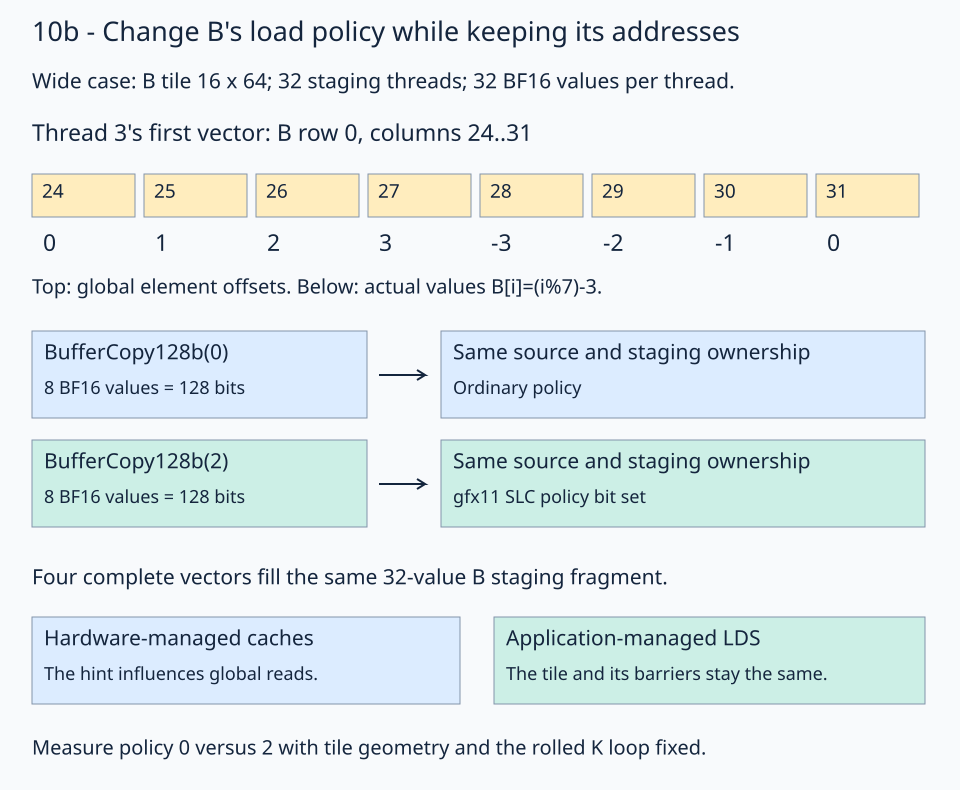

# 10b · Measure a cache policy for B loads

A buffer load can carry a cache-policy hint without changing its addresses or ownership. This lesson varies that hint for B while retaining [10a's synchronization](../10a-synchronization-scope/README.md), the same coalesced global copy plan, and the rolled K loop. The caches still choose their contents in hardware.

The launch retains [09's grouped split-K traversal](../09-split-k/README.md#1-assign-each-block-an-output-tile-and-a-k-partition): row within M group first, then K split, tile column, and M group. The layout decodes `logical_block_id` after independent-wave assignment. Workspace tile IDs remain row-major and independent of launch order. The locked skinny configurations use `group_m=1`; the same mapping supports complete larger M groups.

## Keep the transfer the same

Use `(16,4096,8192)` with two independent 16×64×16 wave tiles per block. Each wave has 32 threads. Its packed B tile contains `16*64=1024` BF16 values. Dividing those values across 32 staging threads gives **32 BF16 values per thread**.



Follow thread 3's first vector. It loads B row 0, columns 24–31. In the structured trace `B[i]=(i%7)-3`, those element offsets contain `[0,1,2,3,-3,-2,-1,0]`. Both cache policies request the same values. A 128-bit instruction transfers eight BF16 values; it does not describe the size of the thread's complete staging fragment.

## Attach the hint to the operation

These API fragments come from the [native solution](solution.py):

```python
right_load_operation = fx.rocdl.BufferCopy128b(RIGHT_CACHE_MODIFIER)
gmem_right_load_128b = fx.make_copy_atom(right_load_operation, fx.BFloat16)
```

The existing `gmem_right_load_thread` partitions the selected B view with this atom. Copy ownership, the row-major global stride, LDS layout, WMMA computation, and split-K reduction are identical for modifiers 0 and 2.

`right_cache_modifier` is a compile-time config field. The lesson restricts it to the two policies actually compared on this target:

| Value | Generated gfx11 buffer-load policy |
| --- | --- |
| `0` | Ordinary policy, without SLC |
| `2` | SLC policy bit set |

SLC is a target-specific cache hint. Read its encoding in the [LLVM AMDGPU builtin reference](https://clang.llvm.org/docs/AMDGPUBuiltinReference.html) and its target semantics in the [RDNA 3.5 ISA reference](https://docs.amd.com/api/khub/documents/UVVZM22UN7tMUeiW_4ShTQ/content). Do not interpret the config value as an allocation in a particular cache. The inspector verifies the actual `buffer_load_b128` SLC flag for policy 2.

## Distinguish caches from LDS

Global loads travel through the hardware memory hierarchy to registers. The application allocates private fragments and shared LDS tiles explicitly; cache lines and their replacement remain hardware managed. A cache hint can influence that traffic, but it neither gives the kernel a pointer to L1/L2 nor changes LDS into L1.

For this B path, values still travel through private staging registers, packed LDS, and then the WMMA operand registers. The cache experiment affects the global read operation at the start of that path. The compute strategy stays the same.

The selected configs use modifier 2. The benchmark pairs it with modifier 0 on identical buffers, with identical tile geometry and synchronization. Its result describes that particular target and workload. A policy win in the earlier combined experiment does not establish a win in isolation with a rolled K loop; use the new controlled measurements linked below.

## Practice and checking

[practice.py](practice.py) supplies the global views, copy/MMA ownership, prefetch pipeline, single-kernel split-K finalizer, launch, and independent host checker. Fill only these two expressions:

1. `right_load_operation`: construct `BufferCopy128b` with `RIGHT_CACHE_MODIFIER`.
2. `gmem_right_load_128b`: wrap that operation in a BF16 copy atom.

The default full-size checkpoint is **`[8,5,2,-1]`**, the first four BF16 output values in row 0 of the wide workload. Both narrow shape selectors return `[7,4,1,-2]`. The tile-tag traces above use different inputs to isolate pipeline boundaries.

The checker compares the entire output with CPU FP32 arithmetic on the quantized BF16 inputs, rounded to BF16. It checks structured/random inputs, changed signs across workspace reuse, NaN output replacement, output/workspace sentinels, reset arrival counters, and exact tagged FP32 partials. Random tolerances are `rtol=0.016, atol=0.03125`. Course checking covers all three shapes with split counts 1,2,4. Contiguous storage, complete tiles, and equal K partitions are required.

Each GEMM remains **one kernel**, including partial reduction and counter reset. Reuse of one workspace is serialized on a single stream.

## Revision question

If a B staging fragment holds 32 BF16 values per thread, does a 128-bit copy require 32 values in a single instruction?

<details><summary>Answer</summary>

No. One complete 128-bit transfer contains eight BF16 values. The partition describes four such vectors per thread for this tile. The cache modifier changes the policy on those loads, while the fragment still holds the same 32 logical values.

</details>

Run from the repository root:

```bash
pixi run python lessons/01-gpu-programming/13-matmul/10b-cache-policy/practice.py --check-only
pixi run python lessons/01-gpu-programming/13-matmul/10b-cache-policy/solution.py
pixi run python lessons/01-gpu-programming/13-matmul/10b-cache-policy/tune.py --output /tmp/stage-10b-comparison.json
pixi run python lessons/01-gpu-programming/13-matmul/10b-cache-policy/inspect_kernel.py --output /tmp/stage-10b-isa
pixi run gpu-check
```

The unfinished starter reports `Practice not finished:`; the [worked solution](solution.py) reports `Exercise passed:` before its controlled timing table. Add `--shape 32 1024 8192` to select a narrow workload. Benchmarks use validated 32-node graph replay and synchronized host timing; `--timing direct-host` measures ordinary dispatch separately. Use fresh output paths for instruction captures.

See the [focused sequence's validation and controlled measurements](../10c-k-unrolling/results/README.md). These are gfx1151 observations with FlyDSL 0.4.1, not a guaranteed speedup on every shape or GPU.

[Previous: synchronization scope](../10a-synchronization-scope/README.md) · [Matmul series](../README.md) · [Next: K-loop unrolling](../10c-k-unrolling/README.md)
