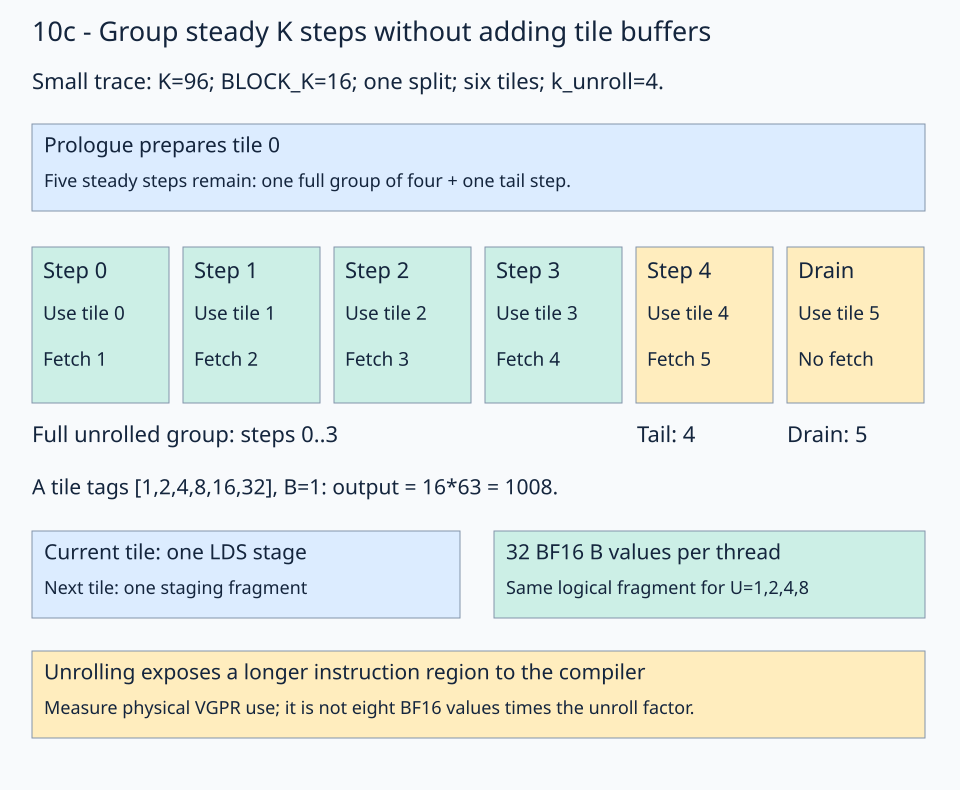

# 10c · Unroll the prefetched K loop

Loop unrolling exposes several consecutive K iterations to the compiler. It can reduce loop overhead and change instruction scheduling and register lifetimes. This lesson varies `k_unroll` while retaining [10b's B cache policy](../10b-cache-policy/README.md), independent-wave mapping, and LDS-only handoffs. It keeps one current LDS tile and one logical next-tile staging fragment.

## Count pipeline steps before unrolling

The default workload is `(16,4096,8192)` with `BLOCK_K=16`, two independent waves per block, and `split_k=1`. For a small trace of exactly the same tile path, reduce K to 96. Each wave then consumes six K tiles. Set A's tile tags to `[1,2,4,8,16,32]` and B to 1. Every output must be `16*(1+2+4+8+16+32)=1008`.



Follow the tile numbers. The prologue prepares tile 0, so six tiles need **five steady steps**, followed by the final drain. With `k_unroll=4`, those steps form one full group of four plus one tail step.

## Expand the full groups

Let `tiles_per_split=K//(BLOCK_K*SPLIT_K)`. The [solution](solution.py) uses a runtime loop for full groups and a tracing-time constant loop inside it. The pinned [FlyDSL kernel-authoring guide](https://github.com/ROCm/FlyDSL/blob/888d7d80528f0cf2abab8a86610d5ccca47f205d/docs/kernel_authoring_guide.md) explains these loop forms:

```python
for group_k in range((tiles_per_split - 1) // K_UNROLL):
    for step in fx.range_constexpr(K_UNROLL):
        next_tile_k = initial_tile_k + group_k * K_UNROLL + step + 1
        gmem2reg_load_tile(next_tile_k)
        compute_lds()
        lds_barrier()
        reg2lds_store_tile()
        lds_barrier()
```

For the six-tile example, `group_k=0` and `step=0,1,2,3` select future tiles 1,2,3,4. Each expanded step still loads one successor and consumes one current tile. The handoffs remain between those steps.

`initial_tile_k` is the split's starting tile. A later split uses the same local progression with that base added once.

## Cover the remainder and drain

The number of remaining steady steps is `(tiles_per_split-1)%K_UNROLL`:

```python
for tail in fx.range_constexpr((tiles_per_split - 1) % K_UNROLL):
    next_tile_k = (
        initial_tile_k
        + ((tiles_per_split - 1) // K_UNROLL) * K_UNROLL
        + tail + 1
    )
    # The same load / compute / handoff sequence follows.
```

In the trace, `tail=0` selects future tile 5 and consumes current tile 4. After publishing tile 5, the drain calls `compute_lds()` once more. It does not fetch tile 6.

For one tile per split, both steady loops are empty. For three tiles with unroll four, the full-group loop is empty and the two tail steps still run. These cases are essential checks: a long benchmark alone can conceal a missing tail.

## Separate logical storage from physical registers

For the 16×64×16 one-wave tile, B staging remains `16*64/32=32` BF16 values per thread for unroll factors 1,2,4,8,16. A's staging fragment and the single LDS allocation also retain their shapes. This implementation does not allocate an array of `K_UNROLL` future tiles.

The compiler sees a longer instruction region and may overlap lifetimes or choose different scheduling. Physical VGPR use can therefore change. Count it in the generated resource report; multiplying eight BF16 values per copy instruction by the unroll factor does not predict register allocation. The inspector reports logical staging size, VGPR count, LDS bytes, and scratch separately.

The default wide selection uses unroll 4. Both narrow selections use unroll 2. The native builder is preserved from the [original combined prefetch experiment](../../../../experiments/wave-local-prefetch/README.md); lessons 10–10b expose its earlier decisions separately. This makes 10c the tuned prefetch control for [operand paths](../12-operand-paths/README.md).

The benchmark compares factors 1,2,4,8 with all other parameters fixed. The config also accepts 16 for further exploration. No performance assertion is part of correctness.

## Practice and checking

[practice.py](practice.py) supplies the global views, copy/MMA ownership, prefetch pipeline, single-kernel split-K finalizer, launch, and independent host checker. Fill only these two expressions:

1. The full-group `next_tile_k`: add the split base, full-group offset, constant step, and the one-tile prefetch lead.
2. The tail `next_tile_k`: start after all full groups, add the tail index and the same lead.

The default full-size checkpoint is **`[8,5,2,-1]`**, the first four BF16 output values in row 0 of the wide workload. Both narrow shape selectors return `[7,4,1,-2]`. The tile-tag traces above use different inputs to isolate pipeline boundaries.

The checker compares the entire output with CPU FP32 arithmetic on the quantized BF16 inputs, rounded to BF16. It checks structured/random inputs, changed signs across workspace reuse, NaN output replacement, output/workspace sentinels, reset arrival counters, and exact tagged FP32 partials. Random tolerances are `rtol=0.016, atol=0.03125`. Course checking covers all three shapes with split counts 1,2,4. Contiguous storage, complete tiles, and equal K partitions are required.

Each GEMM remains **one kernel**, including partial reduction and counter reset. Reuse of one workspace is serialized on a single stream.

## Revision question

For 64 tiles per split and unroll eight, how many full groups and tail steps precede the drain?

<details><summary>Answer</summary>

The prologue removes one tile from the steady count: 63 steps remain. They form seven groups of eight and seven tail steps. The final drain consumes the last prepared tile, giving 64 computations altogether.

</details>

Run from the repository root:

```bash
pixi run python lessons/01-gpu-programming/13-matmul/10c-k-unrolling/practice.py --check-only
pixi run python lessons/01-gpu-programming/13-matmul/10c-k-unrolling/solution.py
pixi run python lessons/01-gpu-programming/13-matmul/10c-k-unrolling/tune.py --output /tmp/stage-10c-comparison.json
pixi run python lessons/01-gpu-programming/13-matmul/10c-k-unrolling/inspect_kernel.py --output /tmp/stage-10c-isa
pixi run gpu-check
```

The unfinished starter reports `Practice not finished:`; the [worked solution](solution.py) reports `Exercise passed:` before its controlled timing table. Add `--shape 32 1024 8192` to select a narrow workload. Benchmarks use validated 32-node graph replay and synchronized host timing; `--timing direct-host` measures ordinary dispatch separately. Use fresh output paths for instruction captures.

See the [focused sequence's validation and controlled measurements](../10c-k-unrolling/results/README.md). These are gfx1151 observations with FlyDSL 0.4.1, not a guaranteed speedup on every shape or GPU.

[Previous: B cache policy](../10b-cache-policy/README.md) · [Matmul series](../README.md) · [Next: operand-specific paths](../12-operand-paths/README.md)
