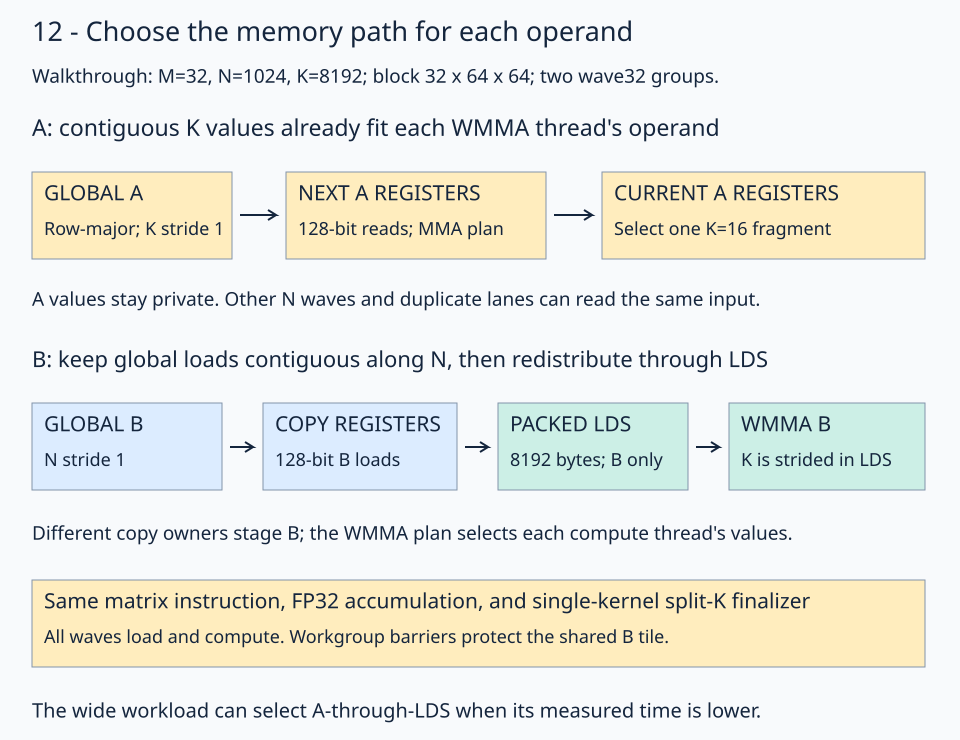
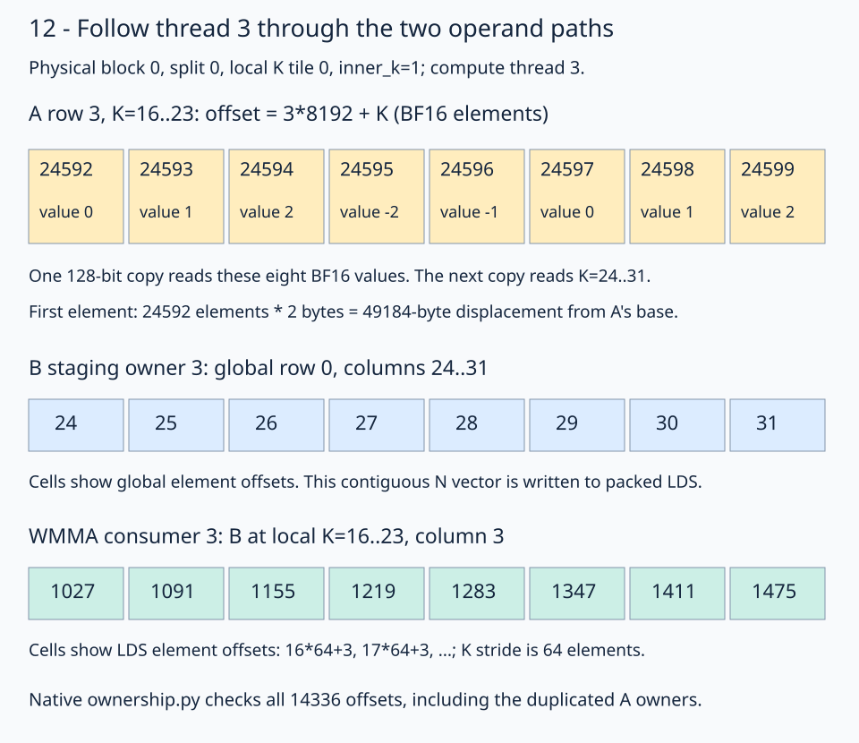

# 12 · Choose the memory path for each operand

A and B need not pass through the same storage. For skinny `C=A@B`, A has only 16 or 32 rows and its K values are contiguous. Each compute thread can load those values directly into registers arranged for WMMA. B is much larger, and its contiguous direction is N. Keeping B's cooperative, coalesced staging path can be cheaper than loading its strided K operands directly.

This lesson measures that choice. It retains row-major BF16 inputs/output, FP32 accumulation, one-dimensional physical block IDs, prefetch, and stage 09's single-kernel split-K finalizer. All waves load and compute using the [10c prefetch schedule](../10c-k-unrolling/README.md). This lesson changes the operand route while retaining that schedule. Read [10](../10-wave-local-tiles/README.md) for the independent-wave mapping and [stage 05](../05-matrix-instructions/README.md) for WMMA ownership.

## Why the course keeps prefetch

The main path follows **09 → 10 → 10a → 10b → 10c → 12**. Every wave loads its future operands and computes its current tile. Dedicated loader waves, ready/free semaphore handoffs, polling sleeps, and signal-mode tuning are confined to the [wave-specialization research archive](../../../../experiments/wave-specialization/README.md).

That choice follows the measured tradeoff on Radeon 8060S (`gfx1151`). Tuned wave specialization improved the M=32 graph workload by about 7% over the earlier tuned prefetch control, but the other two shapes met prefetch parity and ordinary narrow Python calls were slower. It did not provide a consistent gain across the declared workloads.

The [original operand-path comparison](results/initial-study.md#fresh-graph-replay-verification) then measured these locked kernels together in the same nine graph-replay rounds per shape:

| Shape M,N,K | Tuned wave specialization µs | This lesson's all-wave prefetch µs | Outcome versus specialization |
| --- | --- | --- | --- |
| 16,1024,8192 | 21.01 | 20.28 | Small gain; within the declared 5% parity band |
| 32,1024,8192 | 26.16 | 23.65 | About 9% lower time; all 9 rounds pass the 5% win criterion |
| 16,4096,8192 | 272.40 | 273.69 | Parity |

For these shapes, the retained operand paths deliver the stronger M=32 result with a simpler loading/compute schedule. They preserve one LDS stage and avoid the extra roles and handoff protocol. The [active comparison](results/README.md) measures the result directly against independently tuned 10c and same-geometry prefetch.

This comparison uses different tuned strategies. It does **not** test an otherwise-identical lesson-12 kernel with wave specialization toggled on, and it does not establish that specialization is ineffective on every GPU or shape. The archived code, sweeps, and raw samples remain available for that research.

The dropped semaphores coordinate loader and compute waves through LDS. **The global split-K arrival counters remain**: they publish partials, elect the final peer, and finalize C in this same kernel, as taught in [09](../09-split-k/README.md).

## Start from the Torch profile

The [Torch investigation](../../../../experiments/torch-strategy/README.md) matches hipBLASLt's logged solution indices, installed library metadata, and actual GPU kernel symbols. These three Torch kernels use the same BF16 16×16×16 WMMA instruction as the course, with conventional prefetch and no split-K or Stream-K. Matching their instruction does not require copying their entire schedule.

For `(32,1024,8192)`, Torch uses a 16×32 output tile; the current native kernel uses 32×64. Reusing B across more output rows already helps the native kernel. On the wide shape, Torch also generates about 2.3 times as many 128-byte L1→L2 read requests as the native control. Meanwhile, our native ISA still spends many instructions moving operands through LDS. The next question is which of those transfers are useful.

## Trace a 32×64×64 block

The walkthrough uses `(M,N,K)=(32,1024,8192)`, a 32×64 output tile, K chunks of 64, and two cooperating wave32 groups. With `split_k=4`, each logical block accumulates 2048 K values. The flat layout mapping selects the same split and output tile as the preceding lessons.

This legal K=64 example exposes four K=16 fragments. The selected timing configuration uses K=32; its two fragments follow the same path with a smaller allocation.



Follow the gold A path first. Only its owner needs the loaded fragment. The blue/teal B path changes ownership between global loading and WMMA consumption, using LDS to make the values available to the right threads.

The input views remain:

```python
left_global_view = fx.make_view(fx.get_iter(left_buffer), fx.make_layout((m, k), (k, 1)))
right_global_view = fx.make_view(fx.get_iter(right_buffer), fx.make_layout((k, n), (n, 1)))
```

A's `(row,K)` layout has strides `(8192,1)`; B's `(K,column)` layout has strides `(1024,1)`. Dividing and slicing these views preserves their original row strides. A view selection does not pack the input or copy any values.

## Load A using the WMMA ownership plan

`thread_mma.make_fragment_A(left_global_model)` allocates an uninitialized register fragment for a complete A K chunk. The model view supplies its shape; actual reads use the block/tile view selected in `gmem2reg_load_tile(tile_k)`.

The copy plan uses the MMA's A ownership directly:

```python
left_direct_atom = fx.make_copy_atom(
    fx.rocdl.BufferCopy128b(LEFT_CACHE_MODIFIER), fx.BFloat16
)
left_direct_plan = fx.make_tiled_copy_A(left_direct_atom, mma).get_slice(
    compute_thread_id
)
left_direct_destination = left_direct_plan.retile(left_full_fragment)

# Inside gmem2reg_load_tile(tile_k), after selecting left_block_view:
left_direct_source = left_direct_plan.partition_S(left_block_view)
fx.copy(left_direct_atom, left_direct_source, left_direct_destination)
```

These are API fragments from the [runnable solution](solution.py). The copy atom transfers eight BF16 values, or 128 bits, per complete vector. Retiling describes the same register values in the copy plan's domain; it does not change their numerical type.

For compute thread 3 in block 0, the second K=16 slice uses A row 3, K=16–31. Its first vector reaches global element offsets **24592–24599**, from `3*8192+16` through `3*8192+23`. The input trace is `A[i]=(i%5)-2`, so the actual values are **`[0,1,2,-2,-1,0,1,2]`**. Element offset 24592 means a 49184-byte displacement for BF16.

The legacy gfx11 WMMA ABI duplicates A values between lanes 0–15 and 16–31. Waves assigned to different N tiles also reuse A. Thus threads 3, 19, 35 and 51 have the same A offsets in this example. Direct loading accepts these repeated requests to avoid A's LDS stores and reads. A's small, reused working set and its contiguous K vectors make this a useful trade to measure, rather than a rule for every GEMM.

## Keep B's coalesced staging path

B's staging plan still distributes eight adjacent N values per thread. With 64 threads, its thread layout is `(8,8)` with N chunks first. Staging thread 3 loads global B row 0, columns 24–31, then writes that vector to packed LDS. It is not loading its own final WMMA column.

For WMMA, reinterpret the shared tile as `(N,K)` with strides `(1,64)`. Consumer thread 3 needs column 3 and, in the second K slice, K=16–31. Its LDS offsets begin **`[1027,1091,1155,1219,...]`**, separated by 64 BF16 elements.



Read each row's units: global element offsets for A and B staging, LDS element offsets for B consumption. The staging and compute plans serve different ownership domains. [ownership.py](ownership.py) records and independently checks all **14336 native offsets** in this walkthrough, including A's duplicate owners.

Loading B directly with the WMMA plan required many narrow global reads in the experiment. Transposing B in LDS made its operand reads wider, but scalar stores and register-shuffle variants cost more than they saved. The retained solution therefore preserves B's existing global access pattern.

## Advance A privately while protecting B

`left_full_fragment` holds the prefetched A chunk. `left_compute_fragment` holds the current chunk. It contains 16 values per K slice, two row repetitions, and four K slices per thread in this example. `left_full_tiled` exposes those K slices using native layout division:

```python
left_full_tiled = fx.flat_divide(
    left_compute_fragment, (16, BLOCK_M // (16 * WAVES_M), 1)
)
left_current = fx.slice(left_full_tiled, (None, None, None, 0, 0, inner_k))
fx.copy(copy_16b, left_current, left_r_tile)
```

The first three modes retain one complete operand fragment; the first two quotient coordinates are zero, and the last selects `inner_k`. This copy moves register values into the fragment consumed by `fx.gemm`. It performs no LDS read for A.

The steady state remains prefetched:

```text
load next A/B into private registers
compute current A registers × current B LDS tile
finish current B readers
advance A registers; publish next B to LDS
make the new B tile visible
```

The prologue prepares the first tile, and the drain consumes the last tile without loading beyond its partition. Cooperating waves use LDS-only workgroup barriers. Independent wave groups have disjoint tiles and use subgroup scope. A's private fragments do not remove B's synchronization requirements.

The 32×64×64 walkthrough allocates **8192 LDS bytes** for B. Staging padded A as well would use **12800 bytes**. Register pressure can rise because A's current and next chunks remain private; the selected native resource reports and scratch checks are in [the results](results/README.md).

## Select paths by measurement

`left_in_registers=True` selects the mixed path. `False` selects the supplied padded-A/packed-B LDS path. This is a tracing-time specialization, not a GPU branch that chooses the path at runtime. The selected wide workload retains A staging because direct A reads do not improve it.

The A/B cache modifiers are instruction policy hints. L0/L1/L2 contents remain hardware managed; LDS is the explicitly allocated shared tile. On this gfx1151 experiment, A benefits from policy 0 and streaming B generally benefits from policy 2. Other policies and direct/register-transpose variants are retained in the [research evidence](../../../../experiments/torch-strategy/README.md). LLVM documents the [cache-policy bits](https://clang.llvm.org/docs/AMDGPUBuiltinReference.html); the [RDNA3.5 reference](https://docs.amd.com/api/khub/documents/UVVZM22UN7tMUeiW_4ShTQ/content) specifies their target-specific effects.

The comparison uses locked configurations selected on training seed 13, then tests fresh inputs. It compares the operand-path kernel directly with **independently tuned 10c prefetch**, **same-geometry prefetch**, and GPU Torch. Both native strategies let every wave load and compute; their timed kernels use no dedicated loader waves, semaphore polling, or ready/free signals.

The independently tuned control tests against the previous prefetch selection. The same-geometry control keeps the output tile, K chunk, wave arrangement, split count, unroll and B cache policy fixed while using the earlier A/B LDS path. This separates A's route from other tuning changes. The selected configurations stay fixed for the rerun; removing a benchmark reference does not change the native kernel.

[Current results and reproduction commands](results/README.md) report graph replay throughput and ordinary Python dispatch separately. The [initial study](results/initial-study.md) retains the earlier wave-specialization comparison and raw samples. The active lesson benchmark depends directly on stages 09 and 10c and contains no wave-specialized implementation.

The controlled M=32 profile holds geometry and scheduling fixed while switching A's path: LDS instructions fall from 638976 to 557056 and the bank-conflict metric from 6.25% to zero. Global-load instructions double, while L1→L2 and external read requests stay nearly unchanged. This supports using A's hardware-cache reuse to remove shared transfers; it does not require a new matrix instruction.

## Practice

[practice.py](practice.py) supplies global/block views, storage, register allocation, the B path, synchronization, split-K finalization, and the complete checker. Fill two expressions:

1. `left_direct_plan`: derive the A copy plan from `left_direct_atom` and `mma`, then select `compute_thread_id`.
2. `left_current`: select `inner_k` from `left_full_tiled`, retaining the operand's first three modes.

The default full-size trace checkpoint is **`[7,4,1,-2]`**, the first four outputs in row 0. The wide selector's checkpoint is `[8,5,2,-1]`. These are BF16 output values, not addresses or per-split partials.

The checker compares every output with CPU FP32 arithmetic on the actual BF16 inputs, rounded to BF16. It tests structured and random data, signed input changes across workspace reuses, NaN output replacement, output/workspace sentinels, counter reset, and exact FP32 partials at tagged K boundaries. The course check covers all three shapes with split counts 1, 2 and 4. Complete tiles and contiguous inputs are required. Random tolerances are `rtol=0.016, atol=0.03125`.

## Revision question

Why can B's cooperative staging plan be different from its WMMA operand plan, while A's direct global plan must already match WMMA ownership?

<details><summary>Answer</summary>

LDS lets one thread publish values that another thread later reads, so B can use one ownership map for coalesced global loads and another for computation. A bypasses that shared exchange: its private values must already belong to the thread that will consume them. `make_tiled_copy_A` derives that ownership from the same tiled MMA used for computation.

</details>

Run from the repository root:

```bash
pixi run python lessons/01-gpu-programming/13-matmul/12-operand-paths/practice.py --check-only
pixi run python lessons/01-gpu-programming/13-matmul/12-operand-paths/solution.py
pixi run python lessons/01-gpu-programming/13-matmul/12-operand-paths/ownership.py
pixi run gpu-check
```

The unfinished starter reports `Practice not finished:`. A completed program reports `Exercise passed:`; compare the [worked solution](solution.py). Each timed GEMM remains one native kernel, including split-K reduction and counter reset. Workspace reuse is serialized on one stream.

[Previous: K-loop unrolling](../10c-k-unrolling/README.md) · [Matmul series](../README.md) · [Next experiments](../../../../ROADMAP.md#matmul-continuation-planned)
