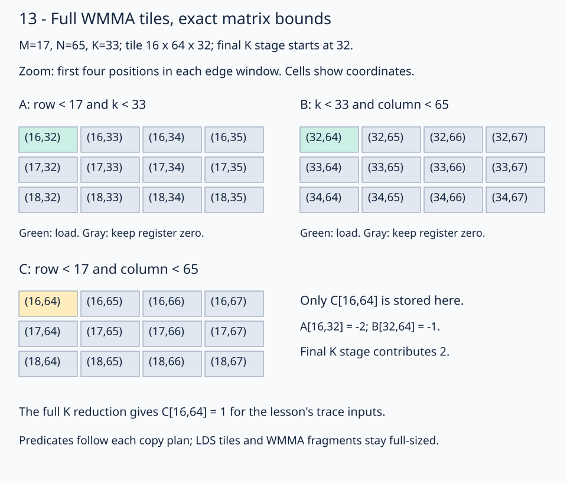

# 13 · Make tile edges safe

A matrix instruction always consumes a complete fragment. A matrix does not have to contain complete tiles. This lesson keeps [12's operand paths](../12-operand-paths/README.md), fills missing A/B positions with zero in registers, and predicates global transfers against the actual M, N, and K bounds. The same kernel accepts every positive M,N,K within its contiguous BF16/gfx11 contract, including dimensions smaller than one WMMA instruction.

Complete [predicates and tails](../../10-predicates-and-tails/README.md) and [operand paths](../12-operand-paths/README.md) first. The new operation is `fx.copy(..., pred=predicate)`. Tiling determines candidate coordinates; predicates determine whether an access is valid.

## Follow the final corner

Use **M=17, N=65, K=33**, with a **16×64×32** group tile. A has layout `(17,33):(33,1)`, B has `(33,65):(65,1)`, and C has `(17,65):(65,1)`. All storage is row-major BF16; accumulation is FP32.

Use `Config(block_k=32, waves_n=1, split_k=4, k_unroll=2)` to reproduce the illustrated layout through `matmul_bf16(..., config=...)`. The shape selector uses the measured performance configuration.

The output needs two tile rows and two tile columns. The corner window starts at output `(16,64)`. Its final K stage starts at 32. Only one row, column, and reduction position remain valid.



Read the green A/B cells first. For trace inputs `A[i]=(i%5)-2` and `B[i]=(i%7)-3`, A[16,32] has element offset `16*33+32=560`, a **1120-byte displacement**, and value **-2**. B[32,64] has element offset `32*65+64=2144`, a **4288-byte displacement**, and value **-1**. The final stage contributes 2 to C[16,64]. The complete reduction gives **1** there. The first four outputs of row 0 are **`[-4,-7,4,1]`**.

## Keep exact matrix views

The solution describes the actual matrix dimensions and divides those views directly:

```python
left_global_view = fx.make_view(
    fx.get_iter(left_buffer), fx.make_layout((m, k), (k, 1))
)
left_block_tiles = fx.flat_divide(left_global_view, (BLOCK_M, STAGE_K))
```

`flat_divide` provides full-sized windows covering the domain, including the edge windows. It does not allocate data or guard accesses. Output tile counts come from the divided view's rest modes. The launch uses `fx.ceildiv(m, BLOCK_M)` and `fx.ceildiv(n, BLOCK_N)`. Workspace reserves every launched group tile, including completely inactive wave rows or columns. No dense padded input, output, or cleanup kernel is needed.

`make_buffer_tensor(..., max_size=False)` additionally bounds each descriptor to its actual storage footprint. Those byte bounds complement the coordinate predicates.

## Partition coordinates with the data

An identity layout maps a coordinate to the same coordinate tuple. Its view is index-only:

```python
left_coordinates = fx.make_view(
    fx.make_int_tuple((0, 0)), fx.make_identity_layout((m, k))
)
left_coordinate_tiles = fx.flat_divide(left_coordinates, (BLOCK_M, STAGE_K))
```

Select the same block and group from data and coordinate views. Then apply the same thread-copy plan to both:

```python
left_global_source = left_global_thread_copy.partition_S(left_group_view)
left_thread_coordinates = left_global_thread_copy.partition_S(left_group_coordinates)
```

The coordinate partition describes exactly the positions owned by that thread’s A copy. With direct A, `left_global_thread_copy` comes from `make_tiled_copy_A`, which loads each lane’s WMMA values. With LDS staging, it follows the cooperative K-chunk plan. B follows its cooperative N-chunk plan, and C follows the WMMA C store plan.

For a copy atom transferring `width` adjacent BF16 values, the helper derives:

```python
valid = (row < rows) & (column + width <= columns) & stage_valid
predicate[(x, y, z)] = valid
fx.copy(atom, source, destination, pred=predicate)
```

The same expression serves A with `(rows,columns)=(m,k)`, B with `(k,n)`, and C with `(m,n)`. Coordinates are nonnegative by construction. `stage_valid` also disables loads for K stages assigned beyond the last real stage.

FlyDSL 0.4.1 expects **one scalar boolean per copy atom**. For a partition with `values` in its first mode, the predicate's first mode is `(1,values//width)`. The leading 1 provides one predicate for the whole vector. Eight independent booleans cannot mask the eight elements of a `BufferCopy128b` atom.

## Initialize every skipped input

A false load predicate preserves the old destination. Clear the destination fragment before every masked load, including prefetched stages:

```python
left_global_destination.fill(0)
# Predicated loads replace only valid positions in this zeroed fragment.
```

Each global-load path clears its retiled destination before calling the helper. From there, the copy setup follows [operand paths](../12-operand-paths/README.md#advance-a-privately-while-protecting-b): staging copies for A and B, then the one-step MMA copies for A and B. With direct A, `publish_stage()` moves the full prefetched fragment into `left_compute_fragment`. `compute_stage()` selects `inner_k` and copies that chunk into `left_r_tile` within each lane. With LDS staging, the MMA copy plans read each lane’s current chunk from LDS.

A false C predicate skips the store. Split-K partials retain full FP32 tiles so every participant still publishes its slots and resets its arrival counters.

## Preserve safe vector widths

A full vector must fit both the row alignment and the row's valid extent. The tracing-time choice is:

```python
LEFT_WIDTH = min(8, k & -k)
RIGHT_WIDTH = min(8, n & -n)
```

Use 128-bit A/B loads wherever the actual row extent allows them. Narrower atoms are selected automatically for alignment and bounds safety. These expressions produce 1, 2, 4, or 8 BF16 values: 16-, 32-, 64-, or 128-bit buffer copies. For K=33 and N=65, both operands use scalar global copies. For K=8200 and N=1032, both retain 128-bit loads even though the final tiles are partial. The selected width divides the real row extent, so a true vector predicate always covers a whole valid vector.

Global load plans use the selected atom and retile their staging destination accordingly. The LDS publication plan retains its `UniversalCopy128b` atom; MMA operand transfers retain `UniversalCopy16b`, and C retains scalar `BufferCopy16b` stores. The backend can combine adjacent operations, so final instruction widths remain a compiler result. WMMA ownership and full tile geometry remain fixed. The numeric factory `fx.rocdl.BufferCopy(16 * LEFT_WIDTH, cache_modifier)` constructs the safe atom; the maximum width is fixed rather than tuned.

![A 3 by 5 matrix shows why invalid coordinate A[0,5] aliases valid A[1,0] at element offset 5. The byte address is within the allocation; a column predicate rejects the access.](../../../../assets/01-gpu-programming/13-matmul/13-edge-safety/cross-row-bounds.svg)

Follow offset 5. A whole-buffer bound accepts it, but the column coordinate 5 is invalid for a five-column row. This is why byte bounds alone cannot protect N/K edges.

The descriptor-only GPU experiment checks this directly. Its M-only and large K-only cases passed, while a partial N tile overwrote valid output and empty K splits accumulated the real tile more than once. [Correctness checks and performance comparison](results/README.md#descriptor-only-bounds-experiment)

## Cover split-K and grouped edges

Each split receives `ceil(K / (STAGE_K*SPLIT_K))` stage slots. The split's initial stage is `split_id*tiles_per_split`. This covers all real K positions exactly once; excess stage slots load zero. Even an empty split participates in FP32 publication and finalization.

Check `tile_k*STAGE_K < k` explicitly. A singleton rest mode can have zero stride after layout simplification, so selecting a nonexistent stage is not a substitute for an empty-stage predicate. The last physical M traversal group may also have fewer rows than `group_m`; the block decoder uses its actual remaining row count. Neither case requires shape divisibility gates.

## Why vector width and predicate placement are fixed

The lesson uses **128-bit global loads when safe and always-predicated copies**. There are no vector-width or edge-only configuration knobs. Automatic narrowing for odd or partially aligned N/K remains necessary for correctness.

Controlled [measurements](results/README.md#buffer-width-tuning) tested 16/32/64/128-bit buffer atoms at identical tile geometry. The 128-bit atoms were consistently fastest on all three larger teaching workloads. For `(17,1032,8200)`, always-predicated copies took about **227/46/39/35 μs** respectively. Keeping the widest safe atom avoids an extra tuning dimension without losing the measured winner.

A separate [predicate study](results/README.md#predicate-placement) compared always-predicated copies with full-tile fast paths, including a combined `full_m & full_n & full_k` guard. That branch had no consistent advantage on the vector workloads: its small improvements stayed within the 5% parity band, while some shapes regressed. Always-predicated copies keep one access path and the same per-axis safety rule for every tile.

Per-operand full-tile guards did improve the fully odd scalar-copy case, so this is a measured choice for the lesson's scope rather than a claim that branching can never help. The frozen [study driver](results/compare_predicates.py), native study source, and raw reports remain under `results/` for reproducing the alternatives. The runnable lesson and practice retain only the simpler selected path.

## Practice

[practice.py](practice.py) supplies the exact-shaped views, coordinate partitions, zero initialization, width selection, prefetch pipeline, split-K finalization, and examples. Fill two expressions:

1. `valid`: require a valid row, a complete vector within the column extent, and a valid K stage.
2. `output_thread_coordinates`: partition `group_coordinates` with `reg2gmem_thread_copy.partition_D`, matching the output destination.

The tiny trace checkpoint is **`[-4,-7,4,1]`**. The checker compares every output with independent CPU FP32 arithmetic on the actual BF16 inputs, rounded to BF16. It checks trace/random data, changed-sign workspace reuse, NaN output replacement, exact-sized input allocations, poisoned input backing, output/workspace guards, and counter reset. Forty-one small configurations cover all four global copy widths, both A paths, inactive grouped waves, a short final M traversal group, split counts 1/2/4, empty splits, and K pipeline boundaries. Random tolerances are `rtol=0.016, atol=0.03125`; trace uses `rtol=0, atol=0.001` for gfx11 WMMA residue.

## Measure edge cases against Torch

The solution and completed practice print the median milliseconds per matmul and effective GPU TFLOP/s side by side for FlyDSL and `torch.matmul`. Both rates use the logical work `2 * M * N * K` divided by the respective median time. The tiny example explains predicates. The larger cases retain eight-BF16 alignment while cutting across M/N/K tile boundaries. Shape safety applies to odd dimensions too, and throughput depends on shape and copy width. [Timing results and raw paired samples](results/README.md)

Timing uses warm row-major BF16 GPU inputs, a preallocated BF16 output, and the same arithmetic contract. `graph-host` times synchronized graph replay with 32 GEMMs per replay, including captured split-K workspace initialization. `direct-host` includes ordinary Python dispatch. Both methods use host clocks and report their scope. Performance is measured separately from correctness and has no test assertion.

Run from the repository root:

```bash
pixi run python lessons/01-gpu-programming/13-matmul/13-edge-safety/practice.py --check-only
pixi run python lessons/01-gpu-programming/13-matmul/13-edge-safety/solution.py
pixi run python lessons/01-gpu-programming/13-matmul/13-edge-safety/solution.py --shape 19 67 35 --check-only
pixi run python lessons/01-gpu-programming/13-matmul/13-edge-safety/tune.py --shape 17 1032 8200 --output /tmp/edge-verification.json
pixi run gpu-check
```

The starter reports `Practice not finished:`. The [worked solution](solution.py) and a completed practice report `Exercise passed:` for each example. Calls without an explicit config get a valid shape-based default; the listed timing examples use measured configurations. Workspaces remain isolated per configuration, shape, device, stream, and capture, and reuse is serialized on a stream.

## Tuned shape defaults

The cross-stage retune registers 13 workloads, including the descriptor experiment and the scalar, 32-bit, and 64-bit edge cases. The selected `31×1036×8204` config runs at 0.036889 ms versus 0.170685 ms for its starting config and 0.055186 ms for Torch. All times are matched graph-replay medians. [Per-shape results and selected configs](results/retuned-workloads.json)

## Revision question

Why is guarding only C insufficient when K=33, even if the final output tile contains just one valid element?

<details><summary>Answer</summary>

WMMA consumes every input position in its fragment. An unguarded A load at column 33 can read the next row, while an unguarded B load can leave its allocation. Both operands must load only valid coordinates and supply zero elsewhere before computation. Guarding C only controls which already-computed results are stored.

</details>

References: [FlyDSL layout and predicated-copy guide](https://rocm.docs.amd.com/projects/FlyDSL/en/latest/layout_system_guide.html), [pinned buffer-copy lowering](https://github.com/ROCm/FlyDSL/blob/888d7d80528f0cf2abab8a86610d5ccca47f205d/lib/Dialect/FlyROCDL/CDNA3/CopyAtom.cpp). Executable signatures and scalar-predicate behavior were checked against the installed FlyDSL 0.4.1 package.

[Previous: operand paths](../12-operand-paths/README.md) · [Matmul series](../README.md) · [Next: targeted M/N/K guards](../14-targeted-guards/README.md)
