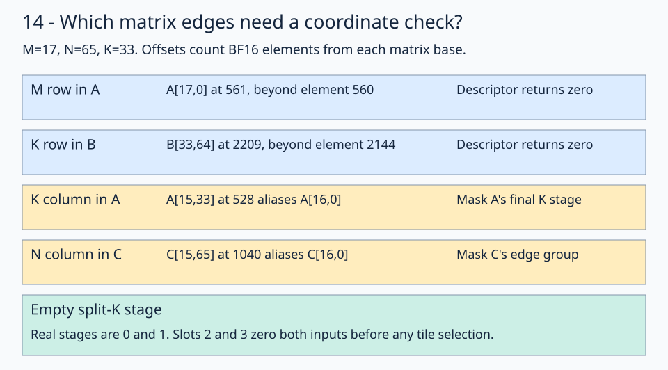

# 14 · Targeted M/N/K guards

Keep arbitrary positive `M`, `N`, and `K` for contiguous BF16 matrices while moving edge checks out of the common copy path. A bounded buffer can handle accesses that fall past the allocation. A coordinate guard is needed when a tile coordinate can map to a valid address in the wrong row, or when a split asks for a K stage that does not exist. Start with the [edge-safety lesson](../13-edge-safety/README.md) and its [descriptor-only experiment](../13-edge-safety/results/README.md#descriptor-only-bounds-experiment).

## Trace one corner

Use `M=17`, `N=65`, `K=33` and a `16×64×32` tile. The row-major layouts are A `(17,33):(33,1)`, B `(33,65):(65,1)`, and C `(17,65):(65,1)`. All three descriptors have their exact byte bounds. The bottom-right tile starts at C row 16 and column 64. Its last real K stage starts at K=32.

Use `Config(stage_k=32, waves_per_group_n=1, split_k=4, k_unroll=2)` to reproduce the illustrated layout through `matmul_bf16(..., config=...)`. The shape selector uses the measured performance configuration.



Follow the two offsets that alias another row. For A, the extra K coordinate `(15,33)` maps to offset 528, which stores `A[16,0]`. For C, the extra N coordinate `(15,65)` maps to offset 1040, which stores `C[16,0]`. Both addresses are in bounds. At the bottom-right corner, A `[16,32]` supplies −2 and B `[32,64]` supplies −1 for the trace inputs. That K stage contributes 2 to C `[16,64]`. The full reduction gives 1 there.

| Edge | How the kernel handles it |
| --- | --- |
| M tail | Whole A rows past M fall outside the A descriptor. C stores for rows past M fall outside the C descriptor. |
| N tail | B loads feed separate output columns. Extra B values belong to discarded columns. Mask C’s stores in the final incomplete N group so they cannot overwrite the next row. |
| K tail | For a valid output column, B rows past K read zero via the descriptor. Mask A’s extra K columns in the last real stage and leave those register slots at zero. |
| Empty K stage | Check the stage index before slicing either operand. Fill both register fragments with zero for an empty slot. |

## Guard only the copies that need it

The copy setup follows the earlier lessons. Set up staging for A and B first, then configure the one-step WMMA copies for A and B. The prefetch and split-K schedules still cover full register and LDS tiles. The global A/B atom width divides the actual contiguous row length, so a vector beginning in a valid row segment fits that segment.

The A K tail can pick up a NaN or Inf from the next row. A zero from B cannot cancel that value. Clear A’s destination for the last partial stage, partition its coordinate view with `a_global_thread_copy`, and allow a whole vector only if `column + LEFT_WIDTH <= k`. The full stages use ordinary buffer copies. B uses an ordinary buffer copy for all real stages. C uses scalar copies, so its masked path applies `column + 1 <= n`.

These expressions select the real-stage and full-column paths in the [solution](solution.py).

```python
REAL_K_STAGES = (k + STAGE_K - 1) // STAGE_K
stage_exists = tile_k < REAL_K_STAGES
complete_n = (output_group_col + 1) * GROUP_TILE_N <= n
```

With split-K 4, the example assigns stages 0 and 1 to the first two splits and empty slots 2 and 3 to the other two. The whole-stage branch is needed only when the scheduled slots can exceed `REAL_K_STAGES`. A group that ends exactly at `n` is complete. When N cuts a physical block, one wave group may be complete while the next is partial or entirely outside N. Use `output_group_col` to make that decision for each group. Shape constants omit unused guards when tracing the kernel.

## Practice

Fill the two expressions in [practice.py](practice.py).

1. `stage_exists` checks whether `tile_k` names a real stage before selecting the input views.
2. `complete_n` checks whether the exclusive end of the group’s output columns fits inside N.

The tiny trace is **`[-4,-7,4,1]`**, the first four C values in row 0. The checker compares full outputs to CPU FP32 arithmetic rounded to BF16. It covers both A paths, all four buffer vector widths, split-K values 1/2/4, grouped tiles, input and output guards, and workspace reuse. Four extra cases place NaN and Inf in neighboring A rows to verify that the K tail keeps them out of earlier results.

```bash
pixi run python lessons/01-gpu-programming/13-matmul/14-targeted-guards/practice.py --check-only
pixi run python lessons/01-gpu-programming/13-matmul/14-targeted-guards/solution.py
pixi run python lessons/01-gpu-programming/13-matmul/14-targeted-guards/tune.py --output /tmp/targeted-guards.json
```

## Measure against lesson 13 and Torch

The benchmark holds FlyDSL tile geometry, waves, split count, copy widths, and A storage path fixed for each shape. Each implementation uses the same exact-shaped inputs and preallocated output. Graph timing uses a synchronized host clock, 32 GEMMs per replay, and includes captured split-K workspace initialization. The table shows medians across three seeds on Radeon 8060S `gfx1151`, with seven shuffled batches per seed and ten replays per batch. Throughput uses the logical work `2 * M * N * K`.

| M,N,K | Targeted ms / TFLOP/s | Lesson 13 ms / TFLOP/s | Torch ms / TFLOP/s |
| --- | ---: | ---: | ---: |
| 16,1024,8192 | 0.021657 / 12.395 | 0.021760 / 12.336 | 0.034458 / 7.790 |
| 17,1024,8192 | 0.034338 / 8.306 | 0.039170 / 7.281 | 0.065096 / 4.381 |
| 16,1032,8192 | 0.025892 / 10.448 | 0.029423 / 9.195 | 0.033313 / 8.121 |
| 16,1024,8200 | 0.028329 / 9.485 | 0.036027 / 7.458 | 0.035001 / 7.677 |
| 7,1032,8200 | 0.025317 / 4.680 | 0.027207 / 4.355 | 0.033640 / 3.522 |
| 17,1032,8200 | 0.030891 / 9.314 | 0.035175 / 8.180 | 0.054908 / 5.240 |
| 31,1048,8184 | 0.030004 / 17.723 | 0.032973 / 16.127 | 0.055120 / 9.647 |
| 31,1025,8193 | 0.090508 / 5.753 | 0.487646 / 1.068 | 0.055336 / 9.409 |

The aligned skinny case is near parity with lesson 13. The mixed vector-width edges take 6.9–12.2% less time, and the K-only case takes 21.4% less time. The fully odd case takes 81.4% less time than the same lesson-13 configuration, with Torch still faster on that shape. The CLI prints milliseconds and effective GPU TFLOP/s for all three implementations. [Raw samples, graph checks, and source fingerprints](results/graph-host.json)

## Tune square and near-square workloads

The square suite includes `512³`, `1024³`, and `2048³`, plus two shapes that exercise guards at a similar aspect ratio. The `1032×1048×1016` shape retains eight-BF16 global copy atoms while cutting across the selected tiles. In `1025³`, the odd K and N row lengths select scalar global copy atoms for both operands.

The search starts from the general edge configuration and two previous square winners, then varies tile geometry, cooperating versus independent waves, and whether A stages through LDS. It refines the two fastest initial configurations over M traversal grouping, B cache policy, K unroll, and split-K. Training uses seed 13, three batches of five graph replays, and eight GEMMs per replay. All 281 candidates pass a full-output CPU comparison before timing. The selected configurations pass the lesson checker and are the defaults for their exact shapes. [Earlier square tuning study](../12-operand-paths/results/square-shapes.md) · [Candidate timings and first held-out rounds](results/square-tuning.json)

| M,N,K | Tile M×N×K | Cooperating waves M×N | M grouping | A path | B cache policy |
| --- | --- | --- | ---: | --- | ---: |
| 512,512,512 | 64×64×32 | 2×2 | 4 | Registers | 2 |
| 1024,1024,1024 | 128×128×32 | 1×4 | 4 | LDS | 0 |
| 2048,2048,2048 | 64×64×64 | 1×2 | 2 | Registers | 1 |
| 1032,1048,1016 | 64×64×32 | 2×2 | 4 | Registers | 2 |
| 1025,1025,1025 | 128×128×32 | 1×4 | 4 | LDS | 0 |

Every selection uses split-K 1, K unroll 2, and one wave group per block. The table below uses three additional fresh seeds with the published defaults. Each seed uses seven shuffled batches with ten replays or ordinary calls per batch. Each replay contains 32 GEMMs. Stage 13 uses the same geometry as stage 14 to isolate the guard strategy.

| M,N,K | Targeted graph ms / TFLOP/s | Lesson 13 graph ms / TFLOP/s | Torch graph ms / TFLOP/s | Targeted / Torch ordinary call, ms |
| --- | ---: | ---: | ---: | ---: |
| 512,512,512 | 0.010882 / 24.669 | 0.013398 / 20.035 | 0.015760 / 17.033 | 0.093160 / 0.019205 |
| 1024,1024,1024 | 0.061871 / 34.709 | 0.073932 / 29.047 | 0.070080 / 30.643 | 0.101462 / 0.080027 |
| 2048,2048,2048 | 0.419426 / 40.960 | 2.030035 / 8.463 | 0.531536 / 32.321 | 0.396915 / 0.525635 |
| 1032,1048,1016 | 0.071932 / 30.552 | 0.088122 / 24.939 | 0.091397 / 24.045 | 0.127943 / 0.095959 |
| 1025,1025,1025 | 0.086326 / 24.949 | 0.222941 / 9.661 | 0.092495 / 23.285 | 0.130811 / 0.096411 |

Stage 14 beats Torch on all five shapes in graph replay, with median time reductions of 6.7–31.0%. The smallest margin is the scalar-copy `1025³` case. Ordinary Python calls consistently favor stage 14 only at `2048³`. [Fresh verification runs and source fingerprints](results/square-verification.json)

```bash
pixi run python lessons/01-gpu-programming/13-matmul/14-targeted-guards/tune.py --suite square --sweep --timing both --output /tmp/targeted-square-search.json
pixi run python lessons/01-gpu-programming/13-matmul/14-targeted-guards/tune.py --suite square --timing both --seeds 2727 2828 2929 --output /tmp/targeted-square-verify.json
pixi run python lessons/01-gpu-programming/13-matmul/14-targeted-guards/solution.py --shape 1024 1024 1024
```

## Tuned shape defaults

The solution and practice use independently tuned defaults for all 14 benchmark shapes. In the matched graph replay, the isolated M-tail shape `17×1024×8192` went from 0.03451 to 0.02659 ms, while Torch took 0.05828 ms. The `512³`, `1024³`, and `2048³` defaults held up in the fresh comparison. [Configurations and raw samples](results/retuned-workloads.json)

## Revision question

Why can a group with 64 output columns use plain B loads when only the first column is valid, while the C stores still need a mask?

<details><summary>Answer</summary>

Each B column contributes only to its corresponding C column. An extra B load can change an output that will be discarded. An extra C store can land on a valid element of the next row, so the store must check its logical column.

</details>

[Previous: edge safety](../13-edge-safety/README.md) · [Matmul series](../README.md) · [Next: mixed-width edge loads](../15-edge-load-widths/README.md)
