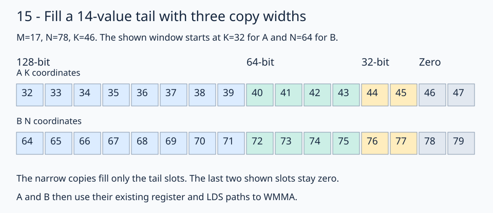

# 15 · Mixed-width edge loads

A BF16 copy atom moves a fixed number of values. A 128-bit atom moves eight BF16 values, so a six-value suffix needs a smaller copy. Keep the eight-value atom for complete chunks and use 64- and 32-bit atoms for the four- and two-value pieces of the suffix. A seven-value suffix adds one 16-bit atom. This builds on the [targeted-guards lesson](../14-targeted-guards/README.md) and the [shared edge-copy discussion](https://chatgpt.com/share/6afeb31d-7b08-83ec-926b-2469449f6a28).

## Trace the wide prefix and narrow suffix

Use a contiguous `M=17, N=78, K=46` product and a `16×64×32` tile. A’s final K stage begins at 32 and B’s final N group begins at 64. Both have 14 valid values along the copied axis in the displayed window. The first eight values form a wide prefix. The six-value suffix uses two smaller atoms, and the unused slots stay zero in the guarded path.



Follow the 32-bit piece. `A[16,44]` and `A[16,45]` have element offsets 780 and 781 and hold −2 and −1 in the trace. `B[45,76]` and `B[45,77]` have offsets 3586 and 3587 and hold −1 and 0. These are logical row coordinates, global element offsets, and BF16 values, respectively. The full K reduction for `C[16,77]` is −7.

The widths and starts are selected at trace time. `_tail_segments(46)` returns `((40, 4), (44, 2))`, where each tuple gives the first global column and the width in BF16 elements. At runtime the selected copy plan partitions the data and the matching coordinate view for each lane. The narrow copy plan reuses the wide plan’s ownership and retile gives it access to the same staging registers. A predicate allows each narrow atom to write only the assigned interval, so it leaves the wide prefix intact. For the final A stage, zeroing the fragment also keeps extra K columns from importing a NaN or Inf from a neighboring row.

```python
# Shape-specialized start of the suffix.
column = extent // 8 * 8

# One scalar predicate per atom for a nonzero interval start.
valid = (column >= first) & (column + width <= extent)
```

The GPU probe on Radeon 8060S read all eight expected BF16 values even when the start was only two-byte aligned. The kernel uses that tested wide-load behavior on these row pitches. A deliberate partition still keeps the final partial atom inside the valid interval. Raw buffer load alignment and partial out-of-bounds behavior depend on the target and instruction. [AMD RDNA3.5 ISA reference](https://docs.amd.com/api/khub/documents/UVVZM22UN7tMUeiW_4ShTQ/content) · [LLVM AMDGPU buffer semantics](https://llvm.org/docs/AMDGPUUsage.html#buffer-fat-pointer-out-of-bounds-oob-handling)

## Apply the N-edge copy only where B needs it

An incomplete N group does not need narrow B loads at every K stage. For `N >= 8`, any valid B position before the last K stage has enough allocated storage for an eight-value read. A vector can pick up values in the next physical row, but those values feed only invalid C columns. The C store predicate from stage 14 discards them. In the last real K stage, the final B row can end inside a vector, so that incomplete N group switches to the guarded wide prefix and narrow suffix. For `N < 8`, retain the guarded N path at every real stage.

```python
wide_b = (output_group_col + 1) * GROUP_TILE_N <= n
if fx.const_expr(n >= 8):
    wide_b = wide_b | (tile_k < REAL_K_STAGES - 1)
```

A still guards its last partial K stage, and empty split-K stages still zero both fragments before any tile selection. A and B staging come before the MMA copies. LDS publication and WMMA register consumption use their existing layouts. On the teaching shape, the compiler emits 128-, 64-, and 32-bit load sites and one 96-bit load site. The listing counts static instruction sites. [Native width inspection](results/isa-six-value-tail.json)

## Practice

Fill the two expressions in [practice.py](practice.py).

1. `column` selects the first BF16 slot beyond the last complete eight-value chunk.
2. `wide_b` extends the full-width B path to earlier K stages when the row has at least eight elements.

The trace begins with **`[-1,4,16,0]`**, with a small FP32 residual allowed for zero. The checker compares full outputs with CPU FP32 arithmetic rounded to BF16. It includes both A routes, every suffix length from one through seven, independent wave groups, exact and poisoned backing storage, nonfinite A inputs, output and workspace sentinels, and empty split-K slots. [Worked solution](solution.py)

```bash
pixi run python lessons/01-gpu-programming/13-matmul/15-edge-load-widths/practice.py --check-only
pixi run python lessons/01-gpu-programming/13-matmul/15-edge-load-widths/solution.py
pixi run python lessons/01-gpu-programming/13-matmul/15-edge-load-widths/tune.py --timing both --seeds 3444 3555 3666 --output /tmp/mixed-widths.json
```

## Measure the gain

Stage 14 picks a single width per operand from the row extent. The matched comparison holds each shape’s geometry, cache policies, A route, and split count fixed. All three implementations use the same BF16 data and a preallocated output. These `gfx1151` medians combine three seeds with seven shuffled batches each and ten replays per batch. Each graph replay runs 32 GEMMs. Throughput uses `2 * M * N * K`.

| M,N,K | Mixed widths ms / TFLOP/s | Lesson 14 ms / TFLOP/s | Torch ms / TFLOP/s |
| --- | ---: | ---: | ---: |
| 1024,1024,1024 | 0.062094 / 34.585 | 0.061921 / 34.681 | 0.070123 / 30.624 |
| 1032,1048,1016 | 0.072121 / 30.472 | 0.071954 / 30.543 | 0.091671 / 23.974 |
| 17,1024,8214 | 0.030102 / 9.500 | 0.029988 / 9.536 | 0.065196 / 4.386 |
| 17,1046,8192 | 0.030985 / 9.403 | 0.031063 / 9.379 | 0.054329 / 5.362 |
| 17,1046,8214 | 0.031546 / 9.260 | 0.031342 / 9.320 | 0.055004 / 5.311 |
| 1030,1046,1022 | 0.092034 / 23.928 | 0.096776 / 22.755 | 0.091620 / 24.036 |
| 1025,1025,1025 | 0.081147 / 26.542 | 0.086600 / 24.871 | 0.092540 / 23.274 |
| 31,1025,8193 | 0.065558 / 7.942 | 0.090629 / 5.745 | 0.055250 / 9.424 |

The isolated six-value skinny tails stay near parity with lesson 14. The six-value near-square shape takes 4.9% less time and runs close to Torch. The largest gains come from avoiding whole-operand scalar copies on odd rows. The `1025³` square takes 6.3% less time than lesson 14 and beats Torch in the graph measurements. The long-K odd shape takes 27.7% less time than lesson 14 and remains slower than Torch. [Matched graph and ordinary-call measurements](results/width-comparison.json)

An initial variant used B’s guarded N-edge copy at every K stage of an incomplete group. It took 0.159028 ms for `31×1025×8193`, compared with 0.065558 ms after limiting that copy to the physical boundary. The initial variant corresponds to using `wide_b` with only the complete-group condition. Those measurements use the original geometry for this shape. [Initial logical-tail comparison](results/logical-tail-comparison.json)

## Tune the long odd shape

For `31×1025×8193`, the geometry sweep crosses 18 tile and wave arrangements with K stages of 16, 32, and 64, split-K counts of 1, 2, and 4, and both A paths. The best candidates are refined over M traversal grouping, K unroll, and A/B cache policy. The sweep considers 405 configurations. Nine fail the copy-geometry checks, and all 396 measured candidates pass the CPU comparison and graph replay with changed inputs. Twelve finalists run together on seed 29 after the seed-13 search. The selected config then runs on five fresh seeds against Torch and the original lesson 15 config. Each verification graph contains 32 GEMMs.

The tuned default uses a `32×128×64` tile, two cooperating N waves, A staging through LDS, split-K 4, and K unroll 2. It uses the original contiguous B, with a row stride of 1025 BF16 values.

| Implementation | Graph ms | Effective TFLOP/s |
| --- | ---: | ---: |
| Tuned lesson 15 | 0.033481 | 15.55 |
| Original lesson 15 | 0.064415 | 8.08 |
| Torch | 0.055218 | 9.43 |

The table shows medians across the five verification rounds on `gfx1151`. The tuned config takes 48.0% less time than the original config and 39.4% less time than Torch. Its paired tuned/Torch ratios range from 0.603 to 0.615. [Full search, finalist ranking, and verification](results/long-odd-tuning.json)

```bash
pixi run python lessons/01-gpu-programming/13-matmul/15-edge-load-widths/tune_long_odd.py --output /tmp/long-odd-tuning.json
```

## Revision question

Why does the six-value suffix need both a 64-bit and a 32-bit copy when only six values are valid, and why can B keep the wide atom before its last K stage?

<details><summary>Answer</summary>

The 64-bit copy fills four BF16 slots, and the 32-bit copy fills the next two. A predicate on the whole 128-bit atom would skip all eight slots. Earlier B rows have enough physical storage for a full read when `N >= 8`. Any values fetched past the logical N edge can affect only C columns that the store masks.

</details>

[Previous: targeted M/N/K guards](../14-targeted-guards/README.md) · [Matmul series](../README.md) · [Next: quantized matmul](../../14-quantized-matmul/README.md)
