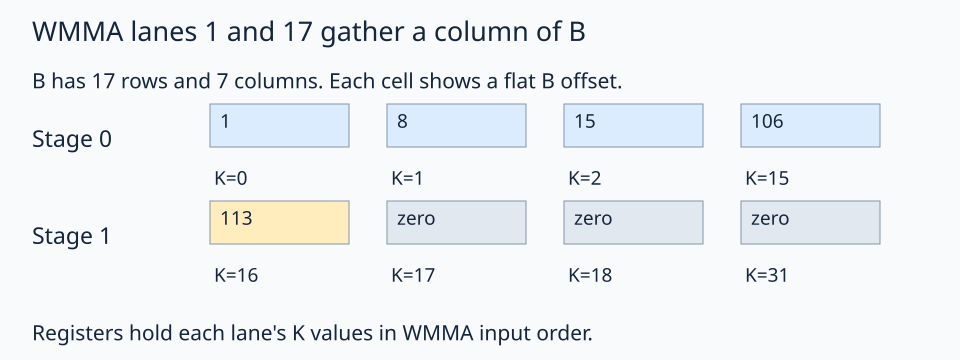

# 16 · Stage B directly in WMMA registers

Set `Config(right_in_registers=True)` to let each WMMA lane gather its own B column from the row-major input. The existing LDS route loads eight adjacent columns cooperatively, writes a tile to LDS, then gives each lane its column from that tile. The direct route gathers along K and supplies the same fragment to the same BF16 WMMA instruction. With both register options enabled, the BF16 kernel needs zero LDS bytes and skips the LDS barriers. [Stage 15 · Mixed-width edge loads](../15-edge-load-widths/README.md)

## Why put B in registers?

If a lane can load its own WMMA values cheaply, the LDS round trip adds a store and a later load. Removing that handoff lets the lane keep the next B tile private while it computes with the current one. The `3×7×17` compiled trace drops from 512 bytes of LDS to zero and from 34 static LDS access sites to zero. It uses 59 VGPRs instead of 44. The larger register footprint can constrain how many waves fit, and row-major B makes each lane's K gather strided when N grows. Cooperative loads can then make better use of wide aligned chunks and share B across M waves. [ISA inspection](results/README.md#inspect-the-teaching-shape)

## Trace a B column

Use `(M,N,K) = (3,7,17)`, a `16×16×16` tile, and one wave32. On gfx11, lanes 0–15 each supply one B column for all 16 K positions of a WMMA instruction. Lanes 16–31 repeat those inputs. This means lanes 1 and 17 both supply B column 1. [AMD RDNA 3 WMMA guide](https://gpuopen.com/learn/wmma_on_rdna3/)



B is row-major, so the address in BF16 elements is `b_row * n + b_column`. At K=16, both lanes read element offset `16 * 7 + 1 = 113`. Slots K=17–31 address beyond the bounded B buffer and produce zeros. Columns beyond N explicitly select an out-of-range offset so they cannot read into the next physical row. The kernel stores each value in `b_staging_fragment[(value_id, column_slot, step)]`. The pipelined loop computes with the current registers while it fetches the next stage.

With several wave tiles across N, `wave_n` selects the first tile column and `column_slot` advances by the width covered by all N waves. Staging in registers avoids LDS traffic and may duplicate global B reads across half-waves and M waves. The effect depends on the tile and K-stage settings.

## Practice

Fill `b_column` in `load_b_registers` in [practice.py](practice.py). Start at `b_first_column` and advance by `MMA_N * WAVES_N` for each `column_slot`. The trace has **`C[0,1] = 6.0`**. The checker compares the entire output with Torch, changes A between launches, and checks poisoned backing storage and output guards. [Worked solution](solution.py)

```bash
pixi run python lessons/01-gpu-programming/13-matmul/16-right-register-staging/practice.py --check-only
pixi run python lessons/01-gpu-programming/13-matmul/16-right-register-staging/solution.py --edge-checks
```

## Tune BF16 against PyTorch

Run the BF16 sweep from the repository root to tune both B routes and time `torch.matmul` on the same contiguous BF16 inputs and preallocated BF16 output.

```bash
pixi run python lessons/01-gpu-programming/13-matmul/16-right-register-staging/tune.py \
  --kernel bf16 --shape 16 1 4096 --shape 16 2 4096 --shape 16 4 4096 \
  --shape 16 7 4097 --shape 128 16 4096 --output /tmp/right-register-bf16-torch.json
```

The search varies K-stage depth, split-K, K unroll, A staging, and M tile and wave layout. It verifies the three fastest candidates from each route alongside the matched pair and PyTorch in three shuffled timing rounds. Every graph passes a full CPU FP32 reference check rounded to BF16 and replays with changed B. GPU event time is divided by the number of matmuls in the batch.

On Radeon 8060S (`gfx1151`), the same BF16 graph-replay comparison gives these median times per matmul. Speedup is PyTorch time divided by the faster FlyDSL time.

| M × N × K | Tuned B in LDS (µs) | Tuned B in registers (µs) | PyTorch (µs) | Speedup |
| --- | ---: | ---: | ---: | ---: |
| 16 × 1 × 4096 | 6.99 | **6.41** | 19.08 | 2.98× |
| 16 × 2 × 4096 | **5.74** | 6.18 | 19.00 | 3.31× |
| 16 × 4 × 4096 | **6.11** | 6.23 | 19.13 | 3.13× |
| 16 × 7 × 4097 | **7.96** | 8.28 | 28.97 | 3.64× |
| 128 × 16 × 4096 | **5.61** | 6.53 | 11.72 | 2.09× |

On the single-column shape, the matched 32-row stage is effectively tied at 8.13 µs for LDS and 8.24 µs for registers. The winning configuration uses a 64-row K stage and keeps both operands in registers. With M and K fixed, the winner switches to LDS at N=2 and stays with LDS at N=4. The margin at N=4 is about 2%. LDS also wins at the two wider shapes. Each winner leads both the other route and PyTorch in all three verification rounds. [Exact configs, matched timings, and raw samples](results/README.md#tuned-bf16-versus-pytorch)

## Compare staging routes for quantized B

`tune.py` measures each format at matched settings and also searches the same geometry candidates for the two routes. The fused quantized register paths use the same B-column ownership. They prefetch packed codes and decode them into the current WMMA registers. At N=1 with K divisible by eight, the codes for a column are contiguous, so each packed load supplies eight consecutive K values. The scalar paths dequantize B first and time that decode together with the BF16 matmul. [Quantized matmul](../../14-quantized-matmul/README.md)

On Radeon 8060S at `16×1×4096`, the matched 32-row MXFP4 LUT tile takes 8.63 µs with B in registers and 10.46 µs with B in LDS. Its tuned 16-row register path reaches **8.52 µs**, an 18.6% reduction versus tuned LDS.

At `16×7×4097` and `128×16×4096`, tuned LDS wins for every quantized kernel in the original sweep. Row-major B lets each cooperative lane move up to eight adjacent values in one load. The direct gather can still coalesce requests across lanes, and each lane issues a small load for each K slot. Use the matched pair to see the effect of the route at fixed geometry. Choose a config from the separately tuned measurements. [Full small-N comparisons](results/README.md#original-staging-sweep)

The broader NVFP4 sweep found B-register wins for LUT and scale reuse at `2×9×17` and `16×1×4096`. For scale reuse, tuned registers took 2.15 µs versus 2.30 µs for tuned LDS on the tiny case and 16.84 µs versus 17.30 µs on the single-column case. Each register choice beat its LDS finalist in all three verification rounds. MXFP8 selected LDS on all seven shapes in its separate sweep. [NVFP4 sweep](../../14-quantized-matmul/03-nvfp4-w4a16/results/README.md) · [MXFP8 sweep](../../14-quantized-matmul/02-mxfp8-blockscale/results/README.md#shape-tuning-with-b-registers)

```bash
pixi run python lessons/01-gpu-programming/13-matmul/16-right-register-staging/tune.py \
  --output /tmp/right-register-staging.json
```

## Revision question

For the same tile, which lanes load `B[16,4]`, and what element offset do they read?

<details><summary>Answer</summary>

Lanes 4 and 20 read `16 * 7 + 4 = 116`. This value is their first K slot in stage 1.

</details>

[Previous · Mixed-width edge loads](../15-edge-load-widths/README.md) · [BF16 matmul](../README.md) · [Next · Read an MXFP4 weight](../../14-quantized-matmul/01-mxfp4-w4a16/01-mxfp4-format/README.md)
