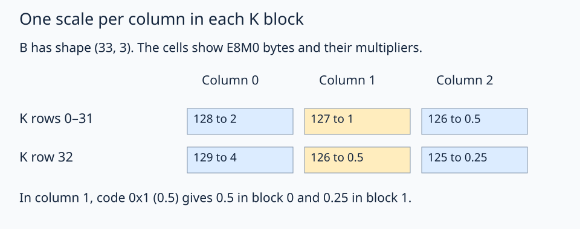

# 14.1.1 · Read an MXFP4 weight

Stage 15 loads each weight of B as a BF16 value. MXFP4 stores each weight as a four-bit code and shares a scale across 32 weights. This saves storage by offering a small set of values at a scale chosen for the group. In **W4A16**, B uses four-bit weight codes and A keeps its 16-bit BF16 activations. [Stage 15 · Mixed-width edge loads](../../../13-matmul/15-edge-load-widths/README.md)

## What fits in four bits

An E2M1 code has one sign bit, two exponent bits, and one mantissa bit. The low three bits select a magnitude. Add the sign bit to get the negative form, including signed zero.

| Low three bits | `000` | `001` | `010` | `011` | `100` | `101` | `110` | `111` |
| --- | --- | --- | --- | --- | --- | --- | --- | --- |
| E2M1 magnitude | 0 | 0.5 | 1 | 1.5 | 2 | 3 | 4 | 6 |

A shared E8M0 scale multiplies these levels by a power of two. A byte of `126` gives `2^(126 − 127) = 0.5`, so the first positive levels become `0.25`, `0.5`, and `0.75`. To quantize a weight of `0.30` at this scale, divide by `0.5` to get `0.60` and round to the nearest E2M1 value, `0.5` (code `0x1`). Dequantization multiplies by the scale again and recovers `0.25`. A larger scale extends the range, and the gaps between levels grow with it. E8M0 reserves byte `255` for a NaN scale. [OCP Microscaling Formats v1.0](https://www.opencompute.org/documents/ocp-microscaling-formats-mx-v1.0-spec-final-pdf)

## Where the code and scale live

Use the next exercise's B matrix with shape `(K,N) = (33,3)`. For each column, rows `0–31` share one scale. Row `32` starts a second, partial K block with its own scale. The scale matrix has shape `(2,3)` and stores the following bytes.

| K rows | Scale for column 0 | Scale for column 1 | Scale for column 2 |
| --- | ---: | ---: | ---: |
| 0–31 | 128 | 127 | 126 |
| 32 | 129 | 126 | 125 |

Follow column 1 down the diagram. The same code `0x1` would give `0.5` in the first block and `0.25` in the second block. The code and scale are addressed separately. The scale row is `k // 32` for K coordinate `k`.

This lesson packs the weight codes consecutively in row-major order. Even flat indices use a byte's low nibble, the low four bits. Odd flat indices use its high nibble. In the exercise, byte `0x32` holds code `0x2` for `B[0,2]` in its low nibble and code `0x3` for `B[1,0]` in its high nibble. The row boundary falls between the two nibbles.

The 99 weights take 50 packed bytes and six scale bytes. A dense BF16 B takes 198 bytes. The last packed byte has one unused high nibble, and the last K block still needs one scale per column.

## Revision question

If `B[32,1]` has code `0x1`, which scale byte applies, and what value does the decoder return?

Answer

The scale is `b_scales[1,1] = 126` because `32 // 32 = 1`. Code `0x1` has magnitude `0.5`, so the decoded value is `0.5 × 2^(126 − 127) = 0.25`.

[Previous · Mixed-width BF16 edge loads](../../../13-matmul/15-edge-load-widths/README.md) · [MXFP4 W4A16](../README.md) · [Next · Decode one weight per thread](../02-scalar-dequant/README.md)
