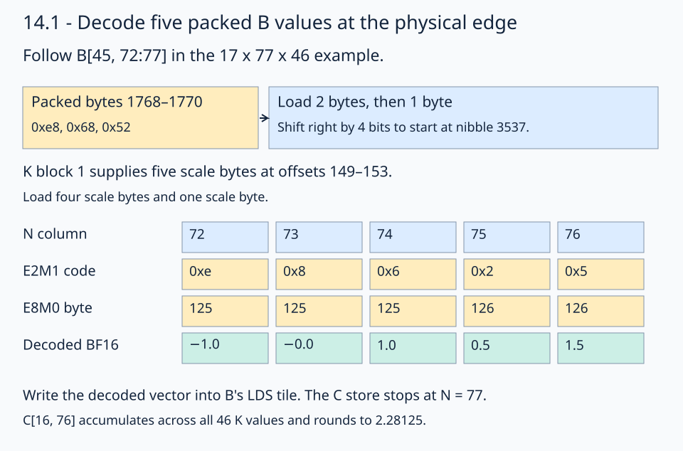

# 14.1.3 · Fuse decode into W4A16 matmul

The scalar decoder writes a dense BF16 B to global memory before stage 15 reads it. Decode and scale the weights in B's staging step so the expanded BF16 weights go straight to LDS. A stays in BF16 throughout. [Scalar dequantization and stage 15](../02-scalar-dequant/README.md)

In the fused kernel, B stays packed until staging. By default, each lane prefetches B's codes and scales, expands them into a BF16 LDS tile, then feeds BF16 WMMA. [Mixed-width edge loads](../../../13-matmul/15-edge-load-widths/README.md) supplies the A staging paths, edge guards, and split-K schedule. The only dense BF16 B tile in the fused path is local to the wave group.

## Trace the last five B values

Use `(M,N,K) = (17,77,46)` and `Config(stage_k=32, waves_per_group_n=1, split_k=4, k_unroll=2)` to follow the illustrated `16×64×32` group tile. A is contiguous BF16 with shape `(M,K)`. B's `(K,N)` values are packed in flat row-major order, with the even index in the low nibble. The scale matrix has shape `(ceil(K/32),N)`, with one E8M0 byte per output column for each group of 32 K values. The last K block keeps its scale row and stores only the actual weights. [OCP MX Formats](https://www.opencompute.org/documents/ocp-microscaling-formats-mx-v1-0-spec-final-pdf)



The last N group begins at 64. It contains a complete eight-value chunk at columns `64–71` and five values at columns `72–76`. Follow `B[45,72]` at flat element index `45 * 77 + 72 = 3537`. It starts on the high nibble of byte `1768`. A 16-bit load and an 8-bit load supply the three remaining packed bytes. Shifting by four bits brings the first valid code into the low nibble. The five E8M0 scales start at byte `1 * 77 + 72 = 149` and use a 32-bit load and an 8-bit load.

The low three bits of an E2M1 code map to `0, 0.5, 1, 1.5, 2, 3, 4, 6`. The top bit supplies the sign. Code `0xe` decodes to `−4`, and E8M0 byte `125` scales it by `2^(125−127) = 1/4`, giving `−1` in the first slot. Byte `255` supplies a NaN scale to its entire MX block.

## Carry the stage through WMMA

The K loop calls `load_stage` to prefetch, `publish_stage` to make the data ready for compute, and `compute_stage` to run WMMA. After publishing the first stage, the loop prefetches the next stage, computes on the current stage, then publishes the prefetched stage.

In the default B path, `prefetch_b_for_lds` reads packed words and scale bytes into registers. For a complete eight-column chunk B needs four packed bytes, plus one byte for the final nibble when the row starts on a high nibble. Eight adjacent columns use eight different scale bytes. A lane reuses its scale word for the K rows it owns in the same 32-value MX block. The packed and scale descriptors each have their own physical byte limits. For odd N, a complete N group takes the wide path, and earlier MX blocks can stay wide while both buffers have a later row.

In `publish_b_to_lds`, each lane already owns the bytes for eight adjacent B columns. For each `value_id`, extract the four-bit code with shift `4 * value_id` and the scale byte with shift `8 * value_id`. Pass both fields to `_scale_b_e2m1`. It builds the FP32 bit patterns for the unscaled E2M1 weight and its E8M0 scale, multiplies them, then casts the result to BF16. For code `0xe`, the weight bits are `0xc0800000` for −4. Scale byte `125` shifts into the FP32 exponent field to give `0x3e800000` for ¼. The product is −1, which is stored as BF16 bits `0xbf80`. Scale byte 0 sets a fraction bit to represent `2^-127`, and byte 255 sets that bit to encode NaN. The lane publishes all eight BF16 values with one 128-bit LDS store. For the five-value suffix in the diagram, the remaining slots are padding.

On a partial K stage, `publish_b_to_lds` compares each decoded row's global K coordinate with the logical K extent. It selects BF16 zero for padded rows before the LDS store. [Matched K-tail timings](../../results/README.md#masking-the-quantized-k-tail)

`load_b_operand_from_lds` reads one K=16 slice of the BF16 tile into the WMMA operand registers. With `right_in_registers=True`, `prefetch_b_for_registers` gathers eight K codes from one column into each packed word. `publish_b_to_compute_fragment` dequantizes those codes into BF16 registers, and `load_b_operand_from_registers` copies one K=16 slice from that fragment.

A uses `prefetch_a_for_lds` for cooperative K chunks or `prefetch_a_for_registers` for WMMA lane ownership. Both call the same guarded tile loader for the mixed-width copies in a partial K stage. Its publish and operand-load helpers name their destination or source explicitly. `compute_stage` loads both operands and calls WMMA. Missing split-K stages load zeros, and C's store masks columns past N. FP32 partials are reduced inside the kernel before BF16 output.

## Where fusion pays off

On Radeon 8060S, the independently tuned `16×1024×8192` product takes 136.33 µs with scalar decode plus BF16 matmul and 47.48 µs with the earlier fused FP32 decoder. Fusion avoids the separate launch and the global BF16 B round trip. The tiny `17×77×46` case has a much smaller absolute saving. [Three-path timings](../results/README.md#scalar-fused-arithmetic-and-fused-lut-sweep)

The current path builds the scale with an integer shift and uses an FP32 multiply. In a matched sweep on Radeon 8060S (`gfx1151`) with FlyDSL 0.4.1, this path won two of the three aligned shapes. Building the unscaled FP32 value and applying `ldexp` won the other aligned shape by 0.60 µs. A matched rerun compares the installed path with the earlier direct-BF16 bit decoder below. Each time is the median per matmul over 11 batches of 40 CUDA-graph replays, with 16 matmuls per graph. VGPR counts come from the final ISA metadata.

| Shape (M,N,K) | Direct BF16 (µs) | FP32 scale multiply (µs) | VGPRs, direct → multiply |
| --- | ---: | ---: | ---: |
| (16, 1024, 8192) | 55.66 | 45.18 | 166 → 138 |
| (32, 1024, 8192) | 73.93 | 55.42 | 189 → 144 |
| (16, 4096, 8192) | 161.71 | 126.12 | 156 → 114 |
| (17, 77, 46) | 2.95 | 2.98 | 169 → 169 |

The decoder still publishes eight BF16 values with one 128-bit LDS store. The benchmark compares nine scaling strategies, and the verifier checks all 4,096 code and scale combinations. [Benchmark](../../../../../experiments/mxfp4-w4a16-optimization/bench_scaling.py) · [Full-range verifier](../../../../../experiments/mxfp4-w4a16-optimization/verify_direct_bf16.py)

## Practice

Each file defines its own `Config`, launch defaults, staging helpers, and split-K workspace.

Fill the two expressions in `publish_b_to_lds` in [practice.py](practice.py).

1. `nibble` extracts one E2M1 code from the packed register word so the decoder can recover its sign, exponent, and mantissa.
2. `b_scale_byte` extracts the matching E8M0 byte from the scale word.

For the default shape `(17,77,46)`, the first four outputs are **`[0.34375, 3.921875, 9.875, 4.90625]`** and `C[16,76]` is `2.28125`. The checker compares every output against an independent CPU FP32 product with decoded BF16 B. The edge suite checks all seven suffix widths, short rows, both A routes, exact logical sizes with poisoned backing, nonfinite data, and split-K sentinels. [Worked solution](solution.py)

```bash
pixi run python lessons/01-gpu-programming/14-quantized-matmul/01-mxfp4-w4a16/03-fused-staging/practice.py
pixi run python lessons/01-gpu-programming/14-quantized-matmul/01-mxfp4-w4a16/03-fused-staging/solution.py --edge-checks
```

Both files use the same FP32 scale multiply and BF16 cast. Step 04 keeps the staging pipeline and changes how each lane decodes its eight weights.

## Revision question

Why can the packed B load use three bytes for the five-value suffix, while its scales require five bytes?

<details><summary>Answer</summary>

The flat layout stores two E2M1 nibbles per byte, and the five values in this example begin at the high nibble of the first byte. Each value belongs to a different output column. The scale row is byte-addressed, with one E8M0 byte per column.

</details>

[Previous · Decode one weight per thread](../02-scalar-dequant/README.md) · [MXFP4 W4A16](../README.md) · [Next · Decode with a register lookup](../04-lut-decode/README.md)
