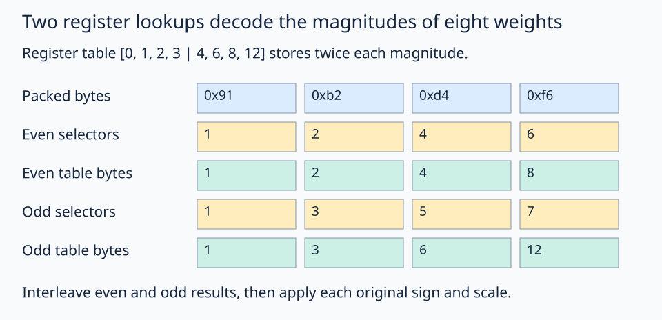

# 14.1.4 · Decode eight E2M1 magnitudes with a register lookup

Keep the fused staging pipeline and look up the magnitudes of eight packed weights in registers. This version scales those magnitudes with `ldexp` before publishing a BF16 tile to LDS. On gfx1151 and gfx1152, AMD's `perm_b32` instruction can select four bytes from two source registers in one operation. [Fused staging](../03-fused-staging/README.md) · [AMD RDNA 3.5 ISA](https://www.amd.com/content/dam/amd/en/documents/radeon-tech-docs/instruction-set-architectures/rdna35_instruction_set_architecture.pdf) · [FlyDSL packed lookup example](https://github.com/ROCm/FlyDSL/pull/1374/files)

## Pack the table into two registers

The eight E2M1 magnitudes include half integers, so store **twice** each magnitude as a byte.

| Magnitude bits | `0` | `1` | `2` | `3` | `4` | `5` | `6` | `7` |
| --- | --- | --- | --- | --- | --- | --- | --- | --- |
| Table byte | 0 | 1 | 2 | 3 | 4 | 6 | 8 | 12 |

Pack entries 0–3 into `low = 0x03020100` and entries 4–7 into `high = 0x0C080604`. In each register, byte 0 is the low byte. `perm_b32(high, low, selectors)` takes four selector bytes. Selectors 0–3 read from `low`, and selectors 4–7 read from `high`.

## Issue two lookups for one packed word

Take the four bytes `[0x91, 0xb2, 0xd4, 0xf6]` in address order. The packed word is `0xf6d4b291`. Each byte has an even weight in its low nibble and an odd weight in its high nibble.



Read one column of the diagram. Byte `0xd4` holds codes `0x4` and `0xd`. Mask off the sign bits to get selectors 4 and 5. The two lookups return 4 and 6 for those slots. The original codes still supply the signs.

The even lookup uses bits 0–2 of each byte. The odd lookup shifts the word right by four, then keeps bits 0–2 of each byte. When writing B, take byte `value_id // 2` from the result that matches the parity of `value_id`.

`ldexp(doubled_magnitude, b_scale_byte - 128)` applies the E8M0 scale and cancels the table's factor of two. With scale byte `126` for all eight columns, the output weights are `[0.25, -0.25, 0.5, -0.75, 1.0, -1.5, 2.0, -3.0]`. The fused edge checker runs this chunk with one activation equal to 1 and checks all eight results.

The LDS path selects BF16 zero for padded K rows after lookup and scaling. The bound compares the row's global K coordinate with the logical K extent. [Matched K-tail timings](../../results/README.md#masking-the-quantized-k-tail)

## Practice

Each file defines its own `Config`, launch defaults, staging helpers, and split-K workspace.

Fill `even_codes` in `_decode_mxfp4_word` in [practice.py](practice.py). Keep the low three bits of each low nibble so they form four byte selectors. The scaffold supplies the odd selectors, the two lookup instructions, and the final stores. [Worked solution](solution.py)

```bash
pixi run python lessons/01-gpu-programming/14-quantized-matmul/01-mxfp4-w4a16/04-lut-decode/practice.py
pixi run python lessons/01-gpu-programming/14-quantized-matmul/01-mxfp4-w4a16/04-lut-decode/solution.py --edge-checks
```

## Measure the three paths

The sweep times scalar decode plus stage 15, the fused arithmetic kernel from step 03, and the fused LUT kernel from this lesson using the same packed inputs. On gfx1151, LUT decode reduced latency by 11.4–67.8% across the seven workloads at matched geometry. It tunes each path independently and also compares the fused decoders with the same tile, waves, and split count to isolate the LUT. Every timed graph is checked against a CPU reference and rerun after changing the packed weights. [Measurements and search scope](../results/README.md)

```bash
pixi run python lessons/01-gpu-programming/14-quantized-matmul/01-mxfp4-w4a16/tune.py --lesson-sweep --output /tmp/mxfp4-lesson-sweep.json
```

Use the LUT-only sweep to search a wider range of output tiles, wave geometries, and split-K schedules against the current step 04 defaults. [LUT-only results](../results/README.md#lut-only-schedule-sweep)

```bash
pixi run python lessons/01-gpu-programming/14-quantized-matmul/01-mxfp4-w4a16/tune.py --lut-sweep --output /tmp/mxfp4-lut-sweep.json
```

## Revision question

Why does code `0xd` use table selector 5, and why does its recovered sign still matter?

<details><summary>Answer</summary>

The lookup indexes only the three low bits, so code `0xd` uses the same magnitude as `0x5`. The sign bit in `0xd` negates that magnitude after scaling.

</details>

[Previous · Fuse arithmetic decode into staging](../03-fused-staging/README.md) · [MXFP4 W4A16](../README.md) · [Next · MXFP8 block-scale matmul](../../02-mxfp8-blockscale/README.md)
