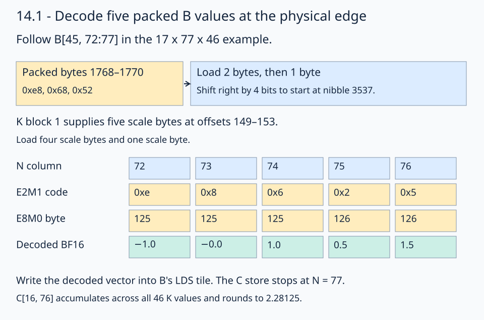

# 14.1 · Fuse MXFP4 decode into W4A16 matmul

How can a matrix multiply consume four-bit weights without first expanding the whole matrix? This lesson follows each packed nibble and its shared scale into the B tile in LDS, where the values become BF16 just before the lesson-12 WMMA path reads them.

## The MX block and its storage

The worked workload is `(M,N,K)=(32,1024,8192)`. A is contiguous row-major BF16, and B is logically `(K,N)` with one E8M0 scale for each group of 32 K values in each output column. Two E2M1 values occupy each byte: the even flat index is the low nibble, and the next index is the high nibble. Scales use row-major `(K/32,N)` byte order.



Read byte `0x32` as two independent codes: `2` in the low nibble and `3` in the high nibble. With scale byte `127`, the shared scale is `2^(127-127)=1`, so the values are `1.0` and `1.5`. E2M1 includes subnormals: code 1 is `0.5`; codes 0–7 represent `0, 0.5, 1, 1.5, 2, 3, 4, 6`, and bit 3 supplies the sign.

The OCP MX format defines 32 values per MXFP4 block and an E8M0 shared scale. The offline checker chooses the largest power of two no greater than `max(abs(block))/4`, rounds scaled values to E2M1 with ties to even, and saturates at 6. Timed calls start from already packed weights and scales.

## Decode one B tile as it is staged

The target (`gfx1152`) has BF16 WMMA but no native MXFP4 matrix operation in this path. The fused kernel loads packed B words and the corresponding scale bytes for a tile. A thread turns each eight-value packed chunk into eight BF16 register values, applies their column scales by constructing BF16 exponent bits, and writes one 128-bit vector into its B region in LDS. WMMA reads that tile from LDS while A follows the configured register or LDS route from [lesson 12](../../13-matmul/12-operand-paths/README.md). Split-K uses the same FP32 partial reduction as that lesson.

The scale lookup uses the K block and the first output column of the eight-value chunk:

```python
global_row = tile_k * BLOCK_K + local_row
global_col = block_col * BLOCK_N + right_n_lane * 8
packed_word_id = (global_row * N + global_col) // 8
scale_word_id = (global_row // 32) * (N // 8) + global_col // 8
```

The packed word contains eight adjacent K,N values, while the scale word contains the eight column scales for that K block. Each decoded value uses its own scale byte. The output is a BF16 LDS tile; the full `(K,N)` BF16 matrix is never written to global memory. The kernel still performs BF16 WMMA, so this is a software compatibility path rather than native MXFP4 arithmetic.

The solution also keeps a standalone register decoder adapted from the packed-word `perm_b32` lookup in [FlyDSL PR #1374](https://github.com/ROCm/FlyDSL/pull/1374/files). `solve()` checks this decoder against the CPU BF16 reference before checking the fused matmul. The PR's RDNA4-specific native FP8 WMMA route is not used on gfx1152.

## Practice

[practice.py](practice.py) supplies the packed and scale layouts, input packing, launcher, and complete checker. Fill two expressions in `_matmul_mxfp4_w4a16`:

1. Decode each nibble's sign, exponent, and mantissa, including the E2M1 subnormal case.
2. Apply its E8M0 power-of-two scale before storing BF16.

The practice kernel writes a dense BF16 reference matrix so each decoded pair can be inspected directly. The worked solution uses the same decode rules inside the fused B staging path. The checker compares the matmul with an independent CPU FP32 product and checks 16 output sentinel values. `solution.py` also checks its standalone register decoder against the same reference. Use `--shape M N K` for the three supported cases.

## Tune and compare

The tuner searches nearby split-K, A-staging, and K-unroll configurations using lesson-12 tile geometry. It checks each candidate before timing, then compares the selected fused path with the register and scalar unpack reference pipelines and GPU `torch.matmul` on BF16 weights decoded once from the same packed input. Torch's timing excludes decode; fused FlyDSL timing includes packed-weight loads, decode, staging, and matmul. Graph replay results and their timing scope are in [results](results/README.md). Profiler-guided experiments and raw counter traces remain in [the separate experiment directory](../../../../experiments/mxfp4-w4a16-optimization/README.md).

```bash
pixi run python lessons/01-gpu-programming/14-quantized-matmul/01-mxfp4-w4a16/practice.py
pixi run python lessons/01-gpu-programming/14-quantized-matmul/01-mxfp4-w4a16/solution.py --check-only
pixi run python lessons/01-gpu-programming/14-quantized-matmul/01-mxfp4-w4a16/tune.py \
  --output lessons/01-gpu-programming/14-quantized-matmul/01-mxfp4-w4a16/results/run/tuning.json
```

Timings are observations for the recorded GPU and software versions, not pass/fail thresholds. AMD documents native microscaled matrix support on later targets such as gfx950; these gfx1152 results make no claim about gfx1151 or native MXFP4 hardware.

## Revision question

If one E8M0 byte is shared by 32 K values, why load a scale byte for each decoded value?

<details><summary>Answer</summary>

The block index selects the correct K group, but the scale also depends on the output column. Adjacent K values in a column share one byte; an eight-value chunk crosses eight columns, so its scale word supplies eight distinct column scales.

</details>

[Previous: mixed-width BF16 edge loads](../../13-matmul/15-edge-load-widths/README.md) · [Quantized matmul](../README.md) · [Course overview](../../../../README.md)
