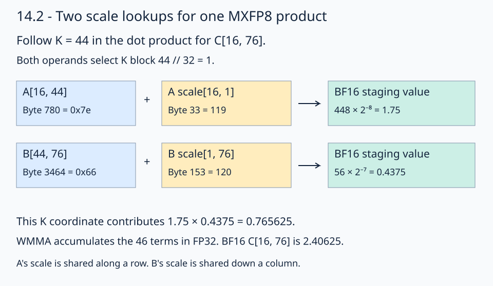

# 14.2 · Fuse block-scaled FP8 matmul

Give both A and B E4M3FN values and E8M0 block scales. A scale follows one row along K. B's scale follows one column along K. The kernel loads the two compact operands, decodes each tile into BF16 LDS, and accumulates the product in FP32 with the same gfx11 WMMA path as [fused MXFP4 W4A16](../01-mxfp4-w4a16/04-lut-decode/README.md). Both input tensors remain compact in global memory.

## Trace one pair of scales

Use `(M,N,K) = (17,77,46)`. A and B are contiguous row-major `uint8` matrices holding the E4M3FN bit patterns. The scale tensors are `uint8`, with A scales shaped `(M,ceil(K/32))` and B scales shaped `(ceil(K/32),N)`. The last 14 values in each K vector share the second scale. E4M3FN uses exponent bias 7, retains subnormals, and reserves the largest all-ones magnitude code for NaN. An E8M0 byte scales its block by `2^(byte−127)`. Byte `255` supplies a NaN scale. [OCP MX Formats](https://www.opencompute.org/documents/ocp-microscaling-formats-mx-v1-0-spec-final-pdf)



Follow `K=44` for `C[16,76]`. Both operands use MX block `44 // 32 = 1`. A's data byte is at offset `16 * 46 + 44 = 780` and its scale byte is at offset `16 * 2 + 1 = 33`. Code `0x7e` is 448, which becomes `1.75` with scale byte 119. B's data byte is at offset `44 * 77 + 76 = 3464` and its scale byte is at offset `1 * 77 + 76 = 153`. Code `0x66` is 56, which becomes `0.4375` with scale byte 120. Their product contributes `0.765625` to the FP32 sum.

## Load, decode, publish

A lane owns eight neighboring K bytes from one row. It shares one A scale across those values because each chunk starts at a multiple of eight. A B lane owns eight neighboring N bytes in one K row. It has a separate scale for each column and reuses the scale word for rows in the same MX block. Separate byte offsets keep the two lookups independent.

```python
a_scale_offset = row * SCALE_ROWS + column // MX_BLOCK_K
b_scale_row = b_k // MX_BLOCK_K
b_scale_offset = b_scale_row * n + global_n_col
```

Complete chunks use eight-byte reads. The last A K chunk uses smaller reads and zeros missing K slots before WMMA. B data and scale loads use the wide word while their physical buffer has room for it. Each allocation narrows its final partial word as needed. The C-store predicate from [lesson 15](../../13-matmul/15-edge-load-widths/README.md) masks extra output columns. After prefetch, each lane converts its E4M3FN values to BF16 with its E8M0 scale. Eight BF16 values become one 128-bit LDS store. WMMA consumes one K=16 slice of each tile while the next stage is prefetched.

The decoder maps E4M3 normals into FP16 bits with an exponent bias adjustment. For exponent zero, an eight-entry register table supplies the high FP16 bytes for magnitudes `0` through `7 × 2⁻⁹`. Two `perm_b32` instructions look up the eight entries in each staging chunk. The lane converts the exact FP16 value to FP32, applies E8M0, then rounds to BF16.

Both B staging routes are candidates in the tuner. A remains cooperative in LDS, so enabling B registers saves the B tile and its LDS transfers while preserving the A handoff. Use the validated shape default for the measured workloads. [Stage 16 small-N comparison](../../13-matmul/16-right-register-staging/README.md)

## Practice

Fill two expressions in [practice.py](practice.py).

1. `scale_offset` in `load_a_stage` locates the one A scale shared by the lane's eight K values.
2. `scale_row` in `load_b_stage` locates the B scale row for the first K value assigned to that scale slot.

The first four outputs are **`[-1.1796875, 4.53125, 9.625, 5.09375]`** and `C[16,76]` rounds to `2.40625`. The checker decodes the byte tensors on the CPU with PyTorch's E4M3FN type and verifies every output and the split-K sentinels. `--edge-checks` adds all seven suffix widths, short rows, poisoned padding, and NaN cases. [Worked solution](solution.py)

```bash
pixi run python lessons/01-gpu-programming/14-quantized-matmul/02-mxfp8-blockscale/practice.py --check-only
pixi run python lessons/01-gpu-programming/14-quantized-matmul/02-mxfp8-blockscale/solution.py --check-only --edge-checks
pixi run python lessons/01-gpu-programming/14-quantized-matmul/02-mxfp8-blockscale/tune.py --output /tmp/mxfp8-tuning.json
```

## Compare GPU time

The search compares both B routes while keeping A cooperative. It varies tile and wave geometry, K-stage depth, split count, unroll, cache policy, and eligible wave groups and traversal. Finalists replay changed inputs and compete again on three fresh seeds. Use `--small-n` for the Stage 16 workload set and `--beam 2` to widen the refinements. [Verified shape defaults](results/README.md#shape-tuning-with-b-registers)

On Radeon 8060S, the `17×77×46` case fell from 3.24 to 2.93 µs with a smaller K and N tile. That geometry stages less padding on the short K extent and incomplete N groups. At `31×1025×8193`, tuning the unroll and B cache policy reduced latency from 99.67 to 95.49 µs. The aligned `32×1024×8192` case retained its previous setting. All three use B through LDS. On `16×7×4097`, the tuned LDS configuration took 18.77 µs versus 355.75 µs for the generic fallback.

FlyDSL and Torch both start from the same two FP8 byte tensors and their E8M0 scales. TorchInductor compiles the conversions to BF16, and `torch.matmul` consumes both decoded matrices on every replay. Torch's timing includes both conversions and the multiply. Lesson 15 gives a separate predecoded BF16 reference. All benchmarks start with preallocated output and exclude offline encoding. [Timings and raw samples](results/README.md)

## Revision question

Why can an A staging lane share one scale across its eight values while a B staging lane needs eight scales?

<details><summary>Answer</summary>

A reads along K within one output row and a single 32-element MX block. B reads across N, so each of its eight values belongs to a different output column. Each column has its own scale for the current K block.

</details>

[Previous · Fused MXFP4 W4A16](../01-mxfp4-w4a16/04-lut-decode/README.md) · [Quantized matmul](../README.md) · [Course overview](../../../../README.md) · [Next · Read an NVFP4 weight](../03-nvfp4-w4a16/01-nvfp4-format/README.md)
