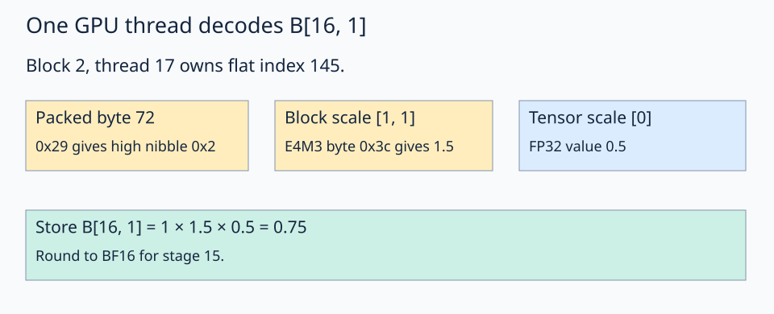

# 14.3.2 · Decode one NVFP4 weight per thread

Run a simple GPU decoder to produce a dense BF16 B, then feed it to BF16 matmul. The example uses [stage 15’s LDS route](../../../13-matmul/15-edge-load-widths/README.md) through the stage 16 launcher. Keep the same `(17,9)` weights and two scale rows from the [format example](../01-nvfp4-format/README.md).

## Follow block 2, thread 17

The decoder launches 64 threads per block. Block 2, thread 17 owns flat index `2 * 64 + 17 = 145`, which corresponds to B coordinate `(16,1)`. Threads at flat indices 153 and above skip all accesses.



Byte 72 contains `0x29`. Its high nibble is `0x2`, giving the value 1. Read `b_scales[16 // 16, 1]` to get `0x3c`, or 1.5. Then read the one-element FP32 tensor `b_tensor_scale` to get 0.5. Multiply in FP32 and store BF16 0.75.

The E4M3 decoder handles exponent-zero bytes with `mantissa * 2^-9`. For example, the scale byte `0x01` at `(1,8)` is `2^-9`. The weight nibble there is `0x1`, so `B[16,8] = 0.5 × 2^-9 × 0.5 = 2^-11`. E4M3FN reserves magnitude code `0x7f` for NaN.

## Run the product

```python
b = dequantize_nvfp4(b_packed, b_scales, b_tensor_scale, k)
c = matmul_bf16(a, b)
```

Both launches use the current GPU stream. A has shape `(2,17)`. Row 0 selects K coordinate 16, and row 1 sums coordinates 15 and 16, giving `C[1,1] = 0.5 + 0.75 = 1.25`.

## Practice

Fill two expressions in [practice.py](practice.py).

1. `b_scale_row` finds the block containing `row`.
2. `tensor_scale` loads the single FP32 value shared by the entire tensor.

The checkpoint is **`B[16, 1] = 0.75, C[1, 1] = 1.25`**. The checker compares every decoded weight and output and tests all 4,096 combinations of E2M1 code and E4M3FN byte against a CPU reference. [Worked solution](solution.py)

```bash
pixi run python lessons/01-gpu-programming/14-quantized-matmul/03-nvfp4-w4a16/02-scalar-dequant/practice.py
pixi run python lessons/01-gpu-programming/14-quantized-matmul/03-nvfp4-w4a16/02-scalar-dequant/solution.py
```

## Revision question

Why does the nibble shift depend on the flat index for a nine-column matrix?

<details><summary>Answer</summary>

An odd row width flips the parity of each new row's starting index. For example, column 0 uses the low nibble in row 0 and the high nibble in row 1.

</details>

[Previous · Read an NVFP4 weight](../01-nvfp4-format/README.md) · [NVFP4 W4A16](../README.md) · [Next · Fuse arithmetic decode](../03-fused-staging/README.md)

The follow-on BF16 multiply uses its LDS route in this walkthrough. Stage 16 compares both B routes, including separate-decode timings that include both GPU launches. [BF16 stage 16](../../../13-matmul/16-right-register-staging/README.md)
